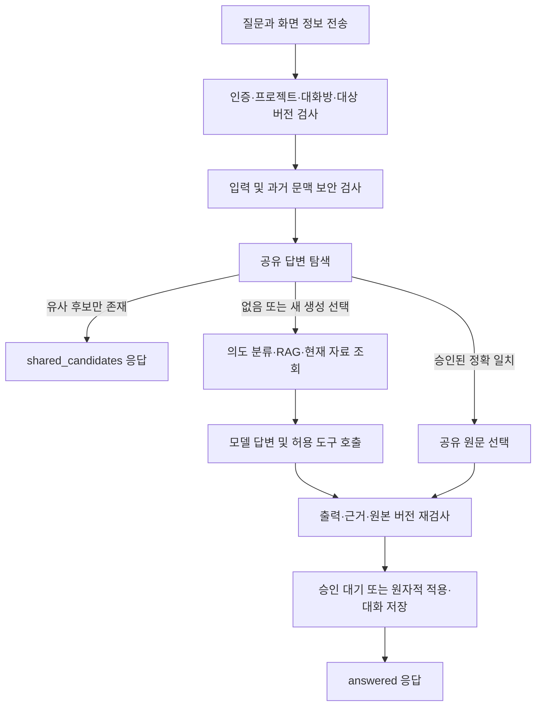

# AI Chatbot Input / Output 명세

- 작성일: 2026-11-17 (한국시간)
- 기준: 작성 시점의 실제 소스. 향후 설계안이 아닌 현재 구현 동작을 설명한다.
- 범위: AI 채팅 실행 API, 대화·이미지·근거·공유 답변·승인 DTO, 서버 내부 모델 입력 및 도구 입출력 경계.
- 이 문서 작성으로 애플리케이션 소스 또는 DB를 변경하지 않는다.

## 1. 입출력 경계와 처리 흐름

AI 채팅에는 서로 다른 세 가지 계약이 있다. 브라우저가 서버에 보내는 요청, 서버가 모델에 구성하는 입력, 서버가 최종적으로 브라우저에 보내는 응답이다. 이 세 형식을 같은 것으로 취급하면 안 된다.

| 경계 | Input | Output | 책임 |
| --- | --- | --- | --- |
| 브라우저 → 채팅 서버 | 질문, 모델, 대화방, 프로젝트, 실제 화면, AI 대상과 버전, 이미지 | 답변 / 공유 후보 / 취소 / 오류 | 사용자 요청 전달 및 결과 표시 |
| 서버 → 생성 모델 | 서버 지침, 권한으로 조회한 문맥, 질문, 과거 대화, 이미지, 허용 도구 | 텍스트 또는 함수 호출 | 답변 생성과 도구 사용 제안 |
| 모델 → 서버 도구 | 도구 이름과 JSON 인자 | 조회 자료 또는 검증된 변경안 결과 | 실제 권한·버전·업무 규칙 검사 |



공유 원문을 선택하면 본문 재생성 및 업무 실행은 하지 않는다. 다만 의도 분류, 제목 생성, 보안 검사 등 보조 처리까지 전부 생략되는 것은 아니므로 공유 반환을 항상 모델 호출 0회라고 가정하면 안 된다.

주요 구현: [실행 API](../app/api/ai/chats/route.ts), [브라우저 요청](../components/ai/ai-chatbot.tsx), [공통 DTO](../lib/ai-context.ts).

## 2. 실행 전 준비 API

| API | 주요 입력 | 주요 출력 | 설명 |
| --- | --- | --- | --- |
| `GET /api/ai/models` | 로그인 세션 | `{ models: string[], defaultModel: string }` | 실제 사용 가능한 모델을 조회한다. 모델 ID를 클라이언트에서 고정하지 않는다. |
| `GET /api/ai/conversations?projectId=...` | 프로젝트 ID 또는 빈 문자열 | `{ conversations: AiConversation[], historyEnabled?: boolean }` | 현재 사용자의 대화방 목록. 이력 미저장 플랜은 빈 목록과 `historyEnabled:false`. |
| `POST /api/ai/conversations` | `{ projectId, targetPage?, sourceContext? }` | HTTP 201 `{ conversation: AiConversation }` | 실행 전에 대화방을 만든다. 일반 채팅 POST가 임의 대화방을 자동 생성하지 않는다. |
| `GET /api/ai/chats` | 아래 7절 참조 | 대화 10건과 커서 | 선택한 방의 과거 메시지를 불러온다. |

대화방 생성 시 `sourceContext`와 초기 대상의 일관성을 검사한다. 미지원 문서함 대상을 방에 저장할 수 있어도 그 대상으로 답변을 실행할 수 있는 것은 아니다. 이력 미저장 플랜에서는 `temporary-<UUID>` 형식의 방을 사용한다.

## 3. 채팅 실행 요청

### 3.1 전송 규약

- Method / URL: `POST /api/ai/chats`
- Content-Type: `application/json`
- 인증: 서비스 로그인 세션. `userId`, `workspaceId`, 프로젝트 권한을 요청 본문에서 지정하지 않는다.
- 변경 요청의 Origin을 검사한다.
- 요청 본문 상한: `15 * 1024 * 1024`바이트. 이미지의 base64 문자열도 이 크기에 포함된다.
- 응답은 처리 완료 후 JSON 한 번으로 반환한다. 이 API는 SSE나 텍스트 스트림을 반환하지 않는다.
- route `maxDuration`은 180초이고, 내부 요청 deadline은 시작 후 140초이다. 모델 생성 함수에도 별도 처리 예산이 있다. 180초 동안의 성공을 보장하는 계약은 아니다.

### 3.2 입력 필드

아래 필수 여부는 신규 연동 시 권장 계약이다. 구형 요청 호환 동작은 따로 적었다. 타입은 설명용이며 별도 런타임 스키마가 추가되었다는 뜻은 아니다.

| 필드 | 타입 | 필수 / 기본값 | 설명 및 검증 |
| --- | --- | --- | --- |
| `requestId` | UUID v4 문자열 | 전송 권장 / 생략하면 서버 생성 | 생성·중지·토큰 집계의 공통 식별자. 전달 시 UUID v4 정규식 검사. 새로운 실행마다 새 값을 사용한다. |
| `convId` | string | 필수 | 비어 있지 않은 100자 이하 문자열. 현재 사용자·workspace·프로젝트에 속한 대화방이어야 한다. |
| `projectId` | string | 프로젝트 채팅 필수 / 비문자열·생략은 `""` | 선택한 AI 프로젝트. 빈 값은 대시보드·팀 공유 문맥이다. |
| `prompt` | string | 이미지가 없으면 필수 | 앞뒤 공백 제거 후 1~2,000자. 이미지가 있고 문장이 비어 있으면 서버가 기본 이미지 분석 문장을 넣는다. 길이는 JS 문자열 `length` 기준이다. |
| `model` | string | 필수 | `GET /api/ai/models` 목록에 포함되어야 한다. 공유 답변 우선 탐색이어도 검사한다. |
| `sourceContext` | `{ pathname: string, tab?: ProjectTab \| null }` | 신규 요청 필수 권장 | 실제 사용자가 열어둔 화면. 실행 대상으로 재작성하지 않는다. pathname은 200자 이하이며 허용된 화면 조합이어야 한다. |
| `targetPage` | AiTargetPage | 신규 요청 필수 권장 | 대화방에 저장된 AI 실행 대상. 속성 자체를 생략하면 실제 화면에서 대상을 추론하는 구형 호환 경로를 사용한다. `null`을 보내는 것은 생략과 다르며 실행 대상 검사에서 거절될 수 있다. |
| `expectedTargetVersion` | number | `targetPage`를 보낼 때 필수 | 0 이상의 안전한 정수. 저장된 대화방 대상 버전과 비교한다. 대상이 같아도 버전이 다르면 충돌이다. |
| `images` | `{ dataUrl: string }[]` | 선택 / `[]` | PNG 캡처만 허용. 상세 조건은 3.4절. 이미지의 파일명·클라이언트 크기 정보를 신뢰하지 않는다. |
| `sharedMode` | `"prefer_shared" \| "generate_fresh" \| "use_shared"` | 선택 / `"prefer_shared"` | 공유 검색 우선, 새 생성, 검증된 선택 재사용. 다른 값은 400. |
| `selectionToken` | string | `use_shared` 시 필요 | 후보 응답에서 발급한 토큰. 100자 이하. 서버에서 질문·대상 버전·사용자·대화방·만료를 함께 확인한다. |
| `sharedAnswerId` | string | `use_shared` 시 필요 | 토큰에 묶인 후보 ID여야 한다. ID만 지정해서 임의 공유 답변을 반환받을 수 없다. |
| `history` | `{ role: "user" \| "assistant", content: string }[]` | 이력 미저장 모드에서 선택 | 최대 20개 메시지, content 합계 60,000자. 저장형 대화에서는 서버 DB 이력을 사용한다. |
| `temporaryTitle` | string | 임시 대화에서 선택 | 이력 미저장·history 존재 시 대화 제목에 최대 100자를 사용한다. 영구 대화 제목 덮어쓰기 입력이 아니다. |
| `pathname`, `tab` | string / ProjectTab 또는 null | 구형 호환 | `sourceContext`가 없을 때 최상위 입력에서 화면 정보를 읽는다. 현재 UI는 두 형태를 함께 보내지만 서버는 `sourceContext`를 우선한다. |

`temperature`, `systemPrompt`, `instructions`, `tools`, `maxOutputTokens`, `canWrite`는 채팅 POST의 공개 제어 필드가 아니다. 서버가 모델 지침과 실행 권한을 구성한다. 현재 본문은 엄격한 `additionalProperties:false` 스키마가 아니지만, 알 수 없는 속성이 지원된다는 의미는 아니다.

### 3.3 실제 화면과 AI 대상

| 개념 | 예 | 사용처 |
| --- | --- | --- |
| 실제 화면 | `sourceContext: { pathname: "/projects/project-example", tab: "screen" }` | 질문이 발생한 화면 기록 및 출처 검증 |
| AI 대상 | `targetPage: "requirement"` | 서버 조회, 프롬프트, 도구, 답변 제목을 결정 |
| AI 프로젝트 | `projectId: "project-example"` | 프로젝트 접근 권한과 근거의 범위 결정 |

화면과 AI 대상이 항상 같을 필요는 없다. 그러나 프로젝트·화면 조합은 `aiSourceTarget()`으로 유효해야 한다. 저장형 대화의 대상 변경은 대화방 대상 관리 API에서 먼저 수행하고, 받은 최신 대상과 버전으로 질문한다. 채팅 POST에서 기존 방의 대상을 임의 변경하면 409를 반환한다.

실행 가능한 프로젝트 대상:

`project-analysis`, `overview`, `rfp`, `wbs`, `architecture`, `requirement`, `screen`, `database`, `function`, `program`, `test`, `trace`, `acceptance`, `history`, `export`.

- `documents`: 타입·목록에는 있지만 현재 AI 실행 미지원이다.
- `dashboard`, `team`: 프로젝트가 없는 대화에서 사용한다. 팀 공유는 플랜 권한도 필요하다.
- `project-analysis`: 프로젝트 전체 분석이며 읽기 전용이다.
- 화면 pathname은 `/projects/<projectId>`와 유효한 탭, 지원하는 legacy 주소, `/dashboard`, `/team` 규칙으로 검사한다. 경로 문자열만 임의로 넣어 사용할 수 없다.

근거: [대상 목록과 화면 판별](../lib/ai-target-pages.ts), [실행 대상 권한 검사](../lib/ai/resolve-target.ts), [대상 버전](../lib/ai/conversation-targets.ts).

### 3.4 이미지 입력

| 항목 | 현재 조건 |
| --- | --- |
| 개수 | 플랜 `attachmentLimit`과 시스템 상한 중 작은 값 이하. 시스템 상한은 5장이다. |
| MIME / 전송 | `data:image/png;base64,<정상 base64>`만 허용 |
| 한 장 크기 | 디코딩 후 최대 2MiB |
| 해상도 | 너비·높이 각각 1~4096px |
| 실파일 검사 | PNG signature, IHDR, IDAT, IEND 및 끝 위치를 검사 |
| 저장형 대화 | 서버에서 암호화 저장. 응답에는 접근 제어된 이미지 조회 URL과 메타데이터를 제공 |
| 임시 대화 | DB 이미지 저장 없이 응답 URL에 data URL이 들어갈 수 있음 |
| 쓰기 제한 | 정책 `imageMode === "read-only"`이면 현재 또는 과거 이미지가 있는 요청의 쓰기를 차단 |

이미지만 있어도 질문 실행은 가능하다. 다만 이미지 기반 답변은 공유 등록 자격에서 제외된다.

근거: [이미지 상수](../lib/ai-image-types.ts), [검증 및 저장](../lib/ai/chat-images.ts).

### 3.5 실행 요청 예시

아래 ID와 질문은 형식을 설명하는 가상 값이다. `model`에는 모델 조회 API가 반환한 실제 값을 넣는다. `expectedTargetVersion`도 방 조회 결과를 사용한다.

```json
{
  "requestId": "b20fdb1c-e0af-4123-8421-d334f9da0123",
  "convId": "conversation-example",
  "projectId": "project-example",
  "prompt": "REQ-001의 검수 기준을 설명해줘",
  "model": "<models에서 선택한 모델 ID>",
  "sourceContext": {
    "pathname": "/projects/project-example",
    "tab": "requirement"
  },
  "targetPage": "requirement",
  "expectedTargetVersion": 1,
  "images": [],
  "sharedMode": "prefer_shared"
}
```

임시 대화에서는 `convId`를 발급받은 `temporary-<UUID>`로 바꾸고 필요하면 `history`, `temporaryTitle`을 추가한다. 현재 UI는 최근 5개 질문·답변 쌍을 문자열 메시지로 보내며 질문은 2,000자, 답변은 8,000자로 각각 자른다. 이는 서버의 최대 20개/60,000자 검증 한도와 다른 UI 정책이다.

## 4. 채팅 실행 응답

### 4.1 응답 분기

| 결과 | HTTP | 식별 필드 | 처리 |
| --- | --- | --- | --- |
| 답변 완료 | 200 | `kind: "answered"` | `chat`을 대화 목록에 추가 |
| 공유 후보 안내 | 200 | `kind: "shared_candidates"` | 후보를 표시. 아직 생성 완료된 `chat`은 없음 |
| 생성 취소 | 200 | `cancelled: true` | 답변 추가 없이 중지 상태를 표시 |
| 오류 | 4xx / 5xx | `error` 및 선택적 부가 필드 | 상태·부가 정보를 보고 처리 |

현재 취소 응답에는 `kind`가 없다. 모든 200 응답에 `chat`이 있다고 가정하면 안 된다. optional 값이 `undefined`인 속성은 JSON 직렬화 시 생략되고, `null`인 값은 남는다.

### 4.2 답변 완료 envelope

```ts
type AnsweredResponse = {
  kind: "answered";
  chat: AiChat;
  conversation: AiConversation;
  actions: AiAction[];
  projectId: string;
};
```

`actions`는 서버가 확인한 실행 결과이다. 승인 대기 변경은 `review`로 확인해야 하며 `result`의 자연어 문장만으로 저장 성공을 판단하지 않는다. 승인 없이 바로 적용 가능한 경우 서버가 실제 반영한 결과를 본문 끝에도 덧붙인다.

### 4.3 `AiChat`

공통 타입에는 과거 기록 호환을 위한 optional 필드가 있다. 아래 표에서 핵심 필드는 현재 POST 정상 응답에 포함된다.

| 필드 | 타입 | 의미 |
| --- | --- | --- |
| `id` | string | 서버에서 생성한 질문·답변 한 쌍의 ID |
| `convId` | string | 소속 대화방 ID |
| `prompt` | string | 공백 처리·이미지 기본 문장 처리가 끝난 질문 |
| `model` | string | 새 생성은 요청 모델. 공유 반환은 원래 답변의 모델이므로 현재 선택 모델과 다를 수 있음 |
| `screenTitle` | string | 서버가 AI 대상 기준으로 만든 표시 제목 |
| `createdAt` | string | 이 응답을 생성·저장한 시각. 서버 ISO timestamp |
| `result` | string | 최종 표시 본문. Markdown 및 근거 표식을 포함할 수 있음. 모델 raw 응답 JSON이 아님 |
| `responseSource` | `"generated" \| "shared_answer"` | 생성 답변인지 공유 원문인지 구분 |
| `sharedAnswer` | SharedAnswerOrigin, optional | 공유 출처와 원문 버전 |
| `shareEligibility` | `{ eligible: boolean, reason: string \| null }` | 공유 등록 가능 여부와 제외 사유. 등록 시 다시 검사하므로 최종 등록 보장은 아님 |
| `images` | AiImageInfo[] | 이 질문에 첨부된 이미지 메타데이터 |
| `references` | RagReference[] | RAG가 제공한 근거 목록. 모든 직접 조회 자료의 완전한 목록은 아님 |
| `review` | AiChangeReview, optional | 업무 변경안의 승인 상태. 공유 답변 등록 승인과 다른 개념 |
| `targetPage` | AiTargetPage 또는 null | 실제 실행 대상. 공통 타입에서는 optional |
| `targetVersion` | number 또는 null | 실행 시 대상 버전. 공통 타입에서는 optional |

공유 반환에서는 `result`를 등록된 원문 그대로 제공한다. `createdAt`은 이번 반환 시각이며 원래 답변 시각은 `sharedAnswer.originallyAnsweredAt`을 사용한다. 공유 답변의 `references`가 비어 있을 수 있으므로 공유 근거는 공유 상세 DTO의 `evidence`에서 확인한다.

### 4.4 `AiConversation`

| 필드 | 타입 | 의미 |
| --- | --- | --- |
| `convId`, `projectId` | string | 대화방 및 프로젝트. 프로젝트 없는 방의 projectId는 빈 문자열 |
| `title` | string | 표시 제목 |
| `titleSource` | string, optional | `auto_pending`, `auto`, 수동 설정 등 제목 관리 상태 |
| `titleVersion` | number, optional | 제목 동시 수정 방지 버전 |
| `isPinned` | boolean | 고정 여부 |
| `createdAt`, `updatedAt` | string | 서버 시간 문자열. 목록 정렬 등에서 사용 |
| `targetPage` | AiTargetPage 또는 null, optional | 저장된 대상. null은 미초기화 상태 |
| `targetVersion` | number, optional | AI 대상 변경의 낙관적 잠금 버전 |

응답의 conversation을 반영할 때 오래된 `targetVersion`·`titleVersion` 응답으로 더 최신 상태를 덮어쓰지 않는다. 기존 `mergeConversationTarget()`이 이 규칙을 구현한다.

### 4.5 이미지와 근거 DTO

```ts
type AiImageInfo = {
  id: string;
  url: string;
  mimeType: string;
  byteLength: number;
  width: number;
  height: number;
};

type RagReference = {
  chunkId: string;
  sourceType: string;
  sourceId: string;
  version: string;
  hash: string;
  title: string;
  section: string;
  href: string;
  indexedAt: string;
};
```

- `url`: 저장된 이미지는 `/api/ai/chats/<chatId>/images/<imageId>`. 로그인 사용자·workspace·프로젝트 접근 권한을 확인한 뒤 복호화한다.
- `byteLength`: 디코딩한 PNG 바이트 수. base64 문자열 길이가 아니다.
- `chunkId`: 본문 `[근거:<chunkId>]` 표식의 연결 키. 서버가 목록에 없는 표식을 검출하면 502를 반환한다.
- `sourceType`, `sourceId`: 원본 종류와 ID. `version`, `hash`는 해당 원문 상태를 식별한다.
- `title`, `section`, `href`: 사용자에게 근거 제목·구간·이동 링크를 제공한다.
- `indexedAt`: 검색 인덱스 시각으로, 원본 자료의 최신성 자체를 보장하는 값은 아니다. 서버는 반환 전 현재 접근 권한과 원본 상태를 재검증한다.

### 4.6 정상 응답 예시

```json
{
  "kind": "answered",
  "chat": {
    "id": "chat-example",
    "convId": "conversation-example",
    "createdAt": "2026-11-17T01:00:00.000Z",
    "screenTitle": "예시 프로젝트 · 요구사항",
    "prompt": "REQ-001의 검수 기준을 설명해줘",
    "model": "<선택 모델 ID>",
    "responseSource": "generated",
    "shareEligibility": { "eligible": false, "reason": "개인 이력 또는 첨부가 사용된 답변입니다." },
    "result": "REQ-001의 검수 기준은 …",
    "images": [],
    "references": [],
    "targetPage": "requirement",
    "targetVersion": 1
  },
  "conversation": {
    "convId": "conversation-example",
    "projectId": "project-example",
    "title": "REQ-001 검수 기준",
    "titleSource": "auto",
    "titleVersion": 1,
    "isPinned": false,
    "createdAt": "2026-11-17T00:59:00.000Z",
    "updatedAt": "2026-11-17T01:00:00.000Z",
    "targetPage": "requirement",
    "targetVersion": 1
  },
  "actions": [],
  "projectId": "project-example"
}
```

예시의 본문·제목·시각은 설명용이다. 위 예시는 이전 개인 대화가 있어 공유할 수 없는 경우이며, 질문 문장 자체가 항상 공유 불가라는 의미는 아니다.

## 5. 공유 답변 관련 입출력

### 5.1 후보 응답

```ts
type SharedCandidatesResponse = {
  kind: "shared_candidates";
  candidates: SharedCandidate[];
  selectionToken: string;
  expiresAt: string;
  conversation: AiConversation;
  projectId: string;
};
type SharedCandidate = {
  id: string;
  version: number;
  answerVersion: number;
  question: string;
  contract: {
    schema: 1;
    subjectIds: string[];
    temporal: "none";
    conditions: string;
    presentation: string;
    scope: "project";
  };
  originallyAnsweredAt: string;
};
```

- 후보에는 답변 본문이 없다. `question`과 적용 조건을 먼저 보여주고 상세를 열어 확인한다.
- `version`은 공유 자원의 충돌 검사 버전이고, `answerVersion`은 불변 답변 원문의 버전이다. 서로 대체해서 사용하지 않는다.
- `subjectIds`는 관리번호, `conditions`는 적용 조건, `presentation`은 언어·표·요약 등의 표현 조건이다. `temporal:"none"`은 현재 기간·최신 상태 질문을 공유 등록에서 제외함을 나타낸다.
- selection은 5분간 유효하며 사용자·workspace·프로젝트·대화방·질문 해시·대상 버전에 연결된다. 실제 토큰을 로그나 문서에 옮기지 않는다.
- 의미 유사도 점수는 후보 제시용이다. 자동 반환은 승인된 원 질문·별칭의 정규화 일치로 제한한다.
- `use_shared` 검증 경로는 승인된 별칭과의 일치도 요구한다. 유사 후보를 열었다는 이유만으로 그 질문에 대한 답변으로 채택할 수 없다. 현재 UI는 후보 상세 열람과 `generate_fresh`를 통한 새 생성을 제공한다.
- `generate_fresh`에서는 같은 질문·대상 정보로 새 requestId를 발급하여 요청한다.

### 5.2 공유 원문 출처

```ts
type SharedAnswerOrigin = {
  id: string;
  version: number;
  originallyAnsweredAt: string;
  verifiedAt: string;
  unavailable?: boolean;
  stale?: boolean;
};
```

`version`은 원문의 답변 버전이다. 과거 이력을 읽을 때도 현재 열람 권한과 상태를 확인한다. `unavailable:true`이면 본문을 열람 불가 안내로 대체하고 references를 비운다. `stale`은 근거 변경을 나타내며, 오래된 공유 원문을 새 질문의 근거로 제공하지 않는다.

### 5.3 등록 자격과 내부 추적

공유 자격은 서버 내부 `AnswerProvenance`를 기준으로 판단한다. 공개 채팅 DTO에는 전체 추적 정보 대신 `shareEligibility`를 전달한다.

| 내부 필드 | 의미 |
| --- | --- |
| `schema:1` | 추적 형식 버전 |
| `complete`, `reason` | 공유에 필요한 추적 완료 여부와 제외 사유 |
| `manifest` | 수집한 프로젝트 자료 집합의 해시 |
| `sources[]` | 각 자료의 `type,id,version,hash,tab,title,href` |
| `targetPage`, `generatedAt` | 생성 대상과 시각 |
| `reads[]` | 각 읽기 작업의 `name,inputHash,outputHash` |

프로젝트 미선택, 개인 대화·이미지 사용, 개인정보·민감정보 패턴, 상대 시점·기간·현재값 질문, 불명확한 대상, 쓰기 요청, 미추적 도구, 자료 생략·실행 실패 등이 등록 제외 조건이다. 현재는 파일이나 미지원 종류가 포함된 프로젝트 자료 집합도 보수적으로 제외한다.

반환 직전과 등록 시 현재 자료 집합·version/hash를 재검증한다. 과거 답변에 추적 정보가 없으면 등록할 수 없다. `eligible:true`여도 등록 시 권한이나 자료가 바뀌었으면 거절한다. 뷰어의 등록 권한도 별도로 검사한다.

UI의 ‘공유 답변으로 등록’은 프로젝트가 없거나 `shareEligibility.eligible`이 true가 아니면 숨겨진다. 현재 그 위치에 제외 사유는 표시하지 않는다.

근거: [추적](../lib/ai/answer-provenance.ts), [질문 제외와 정규화](../lib/ai/shared-answer-matching.ts), [등록·검색·재검증](../lib/ai/shared-answers.ts), [공유 타입](../lib/ai/shared-answer-types.ts). 공유 등록·승인 관리 API 전체 명세는 이 실행 문서의 범위 밖이다.

## 6. 업무 실행·사용자 승인 DTO

```ts
type AiAction = {
  target?: "artifact" | "rfp";
  action: string;
  id: string;
  code: string;
  title: string;
  version: number;
};
type AiChangeReview = {
  reviewId: string;
  chatId: string;
  status: string;
  version: number;
  hash: string;
  expiresAt: string;
  changes: unknown;
  before: unknown;
  actions: { action: string; code: string; title: string; version: number }[];
};
```

`AiAction.id/code/title/version`은 서버가 확인한 대상의 식별·표시 정보이다. `AiChangeReview.actions`에는 id/target이 없으며 실행 응답의 actions와 다른 타입이다.

| 상태 | 의미 |
| --- | --- |
| `pending` | 검토 대기. 업무 자료에 아직 반영되지 않음 |
| `applied` | 승인 후 적용 완료 |
| `rejected` | 거절되어 미적용 |
| `expired` | 기한 만료로 미적용 |
| `invalidated` | 원본·권한·정책 등의 변경으로 새 변경안 필요 |

`changes`와 `before`는 대상 업무별 내부 구조이며 공개 타입은 `unknown`이다. 모든 탭의 공통 고정 스키마로 해석하지 않고 변경 내용과 이전 상태의 검토 표시에 사용한다.

- `GET /api/ai/reviews/<reviewId>` → `{ review: AiChangeReview }`
- `POST /api/ai/reviews/<reviewId>` → 입력 `{ decision:"approve"|"reject", expectedVersion:number, hash:string }`, 출력 `{ review }`. 최종 검증은 [decideReview](../lib/ai/change-reviews.ts)에서 수행한다.
- 보류 리뷰가 있는 방에서는 다음 생성을 제한한다. 승인 대기 중에 생성 HTTP나 DB 트랜잭션을 유지하지 않는다.
- 서버가 명시 요청, 현재 탭 권한, 플랜, 분류, 이미지 정책, 대상·자료 버전, 가드레일을 함께 검사한다.

근거: [리뷰 타입](../lib/ai-review-types.ts), [리뷰 UI](../components/ai/ai-change-review.tsx), [도구·변경안](../lib/ai/page-tools.ts).

## 7. 이력 조회

`GET /api/ai/chats?projectId=<id>&convId=<id>&before=<cursor>`

| Query | 조건 |
| --- | --- |
| `projectId` | 생략 시 빈 값. 방과 동일한 프로젝트여야 함 |
| `convId` | 필수, 100자 이하 |
| `before` | 선택. 1~18자리 숫자 문자열. 이전 `nextCursor`를 그대로 전송 |

```ts
type ChatsResponse = {
  conversation: AiConversation;
  chats: AiChat[];
  nextCursor: string | null;
  historyEnabled: boolean;
};
```

질문·답변 쌍을 최대 10건 반환한다. 페이지 내부는 오래된 순이며 `before`로 이전 10건을 추가한다. 커서는 rowid 기반 불투명 값으로 취급하며 날짜나 chat ID로 직접 만들지 않는다. 이미지 목록은 메타데이터이며 암호문·복호화 이미지를 이력 JSON에 직접 넣지 않는다. 임시 대화에서는 `chats:[]`, `nextCursor:null`이다.

모델에 재입력하는 이력은 표시용 페이지 조회와 별도 처리한다. 저장형은 최근 20쌍에서 60,000자 예산으로 선택하고 필요한 이미지를 복호화해 모델 입력으로 변환한다. 열람 불가·오래된 공유 답변과 승인 상태도 반영한다. 화면의 표시 건수가 그대로 모델의 기억량이 되는 것은 아니다.

## 8. 중지와 사용량

### 8.1 중지

`POST /api/ai/chats/stop`

```json
{ "requestId": "b20fdb1c-e0af-4123-8421-d334f9da0123", "convId": "conversation-example", "projectId": "project-example" }
```

정상 응답: `{ status:"stop_requested", settled:boolean, actions:AiAction[] }`.

- `settled:false`이면 중지 요청 접수와 최종 확정을 구분한다. 브라우저 fetch abort만으로 공급자 모델의 중지 완료라고 판단하지 않는다.
- 생성 POST보다 중지 요청이 먼저 와도 requestId를 예약하여 나중의 시작을 막는다.
- 생성 POST는 `{ cancelled:true, actions:AiAction[], projectId?:string }`를 반환할 수 있다. projectId는 분기에 따라 생략된다.
- 중지 미확인은 `GenerationStopFailed`이다. 생성 POST는 502와 `stopUnconfirmed:true`를 반환하는 전용 처리가 있지만 stop API 자체는 공통 errorResponse를 사용하므로 같은 부가 필드가 항상 붙지는 않는다.

### 8.2 요청별 사용량

`GET /api/ai/chats/usage?requestId=<UUIDv4>`

```ts
type RequestUsage = {
  input: number;
  output: number;
  total: number;
  calls: number;
  unknown: number;
  pending: number;
};
```

`input/output/total`은 수집된 토큰 합계, `calls`는 중복을 제외한 호출 기록 수다. `unknown`은 사용량 미확정 기록 수, `pending`은 최종 집계 미완료 기록 수이며 토큰 수가 아니다. 0이어도 이후 추가 호출이 없음을 보장하지 않으므로 요청의 최종 상태와 함께 표시한다.

이 API는 답변 본문·완료 상태 대신 로그인 사용자와 workspace 범위의 집계만 반환한다. 생성 보조 호출도 기록하므로 질문 하나가 호출 한 번이라는 뜻은 아니다.

## 9. 오류 계약

공통 형태는 `{ error:string, ...선택적 상세 }`이다. 모든 오류에 `code`, `details`가 있는 것은 아니다.

| HTTP / 상황 | 의미·부가 정보 | 클라이언트 처리 |
| --- | --- | --- |
| 400 | 질문 길이, PNG, 모델, 화면, 대상 버전, 공유 모드 등 입력 오류 | 입력 수정 |
| 401 | 미로그인 등 | 세션 확인 |
| 403 | 권한·Origin·플랜·AI 정책 거절 등 | 현재 접근 조건 확인 |
| 404 | 방·생성 요청·원자료 등을 찾을 수 없음 | 최신 목록 조회 |
| 409 | 대상·자료·정책 충돌, 중복 생성, 보류 리뷰, 공유 선택 만료 등 | 최신 상태 확인 후 새 실행 판단 |
| 409 대상 충돌 | `{ error, conversation }` | 최신 대상·버전 반영 후 안내 |
| 422 가드레일 거절 | `{ error, requestId }` | 사유 표시. 동일 입력 자동 재시도 금지 |
| 429 | 서비스 요청 제한 또는 모델 이용 한도 | 상태 안내 |
| 502 | 모델 실패·불완전 응답·도구 형식 오류·알 수 없는 근거 표식 등 | 저장 성공으로 간주하지 않고 안내 |
| 502 중지 미확인 | 생성 POST: `{ error, stopUnconfirmed:true, actions }` | 같은 requestId로 중지 재시도 제공 |
| 503 | AI 설정·모델 조회 불가 등 | 서비스 설정·상태 확인 |
| 504 | 내부 요청 deadline 초과 | 질문 범위를 줄여 새 실행 검토 |
| 500 | 예상하지 못한 오류 | 일반 실패 문구 반환. 내부 예외 본문 비공개 |

공통 인증 계층에서 `WORKSPACE_PLAN_MISMATCH` 등의 code가 붙을 수 있다. 모든 409를 같은 응답으로 처리하지 않는다. 생성 POST는 단순 재시도에 안전한 API가 아니며 requestId 재사용도 중복 검사로 거절된다. 통신 실패 후에는 기존 결과·리뷰·중지 상태를 확인하고 새 실행을 결정한다.

## 10. 서버가 구성하는 모델 Input

### 10.1 최종 답변 생성 함수

구현: [generateAi](../lib/ai-server.ts), 호출부: [chats route](../app/api/ai/chats/route.ts). 아래 내용은 로컬 소스 구현을 설명한다.

| 인자 | 역할 |
| --- | --- |
| `model` | 선택 모델 |
| `instructions` | 페이지별 지침, 처리 계획, 권한·미승인 안내, 실행 단계 가이드 |
| `input` | 아래 `{ pageContext, ragContext?, request }`의 JSON 문자열 |
| `agent` | 사용자·대상·의도에 따라 허용된 도구 정의와 execute 함수 |
| `images` | 이번 PNG data URL 배열 |
| `history` | 서버가 검증·변환한 과거 user/assistant 메시지 |
| `track` | 사용량·호출 상태 기록 함수 |
| `checkpoint` | 중지·기한·AI 활성 상태 등의 확인 함수 |
| `options` | deadline, 최대 출력, 도구 단계 수, requestId, 선택적 구조화 출력 형식 등 |

```ts
type AnswerModelInput = {
  pageContext: unknown;
  ragContext?: unknown;
  request: string;
};
```

- `pageContext`: 대상 페이지의 현재 자료. RAG만 있으면 `{ project:{id,name}, rag:... }` 형태를 사용한다.
- `ragContext`: 직접 자료와 검색 자료를 함께 전달할 때 추가한다. 직접 문맥이 없으면 독립 속성은 생략한다.
- `request`: 이번 처리된 질문.
- `pageContext`는 모든 대상의 고정 공통 DTO가 아니다. RFP, 산출물, WBS, DB 도메인, 이력, 전체 분석, 대시보드, 팀에 따라 구조가 달라진다.
- 실제 값은 [readAiPage](../lib/ai/page-data.ts), [project-analysis](../lib/ai/project-analysis.ts), [RAG retrieval](../lib/ai/rag-retrieval.ts)에 따른다. 다른 목적의 요약 DTO를 전체 입력으로 해석하지 않는다.

### 10.2 1-layer 처리 계획

```ts
type IntentPlan = {
  primaryIntent: "rag" | "realtime" | "execution";
  needsRag: boolean;
  needsRealtime: boolean;
  needsExecution: boolean;
  needsClarification: boolean;
  reasonCode: string;
  classifierVersion: 1;
};
```

보통 규칙으로 분류하고 모호한 경우에만 모델로 보조한다. 보조 모델 입력은 `{ request, recentUserMessages }`, 출력은 엄격한 JSON `{ primaryIntent, needsClarification }`이며 서버가 검증 후 계획에 통합한다.

`needsExecution:true`만으로 실행 권한을 부여하지 않는다. 보조 모델이 execution으로 분류해도 사용자의 명시 요청을 새로 만든 것으로 간주하지 않고 확인 질문으로 처리한다. [intent-classifier](../lib/ai/intent-classifier.ts), [orchestration](../lib/ai/orchestration.ts)의 내부 계약이며 공개 answered 응답에는 plan 전체를 반환하지 않는다.

### 10.3 모델 공급 계층으로 변환

현재 어댑터는 `model`, `instructions`, `input`, `store:false`, `background:true`, `max_output_tokens`를 구성한다. agent가 있으면 `tools`, `parallel_tool_calls:false`, reasoning 연속 처리를 위한 include 등도 지정한다. 마지막 단계에서는 `tool_choice:"none"`으로 설정한다.

과거 메시지 뒤에 이번 user 메시지를 추가하며 이미지가 있으면 content를 아래 parts로 구성한다.

```ts
[
  { type: "input_text", text: "<구성한 JSON 문자열>" },
  { type: "input_image", image_url: "data:image/png;base64,...", detail: "auto" }
]
```

생성 함수의 최대 출력 기본값은 6,000 tokens이며 지정값을 1~16,000으로 제한한다. 일반 foreground 생성에는 120초 상한과 호출부 deadline 중 작은 값을 적용한다. 도구 단계 기본값은 12지만 채팅에서는 현재 가드레일 정책값을 전달한다. 공개 채팅 POST에서 자유롭게 바꾸는 항목은 아니다.

## 11. 모델 Output과 도구 I/O

### 11.1 최종 텍스트와 함수 호출

공급자가 `status:"completed"`를 반환했는지 확인한다. 출력의 `function_call`에는 `call_id`, `name`, JSON 문자열 `arguments`가 필요하다. arguments를 배열이 아닌 JSON object로 파싱한다.

```ts
// 모델 → 서버
{ type: "function_call", call_id: string, name: string, arguments: string }

// 서버 → 다음 모델 입력
{ type: "function_call_output", call_id: string, output: string }
```

output은 도구 결과의 JSON 문자열이다. 도구 호출 없이 최종 본문을 얻으면 `generateAi()`는 문자열을 반환한다. 공급자의 response ID, 추론 정보, raw usage를 AiChat으로 그대로 공개하지 않는다.

동일한 도구 실패 또는 변화 없는 read_page가 3회 반복되면 중단한다. 단계 한도 도달·불완전 응답·잘못된 JSON을 성공으로 처리하지 않는다.

### 11.2 주요 도구 입력

사용 가능한 도구는 대상마다 다르다. 서버 허용 목록과 execute 검증을 모두 통과해야 사용할 수 있다.

| 도구 | 주요 입력 | 용도 / 조건 |
| --- | --- | --- |
| `read_page` | `{}` | 대상 페이지의 최신 DB 자료, ID/version/연결 조회 |
| `read_database_domains` | `{ q?:string, page?:integer, pageSize?:integer }` | DB 대상 도메인 추가 조회. page≥1, pageSize 1~100 |
| `read_project_artifact` | `{ id?:string, section?:string, offset?:integer }` | 전체 분석의 상세 분할 조회. 대상·값은 execute에서 검증 |
| `read_project_rfp` | 위와 동일 | 전체 분석의 RFP 장 등 조회 |
| `save_artifact` | 아래 참조 | 대상 kind의 CREATE/UPDATE/DELETE 변경안 |
| `save_database_tables` | `{ items:[{ clientRef,title,fields,structure,status?,links? }] }` | DB 테이블 일괄 신규 변경안. 1~100건. 변경 수 제한과 정합성은 별도 검사 |

```ts
type SaveArtifactToolInput = {
  action: "CREATE" | "UPDATE" | "DELETE";
  id?: string;
  version?: number;
  title?: string;
  status?: string;
  fields?: Record<string, string>;
  links?: string[];
  structure?: Record<string, unknown>;
};
```

선언상 required는 action이지만 UPDATE/DELETE에는 실제 조회한 id/version 등이 필요하다. CREATE에는 업무별 필수 필드가 있다. `structure`는 WBS 계층·의존, DB 컬럼/FK, 프로그램 tableOperations, 아키텍처 topology 등으로 구분된다.

RFP는 [rfp-tools](../lib/ai/rfp-tools.ts)의 전용 agent를 사용하므로 일반 save_artifact 형식으로 통일하지 않는다. 전체 업무 필드 정의는 [artifact-types](../lib/artifact-types.ts)와 대상별 검증 코드를 참조한다.

### 11.3 도구 출력 해석

도구별 반환값이 다르며 단일 공통 엄격 DTO는 없다. 모델 실행 루프는 주로 `success`, `status`, `error`, `pendingCount`를 참조한다. 조회는 현재 자료·페이지 정보, 변경 도구는 검증·pending 상태 등을 반환한다.

- `success:false`: 실패이다. error/status를 확인하여 재조회·수정하거나 중단한다.
- `pendingCount`: 변경안 건수이며 저장 완료 건수가 아니다.
- `truncated:true`, `detailsOmitted:true`, null이 아닌 `nextOffset`: 전체 자료를 읽지 못했을 가능성이다. 공유 자격의 완전 추적으로 취급하지 않는다.
- 최종 출력 검사 전 도구 변경은 preview이다. 일반적으로 사용자 승인 대기를 만들고 승인 후 현재 권한·원본 버전 등을 재검증하여 원자적으로 적용한다.

## 12. 보안·호환 주의사항

1. 사용자·workspace·권한·플랜·저장 대상은 서버가 결정한다. 과거 대화·RAG 문서의 지시를 새 쓰기 명령으로 취급하지 않는다.
2. 개인 대화를 타 사용자의 이력 API로 공개하지 않는다. 공유는 승인된 별도 자원이며 원래 개인 대화·첨부를 공개하는 구조가 아니다.
3. 반환 전 현재 권한·자료·정책을 검사한다. 같은 화면이라는 조건이나 오래된 캐시만으로 재사용하지 않는다.
4. 정상 응답은 원칙적으로 `private, no-store`이며 이력·사용량 등도 no-store이다. 공개 CDN에 본문을 공유 캐시하지 않는다.
5. API 키, 암호화 키, 공급자 인증 헤더, 실제 선택 토큰, 이미지 base64, 개인 대화 본문을 명세나 진단 로그에 옮기지 않는다.
6. 현재 후보·완료 응답의 전용 공개 TypeScript union이 한곳에 정의된 것은 아니다. 이 문서의 설명 타입과 함께 route의 실제 분기·기존 DTO를 확인하고 변경 시 모두 갱신한다.

## 13. 소스 대응표·명세 검증 방법

| 항목 | 주요 참조 |
| --- | --- |
| 실행 입력·응답 분기·기한·저장 | [app/api/ai/chats/route.ts](../app/api/ai/chats/route.ts) |
| UI 입력·후보 분기 | [components/ai/ai-chatbot.tsx](../components/ai/ai-chatbot.tsx) |
| 대화·채팅 DTO | [lib/ai-context.ts](../lib/ai-context.ts) |
| 대상·화면·버전 | [lib/ai-target-pages.ts](../lib/ai-target-pages.ts), [conversation-targets](../lib/ai/conversation-targets.ts) |
| 이력·임시 대화 | [lib/ai/conversations.ts](../lib/ai/conversations.ts) |
| 이미지 | [lib/ai/chat-images.ts](../lib/ai/chat-images.ts), [lib/ai-image-types.ts](../lib/ai-image-types.ts) |
| 모델 어댑터 | [lib/ai-server.ts](../lib/ai-server.ts) |
| 분류·검색 | [intent-classifier](../lib/ai/intent-classifier.ts), [orchestration](../lib/ai/orchestration.ts), [rag-types](../lib/ai/rag-types.ts) |
| 도구·리뷰 | [page-tools](../lib/ai/page-tools.ts), [change-reviews](../lib/ai/change-reviews.ts) |
| 공유 타입·자격 | [shared-answer-types](../lib/ai/shared-answer-types.ts), [answer-provenance](../lib/ai/answer-provenance.ts) |
| 중지·집계 | [stop route](../app/api/ai/chats/stop/route.ts), [usage route](../app/api/ai/chats/usage/route.ts) |
| 공통 오류 | [lib/auth.ts](../lib/auth.ts) |

명세 변경 시 일반 답변, 정확한 공유 원문 반환, 유사 후보, 새 생성, 이미지만 전송, 임시 이력, 대상 버전 충돌, 중지, 가드레일 거절, 승인 pending/applied를 나누어 확인한다. 특히 200이지만 chat이 없는 경우, optional과 null, 대상 버전과 답변 원문 버전의 차이를 검증한다.

관련 기존 검증은 `pnpm test:shared-answers`, `pnpm test:shared-answers-browser`, `pnpm test:project-rag`, `pnpm test:ai-settings-reviews`, `pnpm test:ai-tool-execution`, `node scripts/test-ai-chat-pagination.mjs`이다. 이번 문서 작성에서는 기능 테스트를 재실행하지 않고 소스 대조, 문서 내부 링크 및 예시 JSON 검사를 수행한다.
