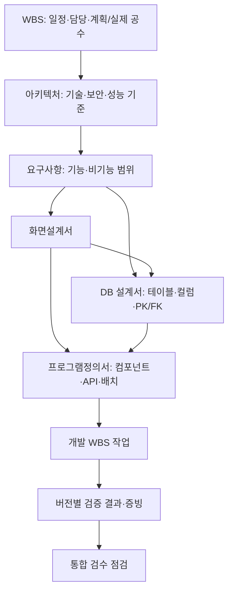

# 통합 산출물 체계

프로젝트의 WBS와 아키텍처를 기준으로 요구사항, 화면, 데이터베이스, 프로그램, 검증 결과를 연결합니다.
모든 문서는 프로젝트 범위의 고정 관리번호를 사용하며 DB·화면·Excel에서 같은 ID와 버전을 사용합니다.

## 문서와 관리번호

| 문서 | 관리번호 | 관리 내용 |
| --- | --- | --- |
| WBS | WBS-001 | 단계, 작업/요약/마일스톤, 부모, 선행 작업, 계획·실제 일정, 담당, 공수, 진척률, 배정 문서 |
| 아키텍처정의서 | ARC-001 | 언어, 프레임워크, DBMS, 서버/WAS, 배포·네트워크, 보안·성능, 개발 표준 |
| 요구사항정의서 | SFR-001 등 | 범위, 출처/RFP 번호, 정의·세부내용, 검수 기준, UI/데이터 설계 필요 여부 |
| 화면설계서 | SCR-001 | 화면 구성, 메뉴·URL, 입출력·검증, 이벤트/흐름, 요구사항·DB 연결 |
| 데이터베이스설계서 | DB-001 | 물리·논리 테이블명, 스키마, 컬럼, PK/UNIQUE/NULL, FK, 인덱스·제약조건 |
| 프로그램정의서 | PGM-001 | 단위업무, 컴포넌트/API/배치, 입출력, 처리 로직, 예외, 테이블 CRUD, 기술 검토 |
| 검수결과서 | TST-001 | 단위/통합/인수 시나리오, 기대·실제 결과, 검증일·담당, 증빙, 확인한 문서 버전 |

일반 문서 연결과 WBS 부모/선행 관계, FK, 프로그램 테이블 CRUD는 별도의 관계 유형으로 저장합니다.
프로그램 목록에서 **개발 WBS 등록**을 누르면 해당 프로그램 연결·담당·작업 범위를 채운 신규 WBS 입력창을 엽니다.
일정과 공수를 확인하여 저장해야 실제 작업이 생성됩니다.

## 일정 통제와 진척률

- 부모는 요약 작업만 선택할 수 있습니다. 부모/선행 관계의 순환을 거절합니다.
- 하위 작업의 계획 기간은 부모 계획 기간에 포함되어야 합니다.
- 후속 작업은 선행 작업의 계획 종료일 이후에 시작합니다. 동일 날짜 시작은 허용합니다.
- 부모나 선행 작업의 일정을 수정할 때 이미 연결된 하위·후속 작업도 검증합니다.
- 요약 작업에는 문서나 선행 작업을 직접 배정하지 않습니다. 실제 작업에 배정합니다.
- 마일스톤은 동일 계획 시작/종료일, 계획 공수 0, 진척률 0 또는 100을 사용합니다.
- 완료 상태인 실제 작업은 진척률 100이어야 합니다.
- 집계는 하위 실제 작업만 포함합니다. 요약 작업을 중복 가산하지 않습니다.
- 진척률 = `Σ(작업 진척률 × 계획 공수 가중치) / Σ(계획 공수 가중치)`.
  계획 공수 0인 실제 작업/마일스톤은 가중치 1로 계산합니다.
- 계획/실제 공수 단위는 시간입니다. 실적 시작/종료일과 미완료·지연을 검수 화면에서 점검합니다.

## DB 설계와 ERD

컬럼은 테이블 내 고정 ID로 식별하므로 이름을 바꾸어도 FK 연결은 유지됩니다.
동일 스키마의 물리 테이블명과 테이블 내 컬럼명/ID 중복을 거절합니다.
PK 컬럼은 NULL을 허용할 수 없습니다. 단일 컬럼 FK는 같은 프로젝트의 단일 PK 또는 UNIQUE 컬럼을 참조하고
자료형·길이가 같아야 합니다. 참조 중인 컬럼의 삭제나 호환되지 않는 변경은 거절합니다.
다른 프로젝트/삭제된 테이블은 FK나 CRUD 대상으로 지정할 수 없습니다.
ERD는 저장한 컬럼과 FK로 그리며 프로그램별 C/R/U/D 행렬도 같은 테이블 ID를 사용합니다.
복합 PK는 컬럼 PK 표시로 표현하고, 복합 FK는 현재 구조화하지 않으므로 제약조건에 기술합니다.
SQL 실행·DB 인트로스펙션·DDL 자동 적용은 수행하지 않습니다.

## 기술 기준과 검증 버전

프로그램의 기술 검토를 `준수` 또는 `예외 승인`으로 저장하려면 승인된 아키텍처를 연결하고,
검토자·검토 근거와 현재 버전의 검토 완료 확인을 입력해야 합니다.
프로그램에는 검토한 아키텍처의 버전을 저장합니다. 아키텍처가 변경되면 기술 재검토가 필요합니다.
이것은 담당자가 기록한 기술 검토이며 실제 소스코드의 프레임워크/보안 규칙을 자동 검사하지는 않습니다.

검증 결과를 실행 상태로 저장하려면 실제 결과·검증일·검증자를 입력하고 현재 버전의 실행 결과임을 확인해야 합니다.
`통과`에는 증빙 위치가 필요합니다. 증빙은 문서 번호/URL/저장 위치를 기록하며 파일 업로드는 포함하지 않습니다.
검증 시점의 요구사항·화면·DB·프로그램·아키텍처 버전을 상위 연결까지 보존합니다.
이후 해당 문서가 수정·삭제되면 기존 통과 결과를 수정하지 않고 `재검증 필요`로 표시합니다.
다시 검증하고 확인하여 저장하면 새 버전의 증빙 스냅샷이 남습니다.

## 통합 검수 기준

통합 검수는 다음 조건을 함께 확인합니다.

1. WBS·아키텍처·요구사항이 존재하는가.
2. 각 문서를 작성·구현·검증할 실제 WBS 작업이 배정되었는가.
3. 실제 작업은 완료/100%이며 실제 시작일·종료일이 있는가. 빈 요약 작업이나 지연이 남아 있는가.
4. 아키텍처, 요구사항 범위, 화면·DB 설계가 승인되었는가.
5. 요구사항에 검수 기준이 있고 필요하다고 지정한 화면·DB가 연결되었는가.
6. 화면·테이블·프로그램이 원본 요구사항으로 추적되는가.
7. 프로그램이 완료되었고 개발 단계 WBS와 연결되었는가.
8. 현재 아키텍처 버전의 기술 검토와 필요한 테이블 CRUD가 있는가.
9. 각 프로그램과 요구사항에 현재 버전의 승인된 검증 통과 결과가 있는가.

미비 사항은 해당 문서를 열어 바로 수정할 수 있습니다. 전체가 충족되면 `검수 준비 완료`를 표시합니다.
이 표시는 실제 발주처의 계약상 최종 검수 승인을 대신하지 않습니다.

## Excel

기존 정의서·설계서·추적표에 다음 시트를 포함합니다.

- WBS / 아키텍처정의서 / 데이터베이스설계서 / 검수결과서
- 프로그램정의서(단위업무 및 명세) / 프로그램설계서(상세 명세)
- 테이블컬럼정의서 / 테이블관계 / 프로그램테이블CRUD
- WBS진척집계 / 검증기준버전 / 통합검수점검 / 미비사항목록

추적표는 실제 경로별로 행을 만들며 서로 연결되지 않은 화면과 프로그램을 조합하지 않습니다.
모든 시트는 동일 read transaction의 문서·버전 스냅샷으로 생성합니다.
현재 출력은 통합 기본 양식이며 기관 지정 원본과 동일한 셀 배치는 원본 확정 후 매핑해야 합니다.

## 마이그레이션과 테스트

`pnpm db:migrate`로 `006_integrated_deliverables.sql`을 적용합니다.
새 kind CHECK와 structure_json, 관계 유형을 추가하기 위해 같은 트랜잭션 안에서 테이블을 복사·교체합니다.
기존 ID·코드·문서 내용·버전·삭제 시각·연결·이력·순번을 보존하고 FK·이력 불변 트리거를 다시 구성합니다.

- `pnpm test:migration`: 005 데이터가 있는 임시 DB에서 006 적용 후 보존·FK·이력 불변성을 검증합니다.
- `pnpm typecheck`, `pnpm lint`, `pnpm build`
- `pnpm test:auth`: 기존 보안/CRUD와 통합 산출물의 검수 준비·재검증 흐름을 실제 HTTP로 검증합니다.
- `pnpm test:auth:dev`, `pnpm test:auth:no-logs`: 개발 렌더링과 감사 로그 비활성화 회귀 검증.

주요 구현: `lib/artifact-types.ts`, `lib/artifact-validation.ts`, `lib/integration.ts`,
`lib/traceability.ts`, `lib/workbook.ts`, `components/pages/`의 페이지·전용 편집기, `components/shared/`의 공통 목록·다이얼로그·상태 훅.
