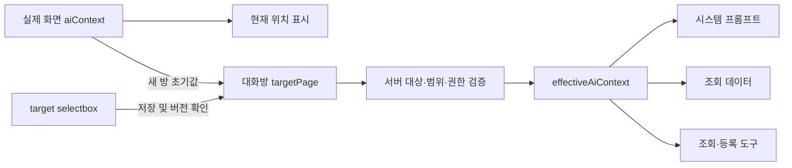

# AI 채팅 대상 페이지 선택 및 대화방별 저장 분석·설계

- 작성일: 2026-11-05 (한국시간, Asia/Seoul)
- 상태: 사용자 검토용 설계 초안. 사용자 검토·직접 수정 후 별도 구현 요청 시 적용한다.
- 분석 기준: 현재 저장소 소스와 마이그레이션. 운영 DB는 조회하지 않았다.
- 이번 작업 범위: 본 문서 신규 작성 및 `HISTORY.md` 링크 추가만 수행한다. 소스·DB·설정·마이그레이션은 변경하지 않는다.
- 구분: **확정 요구사항**은 사용자 요청이며, **권장안**은 구체화한 설계 제안이다. 지원 범위와 예외 정책은 8절에서 검토한다.

## 1. 요구사항

| ID | 확정 요구사항 | 완료 기준 |
| --- | --- | --- |
| R1 | 프롬프트 입력 위 현재 위치 표시의 오른쪽에 target page selectbox를 제공한다. | 실제 화면을 이동하지 않고 AI 작업 대상을 변경할 수 있다. 선택한 target이 시스템 프롬프트에 반영된다. |
| R2 | 새 채팅방을 열면 target page는 현재 화면이다. | 새 방마다 새 채팅을 요청한 시점의 현재 페이지/탭으로 초기화한다. 이전 방의 target을 상속하지 않는다. |
| R3 | 대화방에 target page를 저장하고 다음 호출에도 복원한다. | 선택 후 메시지를 보내지 않고 닫거나 새로고침해도 기존 방을 다시 열면 저장된 target이 선택된다. 이후 요청도 같은 target으로 처리한다. |
| R4 | 이번 단계에서는 분석·설계만 수행한다. | 신규 문서와 HISTORY 링크만 추가하고 기존 소스·DB·다른 변경사항은 보존한다. |

화면과 AI 대상이 달라지므로 시스템 문구뿐 아니라 **조회 데이터, 도구, 저장할 산출물 종류, 권한, 결과 표시**도 동일한 target을 기준으로 동작해야 한다. 화면은 DB 설계에 두고 target을 요구사항으로 선택한 경우, 요구사항 지침·조회 범위·등록 도구를 사용하고 실제 DB 화면은 이동하지 않는 것이 목표다.

## 2. 현재 구조

### 2.1 화면 위치와 UI

| 위치 | 현재 동작 | 설계상 영향 |
| --- | --- | --- |
| `components/project-workbench.tsx` | 실제 URL과 `tab` 쿼리, 선택 프로젝트가 바뀌면 `setAiContext({pathname,screen,tab,projectId,projectName})`를 호출한다. | 현재 `aiContext`는 실제 화면의 상태다. target 선택으로 이 값을 덮어쓰면 화면 연계와 프로젝트 전환 처리가 혼동된다. |
| `components/workspace-shell.tsx` | 프로젝트/레거시 프로젝트 경로 외 화면은 `emptyAiContext`를 기반으로 실제 pathname과 메뉴명을 설정한다. | 대시보드·팀 공유와 프로젝트 작업 공간을 구분해야 한다. 설정·관리자 화면은 별도 예외다. |
| `components/ai/ai-chatbot.tsx` | `AiPanel`은 `aiContext.pathname === usePathname()`일 때만 해당 context를 사용하고 `aiPresentation(context)`로 제목·현재 위치·예시를 만든다. | 현재 위치를 표시하는 `.matrix-ai-context` 옆에 selector를 배치할 수 있다. 제목·예시는 target 기준으로 분리해야 한다. |
| 같은 파일의 `generate()` | 요청에 실제 `context.pathname`, `context.projectId`, `context.tab`을 전달한다. | target 선택값을 서버로 보내는 계약이 필요하다. |
| `components/ai/ai-workspace-layout.tsx` | 실제 pathname 일치와 대화방 프로젝트 일치로 패널 노출을 판단한다. `/settings*`, `/admin*`에서는 숨긴다. | 패널 노출 판정은 실제 화면을 계속 사용해야 한다. AI 대상 pathname을 브라우저 pathname과 비교하면 target을 바꾼 순간 패널이 사라질 수 있다. |
| `stores/workspace.ts` | `setAiContext()`는 프로젝트가 바뀌면 선택 방과 AI 창을 초기화하지만 같은 프로젝트의 탭 변경에는 방을 유지한다. | 같은 프로젝트에서 화면 탭을 이동해도 저장된 target은 유지하는 구조가 적절하다. |

`AiPanel`은 사용자·워크스페이스·대화방 ID로 key가 지정된다. `scope`는 현재 사용자·워크스페이스·프로젝트를 사용하고, 생성 요청 중복 방지·AbortController·중지 재시도·이미지 임시 상태를 별도로 관리한다. target 선택을 추가할 때 이 상태들을 초기화하지 않도록 해야 한다.

### 2.2 프롬프트·데이터·실행 경로

- `app/api/ai/chats/route.ts`의 POST는 클라이언트가 보낸 `pathname/projectId/tab` 조합을 검증하고 `selectAiPage()`로 `aiPages` 항목을 고른다. 현재 화면 정보가 곧 AI 실행 위치다.
- 프로젝트별 `permissionsByTab[tab]`으로 쓰기 가능 여부를 산정한다. 실제 변경은 `page-tools.ts`와 `mutateArtifact()` 또는 RFP 도구가 작업별 권한·의도·버전·관계를 다시 검사한다.
- `lib/ai/page-prompts.ts`의 항목은 `instruction`, `reads`, `source`, 쓰기 대상 `kind`를 함께 정의한다. `pageInstructions()`는 공통 실행 원칙과 `rfpReferenceInstructions`를 결합한다.
- `lib/ai/page-data.ts`는 선택된 page의 데이터 원본·관련 kind를 조회한다. 현재 일반 프로젝트 탭에는 같은 프로젝트의 `project_rfp_documents.document_json` 전체를 제공하고, RFP 탭은 기존 `document.draft` 형식을 사용한다.
- `lib/ai/page-tools.ts`는 RFP 탭에서 `createRfpAgent()`로 위임하고, 일반 편집 탭에는 `save_artifact`, 조회 전용 탭에는 `read_page`만 제공한다.
- 현재 `ProjectTab`에는 문서함(`documents`)도 있지만 `aiPages` 및 `selectAiPage()`에는 문서함 항목이 없다. 단순히 모든 `projectTabLabels`를 selectbox에 넣으면 문서함 선택 시 현재 서버는 400을 반환한다.
- 프로젝트 AI 지원 대상은 현재 13개다: `overview`, `rfp`, `wbs`, `architecture`, `requirement`, `screen`, `database`, `program`, `test`, `trace`, `acceptance`, `history`, `export`. 프로젝트 외에는 `dashboard`, `team`이 있다.

### 2.3 대화방과 저장 데이터

| 파일/테이블 | 현재 구조 | 변경 필요성 |
| --- | --- | --- |
| `lib/ai-context.ts` | `AiConversation`은 `convId/projectId/title/isPinned/createdAt/updatedAt`을 가진다. target 필드는 없다. | 대화방 DTO에 target과 충돌 확인용 버전을 추가해야 한다. |
| `components/ai/ai-conversation-menu.tsx` | 새 방 생성 요청은 `{projectId}`만 전송한다. 목록은 프로젝트별로 조회하고, 생성 중 프로젝트 전환·언마운트 시 오래된 응답을 선택하지 않는다. | 새 방 생성 시 실제 화면을 snapshot으로 함께 전달해야 한다. |
| `app/api/ai/conversations/route.ts` | POST는 방을 만들고 GET은 `conversationColumns`로 목록을 반환한다. | 생성·목록 양쪽에 target 초기값과 저장값을 포함해야 한다. |
| `app/api/ai/conversations/[convId]/route.ts` | PATCH는 제목 또는 고정 여부만 수정한다. DELETE는 생성 잠금을 검사한다. | target PATCH와 충돌·생성 중 변경 검사 추가가 필요하다. 기존 제목·고정 동작은 유지한다. |
| `lib/ai/conversations.ts` | `requireConversation()`은 사용자·워크스페이스·프로젝트 범위를 검증한다. `conversationInfo()`가 방 DTO를 만든다. | 모든 방 응답에서 동일한 target 복원이 필요하다. |
| `components/ai/use-ai-conversation.ts` | 방의 대화 조회 후 응답의 `conversation`으로 store를 갱신한다. | 늦게 도착한 응답이 최근 변경한 target을 덮어쓰지 않도록 버전 비교가 필요하다. |
| `ai_conversations` | `009_ai_conversations.sql`에 방·범위·제목·`request_id/busy_until`, `010`에 고정 필드가 있다. | 방 단위 target 저장 필드가 없다. |
| `ai_prompt_chats` | `007`에 메시지별 `pathname/tab/screen_title`, `009`에 `conv_id`가 추가됐다. | 과거 실행 화면은 기록하지만 방의 현재 설정을 저장하지 못한다. |
| `ai_generation_requests` | `016` 기반으로 요청 상태·중지·정산을 관리한다. | 실행 시 확정한 target snapshot 보관을 검토한다. |

`memberPlan().historyEnabled=false`인 경우 생성 API는 `temporary-*` ID만 발급하고 방을 DB에 저장하지 않는다. `requireConversation()`도 임시 메타데이터를 구성한다. 이 경우 R3의 영속 저장을 어디까지 적용할지는 별도 정책 결정이 필요하다.

## 3. 수정 방향: 화면 위치와 AI 대상을 분리

### 3.1 상태 모델

| 개념 | 역할 | 변경 규칙 |
| --- | --- | --- |
| 실제 화면 `aiContext` | 현재 브라우저 경로·탭·프로젝트, 패널 노출·현재 위치 표시 | 기존 화면 이동 흐름으로만 변경한다. target selector에서는 수정하지 않는다. |
| 방의 `targetPage` | 이 방에서 AI가 처리할 페이지의 정규 key | 새 방에서는 현재 화면으로 초기화하고, 이후 명시적 선택과 서버 저장 결과로만 변경한다. |
| `targetVersion` | target 변경 순서를 식별하는 정수 | 서버에서 target 변경 때만 증가한다. 제목·고정 변경과 독립적이다. |
| `effectiveAiContext` | 서버가 방의 프로젝트와 target을 검증해 만든 실행 context | 프롬프트·데이터·도구·권한·결과 제목에 일관되게 사용한다. |
| 요청 snapshot | 해당 생성 요청에서 확정한 target·버전 | 생성 시작부터 종료까지 고정한다. 나중에 방 설정이 바뀌어도 과거 요청을 재해석하지 않는다. |

**권장안:** target은 원시 URL 대신 `database`, `requirement`, `rfp`, `dashboard` 같은 정규 key로 저장한다. 프로젝트 ID는 기존 대화방의 `project_id`를 사용하며 target 변경으로 프로젝트를 옮기지 않는다. 프로젝트명·권한·표시명은 서버의 현재 데이터에서 구성한다.

현재 클라이언트는 서버 전용 `page-prompts.ts`를 직접 가져올 수 없다. 표시용 key·label·지원 여부·프로젝트 필요 여부는 클라이언트에서도 사용할 수 있는 공통 카탈로그(예: `lib/ai-target-pages.ts`)로 분리하고, 서버의 page 선택도 같은 key를 사용하게 한다. 프롬프트 원문과 도구 구현은 서버 전용 모듈에 남긴다.

### 3.2 UI

- 프롬프트 입력 위 위치 행을 좌측 현재 화면, 우측 `AI 대상` selectbox로 구성한다. 예: `현재: 프로젝트 A · DB 설계 / ERD    AI 대상: [요구사항 ▾]`.
- 기존 모델 선택은 그대로 유지한다. target 선택은 화면 이동·프로젝트 변경·새 방 생성과 구분되는 조작이다.
- 생성 제목·placeholder·이미지만 첨부했을 때의 기본 요청 문구·하단 안내는 **AI 대상**을 따른다. 왼쪽 현재 화면 표시는 실제 위치를 유지한다.
- selector 변경으로 URL, 실제 탭, 대화 내용, 작성 중 프롬프트, 첨부 이미지, 선택 모델을 초기화하지 않는다.
- target 메타데이터 로딩·저장 중에는 생성과 추가 target 변경을 잠시 막고 진행 상태를 표시한다. 저장 실패 시 이전 확정값을 유지하고 오류·재시도 방법을 제공한다.
- 생성 중·중지 중·중지 미확인(`stopRetry`) 상태에서는 selector를 비활성화한다. 중지 미확인을 단순히 생성 종료로 보고 target을 바꾸지 않는다.
- 저장된 target과 실제 화면이 다르면 두 값을 계속 명시한다. 사용자는 실제 페이지를 이동하지 않고 대상 탭의 산출물을 변경할 수 있음을 인지할 수 있어야 한다.
- 좁은 패널·모바일에서는 행을 줄바꿈하되 현재 위치·AI 대상 레이블을 유지한다. 네이티브 select, 키보드 조작, 명확한 접근 가능한 이름, 라이트·다크 테마를 적용한다.

### 3.3 선택 가능한 target 범위

| 대화방 범위 | 권장 선택지 | 범위 처리 |
| --- | --- | --- |
| 프로젝트 방 | 현재 지원되는 13개 프로젝트 AI 탭 | 해당 방의 같은 프로젝트 안에서만 변경한다. 대상 READ 권한을 확인하고 쓰기 가능 여부도 표시한다. |
| 프로젝트 없는 공통 방 | 대시보드·팀 공유 | 팀 공유는 현재 이용 자격과 접근 권한을 다시 확인한다. 프로젝트 작업 대상으로 바꾸려면 해당 프로젝트에서 방을 생성/선택한다. |
| 문서함에서 새 방 | 현재 위치 `documents` 자체는 보존 | 현재 AI 미지원임을 표시하고 지원 대상 선택 전 생성을 막는 안. 문서함 AI를 추가할지는 8절에서 결정한다. |
| 설정·관리자·문서뷰어 등 미지원 위치 | 임의의 지원 페이지로 대체하지 않는다. | 현재 패널 노출 정책을 유지하고, 새 채팅을 허용할 위치·초기화 안내를 검토한다. |

READ는 가능하지만 쓰기가 불가능한 target은 선택 후 조회·분석에 사용할 수 있다. selector 선택 자체가 쓰기 권한을 부여하지 않는다. 현재 서버의 `selectAiPage()` 및 권한 판정을 공통 target 검증기로 옮기거나 재사용해 클라이언트 목록과 서버 허용 목록이 어긋나지 않게 한다.

## 4. 대화방 수명주기와 API 설계

### 4.1 새 방과 기존 방

1. **새 채팅 클릭:** 현재 실제 화면의 프로젝트·정규 target을 snapshot으로 확보한다. 다른 방에서 선택한 target을 재사용하지 않는다.
2. **방 생성:** `POST /api/ai/conversations`에 `projectId`, 초기 `targetPage`, 실제 화면 출처를 보낸다. 서버에서 지원 목록·범위·READ 권한을 검증해 방 생성과 target 저장을 같이 처리한다.
3. **열기:** 서버가 반환한 target을 selector에 표시한다. 생성 대기 중 화면/프로젝트가 변경되면 기존 stale 응답 방지 로직을 확장해 의도치 않게 오래된 방을 열지 않는다. 초기 target은 새 채팅 클릭 시점으로 정의하는 안을 권장한다.
4. **기존 방 선택:** 서버 저장값이 현재 화면보다 우선한다. 선택한 방의 target을 읽어 제목·예시·요청 대상을 복원한다.
5. **target 변경:** 메시지 전송 여부와 무관하게 즉시 저장한다. 저장 성공 후 응답의 메타데이터를 store·목록에 반영한다.
6. **같은 프로젝트 내 화면 이동:** 현재 화면 표시만 바뀌고 선택한 방의 target은 유지한다. 이때 selector를 현재 탭으로 다시 초기화하지 않는다.
7. **프로젝트·계정·워크스페이스 전환:** 기존 방 초기화 정책을 유지한다. 다른 프로젝트 방을 가져와 target만 바꾸는 기능은 추가하지 않는다.

새 방 R2를 위한 현재 화면 전달은 초기값용 정보다. 클라이언트 입력을 권한 근거로 신뢰하는 것은 아니며, 서버는 유효한 target·프로젝트·권한을 확인한다.

### 4.2 권장 API 계약

| API | 변경 방향 |
| --- | --- |
| `GET /api/ai/conversations?projectId=...` | 각 방에 `targetPage`, `targetVersion`을 포함한다. 구버전/미초기화 target은 명확한 null로 반환한다. |
| `POST /api/ai/conversations` | 초기 target과 실제 화면 snapshot을 받아 검증·저장한 방을 반환한다. 누락/지원 불가 위치의 하위 호환 정책은 8절에서 결정한다. |
| `PATCH /api/ai/conversations/[convId]` | 기존 제목·고정에 더해 `{projectId,targetPage,expectedTargetVersion}`을 허용한다. target 변경만 원자적으로 버전 비교하며, 생성 중이면 409를 반환한다. |
| `GET /api/ai/chats` | 기존 `conversation` DTO에 확정 target을 반환한다. 이전 메시지 추가 조회 응답도 최신 target을 무조건 덮어쓰지 않도록 클라이언트에서 버전 비교한다. |
| `POST /api/ai/chats` | `{convId,projectId,targetPage,expectedTargetVersion,sourceContext,...}`를 검증한다. 영속 방은 서버 저장 target을 기준으로 하고, 전송된 값은 불일치 확인에 사용한다. |
| 프로젝트 access API | 기존 `GET /api/projects/[projectId]/access`의 역할별 READ/CRUD 정보를 대상 목록과 상태 표시에 재사용할 수 있다. 최종 권한은 생성 시 서버에서 재검사한다. |

서버는 `targetPage`에서 실행용 `pathname/tab/screen`을 구성한다. 예를 들어 프로젝트 방의 `requirement`는 해당 방의 프로젝트 경로와 요구사항 탭으로 정규화한다. 실제 화면을 나타내는 `sourceContext`는 실행 대상이나 권한 결정에 사용하지 않는다.

현재 pathname/tab 검증을 무조건 삭제하면 안 된다. 대상과 실제 화면의 입력을 분리하고, 구형 호출의 경로를 정규 target으로 변환하는 호환 어댑터를 두는 안을 권장한다. 새 방 생성 클라이언트·기존 API 테스트가 `{projectId}`만 보내는 경우도 확인해야 한다.

### 4.3 서버 실행과 동시성

- **한 target snapshot으로** `selectAiPage`, `projectPermissionAccess`, `readAiPage`, `pageInstructions`, `createPageAgent`, 결과 `screenTitle`을 구성한다. 프롬프트만 target으로 바꾸고 데이터/도구는 실제 탭을 쓰는 혼합 상태를 금지한다.
- 생성 전 대상 READ와 작업별 쓰기 권한, 프로젝트 소속, RFP 읽기 권한, 현재 팀 공유 자격을 확인한다. 실제 변경 도구의 기존 권한·의도·버전 검증도 그대로 유지한다.
- 기존 `request_id/busy_until` 잠금 획득 시 `target_page/target_version`도 비교한다. 메타데이터 조회와 잠금 사이 target이 바뀌면 409로 최신 방 정보를 돌려주고 이전 target으로 실행하지 않는다.
- target PATCH도 사용자·워크스페이스·프로젝트·대화방 범위와 `expectedTargetVersion`, 활성 생성 잠금을 한 원자적 UPDATE 조건 또는 트랜잭션 안에서 확인한다. 먼저 조회만 하고 무조건 UPDATE하는 방식은 피한다.
- 여러 창에서 동시에 target을 바꾸면 한쪽만 성공하고, 충돌한 쪽은 서버의 최신 target을 표시하도록 한다. 최신값을 조용히 덮어쓰거나 생성 요청을 자동 재전송하지 않는다.
- 응답 역전 방지를 위해 store의 `updateAiConversation()`은 같은 방의 더 낮은 `targetVersion`으로 target을 교체하지 않는다. 제목·고정 응답과 target 메타데이터를 구분해서 병합한다.
- 생성 시작 후 target은 확정된 요청 snapshot을 사용한다. 실제 페이지 이동·팝업/패널 전환·오래된 조회 응답으로 실행 위치가 달라지지 않도록 한다.
- 기존 중지·사용량 조회는 requestId/convId/프로젝트 범위를 유지한다. 중지 요청이 생성 POST보다 먼저 도착한 경우, 중지 예약 행의 target snapshot은 미확정/null일 수 있으며 유료 생성 없이 종료하는 기존 동작을 보존한다.
- target 저장 실패나 미확정 상태에서는 생성하지 않는다. 과거 대화에 포함된 다른 탭 지시는 현재 target을 바꾸는 명령으로 간주하지 않는다.

## 5. DB 변경과 기존 데이터 이관: 향후 구현안

이번에는 아래 DDL·데이터 변경을 실행하지 않는다. 현재 최신 마이그레이션은 `035_plan_codes_pro_team.sql`이며 신규 파일은 예를 들어 `036_ai_conversation_targets.sql`로 추가하되 구현 시 번호 중복을 다시 확인한다.

### 5.1 저장 항목

| 테이블 | 추가 제안 | 용도 |
| --- | --- | --- |
| `ai_conversations` | `target_page TEXT NULL`, `target_version INTEGER NOT NULL DEFAULT 0` | 방의 확정 대상과 충돌 버전. null/0은 기존 미초기화 방, 초기 설정 후 버전은 1 이상이다. |
| `ai_prompt_chats` | `target_page TEXT NULL`, `target_version INTEGER NULL` | 성공한 각 메시지의 실행 대상 snapshot. 방 설정을 바꿔도 과거 메시지의 target은 변하지 않는다. |
| `ai_generation_requests` | `target_page TEXT NULL`, `target_version INTEGER NULL` | 생성 시작 시 확정된 대상과 버전. 실패/중지된 요청도 어떤 대상을 사용했는지 식별한다. |

허용 target key와 프로젝트 방/공통 방의 범위 정합성을 서버에서 검증한다. DB 제약 추가 여부와 문서함 같은 미지원 key의 저장 허용 범위는 구현안에서 일치시킨다. 임의 URL·프로젝트 ID를 target 문자열에 넣지 않는다.

기존 `ai_prompt_chats.pathname/tab`은 실제 화면 출처로 유지하는 안을 권장한다. 새 `target_page`는 실행 대상, `screen_title`은 실행 대상의 읽기 쉬운 표시명으로 기록한다. 과거에는 실제 화면과 실행 대상이 같았으므로 기존 행을 다시 쓰거나 과거 `screen_title`을 변경하지 않는다.

`AiChat` 응답에는 필요 시 메시지별 target을 포함해 과거 답변/결과 확대 보기에서 어떤 대상의 응답인지 표시한다. 토큰 통계의 프로젝트·방 소속과 기존 이미지 암호화 AAD는 변경할 필요가 없다.

### 5.2 기존 방 초기값

- 기존 방은 마지막 성공 대화의 유효한 `tab/pathname`을 정규 key로 변환해 backfill하는 안을 권장한다. 동일 시각 메시지가 있을 수 있으므로 기존 조회와 동일하게 `rowid DESC`를 활용한다.
- 가장 최근 행이 지원하지 않는 위치라면 더 이전의 유효한 행을 찾는지, 미지원 위치를 그대로 보존하는지 정책을 정한다. 표시 제목 문자열을 역추론해 target을 만들지 않는다.
- 방의 사용자·워크스페이스·프로젝트와 일치하는 메시지만 이관 근거로 사용한다. `projectSections`의 레거시 경로 매핑과 문서함 예외도 확인한다.
- 대화가 없는 방이나 유효한 위치를 복원할 수 없는 방은 null 상태를 유지한다. 최초 열기 시 현재 화면의 유효한 target을 한 번 저장하는 안을 권장한다. 이후 재열기마다 현재 화면으로 덮어쓰지 않는다.
- null 초기화도 CAS로 처리한다. 여러 창이 서로 다른 현재 화면에서 같은 미초기화 방을 열면 처음 저장한 값이 기준이 되고 다른 창은 서버값을 수용한다.
- 기존 채팅·이미지·방 ID, 고정·제목·프로젝트 범위·생성 잠금·대화 순서·이력은 보존한다. 스키마 변경·backfill 실패 시 전체 이관을 롤백할 수 있도록 한다.

### 5.3 이력 미저장 임시 방

현재 임시 방은 DB 행 자체가 없어 R3를 그대로 구현할 수 없다. **권장안은 기존 요금제 정책을 유지하여 영속 방은 DB 저장, 임시 방은 해당 세션의 메모리에서만 target 유지**다. 단, 이는 R3의 적용 범위에 대한 추가 결정이며 사용자 승인 없이 확정된 예외로 취급하지 않는다.

임시 방에도 새 채팅의 현재 화면 초기값·선택 변경·target 기반 요청은 제공한다. 임시 방 메타데이터를 재구성하는 `requireConversation()`과 대화 GET 응답이 클라이언트에 저장한 target을 기본값으로 되돌리지 않도록 별도 처리해야 한다.

임시 방까지 재접속 후 target을 복원해야 한다면 방 메타데이터만 영속화하는 방식이나 별도 설정 저장소를 검토한다. 이 경우 방 목록 노출·삭제·식별자 검증·잠금·요금제 전환·보관 정책이 달라져 변경 범위가 커진다. localStorage만으로는 다른 브라우저/기기에서 복원되지 않는다.

## 6. 변경 대상 파일과 영향 범위

아래는 **향후 구현 대상**이며 이번에 수정한 소스 목록이 아니다.

| 파일 | 예상 변경 |
| --- | --- |
| `lib/ai-context.ts` | 방·메시지 target DTO, 버전, 실제 화면/실행 대상 구분, target 기준 표시 helper |
| `lib/ai-target-pages.ts` (신규 제안) | 클라이언트·서버 공통 target key/label/프로젝트 범위/지원 목록 |
| `lib/ai/resolve-target.ts` (신규 제안) | 정규화·초기값·권한·실행 context 생성과 서버 page 매핑. 기존 private switch의 역할 이관 |
| `components/ai/ai-chatbot.tsx` | 현재 위치+target selector, 저장 상태·비활성화·재시도, 요청 snapshot, 제목·예시·이미지 기본 요청 안내 |
| `components/ai/ai-chatbot.css`, `components/ai/ai-workspace-layout.css` | 위치 행/selector의 패널·팝업·모바일·테마 배치 |
| `components/ai/ai-conversation-menu.tsx` | 새 방 현재 화면 snapshot 전송, 목록 메타데이터와 늦은 응답 처리 |
| `components/ai/use-ai-conversation.ts`, `stores/workspace.ts` | 방 재열기 복원, target 버전 기반 병합, 임시 방 처리, 계정/프로젝트 전환 정리 |
| `app/api/ai/conversations/route.ts` | 생성 초기값 저장, 목록 target DTO |
| `app/api/ai/conversations/[convId]/route.ts` | target PATCH, CAS·생성 잠금·권한·기존 제목/고정 병합 |
| `lib/ai/conversations.ts` | 공통 SELECT/DTO·방 조회·임시 메타데이터·복원 지원 |
| `app/api/ai/chats/route.ts` | 서버 저장 target 기준 page/data/권한/tool 선택, 잠금 조건, 요청·메시지 snapshot, 결과 제목 |
| `lib/ai/page-prompts.ts` | ‘현재 화면/현재 탭’을 ‘AI 대상’과 구분하는 공통 문구. 기존 `rfpReferenceInstructions`와 탭별 instruction 재사용 |
| `lib/ai/page-data.ts`, `lib/ai/page-tools.ts`, `lib/ai/rfp-tools.ts` | 실행 context가 target에서 일관되게 전달되는지 확인. 문서함 지원 결정 시 별도 조회 전용 분기 필요 |
| `lib/ai/generation-control.ts` 및 생성·중지 관련 route | target snapshot·생성 중 변경 차단·중지 예약과 복구 흐름 검토 |
| `components/ai/ai-conversation-messages.tsx` 등 | 과거 메시지의 대상 표시 및 재사용 동작 검토 |
| 신규 DB 마이그레이션 | 방 설정·버전·메시지/요청 snapshot과 기존 데이터 backfill |
| `components/ai/README.md`, 작업 기록 | 새 계약·범위·운영 이관·검증 결과 반영 |

`project-workbench.tsx`, `workspace-shell.tsx`, `ai-workspace-layout.tsx`의 실제 위치 연계는 유지하되 target 선택값으로 오염되지 않는지 확인한다. 계정·프로젝트 선택, 메뉴 축소, 모바일 드로어, 패널/플로팅 전환, 기존 개인 설정을 회귀 범위에 포함한다.

## 7. 검증 방법

### 7.1 이번 문서 단계

- 신규 경로가 `docs/history/2026-11-05/작업명.md`이고, HISTORY의 기존 목록에 상대 경로·작성일 1건만 추가했는지 확인한다.
- 작업 전부터 존재한 소스·문서 변경을 보존하고, 이번 추가 변경이 본 문서와 `HISTORY.md`뿐인지 확인한다.
- 참조 파일·DTO·API·DB 필드·지원 목록을 현재 소스로 정적 확인한다. DB·외부 AI·개발 서버는 실행하지 않는다.

### 7.2 향후 구현 검증

| 시나리오 | 기대 결과 |
| --- | --- |
| DB 화면에서 새 방 생성 | 실제 화면·초기 target이 DB로 일치하고 서버에 즉시 저장된다. 이전 방의 선택값을 상속하지 않는다. |
| DB 화면에 둔 채 target을 요구사항으로 변경 | 화면·URL·프로젝트는 그대로이며 프롬프트·관련 데이터·제안요청서·쓰기 kind·권한·결과 제목이 요구사항으로 일치한다. |
| target만 변경 후 메시지를 보내지 않고 닫기/새로고침/다른 기기에서 재열기 | 영속 방의 저장값이 복원된다. 현재 화면이 다른 탭이어도 저장값이 우선한다. |
| 같은 프로젝트의 실제 탭 이동 | 현재 위치 표시만 갱신되고 방의 target은 바뀌지 않는다. 선택 불일치 때문에 AI 패널이 사라지지 않는다. |
| 방 A/B 전환 및 계정·워크스페이스·프로젝트 전환 | 방별 target 독립, 다른 범위의 방/target/늦은 응답이 섞이지 않는다. |
| 새 방 생성 또는 target 저장 중 화면 이동 | 오래된 응답으로 잘못된 방을 열거나 다른 방의 target을 수정하지 않는다. |
| 문서함·설정 등 미지원 위치 | 승인한 정책대로 정확한 초기 위치/미지원 상태를 안내하며 다른 target으로 몰래 대체하지 않는다. |
| target 저장 실패·네트워크 재시도 | 미저장 target으로 생성하지 않고 입력·이미지·이전 확정값을 보존한다. |
| 생성·중지·중지 미확인 중 target 변경 | UI는 비활성화되고 조작된 API 호출도 서버에서 거부한다. 확정 요청 target은 변하지 않는다. |
| 여러 창의 target PATCH 및 생성 시작 경합 | targetVersion CAS와 잠금 조건으로 한쪽만 성공하고, 불일치 요청은 유료 호출·산출물 변경 전에 409가 된다. |
| 늦은 대화 GET/제목·고정 PATCH 응답 | 이전 targetVersion이 최신 선택을 덮어쓰지 않는다. 기존 제목·고정 동작도 유지한다. |
| 권한·이용 자격 | READ/CRUD·RFP 소유자 쓰기·viewer·팀 공유 지원 여부를 target 기준으로 검사한다. 다른 사용자/프로젝트/워크스페이스 값 위조를 거부한다. |
| 조회 전용 target에서 저장 요청 | 쓰기 도구 미제공 및 서버 거부. 과거 방의 쓰기 문맥이나 첨부 이미지로 권한이 확대되지 않는다. |
| RFP target | `document.draft` 조회와 `save_rfp_document` 분기가 올바르고 일반 artifact 도구와 혼합되지 않는다. |
| 메시지 이력·재사용 | 각 메시지의 과거 target 표시를 유지하고 방 설정 변경으로 과거 결과를 재표기하지 않는다. 재사용 시 승인한 target 정책을 따른다. |
| 기존 DB 이관 | 마지막 유효 메시지·빈 방·동일 시각·레거시 경로·미지원 위치를 포함한 fixture로 backfill/초기화/재실행·외래키 보존을 검증한다. 이미지 암호문·ID·고정·제목은 유지된다. |
| 이력 미저장 요금제 | 승인한 임시 방 정책에 따라 target 유지/영속 범위가 설명과 일치하고, 대화 조회로 선택값이 초기화되지 않는다. |
| 패널·확대·플로팅·모바일·키보드·다크 | selectbox가 잘리지 않고 레이블·포커스가 보이며, 전환해도 입력·첨부·대상·진행 중 요청이 유지된다. |

서버 검증은 임시 SQLite·합성 사용자·모의 AI를 사용한다. `pnpm typecheck`, 변경 파일 ESLint, `pnpm build`, `pnpm test:ai`, 대화방 마이그레이션 검증을 수행하고 필요한 target 전용 API/브라우저 검증을 추가한다. 기존 `check-ai-conversations.mjs`, `check-ai-conversation-options.mjs`, `check-ai-crud.mjs`, `check-ai-cancellation.mjs`, `check-ai-images.mjs`, `check-ai-token-usage.mjs`, `check-wbs-rfp-context.mjs`, `test-navigation-browser.mjs`의 회귀 범위를 확인한다.

실제 모델 호출 전 테스트 제공자에게 전달되는 instruction·pageContext·tool 목록을 검사해 ‘화면 DB/target 요구사항’ 같은 교차 사례의 일관성을 증명한다. 정적 문자열 비교만으로 구현 완료를 판정하지 않는다.

## 8. 결정이 필요한 사항

| 항목 | 권장안 | 대안과 영향 |
| --- | --- | --- |
| 선택 범위 | 방의 프로젝트 범위 안에서만 target 변경. 공통 방은 대시보드/팀 공유 | 공통 방에서 프로젝트 선택까지 허용하면 방 소속·이력·이미지 AAD·권한·UI 범위가 크게 달라진다. |
| 문서함 초기값 | 현재 위치를 보존해 미지원 표시 후 유효 target 선택 전 생성 차단 | 문서함을 AI 조회 전용 대상으로 새로 추가하면 R2를 더 자연스럽게 충족하지만 파일 조회 범위·본문 제공·권한 정책 설계가 추가된다. 임의 개요 대체는 권장하지 않는다. |
| 설정/관리자 등 현재 AI 미지원 화면 | 기존 패널 노출 정책 유지, 지원 위치에서 방 생성 | 모든 화면에서 AI를 열려면 기존 경로·패널 정책을 함께 변경해야 한다. |
| 이력 미저장 방의 R3 적용 | 기존 정책대로 메모리 유지, 영속 방만 DB 복원 | 임시 방에도 영속 복원을 요구하면 메타데이터 저장과 보관·삭제·목록·잠금 정책을 확대해야 한다. 사용자 검토 필요 |
| 새 방 ‘현재 화면’의 시점 | 새 채팅 클릭 시 snapshot | 서버 응답/실제 열림 시점으로 잡으면 대기 중 화면 이동을 별도 동기화해야 한다. |
| 기존 방 초기 target | 마지막 유효 대화 위치, 없으면 최초 열기 시 현재 화면을 한 번 저장 | 모든 기존 방을 개요로 고정하거나 매번 현재 화면을 사용하면 과거 맥락/지속성 요구와 달라진다. |
| 생성 중 변경 | 변경 금지, 생성/중지 정리 후 가능 | 다음 요청용 target 예약을 허용하려면 현재 실행 대상과 예약값을 UI·DB에서 분리해야 한다. |
| target 저장 시점 | select 변경 즉시 서버 저장, 성공 후 생성 허용 | 메시지 전송 때만 저장하면 선택 후 닫았다 재열 때 R3를 충족하지 못한다. |
| 방 목록 정렬 | target 변경만으로 `updated_at`을 갱신하지 않는 안 | 대상 변경도 활동으로 볼 경우 최근 방 순서가 바뀐다. 별도 target 수정시각 추가도 가능하다. |
| 과거 프롬프트 재사용 | 입력·이미지는 재사용하되 현재 방 target 유지 | 과거 메시지 target까지 복원하려면 target 저장과 충돌 검사를 거쳐야 하며 명시적 UI가 필요하다. |
| 구형 API 호출 | 기존 pathname/tab을 공통 검증기로 변환하는 한시적 어댑터 | 신규 계약만 허용하면 기존 테스트·구버전 클라이언트 동시 배포가 필요하다. 저장 target이 있는 방을 구형 입력으로 조용히 덮어쓰면 안 된다. |

구현은 이 검토본에서 선택 범위·미지원 위치·임시 방 영속 정책을 확정한 뒤 진행한다. 이번 단계에서는 위 DB 설계나 소스 변경을 적용하지 않았다.
