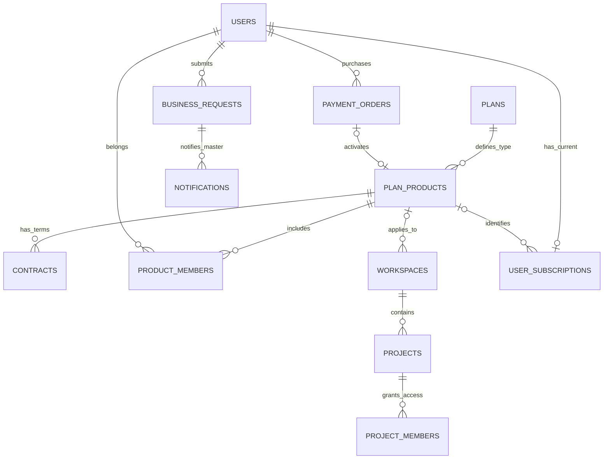

# 슈퍼관리자 메뉴 분리와 Business·Team 상품별 회원 관리 분석 및 설계

- 최초 작성일 / 수정일: 2026-11-09, 한국시간(Asia/Seoul)
- 상태: 사용자 추가 요구사항 5개와 설정·관리자설정·슈퍼관리자설정의 사용 대상 구분을 반영한 검토용 수정본. 검토·수정 후 별도 구현 요청을 기다린다.
- 이번 수정은 이 설계 문서만 변경한다. `HISTORY.md`의 기존 제목·링크 경로·작성일은 유지하고 중복 등록하지 않는다.
- 애플리케이션 소스·설정·마이그레이션·DB는 수정하지 않는다. DB 접속, 실제 결제, 계정 생성, 알림 전송도 하지 않는다.
- 아래 데이터 모델과 API는 후속 구현을 위한 제안이다. ‘현재 구조’에 명시한 내용을 제외하면 아직 구현된 기능이 아니다.

## 1. 이번 수정에서 반영하는 정책

| 추가·수정 요구 | 수정한 설계 기준 |
|---|---|
| Business 상품으로 A업체와 B업체 구분 | 업체별 Business 상품을 각각 생성한다. `Business · A업체`와 `Business · B업체`는 서로 다른 상품 ID를 가지며 이 ID가 관리 범위의 기준이다. 계약은 해당 상품의 계약 조건·진행 상태를 기록한다. |
| biz_admin은 슈퍼관리자가 Business에서 계정 생성 | 슈퍼관리자설정 → Business → 해당 업체 상품 → 관리자 계정 생성에서만 생성한다. Business 신청이나 결제로 자동 생성하지 않는다. |
| 일반 사용자의 Team 결제 후 team_admin 사용 | 정상 결제 성공을 서버에서 검증한 일반 사용자에게 `account_role=team_admin`을 부여하고 해당 Team 상품을 활성화한다. 일반 사용자에게 관리자가 지원한 Team 회원 구독은 관리자 승격과 구분한다. |
| Business 적용 시 슈퍼관리자 알림·계약 유도 | 요금제 화면의 Business 신청을 저장하고 단일 master에게 알림을 남긴다. 알림 → 신청 상세 → 연락/계약 → 업체 상품 활성화 → biz_admin 생성 흐름을 제공한다. |
| 관리자에 의한 프로젝트 양도 금지 | 프로젝트 소유권 양도 UI와 일반 API 경로를 제거/거부한다. project owner·biz_admin·team_admin·기존 admin·master도 일반 관리 기능으로 타인에게 소유권을 넘길 수 없게 한다. |

기존 요구인 master 단일 계정, 요금제 상품 관리의 슈퍼관리자 분리, Business 회원 무제한 지원, Team 회원 20명 제한, 상품별 프로젝트 회원 검색은 유지한다.

### 1.1 변경된 용어와 구분

이번 수정본에서는 **업체를 구분하는 Business 상품 자체를 모델링**한다. 이전 초안의 ‘공통 business 코드 + 계약 ID만으로 업체 범위 구분’은 상품 ID 중심으로 바꾼다.

| 구분 | 의미 | 예시 |
|---|---|---|
| 상품 유형 | 기능·가격 정책의 공통 분류. 기존 4개 코드는 유형으로 유지 | `free`, `pro`, `team`, `business` |
| 개별 상품 | 특정 업체 또는 결제한 팀에 제공하는 구체적인 상품 | `Business · A업체`, `Business · B업체`, `Team · 사용자 C의 팀` |
| 상품 ID | 동일 유형 안에서도 구분되는 고유 식별자 | `bp_A`, `bp_B`, `tp_C` |
| 계약 | 특정 상품의 계약 조건·기간·상태·결제 연결 정보 | A업체 상품의 연간 계약 및 갱신 기록 |
| 계정 역할 | 서비스에 로그인한 계정의 관리 자격 | `master`, `biz_admin`, `team_admin`, `user` |
| 상품 소속 | 그 계정이 어느 상품을 관리/이용하는지 | biz_admin 5명 모두 `bp_A`에 소속 |
| 워크스페이스·프로젝트 | 개별 상품을 이용하는 업무 공간과 그 내부 프로젝트 | A업체 상품 아래 개발/운영 워크스페이스와 여러 프로젝트 |

`business`라는 유형 문자열 하나에 업체 이름을 임의로 덧붙여 저장하지 않는다. 유형은 유지하면서 개별 Business 상품을 별도 행으로 생성하고 그 고유 상품 ID로 업체를 구분한다. 이름이 같은 업체도 상품 ID가 다르면 다른 관리 범위다.

### 1.2 업체별 상품 예시

| 상품 ID 예시 | 상품 유형 | 상품명 | 관리자 생성 경로 | 관리 범위 |
|---|---|---|---|---|
| `bp_A` | business | Business · A업체 | master가 Business 탭에서 생성 | A업체 상품의 회원·공간·프로젝트만 |
| `bp_B` | business | Business · B업체 | master가 Business 탭에서 생성 | B업체 상품의 회원·공간·프로젝트만 |
| `tp_C` | team | Team · 사용자 C의 팀 | 일반 사용자 C의 Team 결제 성공 | C의 Team 상품, 기본 20명 정원 |

상품의 활성 상태와 유효 계약도 확인하지만, 회원·프로젝트·이력의 범위를 계약 ID나 `plan_code`만으로 대신하지 않는다. **상품 ID + 관리 역할/소속 + 활성 상태**를 함께 확인한다.

### 1.3 세 설정 메뉴의 확정된 의미와 사용 대상

세 메뉴는 사용 대상과 설정 범위가 서로 다르다. ‘관리자설정’을 모든 종류의 관리자가 들어가는 공통 메뉴로 해석하지 않는다.

| 메뉴 | 주소 기준 | 사용 대상 | 설정 범위 |
|---|---|---|---|
| 설정 | `/settings` | 로그인한 사용자가 자기 개인 설정을 관리. biz_admin·team_admin·master도 본인의 개인 설정은 이용 | 자기 계정·인터페이스·개인 사용량 등. 다른 회원이나 업체의 관리 기능을 포함하지 않음 |
| 관리자설정 | `/admin/settings` | **Team 관리자(team_admin), Business 관리자(biz_admin)** | 자기 Team/Business 상품의 회원·프로젝트 조건·가드레일·이력 등. 개인 설정이나 서비스 전체 요금제 정책을 관리하는 메뉴가 아님 |
| 슈퍼관리자설정 | `/super-admin/settings` | **전체 서비스에 한 명인 master만** | 요금제 상품 정책, 업체별 Business 상품·계약·biz_admin 생성, 결제된 Team 상품 운영 |

| 계정 구분 | 설정: 자기 개인 설정 | 관리자설정: 자기 상품 관리 | 슈퍼관리자설정 |
|---|---|---|---|
| 일반 user | 허용 | 거부 | 거부 |
| biz_admin | 허용 | 자기 Business 상품만 허용 | 거부 |
| team_admin | 허용 | 자기 Team 상품만 허용 | 거부 |
| 단일 master | 허용 | master라는 이유로 공통 접근 권한을 부여하지 않음. 상품 운영은 슈퍼관리자설정에서 수행 | 허용 |
| 기존 account_role=admin | 로그인 가능한 기존 계정의 자기 설정만 | 이 값만으로는 허용하지 않음. 별도 전환 필요 | 거부 |

- ‘개인 유저 설정’은 일반 user만 사용한다는 뜻이 아니라 **각 계정이 자기 개인 정보와 환경만 설정한다는 뜻**이다. Team/Business 관리자가 되어도 개인 설정은 그대로 이용한다.
- Team 결제 후에는 개인 설정과 자기 Team의 관리자설정을 이용한다. master가 생성한 biz_admin은 개인 설정과 자기 Business의 관리자설정을 이용한다. 두 계정 모두 슈퍼관리자설정은 이용할 수 없다.
- master의 업체·팀 운영 기능은 슈퍼관리자설정의 Business/Team 탭에 둔다. 공통 컴포넌트나 내부 서비스를 재사용할 수 있지만, 이를 이유로 `/admin/settings`와 고객 관리자 API를 master 포함 공통 관리 경로로 열지 않는다.
- 기존 `admin`은 현재 소스에 남아 있는 역할이다. 이 역할을 네 번째 관리자 메뉴나 세 메뉴의 우회 권한으로 유지하지 않는다. 기존 계정의 상품 확인 후 biz_admin/team_admin/user 등으로 전환하는 세부 절차만 별도로 결정한다.
- 메뉴 표시뿐 아니라 직접 주소 접근, 연결된 API, 검색 결과, 모바일·접힌 메뉴에서도 이 구분을 동일하게 적용한다.
- 2절의 ‘현재 master/admin 공통 화면’은 변경 전 소스의 설명이며, 그 권한을 변경 후에도 유지하겠다는 의미가 아니다.

## 2. 현재 소스 확인 결과

이 절은 현재 로컬 소스에 관한 사실이다. 이번 단계에서 운영 DB의 실제 상태는 조회하지 않는다.

### 2.1 계정 역할과 master 보호

- [lib/plan-types.ts](../../../lib/plan-types.ts)의 `AccountRole`은 현재 `master | admin | user | guest`다. `biz_admin`, `team_admin`은 없다.
- [020_accounts_and_plans.sql](../../../db/migrations/020_accounts_and_plans.sql)의 `users.account_role` CHECK도 현재 네 값만 허용한다. `legacy_account_role`은 이전 owner/user 값을 보존하는 컬럼이다.
- `idx_single_master`는 master를 최대 1명으로 제한한다. 삭제·강등·이메일/이름 변경 금지 트리거와 [bootstrap-master.mjs](../../../scripts/lib/bootstrap-master.mjs)의 초기화 원칙을 유지해야 한다.
- `isPlatformAdmin()`은 master와 기존 admin을 전역 관리자로 묶는다. 이 함수에 biz_admin/team_admin을 단순 추가하면 전역 회원·이력·요금제 API가 함께 열릴 수 있다.
- 현재 일반 가입은 [lib/registration.ts](../../../lib/registration.ts)와 [lib/auth.ts](../../../lib/auth.ts)에서 user/Free로 시작한다. 변경 후에도 가입 시에는 user/Free로 시작하며, **일반 가입을 완료한 사용자가 이후 요금제 화면에서 Team 결제를 진행하고 서버에서 결제 성공을 확인하면 `account_role=team_admin`인 Team 관리자가 된다.** 가입 요청에서 직접 관리자 역할을 지정하는 방식이 아니라, 가입 후 Team 결제에 따라 관리자 권한을 부여하는 흐름으로 구현한다.

### 2.2 관리자 메뉴·주소·회원 조회

| 현재 파일 | 확인 내용 |
|---|---|
| [lib/menus.ts](../../../lib/menus.ts) | 관리자설정은 `/admin/settings`, 탭은 plans/members/guardrails/history이며 도움말이 마지막 메뉴다. |
| [components/workspace-shell.tsx](../../../components/workspace-shell.tsx) | 메뉴 권한은 admin boolean과 `isPlatformAdmin()` 기준이다. 메뉴 분리·검색·헤더 경로·기본 탭·CSS 분기에 기존 주소가 사용된다. |
| [app/(workspace)/admin/settings/page.tsx](../../../app/(workspace)/admin/settings/page.tsx) | master/admin 공통 화면이고 기본 탭이 요금제다. |
| [app/(workspace)/admin/plans/page.tsx](../../../app/(workspace)/admin/plans/page.tsx) | `/admin/settings?tab=plans`로 이동하는 호환 주소다. |
| [components/admin/plan-admin.tsx](../../../components/admin/plan-admin.tsx), [요금제 관리 API](../../../app/api/admin/plans/route.ts) | 현재 `/api/admin/plans`에서 master/admin이 상품 정책을 조회·변경한다. |
| [회원 목록·수정 API](../../../app/api/admin/members/route.ts) | 전체 users에 이름/이메일/ID·역할·플랜 필터를 적용한다. 업체 상품·계약·프로젝트의 강제 범위나 정원 검사가 없다. |
| [회원 상세 API](../../../app/api/admin/members/[userId]/route.ts) | 사용자 ID로 전역 상세를 조회한다. 목록만 제한해서는 격리가 되지 않는다. |
| [components/admin/admin-lists.tsx](../../../components/admin/admin-lists.tsx) | 전체 플랜 선택과 역할 편집을 제공하며 업체 상품 선택·프로젝트 조건·정원 표시가 없다. |

### 2.3 요금제·결제·알림

- [035_plan_codes_pro_team.sql](../../../db/migrations/035_plan_codes_pro_team.sql)의 `plans.code`는 4개 유형만 허용한다. 현재 plans 테이블만으로 업체별 Business 상품 행을 추가할 수 없다.
- 사용자 구독은 user_id가 기본키여서 사용자당 하나다. 업체별 상품 ID와 지원/결제 출처는 없다.
- [components/subscription-plans.tsx](../../../components/subscription-plans.tsx)는 결제 미연결 안내와 ‘실제 청구 없이 즉시 변경’ 동작을 제공한다.
- [app/api/me/subscription/route.ts](../../../app/api/me/subscription/route.ts)의 PATCH는 `plan/currentPlan/planVersion`을 받아 Team·Business도 직접 변경한다. 로그의 paymentMode는 none이며 실제 결제 검증이나 관리자 역할 부여가 없다.
- 현재 확인한 `app/api`, `lib`, `db/migrations`에는 결제 주문·결제 승인 웹훅·Business 계약 신청·슈퍼관리자 알림 전용 저장소가 없다.
- 셸의 알림 버튼은 기존 팀 안내 팝오버이며 `teamSharingEnabled`에 표시 내용이 연결되어 있다. master가 Free 공간을 선택해도 Business 신청을 확인할 수 있는 별도 알림 기능이 필요하다.

### 2.4 워크스페이스 플랜과 권한

- [040_workspace_plan_policy.sql](../../../db/migrations/040_workspace_plan_policy.sql)은 생성 시점 플랜을 고정하고 `plan=subscription_plan`을 보장한다. 이후 사용자 구독 변경으로 기존 공간을 자동 갱신하지 않는다.
- [lib/plans.ts](../../../lib/plans.ts)의 `workspacePlan()`과 [lib/auth.ts](../../../lib/auth.ts)의 기본 `requireUser()`는 현재 사용자 구독과 공간의 유형 코드 일치를 검사한다.
- [components/workspace-plan-guard.tsx](../../../components/workspace-plan-guard.tsx)는 불일치 시 업무 화면을 막고 요금제 화면으로 안내한다.
- 현재는 개별 상품 ID가 없어 A업체 Business와 B업체 Business를 업무 정책에서 비교할 수 없다. 후속 구현에서 유형뿐 아니라 상품 ID까지 검사해야 한다.
- 프로젝트 역할은 [lib/project-permissions.ts](../../../lib/project-permissions.ts)에서 별도 검사한다. 상품 관리자 역할과 프로젝트 CRUD 권한은 같지 않다.

### 2.5 현재 프로젝트 양도 기능

- [app/api/team/members/route.ts](../../../app/api/team/members/route.ts)의 PATCH에서 `role='owner'`, `confirmTransfer=true`, `expectedOwnerId`를 받아 프로젝트 owner_id를 다른 사용자로 바꿀 수 있다.
- [components/pages/team/team-membership.tsx](../../../components/pages/team/team-membership.tsx)는 ‘owner · 소유권 이전’ 선택지와 확인 모달을 제공한다. 프로젝트·워크스페이스 양도를 함께 처리하는 UI이므로 둘을 구분해야 한다.
- [lib/ai/page-prompts.ts](../../../lib/ai/page-prompts.ts)에도 팀 화면에서 소유권 양도를 하라는 안내가 있다.
- 프로젝트 생성 시 owner_id는 [app/api/projects/route.ts](../../../app/api/projects/route.ts)에서 생성자로 지정된다. 후속 변경 경로를 막고 생성 시의 소유자를 유지하는 방향이다.

### 2.6 기존 가드레일·이력의 영향

- [lib/ai/guardrail-policy.ts](../../../lib/ai/guardrail-policy.ts)는 master/admin 계정과 워크스페이스 owner/admin 조건을 조합한다. 신규 상품 관리자 역할과 상품 범위에 맞춘 분리가 필요하다.
- [lib/admin-history.ts](../../../lib/admin-history.ts)의 이력 조회는 전역 자료를 UNION하며 요청의 workspace 필터만으로는 업체 격리를 보장하지 않는다.
- [전역 로그 설정 API](../../../app/api/admin/settings/logging/route.ts)의 DB_LOGGING_ENABLED는 서비스 전체 설정이다. 고객 상품 관리자가 다른 업체의 로깅까지 변경할 수 없도록 범위를 결정해야 한다.

## 3. 화면·메뉴·주소 설계

```text
설정                     /settings                     ← 자기 개인 설정
  계정·인터페이스·개인 사용량
요금제                   /settings/subscription
  Free / Pro             기존 개인 구독 흐름
  Team                   Team 결제 → 검증된 성공 후 team_admin
  Business               계약 신청 → master 알림 → 계약 진행
관리자설정               /admin/settings               ← biz_admin / team_admin 전용
  회원 관리              ?tab=members
  AI 가드레일 관리        ?tab=guardrails
  이력 관리              ?tab=history
도움말
슈퍼관리자설정            /super-admin/settings          ← master 전용
  요금제                 ?tab=plans
  Business               ?tab=business
    계약 신청함 / 업체별 Business 상품 / biz_admin 계정 생성
  Team                   ?tab=team
    결제된 Team 상품 / 결제 상태 / team_admin·회원·20명 정원
```

- 도움말 바로 아래의 슈퍼관리자 메뉴는 master에게만 표시한다. 접힘·모바일·검색 결과·직접 주소·API에서도 같은 권한을 적용한다.
- 개인 설정(`/settings`)은 자기 개인 설정으로 유지하고 상품 관리 기능을 넣지 않는다. 개인 요금제 화면은 구독 구매/신청을 위한 별도 화면이며 세 설정 메뉴의 권한을 합치는 근거가 아니다.
- 관리자설정은 biz_admin/team_admin의 자기 상품 관리 메뉴로 한정한다. 요금제 상품 관리 탭을 제거하고 기본 탭은 회원 관리로 바꾸며 자기 상품의 회원·프로젝트만 검색한다.
- 슈퍼관리자 Business 탭은 신청과 알림을 확인한 뒤 업체 상품을 생성·선택하고 biz_admin 계정을 생성하는 운영 화면이다.
- Team 탭은 결제 기반 생성 결과를 관리한다. 미결제 사용자를 수동으로 team_admin으로 만드는 경로를 기본 기능으로 제공하지 않는다.
- `/admin/settings?tab=plans`, `/admin/plans`는 master만 새 요금제 관리 주소로 이동한다. 비master의 직접 접근은 거부한다.
- `/api/admin/plans`는 `/api/super-admin/plans`로 이동하거나 master 전용 호환 핸들러로 제한한다. 예전 admin 권한으로 수정 가능한 API를 남기지 않는다.
- `PlanAdmin`의 소스는 `components/super-admin/plan-admin.tsx` 등으로 이동한다. 일반 `/admin/settings`는 상품 관리자 화면으로 유지한다.
- 개인 가격표·계약 신청·Team 결제 화면인 `/settings/subscription`은 유지한다. 요금제 **정책 수정**과 요금제 **구매/신청**을 같은 권한으로 취급하지 않는다.

## 4. 관리자 계정 모델과 생성 경로

### 4.1 account_role 확장 기준

이번 수정본은 biz_admin/team_admin을 단순 표시명이 아닌 계정 역할로 사용하는 안을 기준으로 설계한다.

| account_role | 생성·부여 조건 | 관리 범위 |
|---|---|---|
| master | 기존 단일 슈퍼관리자 초기화 | 상품 정책, 업체별 상품·계약·biz_admin 생성·운영 |
| admin | 현재 소스의 기존 역할. 상품 확인과 명시적 계정 전환 절차 필요 | 이 값만으로 관리자설정·슈퍼관리자설정을 허용하지 않음 |
| biz_admin | master가 슈퍼관리자설정 Business에서 계정 생성·활성화 | 지정된 업체 Business 상품만 |
| team_admin | 일반 사용자의 Team 결제를 서버에서 성공 확인 | 그 결제로 활성화한 Team 상품만 |
| user | 일반 가입 또는 상품 지원을 받는 일반 회원 | 배정된 프로젝트 역할에 따른 업무 |
| guest | 체험 계정 | 기존 체험 범위 |

`users.account_role` 타입·DB CHECK·API 입력 목록을 확장해야 한다. 기존 master 보호를 보존하는 신규 마이그레이션이 필요하며 `legacy_account_role`은 사용하지 않는다.

역할만으로 상품을 알 수 없으므로 별도 상품 소속도 저장한다. `biz_admin`이고 같은 business 유형이어도 상품 ID가 다르면 다른 업체를 관리할 수 없다. 일반 회원에게 상품을 지원할 때 account_role을 관리자 값으로 바꾸지 않는다.

### 4.2 biz_admin 생성

1. master가 Business 탭에서 계약 신청과 업체 정보를 확인한다.
2. 해당 업체의 Business 상품을 생성하거나 기존 상품을 명시적으로 선택한다. A업체와 B업체 상품을 별도 ID로 구분한다.
3. master가 ‘biz_admin 계정 생성’을 실행한다. 상품 ID·관리자 이름·이메일·계정 활성화 절차를 지정한다.
4. `account_role=biz_admin`, 해당 상품의 admin 소속, 상품 지원 구독을 생성한다. 계정 활성화와 유효 계약 조건을 충족해야 업무·관리 기능을 이용한다.
5. A업체 관리자 5명을 생성하면 모두 A업체 상품 ID를 공유한다. 일반 회원 지원은 무제한이지만 다른 업체 상품에는 적용할 수 없다.

- 일반 가입, Business 신청 제출, 개인 구독 PATCH, 다른 biz_admin의 회원 추가 요청으로 biz_admin을 생성하지 못하게 한다.
- 기존 이메일이 있으면 임의로 중복 계정을 만들거나 기존 권한·구독을 덮어쓰지 않는다. 신규 계정 생성이 기본이며 기존 계정 전환 허용 여부는 별도로 확정한다.
- 초대/초기 비밀번호 설정 방식을 사용할 수 있으나 비밀번호·활성화 토큰 원문을 알림이나 감사 로그에 기록하지 않는다. 실제 계정 생성 방법은 후속 구현에서 확정한다.
- 생성 재시도는 같은 계정과 상품 admin 소속을 중복 생성하지 않도록 처리한다. 고객 관리자 추가·해제 권한은 master에게만 둔다.

### 4.3 team_admin 부여

1. 일반 사용자(user)가 요금제 화면에서 Team을 선택하고 서버가 발행한 주문으로 결제를 진행한다.
2. 서버가 실제 결제 성공과 주문의 사용자·상품·금액·상태를 확인한다.
3. 새 Team 구매이면 독립된 Team 상품 ID를 생성하고 구매자를 admin으로 연결한다.
4. 사용자 account_role을 team_admin으로 변경하고 Team 상품 구독·활성 계약/이용권·관리 버전을 함께 갱신한다.
5. 결제 성공 후 요금제·관리자설정에서 본인의 Team 상품과 정원을 확인할 수 있다. 기존 개인 워크스페이스의 플랜은 바꾸지 않는다.

- Team 결제자와 Team 지원 회원을 구별한다. team_admin이 일반 유저에게 Team을 지원하면 그 일반 유저의 역할은 user로 유지한다.
- 초기 Team 상품 관리자는 검증된 구매자 1명으로 제안한다. 추가 관리자 위임은 자동 허용하지 않는다.
- 기존 team_admin의 갱신 결제는 같은 상품을 갱신한다. 결제 알림 재전송이나 새로고침으로 Team 상품·관리자·좌석을 추가 생성하지 않는다.
- master/admin/biz_admin 등 보호된 다른 관리 계정의 역할을 일반 결제 처리로 덮어쓰지 않는다. 이런 계정의 구매 가능 정책은 별도 결정한다.
- 기존 구독이 Team이라는 이유만으로 일괄 team_admin 승격하지 않는다. 구매자·결제 근거가 없는 기존 사용자는 수동 검토 대상으로 남긴다.

## 5. 데이터 모델 제안

### 5.1 상품 중심 관계



이 그림은 핵심 연결을 설명한다. Team 갱신 주문은 별도 order의 target_product_id로 기존 상품을 참조하며, 새 상품 생성과 구별한다.

### 5.2 신규·확장 데이터

| 대상 | 주요 필드·제약 제안 | 목적 |
|---|---|---|
| 기존 plans | 기존 free/pro/team/business 정책 정의 유지 | 유형별 기능·기본 가격·사용량 정책. 업체 상품 ID 대신 사용하지 않음 |
| plan_products 신규 | id, product_code(unique), plan_code(team/business), 상품명, 업체명/팀명, 상태, version, 생성자 | 업체별 Business 상품과 구매 팀별 Team 상품 식별 |
| contracts 신규 | id, product_id, 상태, 시작/종료 시각, member_limit, admin_limit, 계약/결제 참조, version | 상품의 계약 조건과 갱신 이력. 초기에는 상품당 활성 이용 조건 1개 권장 |
| product_members 신규 | product_id, user_id, role(admin/member), 상태, 부여/회수자·시각, version. 상품/사용자 조합 유일 | 실제 관리·지원 범위와 정원 집계. account_role과 상품 역할의 정합성 검사 |
| product_invitations 신규 | product_id, 확인 대상, 역할, 상태, 만료·좌석 예약·멱등성 키 | 회원 초대와 정원 예약. biz_admin 계정 활성화 초대도 권한 경로를 분리해 기록 |
| user_subscriptions 확장 | product_id, 개인 구매/상품 지원 출처, 주문/지원 참조, 버전 | 같은 business/team 코드 안에서도 구독 상품 식별 |
| workspaces 확장 | 고정 product_id(nullable), 기존 plan/subscription_plan | 생성 당시 유형과 개별 상품을 함께 보존 |
| business_requests 신규 | id, 신청자, 업체명·연락 수단·요청 내용, 상태, 담당 master, 연결 product_id/contract_id, version, 멱등성 키 | Business 신청과 계약 진행 상태 관리 |
| notifications 신규 | id, recipient_user_id, type, business_request_id, created_at, read_at, unique(event, recipient) | master 전용 미확인 알림과 중복 방지 |
| payment_orders·payment_events 신규 | 주문 사용자·대상 유형/상품·금액·통화·가격 버전·결제 상태·provider 참조·event 유일성·처리 상태 | Team 결제 검증·중복 방지·갱신·실패 복구 |
| 상품 감사 이력 | product_id, actor_id, 대상·작업, 변경 전후·좌석 전후, 요청/주문 ID | 관리자 생성·지원·회수·신청 처리·결제 권한 부여 추적 |

필드·테이블 이름은 구현 시 확정한다. 이 문서는 실제 SQL 마이그레이션 파일을 생성하지 않는다.

### 5.3 핵심 정합성

- Business A/B의 product_id는 반드시 다르다. 같은 상품명, 같은 plan_code, 같은 연락처가 상품 격리 조건을 대신하지 않는다.
- biz_admin/team_admin 계정에는 자기 유형과 일치하는 활성 admin 소속과 상품 구독이 있어야 한다. role 문자열만 변경해 관리자가 될 수 없다.
- 일반 회원의 상품 지원은 user 역할을 유지한다. 현재 user_subscriptions가 하나이므로 초기 버전은 사용자당 활성 상품 1개를 권장하며 활성 소속 유일성 제약을 둔다.
- 신규/갱신 계약과 주문 이력이 존재해도 상품 ID는 회원·워크스페이스·이력의 안정적인 기준으로 유지한다.
- Business 회원 정원은 무제한, Team은 상품 전체에서 고유 사용자 20명으로 제안한다. 기본안은 구매 관리자 포함 20명이며 포함 기준은 결정 사항에 명시한다.
- Business 관리자 5명은 예시 인원이다. 모든 업체를 일률적으로 5명으로 제한하지 않고 master가 상품별 명단/상한을 관리한다.
- 프로젝트 여러 개에 참여하는 같은 회원은 한 좌석이다. 관리자 여러 명이나 여러 공간이 있어도 정원을 각각 20명씩 새로 주지 않는다.
- 상품 정지·지원 회수 후 남은 워크스페이스 멤버 행만으로 권한을 얻지 못하도록 상품 소속·구독 출처·활성 상태도 검사한다.
- 워크스페이스를 다른 업체 상품으로 연결하거나 프로젝트를 다른 업체 공간으로 옮겨 사실상 양도하는 우회 경로는 별도 승인 없이 허용하지 않는다.

## 6. Business 신청 → 알림 → 계약 흐름

### 6.1 요금제 화면의 Business 동작

‘Business 플랜 적용’은 기본안에서 **계약 신청 제출**로 처리한다. 요금제 화면에는 ‘Business 계약 신청’ 또는 ‘계약 상담 신청’을 표시하고, 승인 전에는 현재 구독과 역할을 유지한다. 즉시 임시 구독을 적용할지 여부는 결정 사항이지만 미계약 상태에서 관리자 권한을 부여하지 않는 원칙은 고정한다.

```text
일반 사용자의 Business 신청
→ 신청 저장 + master 알림 저장
→ 사용자: 접수 완료 / 진행 상태 확인
→ master: 미확인 알림 확인
→ Business 탭의 신청 상세로 이동
→ 연락·상담·계약 진행
→ 업체별 Business 상품 생성 또는 기존 상품 명시적 연결
→ 계약 확정·상품 활성화
→ master가 biz_admin 계정 생성
→ 일반 회원은 별도 승인/지원 절차로 해당 업체 상품 이용
```

Business 선택만으로 일반 사용자를 biz_admin으로 승격하거나, A/B 어느 업체 상품인지 확인하지 않고 공통 business 구독으로 즉시 확정하지 않는다.

### 6.2 알림과 신청 상태

- 기본 알림 채널은 앱 내부 알림이다. 이번 문서 작업에서 실제 외부 메시지를 보내지 않는다. 이메일 등 외부 채널은 별도 선택 사항이다.
- 수신자는 현재 단일 master 계정이다. 계정 ID/이메일을 화면에서 임의 지정하거나 전체 admin에게 알리지 않는다.
- 신청 저장과 알림 저장을 같은 트랜잭션에서 처리한다. 실패 시 재시도할 수 있게 하며 같은 신청의 중복 알림을 막는다.
- master가 접속하지 않아도 알림이 보관되고, 로그인 시 미확인 건수와 Business 신청으로 이동하는 동작을 제공한다. teamSharingEnabled와 관계없이 표시한다.
- 알림 읽음 처리와 계약 승인/상품 활성화는 다른 작업이다. 읽었다는 이유만으로 Business 구독이나 biz_admin 계정이 생성되지 않는다.
- 알림은 신청자와 업체명·접수 시각·진행 링크를 보여 주고, 상세 연락처는 권한을 확인한 신청 상세에서 조회한다.
- 신청 상태 기본안: submitted → reviewing → contracting → approved. rejected/withdrawn도 구별한다. 상태 변경은 master만 처리하고 신청자는 자기 신청만 조회·허용된 철회 동작을 수행한다.
- 승인 시 product_id와 contract_id를 기록한다. 업체명만 같다고 다른 업체의 기존 상품에 자동 연결하지 않는다.
- 중복 신청 정책은 ‘신청자별 진행 중 요청 중복 방지 + 명시적 재신청’으로 제안한다. 화면 새로고침이나 네트워크 재전송으로 신청을 늘리지 않는다.
- 기존 Business 지원 회원의 요금제 복구는 신규 계약 신청과 구분한다. 유효한 자기 상품 지원을 복원해야 하는 경우 신청 알림을 반복 생성하지 않는다.

## 7. Team 결제·관리자 활성화 흐름

### 7.1 실제 결제 확인 기준

현재 소스에는 실제 결제 연동이 없다. 기존 ‘결재’ 버튼의 무료 플랜 변경 응답을 실제 결제 성공으로 간주해 team_admin을 부여해서는 안 된다.

- 서버가 상품 유형·가격 버전·금액·통화·주문 사용자·대상 상품을 정한 주문을 생성한다.
- 주문 발급 전에 기존 활성 상품 소속과 관리자 역할 충돌을 검사한다. 다른 상품 지원을 받는 일반 회원이 새 Team을 구매하려면 허용된 종료/전환 절차를 먼저 거치게 하며, 이미 결제한 뒤 단일 활성 상품 제약 때문에 승격할 수 없는 흐름을 방지한다.
- 선택할 결제사의 승인 조회/검증된 웹훅 등으로 서버가 결제 결과를 확인한다. 브라우저의 성공 URL, paid=true, 단순 구독 PATCH는 관리자 부여 근거가 아니다.
- 최초 구매는 새 Team 상품, 정상 갱신은 기존 Team 상품을 대상으로 한다. 주문 유형을 구별한다.
- 검증된 성공 주문에 한해 상품·유효 이용 조건·admin 소속·구독·team_admin 역할·관리 버전·감사 이력을 일관되게 반영한다.
- 결제 제공자의 주문/이벤트 ID와 내부 주문 ID를 유일하게 처리한다. 중복 성공 알림, 순서가 바뀐 이벤트, 재접속으로 중복 승격·상품·좌석이 생기면 안 된다.
- 실패·취소·검증 중·금액 불일치에서는 team_admin을 부여하지 않는다.
- 결제는 성공했지만 내부 DB 반영이 실패하면 결제 사실과 재처리 상태를 보존하고 같은 주문을 재처리한다. 다시 결제하도록 유도하거나 결제사가 처리한 청구를 DB 롤백으로 취소됐다고 간주하지 않는다.

### 7.2 일반 회원 지원·갱신·종료

- Team 구매자에게만 결제 기반 team_admin을 부여한다. 지원받는 일반 회원은 user로 유지하며 별도 비용 결제나 관리자 승격을 요구하지 않는다.
- 유효 Team 상품의 기존 관리자가 갱신 결제를 했을 때 새 상품을 생성하지 않는다. 회원 정원과 기존 프로젝트가 유지된다.
- 상품 회원 20명 정원과 결제 갱신 주기·프로젝트 개수·AI 한도는 구별한다. Team 정원 검사는 모든 지원 부여 경로에서 수행한다.
- 만료·해지·환불 시 새 회원 지원과 관리 기능을 제한하고 team_admin 역할·상품 활성 상태·구독의 처리 정책을 맞춘다. 기존 master 등 보호 역할을 변경하지 않는다.
- 관리자 역할을 종료하더라도 프로젝트 owner_id를 다른 사람으로 자동 이전하지 않는다. 기존 자료의 보존/읽기 범위와 재결제 복구 방식을 별도로 결정한다.
- 과거 Team 구독 사용자는 결제 검증 없이 자동 승격하지 않고 기존 구매자 매핑 절차를 거친다.

## 8. 상품별 관리 권한과 회원 조회

### 8.1 권한표

| 기능 | master | 기존 admin | biz_admin | team_admin | user |
|---|---|---|---|---|---|
| 설정: 자기 개인 설정 | 자기 계정만 허용 | 로그인 가능한 자기 계정만 허용 | 자기 계정만 허용 | 자기 계정만 허용 | 자기 계정만 허용 |
| 관리자설정 메뉴·직접 주소·고객 관리자 API | master 역할만으로 허용하지 않음. 슈퍼관리자 경로 사용 | 이 역할만으로 거부 | 자기 Business 상품만 | 자기 Team 상품만 | 거부 |
| 슈퍼관리자 메뉴·상품 정책 관리 | 허용 | 거부 | 거부 | 거부 | 거부 |
| 업체별 Business 상품/계약 승인 | 허용 | 기본 거부 | 거부 | 거부 | 자기 신청만 |
| biz_admin 계정 생성 | Business 탭에서만 허용 | 거부 | 거부 | 거부 | 거부 |
| team_admin 최초 활성화 | 미결제 수동 부여는 기본 미제공 | 거부 | 거부 | 정상 갱신만 | 검증된 Team 구매 성공 시 전환 |
| 상품 회원·프로젝트 검색·상세 | 슈퍼관리자 경로에서 상품을 명시한 운영 범위 | 거부 | 자기 Business 상품 | 자기 Team 상품 | 일반 관리 화면 거부 |
| 일반 회원에게 상품 지원 | 슈퍼관리자 경로에서 상품을 명시하고 공통 서비스 이용 | 거부 | 자기 상품 Business, 정원 무제한 | 자기 상품 Team, 전체 20명 이내 | 거부 |
| 가드레일·이력 관리 | 허용할 운영 기능은 master 전용 경로에서 명시 | 거부 | 자기 상품의 허용 공간/이력 | 자기 상품의 허용 공간/이력 | 거부 |
| 서비스 전역 로깅 설정 | master 전용 운영 기능으로 분리 제안 | 거부 | 거부 | 거부 | 거부 |
| 프로젝트 소유권 양도 | 일반 기능에서 금지 | 금지 | 금지 | 금지 | owner라도 금지 |
| 프로젝트 CRUD | 별도 프로젝트 권한 적용 | 동일 | 별도 프로젝트 권한 적용 | 동일 | 배정된 역할에 따름 |

### 8.2 공통 검사

- 개인 설정과 `/api/me/*`의 개인 데이터는 인증된 본인 ID로 범위를 정한다. 관리자 역할이나 요청에 담긴 타인 ID 때문에 다른 사람의 개인 설정을 수정할 수 없어야 한다.
- `requireSuperAdmin()`: 실제 account_role=master 검사. 슈퍼관리자설정 및 전용 API에서만 사용하며 Business 상품이라고 master 취급하지 않는다.
- `requireProductAdmin(productId)`: 관리자설정 및 고객 관리자 API에서 account_role이 biz_admin 또는 team_admin인지 먼저 검사하고, 해당 상품 admin 소속·유형 정합성·유효 구독/계약 상태를 검사한다. master/admin을 자동 허용하는 우회 조건을 넣지 않는다.
- master가 Business/Team 상품을 운영하는 API는 별도의 슈퍼관리자 인증 후 상품 범위를 명시한다. 지원 부여 등 내부 도메인 서비스는 재사용할 수 있지만 고객 관리자 API 자체의 허용 대상을 넓히지 않는다.
- `requireProductProject/Workspace(...)`: 자원이 그 상품에 속하는지 검사한다. 클라이언트가 보낸 ID를 권한의 근거로 삼지 않는다.
- 목록·총건수·상세·플랜 지원·이력·프로젝트 선택지에서 같은 상품 범위를 사용한다. 기존 전역 API를 고객 관리자에게 그대로 개방하지 않는다.
- biz_admin/team_admin을 `isPlatformAdmin()`에 무조건 추가하지 않고 기능별 권한을 분리한다. master 전용 상품 정책과 고객 상품 관리 기능을 구별한다.
- 관리 계정은 현재 개인 워크스페이스가 Free라는 이유로 자기 상품 관리까지 막히지 않게 검증된 관리 문맥을 사용한다. 업무 API의 기존 플랜 검사 예외를 확대하지 않는다.
- 역할·상품 소속·지원 회수는 저장된 오래된 세션 DTO만으로 판단하지 않고 DB 상태와 관리 버전을 재확인한다.

### 8.3 프로젝트 회원 검색과 일반 유저 추가

- 회원 목록 기본 범위는 현재 업체/팀의 상품 회원이다. ‘전체’도 서비스 전체가 아니라 자기 상품 전체를 뜻한다.
- 프로젝트 필터의 후보부터 자기 상품의 공간·프로젝트로 제한한다. 선택 시 실제 project_members에 있는 회원만 보여 준다.
- 여러 프로젝트에 참여하는 같은 회원은 EXISTS 등으로 중복을 제거한다. 총건수와 페이지 계산도 같은 scope를 적용한다.
- 상품 지원은 받았지만 아직 프로젝트에 배정되지 않은 사람은 ‘미배정’ 필터 등으로 관리한다. 해당 범위의 기본 노출 여부는 결정한다.
- 구독 유형 또는 상품 ID 불일치 회원은 소속을 숨기지 않고 복구 가능한 상태 표시를 제공하는 안을 권장한다.
- 회원 관리의 ‘일반 유저 검색·추가’는 별도 동작이다. 기본안은 이메일 완전 일치/초대이고 다른 상품 소속 회원과 보호 관리자 계정은 제외한다.
- 지원 대상이 확정되면 그 **개별 상품**을 구독에 연결한다. 모든 Business 사용자나 모든 Team 사용자를 같은 상품으로 묶지 않는다.
- 일반 회원 추가에는 관리자 계정 생성/역할 승격을 끼워 넣지 않는다. 프로젝트 추가·역할 배정은 별도 권한을 검사한다.

## 9. 회원 정원·지원·종료

- Business의 무제한은 일반 회원 지원 정원에 적용한다. 관리자 수·AI 사용량·프로젝트 개수까지 전부 무제한으로 확대하지 않는다.
- Team 20명은 개별 Team 상품의 활성 고유 회원과 유효 예약 좌석의 합으로 제안한다. 구매 관리자 포함 여부는 결정 사항이며 기본안은 포함이다.
- 19명 상태에서 두 지원 요청이 동시에 들어오면 하나만 성공해 20명을 넘지 않아야 한다. 여러 관리 경로가 같은 정원을 사용해야 한다.
- 지원 부여는 쓰기 트랜잭션에서 관리자 상품 범위·대상 소속·버전·정원을 다시 확인하고 회원/구독/감사 이력을 함께 갱신한다.
- 중복 초대·재요청은 좌석과 이력을 중복 소비하지 않는다. 만료·취소·회수 시 예약/활성 좌석을 일관되게 반환한다.
- 다른 상품의 회원을 임의로 빼앗을 수 없다. 사용자 지원 상품 이전은 별도 승인·동의·좌석·기존 업무 영향 확인이 필요하다. **회원 지원 변경이 프로젝트 양도를 의미하지 않는다.**
- 상품 지원 종료 시 개인 구독 복원 또는 Free 전환 정책을 정한다. 사용자가 이후에 변경한 최신 구독을 이전 스냅샷으로 덮어쓰지 않는다.
- 구독/역할 회수와 상품 정지가 기존 소속 행을 통해 우회되지 않게 한다. 만료·정지 오류를 ‘같은 plan_code만 선택하면 해결된다’고 안내하지 않는다.
- 본인이 소유한 프로젝트가 있는 상태에서 탈퇴·지원 이전을 요청하는 경우 owner를 타인으로 자동 변경하지 않는다. 정상 탈퇴 제한 또는 보존/중지 처리를 결정한다.

## 10. 프로젝트 양도 금지

### 10.1 적용 기준

- 신규 프로젝트의 소유자는 생성 시 서버가 결정하며 이후 타인에게 소유권을 양도할 수 없다.
- 프로젝트 owner, 프로젝트 admin, biz_admin, team_admin, 기존 admin, master 모두 일반 화면/API에서 같은 금지 정책을 적용한다. 슈퍼관리자 화면에 양도 우회 버튼을 새로 만들지 않는다.
- owner의 업무 관리 권한은 유지할 수 있고 다른 구성원의 admin/member/viewer 역할 변경도 기존 프로젝트 권한 범위에서 가능하다. owner 승격/기존 owner 강등으로 소유자를 바꾸는 동작은 금지한다.
- 긴급 데이터 복구를 위한 별도 운영 예외는 이번 정상 기능 범위에 넣지 않는다. 필요하면 별도 요구사항·승인 절차로 설계한다.

### 10.2 화면·API·데이터 보호

1. 프로젝트 문맥에서 ‘owner · 소유권 이전’ 선택지와 프로젝트 양도 모달·안내를 제거한다.
2. `/api/team/members`의 프로젝트 대상 role=owner 요청은 확인 플래그와 무관하게 거부한다. 기존 클라이언트가 confirmTransfer를 보내도 허용하지 않는다.
3. 같은 API의 `UPDATE projects SET owner_id=...` 양도 분기를 제거하고 기존 owner를 member로 내리는 연동 변경도 차단한다.
4. 프로젝트 수정·상품 관리·일괄 처리·AI 도구가 owner_id 또는 owner 역할을 간접 변경하지 못하도록 허용 필드와 공통 권한 계층을 확인한다.
5. 프로젝트 owner_id의 사후 변경을 막는 DB 트리거 등 방어도 검토한다. 기존 누락 소유자 데이터의 정합성을 먼저 확인한 뒤 신규 제약을 적용한다. 이번 단계에서 실제 트리거를 생성하지 않는다.
6. owner 해제 요청의 안내를 ‘다른 사람에게 양도하세요’에서 양도 금지 정책에 맞게 바꾼다. AI 안내도 프로젝트 양도를 제안하지 않도록 수정한다.
7. 기존 감사 이력에 기록된 과거 양도는 삭제하거나 되돌리지 않는다. 새 금지 정책은 적용 이후의 변경을 차단한다.

### 10.3 워크스페이스 소유권과 구별

요청은 프로젝트 양도 금지다. 워크스페이스/팀 소유권 이전도 전부 금지하는 것으로 자동 확대하지 않는다. 기존 UI/API가 둘을 함께 처리하므로 프로젝트 분기만 확실히 막고, 워크스페이스 이전을 유지한다면 기존 프로젝트 owner_id와 개별 상품 ID는 변경하지 않는다는 점을 명확히 한다. 타 업체 상품으로의 이동은 별도 허용하지 않는다.

## 11. 워크스페이스의 고정 플랜·상품 정책

1. 기존 원칙대로 생성 당시 플랜을 유지한다. Business 신청, Team 결제, 관리자 승격으로 기존 Free 공간을 일괄 UPDATE하지 않는다.
2. 새 공간은 현재 사용자의 구독 유형과 개별 상품 ID를 함께 저장한다. `plan=subscription_plan`뿐 아니라 저장된 상품과 그 유형의 정합성도 검증한다.
3. Business A와 Business B는 유형은 같아도 상품 ID가 다르다. 업무 이용 검사에서 사용자 구독 product_id, 워크스페이스 고정 product_id, 활성 상품 소속을 같이 비교한다.
4. 프로젝트의 상품은 워크스페이스에서 도출한다. 프로젝트마다 상품 ID/플랜을 중복 저장해 서로 어긋나게 하지 않는다.
5. 과거 product_id가 없는 Team/Business 공간은 업체·구매자 확인 후 명시적으로 매핑한다. 같은 코드라는 이유로 모두 첫 상품에 자동 배정하지 않는다.
6. 모달·요금제 복구 화면은 ‘Business · A업체’, ‘Team · C의 팀’ 등 필요한 개별 상품을 안내한다. 단순히 business/team 코드만 같아지면 해결됐다고 판단하지 않는다.
7. 기존 Team 상품 복구/갱신과 새 Team 구매를 구분한다. 불일치 모달에서 결제했더니 새 Team 상품이 생겨 원래 공간을 계속 이용하지 못하는 흐름을 방지한다.
8. Business 회원의 유효 지원 복원은 신규 상담 신청과 구별한다. 신규 신청은 master 알림과 계약 진행으로, 이미 승인된 상품의 복원은 현재 소속 검증으로 처리한다.
9. 상품 정원, 현재 워크스페이스/사용자 기준 프로젝트 한도, 사용자 기준 AI 사용량은 구별한다. 이를 모두 상품 공동 사용량으로 바꾸는 것은 별도 정책이다.

## 12. API·파일 변경 범위

### 12.1 API 제안

| API 제안 | 역할 |
|---|---|
| `/api/super-admin/plans` | master 전용 유형별 요금제 정책 조회·수정 |
| `/api/super-admin/business/products` 및 상세 | 업체별 Business 상품·계약 관리 |
| `/api/super-admin/business/products/[productId]/admins` | master만 biz_admin 계정 생성·활성화·명단 관리 |
| `/api/me/business-requests` | 자기 Business 계약 신청 제출·상태 조회·허용된 철회 |
| `/api/super-admin/business/requests` 및 상세 | master의 신청 확인·상담·계약 진행·상품 연결 |
| `/api/super-admin/notifications` 및 읽음 처리 | master 대상 알림 목록·미확인 건수·읽음 처리 |
| `/api/me/payments/team/orders` | Team 최초/갱신 주문 생성·자기 처리 상태 확인 |
| `/api/payments/<provider>/webhook` 또는 승인 검증 경로 | 선택할 결제사의 인증된 결과 처리. 일반 로그인·CSRF 예외와 웹훅 검증은 구별 |
| `/api/super-admin/team/products` 및 상세 | 결제 기반 Team 상품과 관리자·정원·상태 조회/운영 |
| `/api/admin/products/[productId]/members`, 상세·후보·초대·프로젝트·이력 | 검증된 상품 관리자에게만 자기 상품 범위 제공 |
| 기존 `/api/me/subscription` | Team/Business 임의 PATCH를 주문/신청 경로와 분리. 코드 변경만으로 관리자 권한을 부여하지 않음 |
| 기존 `/api/team/members` | 프로젝트 소유권 양도 거부. 나머지 역할/워크스페이스 동작과 분리 |

주소와 필드명은 구현 시 확정한다. 고객 관리자가 기존 전역 회원 API를 호출해 상품 ID·정원·역할 생성 경로를 우회할 수 없어야 한다.

### 12.2 변경 대상 파일

| 구분 | 현재 파일 또는 신규 제안 | 변경 내용 |
|---|---|---|
| 메뉴·타입 | `lib/menus.ts`, `lib/types.ts`, `lib/plan-types.ts` | 개인 설정 / biz_admin·team_admin 관리자설정 / master 전용 슈퍼관리자설정의 접근 조건 분리, 개별 상품·신청·결제 문맥 타입 |
| 개인 설정 | `app/(workspace)/settings/page.tsx`, `components/personal-settings.tsx`, `app/api/me/route.ts`, `app/api/me/preferences/route.ts` | 자기 계정·인터페이스·개인 사용량 범위 유지. 관리자 승격 후에도 본인만 조회/변경 |
| 셸·알림 | `components/workspace-shell.tsx`, 신규 알림 컴포넌트 | 도움말 아래 메뉴·검색·헤더·모바일, master 전용 Business 알림, Free 공간에서도 알림 조회 |
| 관리자 탭 | `components/settings-tabs.tsx`, `app/(workspace)/admin/settings/page.tsx` | 요금제 제거·회원 기본 탭·상품별 관리 범위·접근성 |
| 슈퍼관리자 화면 | 신규 `app/(workspace)/super-admin/settings/page.tsx` 등 | plans/business/team 탭과 신청·상품·biz_admin 생성 UI |
| 상품 정책 이동 | `components/admin/plan-admin.tsx`, `app/api/admin/plans/route.ts`, `app/(workspace)/admin/plans/page.tsx` | 전용 경로·소스 이동과 master 검사, 이전 API 권한 잔존 방지 |
| 결제/신청 UI | `components/subscription-plans.tsx`, `app/(workspace)/settings/subscription/page.tsx` | Team 결제와 Business 계약 신청 구분, 진행 상태·재시도·상품 복구 표시 |
| 주문·결제 | 신규 `lib/payments/*`, 관련 주문·웹훅 API | 서버 결제 검증·중복/실패 복구·team_admin 부여·갱신/종료 |
| Business 신청·알림 | 신규 `lib/business-requests.ts`, `lib/notifications.ts`, 관련 API | 신청과 master 알림의 원자적 저장·상태·읽음·권한 |
| biz_admin 생성 | 신규 `lib/business-admins.ts`, master 전용 생성 API | 상품 지정 계정 생성, 중복 이메일·활성화·역할 보호 |
| 인증·권한 | `lib/auth.ts`, `lib/plans.ts`, 신규 `lib/admin-access.ts` 등 | role만이 아닌 개별 상품 소속·유효성 검사, 관리 문맥과 업무 검사 구별 |
| 상품·지원 | 신규 `lib/plan-products.ts`, `lib/product-members.ts` 등 | 업체별 상품·지원·정원·계약 상태·버전·감사 처리 |
| 회원 화면/API | `components/admin/admin-lists.tsx`, `app/api/admin/members/route.ts`, `[userId]/route.ts`, 신규 상품별 API | 상품 범위·프로젝트 필터·일반 후보 조회·상세/COUNT/PATCH 일관성 |
| 구독/공간 | `app/api/me/subscription/route.ts`, `app/api/me/workspace/route.ts`, `lib/auth.ts`, `lib/registration.ts` | 개인 구매/상품 지원 구별, 생성 시 상품 ID 고정, 가입 역할 주입 차단 |
| 모달/정책 | `components/workspace-plan-guard.tsx`, `lib/project-permissions.ts`, `lib/artifacts.ts`, 팀/AI 접근 경로 | 유형+상품 ID 일치 검사, 신청/복구/갱신 구별, 지원 회수 후 접근 차단 |
| 양도 UI/API | `components/pages/team/team-membership.tsx`, `app/api/team/members/route.ts`, `lib/team-permissions.ts` | 프로젝트 양도 선택지·모달·owner 변경 분기 제거, 서버 거부와 워크스페이스 이전 분리 |
| AI 안내·도구 | `lib/ai/page-prompts.ts`, `lib/ai/page-tools.ts`, 관련 프로젝트 도구 | 프로젝트 양도 안내 삭제와 owner_id 변경 우회 금지 |
| 가드레일·이력 | `lib/ai/guardrail-policy.ts`, `app/api/admin/ai-guardrails/route.ts`, `lib/admin-history.ts`, 이력 API | 상품별 자원/이력 범위, 과거 무범위 이력 처리 |
| 로그·감사 | `lib/audit.ts`, `lib/settings.ts`, 로깅 API | 전역 설정 보호와 상품·주문·신청·관리자 생성 이력 |
| DB | 신규 `db/migrations/<다음번호>_products_admins_billing_requests.sql` 등 | 역할 CHECK 확장·master 보호, 상품/신청/알림/주문/지원 스키마·상품 고정·owner 변경 방어 |
| 테스트 | 기존 계정·구독·Team·메뉴·워크스페이스·권한 테스트 + 신규 상품/결제/Business 알림 테스트 | 신규 생성 경로, 결제·상품 격리·양도 금지·동시성 검증 |
| 설명 문서 | `docs/WORKSPACE_PLAN_POLICY.md`, 등록·팀/관리자 설명 | 고정 상품, 관리자 생성 차이, 알림/결제, 프로젝트 양도 불가 |

소스 파일은 이 목록에 기록만 하며 이번 단계에서는 이동하거나 수정하지 않는다.

## 13. 후속 마이그레이션과 구현 순서

1. 역할·상품 모델과 아래 남은 세부 정책을 검토한다. 이번 추가 요구 5개를 이전 초안의 선택 사항으로 되돌리지 않는다.
2. 신규 역할 CHECK와 master 보호, 업체/팀별 상품 및 구독·공간 product_id, 주문·신청·알림 모델을 새 마이그레이션으로 설계한다. 기존 SQL 파일을 수정하지 않는다.
3. 기존 Business 회원/공간은 업체별 상품에 명시적으로 매핑한다. 기존 Team 사용자는 실제 구매자·지원 회원을 구분하고 결제 근거가 없는 계정을 자동 관리자 승격하지 않는다.
4. 기존 프로젝트 owner를 보존한다. 누락·불일치 데이터만 적용 전 별도 보고하고, 정책 변경을 이유로 과거 프로젝트를 다른 관리자에게 넘기지 않는다.
5. 서버 권한·상품 범위·biz_admin 생성·Team 주문 검증·Business 알림을 먼저 보호한 뒤 화면을 연결한다. 구독 PATCH나 전역 회원 API의 우회 권한을 함께 닫는다.
6. 프로젝트 양도 UI·API·AI 안내를 함께 제거한다. 기존 프로젝트 양도 성공을 기대하는 테스트를 금지 정책에 맞춘다. 워크스페이스 이전 테스트와 혼동하지 않는다.
7. master 알림이 기존 teamSharingEnabled 및 업무 플랜 불일치 모달로 차단되지 않게 관리 문맥을 연결한다. 정상 업무의 상품 일치 검사는 유지한다.
8. 과거 상품 ID 없는 이력은 현재 소속으로 추정해 다른 업체에 노출하지 않는다. 검증된 매핑만 이관하고 나머지는 운영자 전용으로 남긴다.
9. 격리된 DB와 결제사의 테스트 환경에서 제약·중복·동시성·실패 재처리를 검증한 뒤 실제 적용 계획을 정한다. 이번 단계에서 실행하지 않는다.

## 14. 남아 있는 결정 사항

| 항목 | 현재 설계 기본안 | 확정할 세부 사항 |
|---|---|---|
| 업체별 상품 구조 | 업체별 독립 Business 상품 ID, 유형 코드는 business 유지 | 같은 업체에 상품 여러 개 허용 여부, 업체명 변경·상품명 규칙 |
| Business 신청 시점 | 신청과 master 알림 생성, 계약 승인 전 구독/역할 유지 | 임시 이용이 필요한지, 알림 외 이메일 추가 여부, 재신청 기준 |
| biz_admin 생성 | master가 해당 Business 상품에서 신규 계정 생성 | 활성화/초대 방식, 이미 가입한 이메일의 명시적 전환 허용 여부 |
| Team 관리자 부여 | 서버가 검증한 Team 결제 성공 후 team_admin | 결제사·정기 결제·승인/Webhook 방식, 가격/환불/갱신 운영 정책 |
| Team 20명 | 구매 관리자 포함 고유 사용자 20명, 초대는 예약 | 관리자·viewer 제외 여부와 초대 만료 기간 |
| Team 추가 관리자 | 최초 구매자 1명, 무결제 추가 승격 미제공 | 복수 관리자 필요 여부와 허용 시 별도 결제/승인 기준 |
| 관리자 역할/상품 변경 | 유형과 상품 소속을 함께 검증, 활성 상품 1개 기본 | biz_admin 등의 다른 유형 구매 가능 여부, 이전/종료 시 역할 복원 |
| 기존 admin | 이 값만으로 관리자설정·슈퍼관리자설정 접근 불가 | 기존 계정의 상품 확인과 biz_admin/team_admin/user 전환·안내 절차 |
| 가드레일·로그 | 자기 상품 공간의 정책/이력, 전역 로그 master 전용 제안 | workspace owner/admin 조건 병행 여부, 상품별 로깅 추가 필요 여부 |
| 일반 유저 검색·지원 | 이메일 완전 일치/초대, 일반 회원의 역할은 user 유지 | 부분 검색·즉시 지원 허용 여부, 개인 유료 구독 복원 정책 |
| 기존 공간의 상품 연결 | 기존 플랜 보존, 명시적으로 업체/팀 상품 매핑 | 개인 공간 인수 기준과 유형이 다른 공간의 처리 |
| 프로젝트 양도 | 모든 일반 관리 경로에서 금지, owner_id 유지 | 프로젝트 owner 탈퇴·계정 종료 시 자료 보존/중지 절차 |
| 워크스페이스 소유권 | 프로젝트 금지와 별개, 기존 프로젝트 owner/상품은 유지 | 워크스페이스 이전까지 추가 금지할지 여부 |
| 상품 공동 사용량 | 회원 정원만 상품 단위, 기존 AI/프로젝트 집계 유지 | 프로젝트·AI 한도를 상품 전체로 통합할 필요 여부 |

biz_admin의 master 생성, team_admin의 결제 성공 기반 부여, 업체별 Business 상품 구분, Business 신청 알림, 프로젝트 양도 금지는 추가 요구로 반영된 기준이다. 위 표는 이를 구현하는 세부 운영 결정을 위한 것이다.

## 15. 후속 검증 방법

이번 단계에서는 문서 링크·내용 정합성만 검사한다. 아래는 구현 후 수행할 계획이며 실제 결제·운영 DB·알림 전송 테스트를 지금 실행하지 않는다.

### 15.0 세 설정 메뉴의 분리

- 일반 user는 설정에서 자기 계정·인터페이스·개인 사용량만 관리하고 관리자설정·슈퍼관리자설정의 메뉴/직접 주소/API는 이용하지 못한다.
- biz_admin은 설정과 자기 Business의 관리자설정을 이용하고, team_admin은 설정과 자기 Team의 관리자설정을 이용한다. 다른 상품 및 슈퍼관리자설정은 거부한다.
- master는 자기 개인 설정과 슈퍼관리자설정을 이용하며, 상품 운영은 슈퍼관리자 경로에서 수행한다. master라는 이유로 고객 관리자설정 경로까지 자동 허용되지 않는지 검사한다.
- 기존 admin 계정이 메뉴 표시, 직접 주소, 이전 API, 공통 `isPlatformAdmin()` 판정을 통해 두 관리 메뉴의 권한을 유지하거나 얻지 못하는지 검사한다.
- Team 결제 후 개인 설정이 사라지거나 관리자설정에 개인 설정이 섞이지 않는지, 관리자 역할로 타인의 개인 설정을 변경할 수 없는지 확인한다.
- 모바일·접힌 메뉴·검색 결과·탭·호환 주소에도 1.3절의 동일한 접근 기준이 적용되는지 확인한다.

### 15.1 상품 격리와 계정 생성

- 같은 business 유형의 A/B 상품에서 목록·총건수·상세·지원 변경·이력·프로젝트 선택지가 서로 노출되지 않는다. A biz_admin이 B 상품 ID를 직접 보내도 거부한다.
- master만 Business 탭과 계정 생성 API에서 biz_admin을 생성한다. 일반 신청·일반 가입·구독 PATCH·기존 biz_admin의 요청으로 승격되지 않는다.
- 단일 master UNIQUE·삭제/강등/신원 보호를 유지하고 기존 admin이나 결제 사용자에게 master를 부여하지 않는다.
- Business 5명의 관리자가 같은 업체 상품을 관리하고 일반 회원 정원 제한 없이 지원한다. 일반 지원 회원은 user 역할을 유지한다.
- Team 결제 구매자만 자기 Team 상품의 team_admin이 된다. Team 지원을 받은 회원은 user이며 다른 팀 상품의 관리자가 되지 않는다.

### 15.2 결제 검증·복구

- 정상 성공, 실패, 취소, pending, 주문 사용자/금액/통화 불일치, 위조 성공 URL, 위조 webhook, 중복/순서 역전 이벤트를 구별한다.
- 한 성공 주문에 관리자 승격·상품 생성·지원·감사 기록이 한 번만 반영된다. 갱신은 기존 상품을 유지한다.
- 실제 결제 성공 후 DB 실패를 재처리할 수 있고 동일 주문을 재청구하지 않는다.
- 기존 무료 요금제 변경 응답, 임의 plan=team PATCH, 과거 Team 코드만으로 승격되지 않는다.
- 해지/환불·상품 정지 후 기존 세션과 남은 멤버 행으로 관리 기능을 이용하지 못한다. 프로젝트 owner_id는 바뀌지 않는다.

### 15.3 Business 알림·계약

- 신청 제출 시 신청과 master 알림이 함께 저장되고, 로그인하지 않은 master도 다음 접속에 미확인 알림을 확인한다.
- master의 Free 워크스페이스·teamSharingEnabled=false 상태에서도 Business 알림이 보인다.
- 일반 사용자는 다른 사용자의 신청이나 master 알림을 조회·읽음 처리·승인할 수 없다.
- 알림 클릭이 Business 신청 상세로 연결되고, 읽음만으로 구독/역할/상품이 활성화되지 않는다.
- 상담·계약 승인 후 올바른 업체 상품에 연결되고 master가 biz_admin을 생성한다. 업체명 유사성이나 신청 재전송으로 중복 상품·알림이 생기지 않는다.
- 신청 대기 중 현재 구독과 역할은 유지되며, 기존 유효 Business 지원 복원은 신규 신청 알림을 반복 생성하지 않는다.

### 15.4 양도 금지

- 프로젝트 owner와 biz_admin/team_admin/admin/master 모두 프로젝트 소유권 이전 UI를 볼 수 없다.
- 과거 role=owner/confirmTransfer/expectedOwnerId 요청, 직접 API 호출·일괄 변경·AI 도구를 통한 owner_id 변경을 서버가 거부한다.
- 거부 후 프로젝트 owner_id와 기존 owner의 역할·권한이 그대로 유지된다. 과거 양도 이력은 보존된다.
- 새 프로젝트 생성자의 소유권 지정과 허용된 admin/member/viewer 역할 변경은 정상 동작한다.
- 워크스페이스 이전을 유지한다면 프로젝트 소유권과 상품은 변경되지 않는다. 다른 업체로 공간/프로젝트를 옮기는 우회 경로도 검증한다.

### 15.5 정원·고정 상품·메뉴 회귀

- Team 상품 19→20명 성공, 20→21명 거부, 동시 지원·중복 초대·프로젝트 중복 소속에서 고유 정원 유지와 좌석 반환을 확인한다.
- 기존 Free 공간은 보존되고 새 공간은 결제/지원된 유형과 상품 ID로 생성된다. 같은 business/team 유형이어도 상품 ID가 다르면 차단된다.
- 불일치 모달에서 필요한 기존 상품을 복구/갱신할 수 있고 잘못된 새 Team 상품이나 중복 Business 신청을 생성하지 않는다.
- 도움말 아래 master 전용 메뉴, 요금제 탭 이동, 모바일/접힘/검색, 새·구 주소/API 권한과 상품별 회원 프로젝트 필터를 확인한다.
- DB 마이그레이션 롤백/재실행·FK/역할 제약, 타입·린트, 기존 계정/구독/팀/가드레일/워크스페이스 정책 테스트를 새 정책에 맞춰 실행한다.

## 16. 문서 수정 범위

- 기존 문서를 같은 경로에서 수정하고 `HISTORY.md`의 기존 ‘상품별 회원 관리’ 제목·링크·작성일·나머지 목록은 유지한다.
- 추가 요구 5개를 요구사항뿐 아니라 역할 모델·데이터·화면·API·파일 목록·검증 계획 전체에 반영한다.
- 설정은 개인 설정, 관리자설정은 biz_admin/team_admin의 자기 상품 관리, 슈퍼관리자설정은 단일 master 전용이라는 구분을 문서 전체의 기준으로 적용한다.
- 소스와 DB는 변경하지 않는다. 이 문서는 구현 완료 또는 실제 계정·결제·알림 생성 보고서가 아니다.
