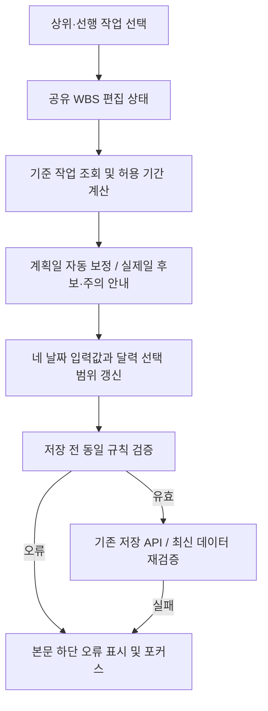

# WBS 등록 오류 포커스 및 관계 기반 날짜 입력·제한 설계

- 작성일: 2026-11-10 (한국시간, Asia/Seoul)
- 상태: 사용자 검토·수정용 설계 초안. 구현은 별도 요청 후 진행한다.
- 이번 작업 범위: 현재 소스 분석, 본 문서 작성, `HISTORY.md` 링크 추가.
- 이번 단계에서는 소스·테스트 코드·DB 스키마·데이터를 수정하지 않는다. 애플리케이션 테스트와 DB 마이그레이션도 실행하지 않는다.
- 분석 기준: 현재 작업 디렉터리의 최신 소스와 기존 미커밋 변경을 포함한다.

## 1. 요구사항

### 1.1 저장 오류에 실제 포커스 이동

프로그램정의 목록의 ‘개발 WBS 등록’으로 열린 모달에서 저장에 실패하면, 모달 본문 하단의 오류 메시지가 보이도록 내부 스크롤을 이동하고 **오류 메시지 요소에 키보드 포커스도 이동**한다.

- 날짜·관계 검증, 권한 거부, 서버 오류, 네트워크 실패를 처리한다.
- 같은 오류로 다시 저장해도 매번 오류 위치로 이동한다.
- 오류가 발생해도 입력값과 관계 선택은 유지한다.
- 모달 밖 화면의 스크롤과 포커스는 변경하지 않는다.
- 필수 입력 누락 등 브라우저 기본 검증으로 `submit`이 발생하지 않는 경우도 별도로 처리한다.

### 1.2 관계 선택과 네 날짜의 연동

| 화면 항목 | 저장 필드 | 현재 필수 여부 |
| --- | --- | --- |
| 계획 시작일 | `startDate` | 필수 |
| 계획 종료일 | `endDate` | 필수 |
| 실제 시작일 | `actualStart` | 선택 |
| 실제 종료일 | `actualEnd` | 선택. 입력 시 실제 시작일 필요 |

요청의 ‘실행 시작일/종료일’은 현재 화면과 저장 모델의 ‘실제 시작일/종료일’로 해석한다. 필드명이나 DB 항목명을 바꾸는 요구는 아니다.

상위 요약 작업과 선행 작업이 바뀌면 네 날짜의 현재 값과 선택 가능한 기간을 다시 계산한다. 계획 날짜에는 관계에 맞는 값을 자동 입력하고, datepicker에서는 허용 기간 밖 날짜를 선택할 수 없게 한다.

**실제 날짜는 현재 서버에서 상위/선행 작업과의 기간 제한을 검사하지 않는다.** 실제일 자동 입력과 관계 제한의 구체적인 기준은 새 업무 규칙이므로, 계획일과 구분해 6절의 제안 및 10절의 결정 사항으로 정리한다. 실제 수행 사실이 없는 날짜를 계획일 복사만으로 저장하지 않는 안을 권장한다.

## 2. 현재 구조와 확인한 문제

### 2.1 프로그램정의 → WBS 등록 → 저장

| 파일 | 현재 동작 및 분석 |
| --- | --- |
| [specifications-page.tsx](../../../components/pages/specifications/specifications-page.tsx) | 프로그램에서 `openCreate('wbs', draft)` 호출. 계획 시작/종료를 한국시간 오늘로 초기화하고 프로그램을 `links`로 연결한다. 상위·선행 관계는 비어 있으며 실제 날짜는 초기 입력하지 않는다. |
| [artifact-dialogs.tsx](../../../components/shared/artifact-dialogs.tsx) | 공통 `ArtifactDialogContent`가 WBS 등록·수정 모달을 표시한다. `ArtifactFields`와 `StructureEditor`를 별도 형제로 렌더링한다. 오류는 본문 하단의 `<p role="alert" className="matrix-error">`에 표시하지만 ref·`tabIndex`·포커스 이동이 없다. |
| [use-artifact-actions.ts](../../../components/shared/use-artifact-actions.ts) | `FormData`의 날짜·`parentId`·`dependencies`를 수집하고 권한 확인 후 공통 산출물 POST/PATCH를 호출한다. 실패하면 문자열 `error`를 저장하고 모달을 유지한다. 저장과 삭제가 같은 오류 상태를 사용한다. |
| [artifact-fields.tsx](../../../components/artifact-fields.tsx) | WBS는 `WbsFields`를 `calendarOnly` 모드로 표시한다. 이전 날짜 스타일 개선이 반영된 상태다. |
| [wbs-fields.tsx](../../../components/pages/wbs/wbs-fields.tsx) | 날짜 등 `fields`를 내부 상태로 관리한다. 마일스톤의 계획/실제 시작·종료일을 같은 날로 맞추는 로직이 있다. 관계 선택 상태는 알지 못한다. |
| [wbs-structure-editor.tsx](../../../components/pages/wbs/wbs-structure-editor.tsx) | 상위는 요약 WBS만, 선행은 요약 이외 WBS만 표시한다. `defaultValue`·`defaultChecked`를 쓰는 비제어 입력으로, 선택 변경을 날짜 상태에 전달하지 않는다. |
| [artifact-field-inputs.tsx](../../../components/shared/artifact-field-inputs.tsx) | 네 날짜를 `WbsDatePicker`로 렌더링한다. 날짜별 허용 범위나 설명을 전달하는 인터페이스가 없다. |
| [wbs-date-picker.tsx](../../../components/pages/wbs/wbs-date-picker.tsx) | 날짜 표시용 읽기 전용 input과 제출용 hidden input, 별도 native dialog 달력을 사용한다. `min`·`max`가 없고 모든 날짜 셀을 선택할 수 있다. 월 이동·방향키 이동에도 범위 제한이 없다. |

달력 스타일은 이미 [wbs-date-picker.css](../../../components/pages/wbs/wbs-date-picker.css)로 분리되어 공통 적용된다. 이번 요구는 스타일 교체보다 **상태 공유, 날짜 범위 계산, 오류 포커스**가 중심이다.

### 2.2 실제 스크롤 위치

[styles/dialog.css](../../../styles/dialog.css)에서 모달 외곽과 form은 `overflow: hidden`, `.admin-detail-body`는 `overflow: auto`다. 따라서 오류를 보여 주려면 모달 본문의 스크롤을 조작해야 한다. 모달 바깥이나 페이지 전체를 스크롤하는 방식은 피한다.

오류 문단은 비활성화되는 입력 `fieldset` 밖에 있으므로 `tabIndex={-1}`을 부여하면 저장 후 포커스를 받을 수 있다.

### 2.3 저장 경로와 현재 검증 규칙

- 공통 등록: [산출물 API](../../../app/api/projects/[projectId]/artifacts/route.ts) → [mutateArtifact()](../../../lib/artifacts.ts) → [prepareStructure()/validateProjectGraph()](../../../lib/artifact-validation.ts).
- WBS 일정 편집: [wbs-task-dialog.tsx](../../../components/pages/wbs/wbs-task-dialog.tsx)에서 편집 중인 일정에 적용한 뒤, [wbs-schedule-server.ts](../../../lib/wbs-schedule-server.ts)의 별도 일괄 저장 경로로 반영한다.

현재 서버의 규칙은 다음과 같다.

1. 상위 작업은 요약 유형이어야 하며 자기 자신을 지정할 수 없다.
2. 선행 작업은 일반 작업 또는 마일스톤이어야 하며 자기 자신을 지정할 수 없다.
3. 상위 관계와 선행 관계 각각의 순환을 거부한다.
4. 계획 시작일 ≤ 계획 종료일이어야 한다.
5. 하위 계획 기간은 상위 요약 작업의 계획 기간 안에 있어야 한다.
6. 각 선행 작업의 계획 종료일 ≤ 현재 작업의 계획 시작일이어야 한다. **같은 날 시작을 허용한다.**
7. 실제 종료일이 있으면 실제 시작일이 필요하고, 실제 시작일 ≤ 실제 종료일이어야 한다.
8. 실제일과 상위 실제 기간·선행 실제 종료일의 관계, 실제일과 계획 기간의 포함 관계는 현재 검사하지 않는다.
9. 마일스톤은 계획 시작/종료가 같고 계획 공수 0, 진척률 0 또는 100이어야 한다. 화면은 실제 시작/종료도 같은 날짜로 동기화한다.
10. 요약 작업에는 산출물 연결과 선행 작업을 직접 배정하지 않는다. 프로그램에서 자동 연결한 항목도 보존·검증해야 한다.

WBS 일괄 저장은 [aggregateSchedule()](../../../lib/wbs-schedule.ts)로 하위 작업의 계획 기간·공수·진척률을 상위 요약에 집계한 후 검증한다. 공통 등록 API는 같은 자동 집계 흐름을 사용하지 않는다. 등록 모달의 상위 기간 제한을 이유로 기존 차트 드래그·일괄 저장의 집계 규칙까지 함께 바꾸지 않는다.

## 3. 범위와 수정 원칙

- 필수 적용 범위는 프로그램정의에서 여는 공통 WBS 등록 모달이다. 공통 WBS 수정에서도 동일한 날짜 컴포넌트를 사용하므로 기존 값 보존과 기존 데이터의 범위 위반 표시를 함께 설계한다.
- 다른 종류의 산출물, 삭제 모달, 프로젝트 생성 화면에 오류 포커스를 일괄 적용하지 않는다. 범위 확장은 결정 사항으로 둔다.
- datepicker 공통 컴포넌트에는 선택적인 범위 입력을 추가한다. 범위를 전달하지 않는 다른 사용처는 현재 선택 동작을 유지한다.
- WBS 일정 작업 편집에도 같은 관계 제한을 적용할지는 별도 확정한다. 공통 상태 구조를 재사용하더라도 차트의 자동 상위 집계는 유지한다.
- 참조 작업은 현재 프로젝트의 WBS만 사용한다. 선택한 상위·선행 작업 자체의 날짜를 자동 수정하거나 프로그램 연결을 해제하지 않는다.
- 날짜는 `YYYY-MM-DD`의 달력 날짜로 처리하고 기존 `scheduleDay()`·`scheduleDate()`를 사용한다. 한국시간 오늘은 기본값에만 사용하며 선택 가능한 최솟값으로 강제하지 않는다.

## 4. 날짜와 관계를 한 상태에서 관리

현재 날짜와 관계가 서로 다른 컴포넌트에 저장되어 있으므로, CSS나 DOM 조회만으로 연결하지 않는다.

권장안은 WBS 전용 편집 상태를 form 단위로 만드는 것이다. 신규 `wbs-form-state.tsx` 또는 동등한 공통 폼 상태 모듈에서 다음을 관리한다.

| 상태 | 목적 |
| --- | --- |
| `fields` | 계획/실제 날짜, 작업 유형 등 기존 입력값 |
| `parentId`, `dependencies` | 선택한 상위·선행 관계 |
| 날짜의 출처·수정 여부 | 초기값·자동 계산값·직접 지정값을 구분하여 불필요한 덮어쓰기 방지 |
| 날짜별 `min`·`max` | 네 datepicker의 범위 |
| `constraintError`, `warnings` | 선택 가능한 기간 없음, 실제 기준 부족, 기존 값 범위 위반 등 |
| 편집 세션 식별 | 다른 WBS·다른 프로그램의 신규 등록으로 전환할 때 이전 상태 유입 방지 |

`ArtifactDialogContent`의 WBS 필드와 관계 입력을 동일한 상태 제공 범위로 감싸고, `WbsFields`와 `WbsStructureEditor`가 값을 읽고 변경하도록 한다. 네이티브 입력의 `defaultValue`·`defaultChecked`는 제어 상태로 전환한다. 일반 산출물 경로는 유지한다.



폼 제출용 이름은 `startDate`, `endDate`, `actualStart`, `actualEnd`, `parentId`, `dependencies`를 유지한다. 날짜별 hidden input과 관계 입력이 중복 제출되지 않도록 한다.

달력 클릭과 자동 보정은 hidden input의 값만 바꾸므로 폼의 일반 `onChange`에 의존하지 않는다. 공유 상태의 변경 함수에서 `onDirtyChange` 또는 동등한 수정 상태 통지를 명시적으로 호출해 미저장 변경 경고를 유지한다. 단순 초기화·허용 범위 계산만으로는 사용자 수정 상태를 만들지 않는다.

## 5. 저장 오류 포커스 설계

### 5.1 오류 상태와 재시도 식별

`useArtifactActions`에 저장 실패 발생을 구분하는 카운터 또는 저장 시도 식별자를 추가하는 안을 권장한다. 삭제 오류와 구분하여 **저장 실패 때만** 증가시킨다.

오류 문자열만 effect 의존성으로 사용하면 동일한 메시지의 반복 실패를 안정적으로 식별하기 어렵다. 실패 식별자와 편집 세션을 함께 확인하여 매 저장 실패마다 동작하도록 한다. 실패 당시 모달이 닫혔거나 다른 편집으로 바뀌었다면 포커스를 이동하지 않는다.

새 클라이언트 날짜 검증과 기존 API 실패가 같은 하단 오류 표시 경로를 사용하도록 오류 전달 계약도 정리한다. 예를 들어 공통 저장 오류 보고 함수를 두되, 실제 이름은 구현 시 확정한다.

### 5.2 포커스와 스크롤 순서

1. 오류 메시지를 현재 위치인 본문 하단에 렌더링한다. `role="alert"`를 유지하고 `ref`, `tabIndex={-1}`, 안정적인 오류 ID를 추가한다.
2. 저장 처리 종료와 DOM 반영 후, 현재 WBS 모달이 열려 있는지 확인한다.
3. 오류 요소에 `focus({ preventScroll: true })`를 적용한다.
4. 해당 모달의 `.admin-detail-body`만 스크롤하여 오류가 본문 안에 보이도록 조정한다. 긴 오류는 첫 줄부터 읽을 수 있게 정렬한다.
5. 오류 요소의 포커스 표시를 제공하고 닫기·저장 버튼의 키보드 접근을 유지한다.

`scrollIntoView()`만 호출하고 포커스를 저장 버튼에 남겨 두는 처리는 요구를 충족하지 않는다. 메시지 영역에 별도 일반 탭 순서를 추가하지 않고, 실패 시에만 프로그램 방식으로 포커스를 준다.

### 5.3 필수 입력 누락과 로컬 검증

- 제목 등 네이티브 검증 실패는 `submit` 전에 발생한다. WBS form의 `onInvalidCapture` 등으로 오류를 수집하고 기본 툴팁/자동 포커스와 충돌하지 않게 하단 오류로 연결한다.
- 다른 산출물의 기본 검증은 유지한다. 공통 form 전체에 무조건 `noValidate`를 적용하지 않는다.
- datepicker의 읽기 전용 표시 input·hidden input만으로 날짜 필수 검증이 보장된다고 가정하지 않는다. 저장 전에 필수 날짜, 허용 범위, 시작/종료 순서, 관계 충돌을 명시적으로 검사한다.
- 허용 구간이 없으면 날짜 선택을 막고 이유를 보여 준다. 저장 시에는 API를 호출하지 않고 동일한 하단 오류·포커스 경로로 안내한다. 관계 선택 직후마다 포커스를 강제로 옮기지는 않는다.

## 6. 관계 기반 날짜 계산과 자동 입력

### 6.1 계획 기간의 공통 경계

상위가 선택되었을 때 그 계획 시작/종료를 `Pstart`, `Pend`, 선택한 선행 작업들의 계획 종료일 중 최댓값을 `Dend`라고 한다.

```text
L = max(선택된 상위의 Pstart, 선택된 선행 작업들의 Dend)
U = 선택된 상위의 Pend
```

선택되지 않은 조건은 계산에서 제외한다. 하한 또는 상한이 없으면 `undefined` 등 명시적인 무제한 값으로 취급하며, 실제 날짜 문자열로 가짜 최솟값/최댓값을 저장하지 않는다.

| 관계 상태 | 계획 기간 제한 |
| --- | --- |
| 상위 없음·선행 없음 | 관계에 따른 제한 없음. 시작 ≤ 종료만 검사 |
| 상위만 선택 | `Pstart ≤ 시작 ≤ 종료 ≤ Pend` |
| 선행만 선택 | `max(선행 종료일) ≤ 시작 ≤ 종료` |
| 상위·선행 모두 선택 | `L ≤ 시작 ≤ 종료 ≤ U` |
| `L = U` | 해당 하루만 선택 가능 |
| `L > U` | 가능한 기간 없음. 입력값을 임의 생성하지 않고 충돌 원인을 표시 |

상위가 요약 유형인지, 선행이 일반 작업/마일스톤인지, 자기 자신이나 순환 관계가 없는지도 날짜 계산 전에 확인한다. 편집 화면에서는 자기 하위 항목을 상위로 선택하는 경우 등을 미리 차단하고 서버 검사도 유지한다.

### 6.2 계획일 자동 입력의 권장안

- 신규 등록의 초기 날짜는 관계를 처음 선택했을 때 허용 구간의 가장 이른 날짜로 맞춘다. 오늘이라는 이유로 관계 기간 밖의 값을 유지하지 않는다.
- 현재 기간이 유효하면 날짜 간 차이 `D = endDay - startDay`를 보존하는 안을 권장한다. 하루 작업은 `D=0`이다. 영업일/휴일 달력은 새로 도입하지 않는다.
- 직접 지정한 계획일이 새 허용 구간 안에 있으면 유지한다.
- 구간 밖이면 기간 길이를 보존하는 새 시작·종료를 계산해 함께 자동 입력하고, 어떤 관계 때문에 조정했는지 표시한다. 상한을 넘으면 길이를 유지한 채 더 앞쪽으로 배치할 수 있는지 확인한다.
- 주어진 구간에 기존 기간 길이가 들어가지 않으면 자동으로 작업 기간을 줄이지 않는다. 기존 값을 유지하고 기간 또는 관계를 조정하도록 안내한다. 자동 단축 여부는 결정 사항이다.
- 상위·선행 선택을 해제해 범위가 넓어진 경우에는 이미 유효한 날짜를 초기값으로 되돌리지 않는다.
- 상위·선행 작업의 날짜나 다른 작업의 일정 자체는 자동 변경하지 않는다.
- 마일스톤은 가능한 한 날짜로 계획 시작/종료를 함께 설정한다. 공수·진척률 등 기존 제약도 유지한다.

### 6.3 datepicker별 계획 범위

| 필드 | 최소 선택일 | 최대 선택일 |
| --- | --- | --- |
| 계획 시작일 | `L` | `min(U, 현재 유효한 계획 종료일)` |
| 계획 종료일 | `max(L, 현재 유효한 계획 시작일)` | `U` |

현재 반대편 날짜가 관계 구간 자체를 벗어나 있다면 이를 추가 경계로 사용해 양쪽 달력을 모두 막지 않는다. 관계의 기본 경계부터 적용하고 자동 보정 또는 사용자 수정으로 복구할 수 있게 한다.

### 6.4 실제 날짜: 현재 정책과 제안 구분

실제 날짜는 작업 수행 기록이다. **상위나 선행의 계획일을 현재 작업의 실제 수행일로 복사하는 기본안은 권장하지 않는다.** 신규 작업이 아직 시작되지 않았다면 실제일은 빈 값이 정상일 수 있다.

| 상황 | 권장 제안 |
| --- | --- |
| 신규 작업의 실제일이 비어 있음 | 계획 관계를 고르는 것만으로 실제 수행 기록을 생성하지 않는다. 실제 기준이 있으면 입력 가능한 기간과 후보를 안내하고, 사용자가 실제 수행일 적용을 명시적으로 확정하도록 한다. |
| 상위·선행에 실제 날짜가 충분히 있음 | 상위 실제 시작일과 모든 선행 실제 종료일의 최댓값을 실제 시작의 하한 후보로, 상위 실제 종료일을 상한 후보로 계산한다. 이 관계 제한을 실제 저장 규칙으로 채택할지는 10절에서 확정한다. |
| 선행 중 실제 종료일이 비어 있음 | ‘실제 기준 미확정’으로 표시한다. 계획 종료일이나 오늘로 대체하여 선행이 완료된 것으로 취급하지 않는다. 실제일 자동 입력은 보류하고 기존 실제일은 보존한다. |
| 상위 실제 시작/종료 중 일부가 없음 | 확인된 경계와 없는 경계를 구분해 표시한다. 완전한 실제 기간으로 표현하지 않는다. 미확정 기준에서 강제 제한을 걸지는 별도 결정한다. |
| 이미 실제일이 입력되어 있음 | 참조 관계 변경으로 실적을 자동 이동·삭제하지 않는다. 확정된 실제 정책에 어긋나면 충돌 이유와 수정 필요를 표시한다. |
| 실제 종료일만 입력하려 함 | 실제 시작일 입력을 먼저 안내한다. 기존 서버 규칙 유지. |

실제 관계 제한을 채택하면 공통 하한/상한을 `AL`, `AU`라고 할 때 실제 시작은 `[AL, min(AU, 실제 종료일)]`, 실제 종료는 `[max(AL, 실제 시작일), AU]`로 제한한다. 실제 종료가 없는 진행 중 작업도 허용한다.

실제 날짜를 계획 기간 안에 반드시 가두는 정책은 별도 결정이 필요하다. 계획보다 빠른 착수나 지연 완료를 기록해야 하는 경우까지 고려해야 한다. 실제 종료일 후보를 만들 근거가 없다면 기간 길이를 계획에서 복사해 완료 사실을 생성하지 않는다.

마일스톤의 실제 날짜를 사용자가 입력·적용하면 기존처럼 실제 시작/종료를 같은 날로 동기화한다. 실제일을 모두 비우는 선택도 유지한다.

### 6.5 사용자 예시의 처리

| 기준 | 예시 값 |
| --- | --- |
| 등록 작업 | 회원 조회 화면 개발 |
| 상위 요약 | 회원 관리 개발: 계획 2026-11-10 ~ 2026-11-30 |
| 선행 작업 | 회원 조회 API 개발: 계획 종료 2026-11-12 |
| 계획 허용 구간 | 2026-11-12 ~ 2026-11-30 |
| 신규 하루 작업의 자동 입력 | 계획 시작/종료 모두 2026-11-12 |
| 사용자가 3일 작업으로 지정 | 계획 시작 2026-11-12, 종료 2026-11-14. 구간 내 선택 허용 |
| 선행이 둘이고 다른 작업의 종료가 11-15 | 하한을 11-15로 다시 계산 |
| 선행 종료가 12-01로 상위 종료보다 늦음 | 가능한 기간 없음. 관계나 기준 일정을 조정하도록 안내 |
| 실제 기준 정보 없음 | 실제일은 빈 값 유지, 실제 기준 미확정 안내. 계획일을 실제일로 자동 복사하지 않음 |

동일 날짜 착수를 허용하므로 선행 종료 11-12에 자동으로 하루를 더해 11-13부터 제한하지 않는다.

## 7. datepicker와 서버의 수정 방향

### 7.1 달력의 허용 기간 표시·선택

- `WbsDatePicker`에 선택적인 `min`, `max`, 입력 ID와 범위 설명 연결을 추가한다. `ArtifactFieldInputs`에서 날짜별 제약을 전달한다.
- 범위 밖 날짜는 네이티브 `disabled`와 시각적 구분을 적용한다. 마우스 클릭·키보드 Enter/Space·방향키·월 이동에서 동일한 선택 규칙을 사용한다.
- 클릭 핸들러도 범위를 재확인한다. 비활성 스타일만으로 선택 금지를 구현하지 않는다.
- 방향키 이동은 경계를 넘지 않게 하고, 이전/다음 달에 선택 가능한 날짜가 전혀 없으면 해당 월 이동을 막는다. 범위 중간의 월·윤년·연도 전환도 지원한다.
- 달력 최초 표시 월은 현재 유효한 선택값 또는 가장 가까운 허용 날짜를 따른다. 기존 값이 범위 밖이어도 해당 값을 숨기거나 로딩 중 조용히 저장하지 않는다.
- 범위가 없거나 선택 가능한 기간이 없으면 설명을 표시하고 날짜 선택을 막되 닫기는 가능하게 한다.
- 필수 계획 날짜의 지우기는 제공하지 않는다. 선택 실제 날짜의 지우기는 유지한다. 실제 시작을 지울 때 종료만 남는 상태의 처리도 공통 검증과 일치시킨다.
- `label`의 `htmlFor`와 실제 표시 input의 ID를 연결하고, 범위·오류 설명을 `aria-describedby` 등으로 제공한다.
- 기존 공통 스타일과 nested dialog의 닫기 후 원래 달력 버튼으로 돌아가는 포커스 동작을 유지한다.

### 7.2 검증 계산의 재사용과 저장 시 재확인

신규 순수 계산 모듈(예: `lib/wbs-date-constraints.ts`)에 관계 참조·허용 구간·유효성 판단을 모은다. 브라우저와 서버가 같은 날짜 경계와 동일 날짜 허용 규칙을 사용하도록 한다. 자동 입력과 실적 변경 같은 UI 정책은 검증 함수와 분리한다.

- 계획 관계는 기존 서버 검증을 유지하고 공통 계산과 일치시킨다.
- 실제 관계 제한을 채택할 경우에는 `prepareStructure()`·`validateProjectGraph()` 등 서버 검증에도 같은 정책을 반영한다. 달력만 제한하고 직접 API 호출을 허용하는 상태로 두지 않는다.
- 서버는 저장 트랜잭션에서 최신 프로젝트 데이터를 읽어 다시 검증한다. UI가 표시한 과거 범위만 신뢰하지 않는다.
- 다른 사용자가 상위·선행 일정을 변경하여 저장이 거부되면 입력값을 유지하고 하단 오류로 포커스를 이동한다. 필요하면 기준 작업만 다시 조회하여 범위를 갱신하고 현재 입력과의 충돌을 표시한다.
- 부모·선행 버전을 요청에 추가해 409를 명시하는 확장 여부는 별도 결정한다. 기본안은 기존 요청 형식과 현재 서버 검증을 우선 재사용한다.
- WBS 일괄 저장의 요약 집계 이후 검증 순서를 보존한다. 공통 등록의 현재 상위 기간과 일괄 저장의 재집계된 상위 기간을 혼동하지 않는다.

## 8. 변경 대상 파일과 영향 범위

아래는 후속 구현의 예상 대상이다. 이번 단계의 실제 변경 대상은 본 문서와 `HISTORY.md`뿐이다.

| 파일 | 예상 변경·확인 내용 |
| --- | --- |
| `components/shared/artifact-dialogs.tsx` | WBS 상태 제공 범위, 하단 오류 ref/ID/tabIndex, 모달 내부 스크롤·실패별 포커스, 네이티브 invalid 처리, 편집 세션 확인 |
| `components/shared/use-artifact-actions.ts` | 저장 실패 식별과 오류 전달 계약, 로컬 검증 연결. 기존 권한 확인·입력 보존·저장/삭제 분리 유지 |
| `components/pages/wbs/wbs-form-state.tsx` 등 신규 폼 상태 모듈 | 날짜와 관계의 공통 상태, 자동 보정·제약 계산·수정 상태 통지 |
| `components/pages/wbs/wbs-fields.tsx` | 공유 상태 연결, 날짜 출처 관리, 기존 마일스톤 동기화 유지 |
| `components/pages/wbs/wbs-structure-editor.tsx` | 제어 입력, 관계 변경 통지, 기준 기간·충돌·미확정 실제 정보 안내 |
| `components/shared/artifact-field-inputs.tsx` | 날짜별 min/max·ID·설명 전달. 다른 산출물 경로 유지 |
| `components/pages/wbs/wbs-date-picker.tsx` | 허용 기간·날짜/월/키보드 이동 제한, 선택 전 재검증, 접근성 |
| `components/pages/wbs/wbs-date-picker.css` | 범위 밖 날짜·사용 불가 월 이동·선택 불가 안내 스타일 |
| `styles/dialog.css` 또는 WBS 범위 스타일 | 오류 포커스 가시성·본문 스크롤 여백. 공통 모달 외형 변경 최소화 |
| `lib/wbs-date-constraints.ts` 등 신규 순수 모듈 | 계획·확정된 실제 정책의 허용 기간 계산 및 유효성 판단 |
| `lib/artifact-validation.ts` | 공통 계산과 기존 검사 정합성, 실제 관계 정책 확정 시 서버 검사 추가 |
| `lib/artifacts.ts` | 공통 저장의 최신 참조 검사와 오류 전달 확인. 기본 요청/데이터 구조 유지 가능 여부 검토 |
| `components/pages/wbs/wbs-task-dialog.tsx` | 공용 상태 구조 변경에 따른 호환성 확인. 관계 제한·오류 포커스 확대 적용은 결정 후 반영 |
| `components/pages/wbs/use-wbs-schedule.ts`, `lib/wbs-schedule.ts`, `lib/wbs-schedule-server.ts` | 기존 미저장 초안·요약 집계·공수·진척률·일괄 저장 회귀 확인 |
| `components/pages/specifications/specifications-page.tsx` | 오늘 초기값과 연결 프로그램 유지 확인. 필요 시 초기값 출처를 전달 |
| 관련 WBS·브라우저 검증 스크립트 | 오류 포커스, 날짜 계산·선택 제한·서버 재검증 검증 추가 |

기존 `parentId`, `dependencies`, 날짜 필드로 저장 가능하므로 기본안은 DB 컬럼·테이블 추가나 기존 데이터 일괄 보정을 요구하지 않는다. 실제 정책을 강화하면 기존 실적 중 새 규칙에 어긋나는 데이터를 어떻게 수정·보존할지도 먼저 결정해야 한다. 과거 데이터를 자동 변경하는 마이그레이션은 기본안에 포함하지 않는다.

## 9. 검증 방법

후속 구현에서 다음을 검증한다. 이번 문서 단계에서는 실행하지 않는다.

| 구분 | 검증 시나리오와 기대 결과 |
| --- | --- |
| 저장 오류 포커스 | 긴 모달의 위·중간·아래에서 저장 실패. `document.activeElement`가 하단 오류이고 오류가 본문 안에 보이며 페이지 외부 스크롤은 유지 |
| 반복 실패 | 같은 메시지로 연속 실패해도 각 시도마다 오류로 포커스 이동 |
| 오류 종류 | 권한 거부·400 검증 오류·409 최신 데이터 충돌·500·네트워크 오류·클라이언트 날짜 오류 처리 |
| 네이티브 검증 | 제목·필수 날짜 누락 시 서버 요청 없이 하단 오류에 포커스. 다른 산출물의 기본 검증은 유지 |
| 입력 보존 | 오류 후 날짜·제목·상위·선행·프로그램 연결·기타 입력 보존 |
| 포커스 범위 | 성공·단순 모달 열기·관계 선택만으로 오류 포커스를 강제하지 않음. 닫힌 세션·삭제 모달·다른 산출물로 포커스 유출 없음 |
| 관계 조합 | 상위만·선행만·둘 다·선택 없음. 선행 여러 개의 최댓값을 정확히 사용 |
| 경계 날짜 | 상위 시작/종료, 선행 종료 당일 허용. 하루 차이로 벗어나는 값 차단. `L=U` 하루 허용, `L>U` 선택 불가·저장 오류 |
| 자동 입력 | 초기값 보정, 유효한 직접 지정값 유지, 기간 길이 보존, 기간이 들어가지 않는 경우 안내, 선택 해제 후 불필요한 초기화 없음 |
| 실제 날짜 | 기준 충분/일부 부족/전체 없음, 진행 중 종료 공란, 실제 종료만 입력, 기존 실적 보존. 실제 정책 확정 후 네 날짜 범위와 서버 결과 일치 |
| 마일스톤·요약 | 계획/실제 동일 날짜 동기화, 요약의 산출물/선행 금지, 하위 작업이 있는 요약의 유형 변경 제한 회귀 |
| 키보드·달력 | 날짜 클릭·Enter·Space·방향키·이전/다음 월·윤년·연도 경계에서 범위 밖 선택 불가. required/clear 동작 유지 |
| 우회·동시 수정 | hidden input·직접 API 요청으로 잘못된 날짜를 보내도 서버가 거부. 참조 기간 변경 후 오래된 화면에서 저장하면 오류와 입력 보존 |
| 관계 무결성 | 자기 자신·다른 프로젝트·잘못된 유형·삭제된 참조·상위/선행 순환 거부 |
| 수정 상태 | 달력 선택과 자동 보정 후 미저장 변경 경고가 작동하고, 단순 열기/닫기는 불필요한 경고를 만들지 않음 |
| 기존 일정 편집 | WBS 탭 날짜 스타일, 미저장 초안, 드래그·요약 집계·공수·진척률·일괄 저장·권한 검증 유지 |

검증은 순수 날짜 계산 검사, 실제 API와 격리 SQLite 검사, 실제 모달의 브라우저 검사로 나눈다. 기존 `scripts/test-wbs-view.mjs`와 `scripts/test-wbs-schedule.mjs`의 전제 데이터를 현재 정책에 맞게 확인하고 필요한 범위를 보강한다. TypeScript·변경 파일 ESLint·포맷 검사도 수행한다. 운영 DB나 외부 AI 호출로 검증하지 않는다.

## 10. 결정이 필요한 사항

| 항목 | 권장 기본안 | 결정이 필요한 이유 |
| --- | --- | --- |
| 실제일을 자동 입력할 조건 | 실제 기준이 충분할 때 후보를 제공하고 사용자가 실제 수행일 적용을 명시적으로 확정. 신규 미착수 작업은 빈 값 유지 | 요청은 네 날짜 연동을 포함하나, 관계 선택만으로 수행·완료 사실을 생성할지는 불명확 |
| 실제일의 관계 범위 | 상위 실제 기간·선행 실제 종료를 기준으로 계산하는 안을 제안. 기준 미확정 시 자동 입력 보류 | 현재 서버에는 실제일 관계 제한이 없으며, 상위 실제일이 사후 입력되는 업무도 있음 |
| 실제일을 계획 기간 안으로 제한할지 | 계획 기간으로 강제 제한하지 않음 | 조기 착수·지연 완료 등 실적 기록을 보존해야 함 |
| 미완료 선행이 있을 때 실제 시작 입력 | 계획일 대체나 자동 확정은 하지 않음. 실제 입력까지 막을지는 업무 정책 확정 | 계획상 순서와 실제 수행 상태의 강제 통제는 서로 다른 기능 |
| 수동 계획일의 자동 변경 | 유효한 값은 유지. 범위 밖이면 길이를 보존해 조정하고 변경 이유 표시 | 모든 관계 선택 때 무조건 earliest로 덮어쓰면 사용자의 일정 의도가 사라짐 |
| 기존 기간이 허용 구간보다 긴 경우 | 자동 단축하지 않고 기간/관계 수정 안내 | 기간 단축은 작업 계획 자체를 바꾸는 결정 |
| 오류 포커스 적용 범위 | 공통 WBS 등록·수정 모달부터 적용 | 다른 산출물·삭제 모달·WBS 일정 작업 편집의 오류 표시 위치는 별도 검토 필요 |
| WBS 일정 편집의 관계 제한 | 공용 컴포넌트 호환성은 유지. 같은 제한을 켤지 별도 확정 | 차트 일괄 저장은 상위 기간을 자동 집계하므로 등록과 의미가 다를 수 있음 |
| 기존 데이터가 새 실제 정책에 어긋남 | 자동 보정하지 않음. 수정 시 안내·적용 기준 결정 | 저장 정책 강화가 과거 실적 수정을 강제할 수 있음 |
| 기준 작업 동시 변경 | 저장 시 최신 서버 검증 유지. 입력을 보존하고 기준 재확인 안내 | 참조 버전까지 요청에 넣어 별도 409로 다룰지는 API 확장 선택 |

이 표의 권장안은 검토를 위한 제안이다. 사용자가 문서를 수정한 후 구현을 요청하면 최신 문서의 확정 내용을 우선 적용한다.

## 11. 이번 작업의 산출물과 제한

- 산출물: 본 설계 문서와 기존 목록을 보존한 `HISTORY.md`의 작성일·상대 경로 링크.
- 소스·테스트·DB 수정, 애플리케이션 테스트, DB 연결·마이그레이션은 수행하지 않는다.
- 비밀번호·API 키·토큰 등 민감정보는 문서에 기록하지 않는다.
