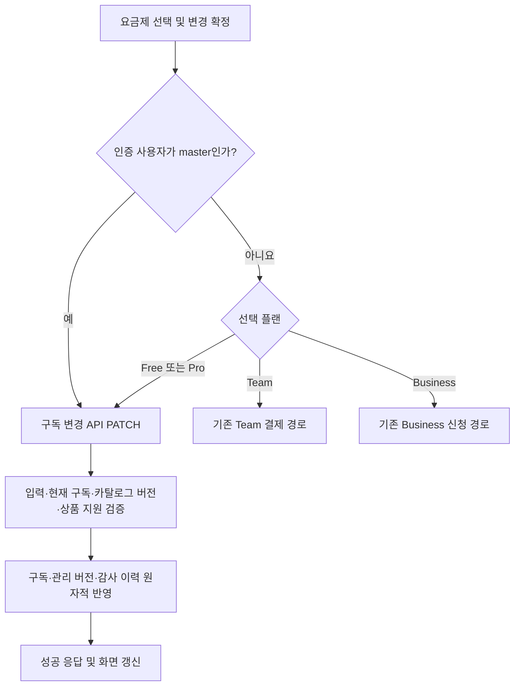

# master 플랜 변경 즉시 반영 분석 및 설계

- 작성일: 2026-11-10 (한국시간, Asia/Seoul)
- 상태: 검토용 설계 초안. 사용자 검토·수정 후 별도 구현 요청 시 반영한다.
- 작업 범위: 현재 소스 분석, 본 문서 작성, `HISTORY.md` 링크 추가.
- 이번 단계에서는 애플리케이션 소스, 테스트 코드, DB 스키마·데이터를 수정하지 않는다. 마이그레이션과 DB 연결이 필요한 실행도 하지 않는다.
- 분석 기준: 현재 작업 디렉터리의 소스. 기존 미커밋 변경과 신규 파일을 포함해 확인했으며, 이전 설계 문서의 변경 전 설명보다 현재 구현을 우선한다.

## 1. 요구사항

`users.account_role = 'master'`인 계정이 본인의 요금제를 변경할 때 승인 대기 없이 즉시 반영되도록 한다. 소스에서 이 값은 인증된 `User.accountRole`로 매핑된다. 클라이언트가 보낸 권한 문자열이나 워크스페이스의 `role`로 master 여부를 판별하지 않는다.

| 항목 | 설계 기준 |
| --- | --- |
| 대상 | 로그인·온보딩을 완료한 master 본인의 개인 구독 변경 |
| 플랜 범위 | 현재 지원하는 `free`, `pro`, `team`, `business` 모두. 특히 현재 직접 변경이 차단된 Team·Business를 포함 |
| 즉시 반영 | 변경 API의 트랜잭션 커밋 후 성공 응답. 다음 구독 조회와 화면 새로고침에 선택 플랜 표시 |
| 승인 절차 | master 본인의 Business 계약 신청·검토·승인 없이 적용 |
| Team 결제 | master는 결제 주문·외부 결제·결제 확인을 거치지 않고 적용하는 안을 제안. ‘승인 생략’에 결제도 포함하는지는 8절 검토 사항 |
| 계정 역할 | Team·Business로 변경해도 `master`를 유지. `team_admin`·`biz_admin`으로 바꾸지 않음 |
| 다른 계정 | 일반 사용자·상품 관리자·게스트의 기존 정책 유지. 다른 회원의 플랜을 변경하는 기능으로 확장하지 않음 |
| 안전장치 | 인증, Origin, 입력 검증, 최신 플랜 버전 확인, 감사 이력, 트랜잭션 유지 |

이 문서의 기본안에서 ‘플랜 변경’은 `user_subscriptions`의 변경이다. 기존 워크스페이스 자체의 플랜까지 변경하는지는 별도 결정이 필요하다. 이 차이는 3절과 8절에 명시한다.

## 2. 현재 구조

### 2.1 화면과 API 흐름

| 위치 | 현재 동작 | 이번 요구와의 관계 |
| --- | --- | --- |
| [요금제 페이지](../../../app/(workspace)/settings/subscription/page.tsx) | `requireUser({ allowPlanMismatch: true })`로 인증하고 개인 구독·전체 플랜·사용량을 조회. `SubscriptionPlans`에 `user` 전달 | master 판별에 필요한 인증 사용자 정보가 이미 화면에 전달됨 |
| [SubscriptionPlans](../../../components/subscription-plans.tsx) | 플랜 선택 후 확인 모달. Business는 `/api/me/business-requests` POST, Team은 `/api/me/payments/team/orders` POST, Free·Pro는 `/api/me/subscription` PATCH | 플랜 코드별 분기 앞에 master 전용 직접 변경 분기가 필요 |
| [구독 변경 API](../../../app/api/me/subscription/route.ts) | `plan`, `currentPlan`, `planVersion`만 허용. Team 요청은 `TEAM_PAYMENT_REQUIRED`, Business 요청은 `BUSINESS_REQUEST_REQUIRED`로 409 반환 | 현재 master도 같은 차단을 받음. UI만 바꿔서는 즉시 반영 불가 |
| [SubscriptionRequests](../../../components/subscription-requests.tsx) | Business 신청 목록과 Team 결제 서비스 안내를 조회·표시 | 현재 master에게도 결제·신청 안내가 표시되어 즉시 변경 안내와 충돌할 수 있음 |

Free·Pro는 현재도 승인이나 실제 청구 없이 직접 변경된다. 따라서 이번 변경의 핵심은 master의 Team·Business 선택을 직접 변경 경로로 연결하는 것이다.

### 2.2 구독 변경 트랜잭션

현재 `PATCH /api/me/subscription`은 다음 순서로 처리한다.

1. Origin과 로그인 사용자 확인. 플랜 불일치 상태에서도 복구를 위해 접근을 허용한다.
2. 입력 키·지원 플랜 코드·양의 정수 `planVersion`을 검사한다. 요청에 `userId` 등을 추가하면 거부한다.
3. Team·Business는 사용자 역할과 관계없이 트랜잭션 진입 전에 409로 차단한다.
4. 쓰기 트랜잭션에서 현재 구독의 `product_id`가 있으면 개인 플랜 변경을 차단한다.
5. `memberPlan()`과 `listPlans()`를 읽어 `currentPlan` 및 대상 플랜 카탈로그 `version`을 비교한다. `planVersion`은 사용자 구독 버전이 아니다.
6. 실제 플랜이 달라지면 `user_subscriptions.plan_code`, `billing_cycle`, `updated_by`, `updated_at`을 갱신하고 `users.management_version`을 증가시킨다.
7. `plan_change_logs`에 변경 전후를 저장한다. 현재 `after_json`에는 `paymentMode: 'none'`이 포함된다.
8. 커밋 후 `{ ok: true, plan: target }`을 반환한다. 검증을 통과한 동일 플랜 요청은 추가 갱신·이력 없이 성공한다.

### 2.3 Business 신청과 Team 결제

- [Business 신청 서비스](../../../lib/business-requests.ts)의 `submitBusinessRequest()`는 신청과 master 대상 알림을 같은 트랜잭션에 저장한다. 진행 상태는 `submitted → reviewing → contracting → approved`이며 거절·철회도 지원한다.
- 현재 Business 승인 처리는 상품·계약 연결과 이벤트 기록을 수행하며, 신청자의 구독이나 계정 역할을 자동 변경하지 않는다. 따라서 master 신청을 자동 승인하는 방식으로 바꾸는 것만으로는 이번 요구를 충족하지 못한다.
- [Team 결제 서비스](../../../lib/team-payments.ts)의 `createTeamOrder()`는 결제 어댑터를 요구하고, 새 상품 구매는 `accountRole === 'user'`인 계정에 한정한다. master는 현재 정상 구매 대상도 아니다.
- 검증된 Team 결제 성공 시에는 상품·계약을 생성하거나 갱신하고 `grantMember()`를 통해 구매자의 상품 소속·구독·`team_admin` 역할을 반영한다.
- [상품 소속 부여 서비스](../../../lib/plan-products.ts)의 `grantMember()`는 master를 상품 관리자나 일반 지원 회원으로 등록하는 것을 허용하지 않는다. 이를 재사용하려고 master 보호를 완화하면 변경 범위가 커진다.

### 2.4 권한과 DB 제약

- [인증 코드](../../../lib/auth.ts)의 `userSelect`와 `toUser()`가 `users.account_role`을 `User.accountRole`로 변환한다. `currentUser()`는 세션을 바탕으로 DB의 현재 사용자·워크스페이스 정보를 조회한다.
- [계정·플랜 타입](../../../lib/plan-types.ts)은 현재 `master`, `admin`, `user`, `guest`, `biz_admin`, `team_admin`을 구분한다. `isPlatformAdmin()`은 master만 허용한다.
- [041 마이그레이션](../../../db/migrations/041_product_administration.sql)은 master 단일 계정 제약, 삭제 금지, 역할·이메일·이름 변경 금지 트리거를 유지한다. master를 상품 관리자 역할로 바꾸는 경로는 이 제약과도 충돌한다.
- `user_subscriptions.product_id`는 nullable이며, 현재 소스와 스키마에는 Team·Business 구독이 반드시 개별 상품을 가져야 한다는 일반 제약은 없다. 단, 상품이 연결된 워크스페이스에서는 별도의 상품 일치·활성·소속 검증을 수행한다.

## 3. 영향 범위: 개인 구독과 워크스페이스 플랜

개인 구독을 변경해도 기존 워크스페이스의 플랜은 자동 변경되지 않는다. 이는 [040 마이그레이션](../../../db/migrations/040_workspace_plan_policy.sql)과 현재 정책 테스트가 명시적으로 유지하는 동작이다.

[workspacePlan()](../../../lib/plans.ts)은 다음을 확인한다.

1. 사용자가 해당 워크스페이스의 회원인지 확인한다.
2. 개인 `plan_code`와 워크스페이스 `plan`이 정확히 일치하는지 확인한다. 상위 플랜이라는 이유로 통과하지 않는다.
3. 개인 구독과 워크스페이스의 `product_id`도 일치하는지 확인한다.
4. 상품이 연결되어 있으면 상품·계약의 유효성과 활성 상품 소속을 추가 확인한다.

현재 이 검사에는 master의 일반 면제 조건이 없다. 기본 `requireUser()`와 프로젝트·쿼터 정책도 이 흐름을 사용한다. [WorkspacePlanGuard](../../../components/workspace-plan-guard.tsx)는 불일치 시 업무 화면을 막고 요금제 변경으로 안내한다. 요금제 화면·워크스페이스 전환/생성 등 복구 경로는 접근할 수 있다.

예를 들어 master가 Free 워크스페이스에서 Business로 직접 변경하면 **개인 구독은 즉시 Business가 되지만, 기존 Free 공간의 업무 접근에는 플랜 불일치가 발생한다.** Business 구독과 `product_id=NULL` 상태에서 새로 만든 공간은 현행 생성 트리거에 따라 Business·`product_id=NULL`을 갖는다. 기존 Free 공간을 다시 사용하려면 개인 구독을 Free로 되돌리는 등의 복구가 필요하다.

기본안은 이 정책을 유지한다. 현재 공간까지 즉시 다른 플랜으로 전환하는 요구라면, 소유자 외 회원의 이용 조건·생성 시점 정책·상품 연결 불변성까지 포함한 추가 설계가 필요하다. 플랜 변경 예외를 이유로 master의 전체 워크스페이스 검사를 해제하지 않는다.

## 4. 수정 방향

### 4.1 권장하는 처리 흐름



서버에서는 master가 아닌 Team·Business PATCH를 계속 거부한다. 위 흐름의 master 여부는 서버가 매 요청마다 별도로 검증하며, 화면 분기는 사용자 경험을 위한 처리다.

### 4.2 서버: master만 직접 변경 허용

`app/api/me/subscription/route.ts`의 기존 PATCH를 확장한다. 새 전용 API나 클라이언트 권한 플래그는 추가하지 않는 안을 권장한다.

- 인증 결과의 `user.accountRole === 'master'`를 사용한다. `admin`·`biz_admin`·`team_admin`, 워크스페이스 owner/admin에게 같은 예외를 주지 않는다.
- Team·Business의 기존 409 차단을 **비master에게만 적용**한다. 입력 검증과 버전 검증을 건너뛰지 않는다.
- 기존 쓰기 트랜잭션과 대상 사용자 `user.id` 조건을 재사용한다. 요청 본문 규격은 `{ plan, currentPlan, planVersion }`을 유지한다.
- master의 직접 변경은 개인 구독만 갱신한다. 상품·계약·상품 회원·결제 주문/이벤트·Business 신청·알림을 새로 만들지 않는다.
- `users.account_role`은 변경하지 않는다. `management_version`은 실제 플랜이 변경된 경우에만 1 증가시킨다.
- 기본안은 기존 저장 규칙을 따라 Business의 `billing_cycle`은 `contract`, 다른 플랜은 `monthly`로 저장한다. 이 값은 주기 분류이며 실제 계약이나 청구가 생성되었다는 뜻으로 표시하지 않는다. 월/연 표시 토글을 새 청구 입력으로 확장하지 않는다.
- 기존 `product_id`가 존재하는 경우에는 현행 409 보호를 유지한다. 현재 정상 상품 부여 경로로 master가 상품 소속이 될 수는 없지만, 과거 데이터가 있다면 이를 자동 분리하거나 계약을 종료하지 않는다. 이 예외 데이터의 처리는 8절에서 결정한다.
- 실제 변경 시 기존 `plan_change_logs`에 기록하되 master 경로는 `after_json`의 `changeMode: 'master_direct'`, `paymentMode: 'none'` 같은 JSON 필드로 구분하는 안을 권장한다. 스키마 변경 없이 기록 가능하다.
- 검증된 동일 플랜 재선택은 기존처럼 성공하되 구독 갱신·관리 버전 증가·이력 추가를 하지 않는다. 오래된 `currentPlan`·카탈로그 버전이면 master도 409를 받는다.
- 감사 이력 저장을 포함한 어떤 쓰기라도 실패하면 전체 롤백한다. 성공 응답은 커밋 이후 반환한다.

### 4.3 화면: 결제·신청 분기보다 master 분기를 우선

`components/subscription-plans.tsx`에서 다음을 변경한다.

1. 이미 전달되는 `user.accountRole`로 master 여부를 계산한다.
2. `changePlan()`의 Business 신청과 Team 결제 분기를 비master에게만 적용한다. master는 선택 플랜과 관계없이 기존 PATCH 경로를 사용한다.
3. master의 안내문은 “승인·결제 없이 선택한 요금제가 즉시 적용됩니다.”로 제안한다. 이는 Team 결제 생략 결정이 확정된 경우의 문구다.
4. master의 확인 모달에는 업체명·연락처·요청 내용 폼과 Team 결제 안내를 표시하지 않는다. 제목은 선택한 플랜으로 변경할지 묻고 확정 버튼은 “즉시 변경”으로 통일한다.
5. 기존 선택·확정 모달은 오조작 방지를 위해 유지하는 안을 권장한다. 이 모달은 관리자 승인 절차가 아니다. 선택 즉시 저장할지는 8절에서 결정한다.
6. 기본안에서는 master에게 `SubscriptionRequests`를 렌더링하지 않아 결제 준비/계약 신청 안내를 숨긴다. 과거 신청 이력을 계속 보여야 한다면 이력과 결제 안내를 분리하는 추가 변경을 검토한다.
7. 성공 시 모달을 닫고 선택을 해제한 뒤 `router.refresh()`로 현재 플랜·사용량·사용자 정보를 다시 반영한다. 현재 워크스페이스와 플랜이 다르면 기존 불일치 안내를 유지한다.
8. 실패 시 기존 플랜을 유지하고 오류를 표시한다. 요청 중 중복 제출 방지와 버튼 비활성화는 유지한다.

### 4.4 데이터와 기존 기능에 미치는 영향

| 구분 | 기본안의 영향 |
| --- | --- |
| `user_subscriptions` | 구현 이후 master가 실제 변경할 때 해당 사용자 행의 플랜·주기·수정자·시각 갱신. `product_id=NULL` 경로 사용 |
| `users` | 실제 변경 시 `management_version` 증가. master 역할·이름·이메일 유지 |
| `plan_change_logs` | 실제 변경 1회당 감사 이력 1건 추가 |
| `plans` | 가격·기능 제한·카탈로그 버전 정책 변경 없음 |
| `workspaces`, 프로젝트·회원 | 기존 플랜·상품 연결·소유권·데이터 유지. 변경 후 일치 조건에 따라 접근 결과가 달라질 수 있음 |
| 사용량·쿼터 | 누적 사용량·예약을 초기화하지 않음. 새 공간의 실제 기능 제한은 해당 공간 플랜을 따름 |
| 상품·계약·결제·신청·알림 | 직접 변경에 따른 신규 생성·승인·상태 전환 없음. 과거 이력 자동 정리 없음 |
| DB 마이그레이션 | 기본안은 새 컬럼·테이블·제약 변경이 필요하지 않음. 기존 마이그레이션을 수정하지 않음 |

위 표는 **후속 구현을 수행한 뒤의 동작**이며 이번 문서 작성 단계에서 실행하는 변경이 아니다.

## 5. 변경 대상 파일

아래는 후속 구현의 예상 변경 범위다. 이번 작업에서는 이 파일들을 수정하지 않는다.

| 파일 | 구분 | 변경·확인 내용 |
| --- | --- | --- |
| `app/api/me/subscription/route.ts` | 필수 변경 | master 직접 변경 허용, 비master 차단 유지, 기존 검증·트랜잭션·로그 유지 및 직접 변경 출처 기록 |
| `components/subscription-plans.tsx` | 필수 변경 | master API 분기, 안내·모달·버튼 문구, 신청·결제 UI 표시 조건 |
| `scripts/test-subscription-change.mjs` | 필수 변경 | master 4개 플랜 전환, 비master 차단, 역할 유지·무청구·중복 이력·롤백 검증. 기존 기대값 보정 |
| `scripts/test-product-administration.mjs` | 회귀 검증 및 필요 시 보강 | 실제 인증·역할·상품 격리·Business 신청·Team 결제 정책 유지, master 직접 경로와의 분리 |
| `scripts/test-product-administration-browser.mjs` | 브라우저 검증 보강 후보 | master Team·Business 선택 시 결제·신청 호출 없이 즉시 변경되는 UI 검증 |
| `scripts/test-workspace-plan-policy.mjs` | 회귀 검증 및 필요 시 보강 | master 변경 후에도 기존 공간 플랜 고정, 불일치와 새 공간 생성·복구 유지 |
| `components/subscription-requests.tsx` | 조건부 변경 | master에게 과거 신청 이력을 남겨야 할 경우 안내/목록 분리. 전체 숨김 기본안이면 수정 불필요 |
| `app/(workspace)/settings/subscription/page.tsx` | 영향 확인 | `user` 전달이 이미 있어 기본안은 수정 불필요. 워크스페이스 정책·안내를 바꾸면 재검토 |
| `lib/auth.ts`, `lib/plans.ts`, `components/workspace-plan-guard.tsx` | 영향 확인 | master 판별·정확한 플랜/상품 일치 검사 유지. 기본안에서 전역 우회 추가 없음 |
| `lib/plan-products.ts`, `lib/team-payments.ts`, `lib/business-requests.ts` | 회귀 확인 | 기존 상품 관리자 부여·결제·계약 신청 정책을 그대로 유지 |
| `db/migrations/020_accounts_and_plans.sql`, `040_workspace_plan_policy.sql`, `041_product_administration.sql` | 제약 확인 | 이번 기본안의 수정 대상 아님. 기존 master 보호·워크스페이스·상품 제약 확인 근거 |

## 6. 검증 방법

### 6.1 서버 및 데이터 검증 시나리오

후속 구현 시 운영 DB와 분리된 임시 SQLite DB에서 검증한다. 현행 구독 단위 테스트는 인증을 모의하므로, master 역할 판별과 워크스페이스 정합성은 실제 인증 로더를 사용하는 통합 테스트로도 확인한다.

| 시나리오 | 기대 결과 |
| --- | --- |
| master의 Free·Pro·Team·Business 간 전환 | 유효한 현재 플랜/대상 버전이면 200, 다음 GET에 대상 플랜 반영 |
| 결제 어댑터가 없는 환경에서 master의 Team 선택 | 직접 PATCH 성공. 결제 서비스 설정이나 외부 요청에 의존하지 않음 |
| master의 Business 선택 | 회사·연락처·신청 승인 없이 반영. 신청·알림·계약 신규 행 없음 |
| 직접 변경의 부수 효과 | master 역할 유지, `management_version` 1 증가, 감사 이력 1건. 상품·소속·결제 관련 행 증가 없음 |
| 동일 플랜 요청 | 유효 버전이면 200. 버전·수정 시각·감사 이력 추가 변경 없음 |
| 오래된 구독 정보 또는 카탈로그 버전 | master도 409. 구독·관리 버전·감사 이력 변화 없음 |
| 다른 대상으로 동시에 변경 | 서로 다른 대상에 동일 `currentPlan`을 보낸 경쟁 요청은 쓰기 트랜잭션으로 직렬화. 먼저 반영된 이후 낡은 요청은 409 |
| 감사 이력 쓰기 실패 주입 | 구독 변경·관리 버전 증가까지 함께 롤백 |
| 비master의 Team·Business 직접 PATCH | 기존 409 및 `TEAM_PAYMENT_REQUIRED`/`BUSINESS_REQUEST_REQUIRED` 유지. 일반 관리자·상품 관리자·owner/admin도 우회 불가 |
| 일반 사용자의 정상 경로 | Free·Pro 직접 변경 유지. Team은 검증된 결제 경로, Business는 신청·알림·계약 경로 유지 |
| 미인증·게스트·다른 Origin | 기존 401/403 거부 유지 |
| `role`, `accountRole`, `userId` 등을 본문에 추가 | 입력 허용 목록 검증으로 400. 다른 회원이나 권한을 지정할 수 없음 |
| 기존 `product_id`가 있는 구독 | 기본안에서는 master도 409. 자동 상품 해제·계약 변경 없음 |
| 기존 워크스페이스와 플랜 불일치 | 개인 구독 변경 자체는 성공. 이후 일반 업무 접근에서 기존 불일치 정책 적용, 복구 화면 접근 가능 |
| 새 워크스페이스 생성 | 변경된 master 구독 플랜과 nullable 상품 값을 반영. 기존 공간·프로젝트는 그대로 유지 |
| 같은 유형이지만 서로 다른 상품 | 상품 ID 일치 및 유효 소속 검사 유지. master 직접 구독으로 타 상품 접근 권한을 얻지 않음 |
| 다운그레이드 | 누적 토큰·이미지 예약·기존 프로젝트·회원·이력 삭제나 초기화 없음 |

현재 `scripts/test-subscription-change.mjs`에는 **일반 사용자의 Team 직접 PATCH가 200이라는 이전 기대값**이 남아 있다. 현재 API는 이를 409로 거부하므로, 구현 시 비master 거부와 master 성공 케이스로 나누어 보정해야 한다. 이 불일치는 소스 읽기로 확인했으며 이번 단계에서 테스트를 실행하거나 수정하지 않았다.

### 6.2 화면 검증

- master로 Team·Business를 각각 선택하여 회사·연락처 폼, 결제 안내, 결제 갱신 버튼이 직접 변경 흐름에 나오지 않는지 확인한다.
- 네트워크에서 master 확정 시 `/api/me/subscription` PATCH만 발생하고 Business 신청 POST·Team 주문 POST·결제 페이지 이동이 없는지 확인한다. 기본안에서는 신청/결제 안내 조회도 생략한다.
- 버튼 중복 클릭 중 요청 중복 방지, 성공 안내·현재 플랜 배지 갱신, 새로고침 후 유지, 실패 시 오류와 기존 상태 보존을 확인한다.
- 일반 사용자와 상품 관리자는 기존 신청·결제 UI를 유지하고, 게스트 공개 가격표는 읽기 전용인지 확인한다.
- 기존 공간 불일치 안내와 새 공간 생성/전환 복구를 확인한다. 기존 공간까지 자동 변경된 것처럼 성공 문구를 표시하지 않는다.

### 6.3 후속 구현 시 실행할 검사

`hams-matrix` 디렉터리에서 다음 검사를 수행한다. 운영 DB용 마이그레이션 명령과 `.env`를 읽어 실제 DB에 연결하는 실행은 검증에 사용하지 않는다.

```text
node scripts/test-subscription-change.mjs
pnpm test:product-administration
pnpm test:workspace-plan
pnpm typecheck
pnpm exec eslint app/api/me/subscription/route.ts components/subscription-plans.tsx
```

브라우저 시나리오는 격리된 테스트 서버·DB에서 수행하며 기존 브라우저 테스트의 실행 조건을 확인한 후 필요한 케이스를 보강한다. 위 명령은 이번 문서 단계에서는 실행하지 않는다.

## 7. 후속 구현 순서

1. 8절의 예외 범위와 워크스페이스 정책을 문서 검토로 확정한다.
2. 서버 PATCH에서 master 예외를 추가하고 비master의 Team·Business 직접 변경 차단을 검증한다.
3. 화면의 master 분기와 확인·안내 문구를 변경한다.
4. 구독 테스트의 이전 Team 기대값을 보정하고, master 직접 변경·원자성·권한 유지 검증을 추가한다.
5. 상품/결제/계약·워크스페이스 회귀 및 브라우저 시나리오를 확인한다.

기본안은 DB 구조 변경이 없어 애플리케이션 배포로 반영할 수 있다. 이후 소스만 되돌려도 이미 변경된 구독 데이터는 자동 복구되지 않으므로, 되돌림이 필요하면 감사 이력을 근거로 별도 데이터 복구 범위를 정해야 한다. 이번 단계에서는 배포·데이터 보정도 수행하지 않는다.

## 8. 결정이 필요한 사항

| 결정 항목 | 권장 기본안 | 다른 선택 시 영향 |
| --- | --- | --- |
| 즉시 변경의 플랜 범위 | master의 4개 플랜 모두 허용 | Business만 예외로 하면 Team은 기존 구매 자격 제한 때문에 master 직접 변경이 계속 불가능 |
| Team 결제도 생략하는가 | master는 승인·계약·결제 없이 직접 적용 | 결제를 유지하려면 master 구매 자격, 결제 후 역할 유지, 상품 소속 부여를 별도로 설계해야 함 |
| 기존 워크스페이스도 바꾸는가 | 개인 구독만 즉시 변경. 공간의 생성 당시 플랜·상품 정책 유지 | 현재 공간까지 변경하면 다른 회원의 접근·기능 제한에 영향. 상품 연결 불변성 및 공간 수정 권한을 포함한 설계 추가 필요 |
| 개별 Team·Business 상품을 만들 것인가 | 만들지 않음. master 개인 구독은 `product_id=NULL`, 서비스 운영은 기존 슈퍼관리자 기능 사용 | 실제 상품 회원·계약·정원까지 필요하면 master 역할을 유지하는 상품 소속 규칙과 생성/전환/해제 수명주기 설계 필요 |
| master가 과거 상품에 연결된 예외 데이터 | 기존 409 보호 유지, 발견 시 별도 검토 | 무조건 즉시 전환을 허용하려면 상품 지원 종료와 기존 공간/계약 영향 처리 필요 |
| 사용자 최종 확인 모달 | 유지. 확정 후 즉시 저장하며 관리자 승인 없음 | 라디오 선택 즉시 저장하려면 오조작·실패 복구·연속 선택 UX 재설계 필요 |
| 월/연 토글과 `billing_cycle` | 실제 청구 없음. 기존 저장 규칙 유지: Business=`contract`, 나머지=`monthly` | 토글 값을 저장하려면 API 입력·검증·무상 적용 의미·테스트 확장 필요 |
| master의 과거 신청 이력 표시 | 기본안은 신청/결제 영역 숨김. 기존 데이터 자동 철회·삭제 없음 | 과거 신청을 계속 조회·철회하려면 이력 목록과 결제 안내를 분리하여 표시 |

위 항목은 사용자가 이 문서를 검토·수정할 수 있도록 제시한 설계 제안이며, 구현 승인이나 정책 확정을 대신하지 않는다.

## 9. 이번 문서 작업의 확인 사항

- 현재 UI, 구독 API, 인증·플랜 정책, 상품·결제·계약 서비스, 관련 마이그레이션과 테스트 소스를 읽어 분석했다.
- 기존 설계의 변경 전 서술과 현재 소스가 다른 부분은 현재 구현을 기준으로 구분했다.
- 산출물은 이 설계 문서와 `HISTORY.md`의 신규 링크다. 기존 HISTORY 목록과 작업 중이던 소스 변경은 보존한다.
- 이번 단계에서는 소스·테스트·DB를 변경하지 않고, 애플리케이션 테스트·DB 마이그레이션·실제 결제·신청 처리를 실행하지 않는다.
