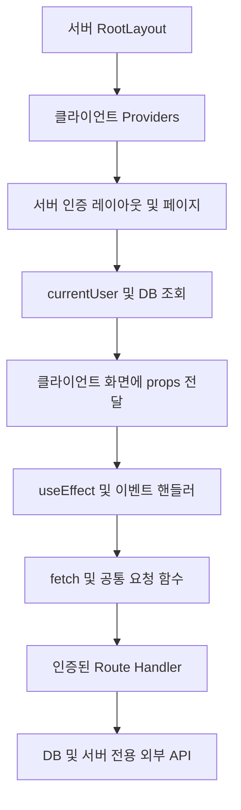
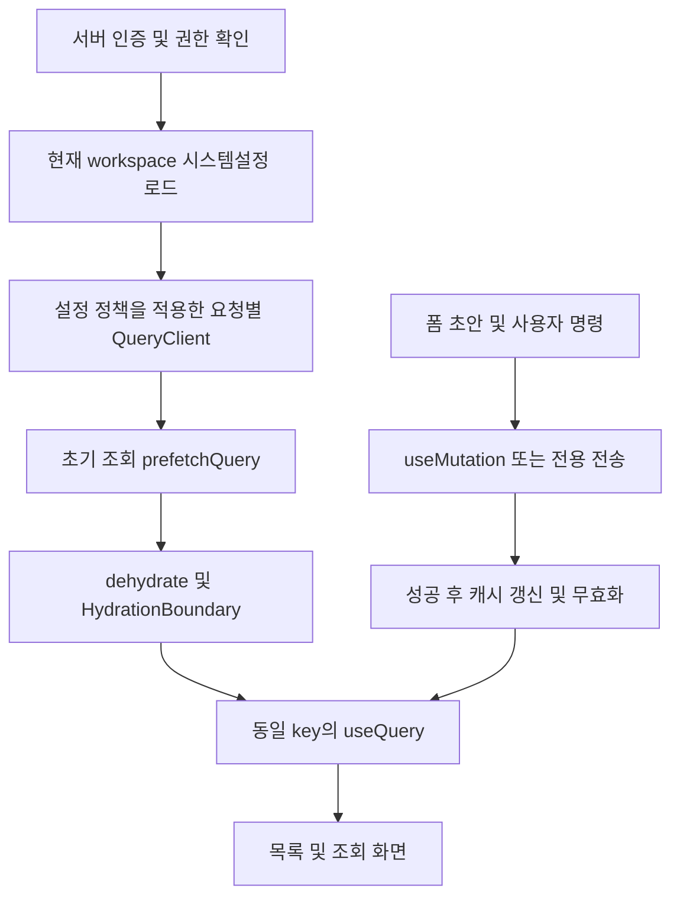

# fetch 전수 조사 및 TanStack Query 전환 설계

- 작성일: 2026-11-11 (한국시간, Asia/Seoul)
- 수정일: 2026-11-11 (한국시간). 워크스페이스별 시스템설정에서 staleTime·재시도 횟수·오류 메시지를 관리하도록 요구사항과 설계를 보완했다.
- 상태: 사용자 검토·수정용 설계 초안. 구현은 별도 요청 후 진행한다.
- 분석 기준: 현재 작업 디렉터리의 소스와 설치된 패키지. 기존 미커밋 변경과 신규 `app/providers.tsx`를 포함한다.
- 이번 작업: 본 문서만 수정하고 기존 `HISTORY.md` 링크와 목록은 유지한다. 애플리케이션·테스트 소스, 패키지, DB 스키마·데이터는 변경하지 않는다. 개발 서버·DB 연결·마이그레이션도 실행하지 않는다. 아래 신규 DB·API 설계는 향후 구현 대상으로만 기술한다.

## 1. 요구사항과 적용 범위

1. `app/layout.tsx`에서 사용하는 `app/providers.tsx`의 QueryClientProvider를 기준으로 데이터 조회 방식을 통일한다.
2. `await fetch` 사용처를 전수 조사하고 실행 환경과 호출 목적을 분류한다. 같은 조회가 누락되지 않도록 `fetch().then()`, `Promise.all([fetch(...)])`, `window.fetch`, fetch 별칭 및 공통 요청 함수의 호출부도 조사한다.
3. 서버 컴포넌트에서 클라이언트에 전달할 초기 조회는 사용자 예시 1의 `QueryClient → prefetchQuery → dehydrate → HydrationBoundary` 흐름을 적용한다.
4. 클라이언트 컴포넌트의 조회는 사용자 예시 2처럼 동일한 queryKey의 `useQuery`로 구독한다. staleTime과 재시도 횟수는 로그인 사용자의 현재 workspace에 저장된 시스템설정을 적용한다. 설정이 없을 때의 초기값은 staleTime 60초와 재시도 3회다. 일반 조회 훅마다 60초·3회를 고정하지 않는다.
5. 서버 컴포넌트와 서버 전용 서비스·Route Handler는 구분한다. 서버에서 실행된다는 이유만으로 OAuth·AI API·파일 처리에 React 훅이나 HydrationBoundary를 추가하지 않는다.
6. 저장·수정·삭제·생성·중지는 queryFn에서 실행하지 않는다. 일반 변경 요청은 `useMutation`, 바이너리 다운로드와 스트리밍은 목적에 맞는 명령형 전송을 사용한다. fetch는 queryFn·mutationFn·전송 유틸리티 안에서 계속 사용할 수 있다.
7. UI, API 계약, 권한·버전 검증, 동시성 제어, 폴링·외부 창 갱신, 작성 중인 초안이 보존되어야 한다.
8. `/admin/settings?tab=system`에 **시스템설정** 탭을 추가한다. staleTime의 초 단위 입력, 재시도 횟수 입력, HTTP 오류 코드별 메시지 입력을 제공한다. 슈퍼관리자설정의 전역 설정으로 저장하지 않는다.
9. 이번 fetch 전환 대상에서 발생한 요청 오류는 현재 workspace의 코드별 메시지로 표시한다. 403·404·500·501을 포함한 초기 문구는 4.9절에 정의하고 관리자 수정값을 우선한다. Query/IQ, Mutation, 다운로드·업로드·스트림 시작 실패 등 공통 전송 오류에 적용한다.
10. UI는 초 단위로 입력받고 저장·Query 옵션은 `staleTimeMs` 밀리초를 사용한다. 요청의 `staleTimesms 60초`는 `staleTimeMs: 60000`으로 정규화하며 `retryCount: 3`은 최초 요청 외 추가 재시도 최대 3회(합계 최대 4회)를 의미한다. 재시도 불가 오류·쓰기·특수 조회의 예외는 4.5절을 따른다.

사용자가 제시한 알림 페이지는 패턴 설명으로 해석한다. 현재 저장소에는 `app/admin/notifications/page.tsx`가 없고, 실제 알림은 `WorkspaceShell` 안의 `SuperNotifications`에 있다. 예시 경로·`item.title`을 그대로 도입하지 않고 실제 배치와 응답을 사용한다.

## 2. 현재 구조

### 2.1 Provider와 프레임워크

| 위치 | 확인한 현재 상태 | 설계에 주는 영향 |
| --- | --- | --- |
| `package.json`, 설치된 패키지 | Next.js 16.4.2, React 19.3.0 선언, TanStack React Query 5.107.1 설치 및 `^5.107.1` 선언 | 설치된 v5 API 기준. 이번 변경을 위해 패키지 추가·업그레이드는 필요하지 않음 |
| `app/providers.tsx:9` | `useState(() => new QueryClient(...))`로 인스턴스 유지. `staleTime: 60_000`, `refetchOnWindowFocus: false`, Devtools 포함 | 현재 60초 고정값을 workspace 시스템설정 기반 정책으로 전환. Provider를 재생성하지 않고 정책을 갱신 |
| `app/layout.tsx` | 서버 루트 레이아웃. `Suspense` 안에서 `<Providers>{children}</Providers>` 렌더링 | 서버 컴포넌트 자식이 모두 클라이언트 컴포넌트로 바뀌는 것은 아님 |
| `next.config.ts` | `cacheComponents: true`, `partialPrefetching: true` | 인증·요청 시점 프리패치는 기존 Suspense 안에서 수행. 캐시 설정을 임의로 해제하지 않음 |
| `app/(workspace)/layout.tsx` | `currentUser()`와 DB로 개인 설정 조회 후 `PreferencesRuntime`, `WorkspaceShell` 렌더링 | 공통 사용자·알림 초기 hydration을 둘 수 있는 서버 경계 |
| `app/(database)/layout.tsx`, `app/(editor)/planning-board/layout.tsx` | 별도 인증·개인 설정·플랜 가드 구성 | 별도 창도 루트 Provider를 사용하지만 브라우저 창 사이 QueryClient는 공유하지 않음 |
| 전체 사용 검색 | Provider 외 `useQuery`, `useMutation`, `prefetchQuery`, `HydrationBoundary`, `dehydrate` 사용 없음 | Provider 연결만으로 기존 fetch가 캐시되거나 중복 제거되지는 않음 |

설치된 `@tanstack/query-core@5.107.1`의 `src/queryClient.ts`도 확인했다. 이 버전에서는 `prefetchQuery`, `fetchQuery`, `ensureQueryData`가 deprecated로 표시되고 `queryClient.query(options)`가 대체 API로 제공된다. 사용자 예시의 prefetchQuery는 현재 설치본에서도 동작하므로 아래 설계 예시에는 요청한 패턴을 유지한다. 실제 구현 API는 7절에서 결정하며, 패키지를 낮추거나 경고를 숨기는 변경은 제안하지 않는다.

현재 작업 트리에는 `PROMPT.md`, `app/layout.tsx`, `package.json`, `pnpm-lock.yaml`의 수정과 신규 `app/providers.tsx`가 있다. 이 상태를 분석 기준으로 삼았으며 기존 변경을 정리하거나 되돌리지 않는다.

### 2.2 조회 흐름



- `useProjectData`는 프로젝트 목록과 산출물 조회 결과를 각각 로컬 state에 보관한다. 대시보드·DB설계·화면설계에서도 같은 자원을 따로 조회한다.
- `jsonRequest`는 JSON 파싱과 오류 변환을 담당한다. `fetchTeam`은 403에서 `matrix:team-access-denied`를 발행한다.
- `WorkspacePlanGuard`는 `window.fetch`를 감싸 플랜 불일치 409 응답을 관찰한다. 내부 `/api/me/workspace` 조회는 `originalFetch` 별칭을 사용한다.
- 플래닝보드의 `boardFetch`는 옛 UI 경로를 `/api/planning/...`으로 변환하고, `expectedVersion`, `expectedScreenVersion`, `requestId`, 창 간 저장 알림을 관리한다. 단순 fetch 대체로 제거하면 안 된다.
- Zustand에는 사용자 정보, UI 선택 상태, 개인 설정 미리보기, AI 상태와 초안이 섞여 있다. 서버 저장본과 편집 초안을 분리해야 한다.

### 2.3 시스템설정 관련 현재 구조와 부족한 부분

| 위치 | 확인한 현재 상태 | 필요한 보완 |
| --- | --- | --- |
| `app/(workspace)/admin/settings/page.tsx`, `lib/menus.ts`의 adminTabs | 회원 관리·AI 가드레일 관리·이력 관리만 있음. 페이지 탭 허용 목록과 헤더/메뉴 라벨을 각각 관리 | 양쪽에 system 탭 추가. system 분기를 ProductAdmin과 분리 |
| `components/admin/product-admin.tsx` | 상품 단위 base로 개요·회원·이력을 조회. master는 현재 workspace base 사용 | 다른 탭의 선택 상품/공간 필터가 시스템설정 workspace를 바꾸면 안 됨 |
| `lib/settings.ts`, `admin_setting` | setting_key를 기준으로 하는 전역 설정. workspace_id 없음 | 전역 설정 테이블에 같은 키를 반복 저장하지 않고 workspace 전용 테이블·조회 서비스를 추가 |
| `app/api/admin/settings/logging/route.ts` | master 전용 전역 DB_LOGGING_ENABLED GET/PATCH, 버전 충돌 검증 | 이번 workspace 설정과 역할이 다름. 기존 로깅 API와 저장 범위 유지 |
| `admin_setting_changes` | DB_LOGGING_ENABLED 및 boolean 값만 허용하는 제약 | 오류 메시지 JSON·숫자 설정 변경 기록에 그대로 재사용할 수 없음 |
| `lib/product-access.ts`, `lib/master-workspace-admin.ts` | 상품 관리자 범위와 master의 workspace 관리 범위를 따로 확인 | 시스템설정 쓰기는 현재 workspace 소속·관리 범위로 추가 확인 |
| `lib/auth.ts`의 errorResponse, 공통 요청 함수 | 서버 error 문자열을 반환하고 호출부에서 Error(message)로 변환 | HTTP status·업무 code를 잃지 않는 오류 타입과 workspace별 표시 메시지 resolver 필요 |
| `lib/audit.ts` | 감사 스냅샷 필드가 허용 목록으로 제한됨 | 설정 변경을 audit_logs에 기록할 때 새 설정 필드를 허용 목록에 명시적으로 추가 |

시스템설정은 현재 소스에 없는 신규 기능이다. 따라서 fetch 전환과 함께 화면·API·저장소를 추가하는 구현 범위로 확장한다. 기존 전수 조사 71개 파일은 변경 전 소스의 조사 결과이며 신규 예정 파일을 포함한 숫자는 아니다.

## 3. 전수 조사 결과

### 3.1 조사 방법과 집계 기준

- `rg --files`와 fetch·요청 함수 검색으로 저장소의 소스 파일을 확인하고 TypeScript AST로 실제 호출식을 교차 확인했다.
- 범위: `app`, `components`, `lib`, `stores`, `scripts`를 포함한 저장소 내 TS/TSX/JS/JSX/MJS/CJS. 문서·생성 결과·의존성 디렉터리는 애플리케이션 호출 집계에서 제외했다.
- 조사한 호출명: `fetch`, `window.fetch`, `globalThis.fetch`, `originalFetch`, `jsonRequest`, `teamJsonRequest`, `fetchTeam`, `boardFetch`, `planningFetch`, `templateRequest`.
- 런타임 소스에서 위 호출식은 **71개 파일, 158개 위치**다. 그중 `fetch`/`window.fetch`/`originalFetch` 형태는 **53개 파일, 107개 위치**, 직접 부모가 `await`인 위치는 **76개**다. 별칭·전달 호출도 포함하므로 실제 HTTP 요청 수나 API 개수와 같지 않다.
- 나머지 위치에는 공통 요청 함수의 호출부가 포함된다. 호출부와 내부 fetch가 함께 집계되므로 요청 수로 합산하지 않는다.
- `scripts`는 문자열로 실행되는 브라우저 스크립트까지 포함하면 **17개 파일**에서 확인된다. React 조회 전환 대상에서 제외하고 회귀 검증에 활용한다.
- 서버 컴포넌트가 직접 호출하는 fetch는 **0건**이다. 서버 전용 라이브러리 5개 파일의 외부 API 호출을 서버 컴포넌트로 오분류하지 않는다.

아래 줄 번호는 작성 시점 기준이다. `C`는 클라이언트 컴포넌트·훅, `C-import`는 클라이언트 import 경로로 사용되는 모듈, `T`는 전송 공통부, `S`는 서버 전용 서비스다. `Q`는 Query 조회, `IQ`는 Infinite Query, `M`은 Mutation, `I`는 명령형 전송 유지다. 하나의 파일이 여러 분류를 가질 수 있다.

### 3.2 공통·계정·관리자·AI

| 파일 | 호출 위치 | 환경 | 현재 요청과 수정 방향 |
| --- | --- | --- | --- |
| `components/workspace-shell.tsx` | 132, 220 | C | `/api/me` Q, 로그아웃 POST M. 포커스·가시성·팀 403 이벤트 갱신과 로그아웃 캐시 제거 |
| `components/workspace-plan-guard.tsx` | 59, 83 | C | 59는 `originalFetch(...args)` 전달, 83은 workspace GET. 조회는 Q로 공유하고 응답 관찰 기능 유지 |
| `components/workspace-picker.tsx` | 13, 24, 43 | C | workspace 목록 GET Q, 전환 PATCH·생성 POST M. 전환 전후 캐시 격리 |
| `components/personal-settings.tsx` | 19 | C | 이름 PATCH M. 사용자 캐시와 표시 동기화 |
| `components/auth-form.tsx` | 39 | C | 로그인·가입 POST M. 인증 성공 시 이전 세션 캐시 정리 |
| `components/registration/onboarding-form.tsx` | 22, 41 | C | 로그아웃·온보딩 POST M. 이동과 세션 초기화 유지 |
| `components/registration/registration-choice-dialog.tsx` | 34 | C | 가입 팀 검색 GET Q. 검색어 key, 기존 검색 지연과 취소 유지 |
| `components/subscription-plans.tsx` | 47, 63, 78 | C | Business 신청 POST, Team 주문 POST, 구독 PATCH M. 구독·사용량·신청·알림 무효화 |
| `components/subscription-requests.tsx` | 19, 23, 59 | C | 신청·주문 GET를 각각 Q, 신청 철회 DELETE M |
| `stores/preferences.ts` | 60, 74 | C | 저장 설정 GET·PATCH. HTTP 호출을 Query 훅/서비스로 이동하고 미리보기·generation·owner 보호 유지 |
| `components/admin/admin-lists.tsx` | 62, 91, 137, 494, 513 | C | 회원/이력 목록·상세 및 로깅 설정 GET Q, 회원·로깅 PATCH M. source/id·필터·페이지 key |
| `components/admin/product-admin.tsx` | 69, 70, 99, 189, 306 | C | 상품/워크스페이스 개요·회원·이력·상세·후보 GET Q, 회원 POST M. base와 scope 구분 |
| `components/admin/guardrail-admin.tsx` | 130, 140, 163, 211 | C | 정책·모델 GET Q, draft/test/activate 등 POST M. 서버 revision·activeVersion 유지 |
| `components/admin/use-guardrail-attachments.ts` | 23 | C | 구독 GET를 공통 구독 Q로 통합. 첨부 제한 판정 유지 |
| `components/super-admin/notifications.tsx` | 21, 104 | C | 알림 GET Q와 읽음 PATCH M. 15초 폴링·포커스·열기 갱신 유지 |
| `components/super-admin/product-console.tsx` | 37, 45, 71 | C | Business/Team 상품·계약 신청 GET Q, 각 변경 POST/PATCH M. 상품 유형 포함 |
| `components/super-admin/plan-admin.tsx` | 19 | C | 현재 PATCH만 사용. 서버 `initialPlans`를 plans Q hydration으로 전환하고 저장은 M |
| `components/ai/ai-chatbot.tsx` | 95, 118, 182, 232, 255 | C | 구독·모델·사용량 GET Q, 중지 POST M, 채팅 POST 응답 스트림 I. 중복 생성·자동 재실행 금지 |
| `components/ai/ai-conversation-menu.tsx` | 103, 134 | C | 대화방 목록 GET Q, 생성 POST M. projectId key |
| `components/ai/ai-conversation-title.tsx` | 29 | C | 이름 PATCH M. 목록과 상세 동기화 |
| `components/ai/ai-conversation-room.tsx` | 88 | C | 고정 상태 PATCH M |
| `components/ai/ai-conversation-dialog.tsx` | 39 | C | 이름 PATCH·삭제 DELETE M |
| `components/ai/use-ai-conversation.ts` | 26, 69 | C | 최신/이전 채팅 GET IQ. `before` 커서, ID 중복 제거, 스크롤 위치, historyEnabled=false 처리 유지 |
| `components/ai/use-ai-target.ts` | 36, 78, 138 | C | 프로젝트 access GET Q, 대상 초기화·변경 PATCH M. expectedTargetVersion 유지 |
| `components/ai/ai-token-statistics.tsx` | 46 | C | 사용 통계 GET Q. 기간·집계 조건 key |
| `components/ai/use-ai-images.ts` | 142 | C | 이미지 Blob 조회 I. 브라우저 저장 동작, Object URL 정리 유지 |

### 3.3 프로젝트·산출물·업무 화면

아래 `jsonRequest` 호출도 실제 fetch 사용에 포함한다.

| 파일 | 호출 위치 | 환경 | 현재 요청과 수정 방향 |
| --- | --- | --- | --- |
| `components/shared/use-project-data.ts` | 19, 55 | C | 프로젝트 목록·산출물 GET Q. 응답 전체를 캐시하고 선택 projectId는 UI 상태로 유지 |
| `components/shared/use-project-access.ts` | 40 | C | access GET Q. 10초·포커스·가시성·storage 이벤트 재확인, 작업 직전 강제 조회 유지 |
| `components/shared/use-artifact-actions.ts` | 85, 145 | C | 산출물 POST/PATCH/DELETE M. 기존 버전·검증 오류·완료 콜백 유지 |
| `components/shared/ai-image-actions.tsx` | 87, 105, 136, 172, 211 | C | 이미지 모델·메타 GET Q, 생성 POST M, 다운로드 I. 열기 전에 생성하지 않음 |
| `components/pages/dashboard/dashboard-page.tsx` | 33, 67 | C | 구독·프로젝트 GET Q. 생성 대화상자 진입 전 구독/프로젝트 한도는 최신 조회 |
| `components/pages/dashboard/create-project-dialog.tsx` | 38, 69 | C | 팀원 GET Q, 프로젝트 POST M. fetchTeam 이벤트 보존 |
| `components/pages/team/team-page.tsx` | 83, 89, 93, 135, 161, 179 | C | 프로젝트·게시물·회원·댓글 GET Q, 게시물·댓글 POST M |
| `components/pages/team/team-membership.tsx` | 57, 61, 100 | C | 가입 요청·회원 GET Q, 승인/역할/소유권 등 동적 변경 M. 관리 권한과 이벤트 유지 |
| `components/pages/team/team-member-add-dialog.tsx` | 34 | C | 회원 추가 POST M |
| `components/pages/team/project-permissions-dialog.tsx` | 48, 70 | C | 권한 GET Q, PATCH M. expectedVersion·탭별 정책·창 간 권한 알림 유지 |
| `components/pages/documents/documents-page.tsx` | 99, 167, 222, 248 | C | 폴더별 GET Q, 생성/이름/삭제 M, 바이너리 업로드 M, 다운로드 I |
| `components/pages/documents/onlyoffice-editor.tsx` | 31 | C | 편집 세션 설정 GET Q 후보. 서명·문서 키 만료 특성이 있어 재사용·재요청 정책 별도 설정 |
| `components/pages/wbs/use-wbs-schedule.ts` | 246, 305 | C | 최신 산출물 GET는 강제 재확인 Q, 일정 저장 POST M. 초안·요청 ID·충돌 복구 유지 |
| `components/pages/wbs/wbs-publication-actions.tsx` | 165, 197 | C | 배포 정보 GET Q, 배포 POST M. 산출물 버전 집합·확인 스냅샷 유지 |
| `components/pages/database/database-page.tsx` | 11 | C | 외부 DB 변경 시 산출물 GET를 공통 산출물 Q 무효화로 통합 |
| `components/pages/database/database-tool-page.tsx` | 61 | C | 별도 창 산출물 GET Q. initialData/initialLoadedAt 대응, dirty 초안 자동 덮어쓰기 금지 |
| `components/pages/database/database-domain-page.tsx` | 44, 73, 91 | C | 검색 목록·상세 GET Q, 삭제 DELETE M. q/page/pageSize key |
| `components/pages/database/database-domain-select.tsx` | 67 | C | 도메인 검색 GET Q. 목록 화면과 pageSize 10/20 차이 구분 |
| `components/pages/database/database-domain-form.tsx` | 70 | C | 도메인 POST/PATCH M. 변경 후 도메인·영향 산출물 무효화 |
| `components/pages/database/database-erd-preview.tsx` | 50, 66, 97 | C | 이미지 메타 GET Q, 생성 POST M, 다운로드 I |
| `components/pages/screens/screens-page.tsx` | 14 | C | 산출물 GET를 공통 Q로 통합. 저장 BroadcastChannel 수신 후 무효화 |
| `components/pages/architecture/architecture-mermaid.tsx` | 200 | C | Mermaid PATCH M. baseVersion·로컬 편집 상태 유지 |
| `components/pages/architecture/architecture-image-surface.tsx` | 32 | C | 이미지 메타 GET Q. artifactId·sourceHash 및 산출물 변경 시 무효화 |
| `components/pages/rfp/use-rfp-document.ts` | 56, 101, 133 | C | RFP GET Q, POST/PATCH/DELETE M. draft·expectedVersion·acceptGenerated 유지 |
| `components/pages/rfp/use-rfp-source.ts` | 38, 55, 119, 136, 211, 240, 269, 308 | C | 원본·모델·생성 상태 GET Q, 원본 업로드/교체/삭제·생성·중지 M. 2초 상태 폴링·세션 복구 유지 |
| `components/pages/rfp/rfp-generation-history.tsx` | 35 | C | 생성 이력 커서 GET IQ. 기존 누적 목록 순서 유지 |
| `app/(workspace)/viewer/md/MarkdownViewer.tsx` | 315 | C | Markdown 저장 PUT M. 조회 캐시 전환과 구분. 기존 `/api/markdown` 연결 문제 수정은 별도 범위 |

### 3.4 플래닝보드와 요청 공통부

`"use client"`가 없는 파일도 클라이언트 진입점에서 import되면 클라이언트 모듈 그래프에 포함된다. 아래 C-import를 서버 컴포넌트로 전환하지 않는다.

| 파일 | 호출 위치 | 환경 | 현재 요청과 수정 방향 |
| --- | --- | --- | --- |
| `app/(editor)/planning-board/stores/editor-provider.tsx` | 184 | C | 화면 access GET Q. 15초·포커스·planning:access-error, fail-closed 및 사용자 전환 차단 유지 |
| `app/(editor)/planning-board/components/planning-board-editor.tsx` | 706, 1116, 1124, 1173, 1223, 1349, 1422, 1479, 1812 | C | 모델·보드·내장 템플릿 GET Q, 사용자 템플릿 적용/저장·보드 저장·리뷰·AI 생성 POST M. 스냅샷·undo 유지 |
| `app/(editor)/planning-board/components/left-panel.tsx` | 359 | C-import | 문서 목록 GET Q. 화면 저장 후 갱신 |
| `app/(editor)/planning-board/components/canvas-editor.tsx` | 235, 714, 747, 783, 830, 922 | C-import | 메모·댓글 GET Q, 댓글/메모 POST/PATCH/DELETE M |
| `app/(editor)/planning-board/components/right-panel.tsx` | 216, 243 | C-import | 에셋 응답/Blob I, 코드 포맷 POST M 또는 명령형 요청. GET 조회로 바꾸지 않음 |
| `app/(editor)/planning-board/components/ai-screen-generator.tsx` | 71 | C | AI 생성 이력 GET Q |
| `app/(editor)/planning-board/components/board-history.tsx` | 13 | C | 탭별 history/reviews 커서 GET IQ. 탭 key와 페이지 초기화 |
| `app/(editor)/planning-board/preview/page.tsx` | 250 | C | boardFetch GET Q. 프리뷰 경로도 클라이언트 페이지 |
| `app/(editor)/planning-board/lib/template-api.ts` | 12, 36 | C/T | templateRequest 전송 유지, useProjectTemplates는 Q. BroadcastChannel·포커스는 무효화로 연결 |
| `app/(editor)/planning-board/lib/upload-image.ts` | 4, 6 | C-import/T | data URL→Blob 변환 I, 에셋 업로드 POST M의 전송부로 유지 |
| `app/(editor)/planning-board/lib/client-api.ts` | 28, 103 | C-import/T | planningFetch/boardFetch 유지. queryFn·mutationFn에서 호출. 경로 변환·버전 커서·requestId·이벤트 보존 |
| `lib/client-request.ts` | 2 | T | JSON 전송 함수 유지. signal 전달과 상태 코드가 있는 오류 타입 보완 후보. 서버 전용 기능 혼입 금지 |
| `lib/team-request.ts` | 7, 14 | C/T | fetchTeam/teamJsonRequest 유지. 403 커스텀 이벤트 보존 |

### 3.5 서버 전용 fetch: hydration 전환 제외

| 파일 | 호출 위치 | 현재 역할 | 처리 기준 |
| --- | --- | --- | --- |
| `lib/ai-server.ts` | 17, 143 | OpenAI 모델 GET, Responses POST | 서버 키·모델 revalidate 300·타임아웃·실행 제어 유지 |
| `lib/ai/image-generation.ts` | 17, 114 | 모델 GET, 이미지 생성 POST | 서버 전용 유지. 생성 요청을 프리패치하거나 클라이언트에 키 노출하지 않음 |
| `lib/ai/background-response.ts` | 12 | 응답 상태 GET, 취소 POST | 서버 작업 생명주기 유지. 브라우저는 기존 내부 상태 API를 Query로 구독 |
| `lib/oauth.ts` | 121, 139 | 코드→토큰 POST, 프로필 GET | 서버 인증 흐름 유지. Query cache/dehydrate 대상 아님 |
| `lib/onlyoffice.ts` | 334 | 검증된 문서 서버에서 변경 파일 다운로드 | origin 검증·redirect:error·타임아웃·저장 처리 유지 |

이 모듈들은 API 및 서버 서비스에서 사용된다. API의 서버 외부 fetch를 제거해야 클라이언트 Query 전환이 완료되는 것은 아니다. DB 조회 함수·Route Handler 자체에도 useQuery를 추가하지 않는다.

### 3.6 검증 스크립트: React 전환 제외

다음 파일은 테스트 준비, HTTP 검증, CDP 연결 또는 문자열 형태의 브라우저 실행 코드다. 제품 컴포넌트가 아니므로 Query 훅으로 바꾸지 않는다.

- `scripts/ai-test-provider.mjs`
- `scripts/check-database-domains-browser.mjs`
- `scripts/planning-project-template-browser-checks.mjs`
- `scripts/planning-screen-list-preview-checks.mjs`
- `scripts/test-accounts-plans.mjs`
- `scripts/test-admin-compact.mjs`
- `scripts/test-ai.mjs`
- `scripts/test-architecture-surface-browser.mjs`
- `scripts/test-auth.mjs`
- `scripts/test-navigation-browser.mjs`
- `scripts/test-personal-preferences-browser.mjs`
- `scripts/test-planning-board-browser.mjs`
- `scripts/test-product-administration-browser.mjs`
- `scripts/test-project-permissions-rfp-browser.mjs`
- `scripts/test-rfp-source-browser.mjs`
- `scripts/test-viewer.mjs`
- `scripts/test-workspace-plan-browser.mjs`

## 4. 수정 방향

### 4.1 기본 흐름과 소유권



- 서버는 인증과 초기 프리패치를 담당하고, 클라이언트 Query cache가 이후 조회 결과를 소유한다.
- 서버 props와 Query cache를 같은 데이터의 영구적인 이중 저장소로 사용하지 않는다. `initialPlans`처럼 서버 props로 시작한 목록은 hydration 후 Query data를 렌더링한다.
- 폼 입력, 검색 입력, 선택 프로젝트, 열린 팝오버, 편집 중 문서·캔버스·Mermaid·WBS 초안은 로컬/Zustand 상태로 유지한다. 서버 저장본이 바뀌어도 dirty 초안을 자동 교체하지 않는다.
- `useProjectData.updateData` 등 기존 소비 인터페이스는 점진적으로 `queryClient.setQueryData`/무효화에 연결하는 어댑터로 유지할 수 있다. 기존 호출부의 함수형 업데이트 계약도 보존한다.
- workspace 시스템설정은 Query 옵션과 오류 표시 정책의 공통 입력이다. SSR 프리패치와 브라우저 조회에 같은 설정 스냅샷을 전달하고 4.9절의 로딩·갱신 절차를 따른다.

### 4.2 queryKey와 응답 형태

공통 scope의 기본안은 `['matrix', userId, workspaceId]`다. 키 빌더를 `lib/query/keys.ts`에 모아 서버·클라이언트가 같은 함수를 사용한다. 인증 쿠키·토큰·비밀키를 queryKey에 넣지 않는다.

| 데이터 | scope 뒤 key 예시 | 비고 |
| --- | --- | --- |
| 현재 사용자 | `['me']` | 사용자/공간이 달라지면 별도 캐시 |
| 시스템설정 | `['system-settings']` | workspaceId·staleTimeMs·retryCount·errorMessages·version. 다른 데이터 key에 설정 version을 일괄 추가하지 않음 |
| 공간 목록·현재 공간 | `['workspaces']` | `/api/me/workspace` 전체 응답 |
| 구독·사용량 | `['subscription']` | `{ plan, workspacePlan, plans, usage, ... }` 응답 전체 |
| 프로젝트 목록 | `['projects']` | `{ projects, activities, ... }` 보존. 대시보드와 useProjectData는 select로 필요한 부분 선택 |
| 프로젝트 산출물 | `['project', projectId, 'artifacts']` | ProjectData 전체 응답. 화면마다 다른 타입으로 같은 key 저장 금지 |
| 프로젝트 권한 | `['project', projectId, 'access']` | permissionsByTab가 전체 응답이면 tab별 중복 key 불필요 |
| 관리자 목록/상세 | `['admin', base, resource, { filters, page, pageSize }]` / `['admin', base, resource, source, id]` | master workspaceMode·상품 범위·이력 source 구분 |
| 슈퍼관리자 알림 | `['super-admin', 'notifications']` | `{ notifications, unread }` |
| 슈퍼관리자 상품/플랜 | `['super-admin', type, 'products']` / `['super-admin', 'plans']` | type=business/team. plans 응답은 `{ plans }`로 통일 |
| 가드레일 | `['guardrail', endpoint]` | super-admin/admin endpoint 구분 |
| 팀 목록·댓글 | `['team', resource, { projectId, filters }]` / `['team', 'comments', postId]` | 프로젝트 미선택 값도 정규화 |
| 문서 목록 | `['project', projectId, 'documents', { folderId }]` | 루트 folderId는 빈 문자열로 정규화 |
| DB 도메인 | `['project', projectId, 'domains', { q, page, pageSize }]` / 상세 id | pageSize가 다르면 다른 결과 |
| 이미지 메타 | `['project', projectId, 'image', endpoint, { sourceHash }]` | 응답을 바꾸는 원본 식별값 포함. Blob은 넣지 않음 |
| RFP | `['project', projectId, 'rfp', resource, requestId]` | 문서/원본/생성 상태/이력 분리 |
| AI 대화 | `['project', projectId, 'conversation', convId, 'chats']` | 목록과 상세를 구분, 임시 대화·history 비활성은 별도 처리 |
| 사용 통계 | `['ai-usage', { period, ...filters }]` | 요청을 바꾸는 모든 필터 포함 |
| 플래닝보드 | `['planning', projectId, screenId, resource]` | access/board/memos/comments/history/reviews/ai-history 분리 |
| 프로젝트 템플릿 | `['planning', projectId, 'templates']` | 사용자 템플릿·내장 템플릿 구분. 내장 원문도 기존 접근 검증 보존 |
| 개인 설정 | `['preferences']` | 저장된 Preferences만 캐시. 미리보기는 제외 |

커서 기반 IQ에서는 커서를 `pageParam`으로 관리하고 필터·정렬은 key에 둔다. 일반 Q의 페이지네이션은 page를 key에 포함한다. 일반 Query와 Infinite Query에 같은 key를 사용하지 않는다. 응답에서 일부 필드만 필요한 화면은 `select`를 사용하고 공유 캐시 형태를 바꾸지 않는다.

키 설계는 Query 함수의 결과를 바꾸는 변수를 포함한다는 공식 원칙에 따른다. [TanStack Query: Query Keys](https://tanstack.com/query/latest/docs/framework/react/guides/query-keys)

### 4.3 서버 프리패치와 인증 전달

현재 직접 fetch를 하는 서버 컴포넌트는 없으므로 기계적으로 바꿀 기존 호출은 없다. 초기 화면을 hydration하는 단계에서는 아래 서버 경계에 프리패치를 추가한다.

| 서버 경계 | 초기 프리패치 후보 | 배치 원칙 |
| --- | --- | --- |
| `app/(workspace)/layout.tsx`의 AuthenticatedWorkspace | workspace 시스템설정, 현재 사용자, master의 알림 | 인증 후 설정을 먼저 로드하고 알림을 포함한 WorkspaceShell 전체를 설정 Runtime 및 HydrationBoundary 자손으로 배치 |
| `components/workspace-section.tsx`, `app/(workspace)/dashboard/page.tsx` | 프로젝트·활동, 필요 시 구독 | 기존 인증·팀공유·감사 흐름을 통과한 뒤 조회. 범용 Section에 모든 도메인 조회를 넣지 않음 |
| `app/(workspace)/projects/[projectId]/page.tsx` | 선택 프로젝트 산출물·access, 필요한 프로젝트 목록 | params 해석·접근 확인 후. 모든 탭의 RFP·문서·이미지 일괄 프리패치 금지 |
| `app/(workspace)/admin/settings/page.tsx` | system이면 현재 workspace 설정, 그 외 현재 탭의 상품/공간 개요·목록·가드레일 | system 전용 workspace 관리 권한 확인. 다른 탭의 productAdminScope/masterWorkspaceScope 및 base 분기 유지 |
| `app/(workspace)/super-admin/settings/page.tsx` | 현재 탭의 plans 또는 Business/Team 목록·신청 | master 검증 후. 현재 listPlans 응답은 `{ plans }`로 맞춰 hydration |
| `app/(workspace)/settings/page.tsx`, `settings/subscription/page.tsx` | 현재 설정 탭, 구독·신청·주문 | 기존 서버 조회는 필요한 캐시에만 연결. 구독 페이지의 plans/current/usage와 API 응답 차이를 먼저 맞춤 |
| `app/(database)/projects/[projectId]/database/{erd,domains}/page.tsx` → `components/pages/database/database-tool-server.tsx` | 이미 서버에서 읽은 초기 프로젝트 데이터 | 실제 DB 읽기·권한 검증은 DatabaseToolServer에 있음. 그 경계에서 기존 DTO를 동일 Q 형태로 전달하고 이중 조회 피하기 |
| `app/(editor)/planning-board/layout.tsx`, `app/(database)/layout.tsx` | workspace 시스템설정, 사용자·개인 설정 공유 후보 | 별도 창도 동일 workspace 정책 적용. 인증·권한 경계 보존. planning page의 서버 wrapper 분리 여부 결정 |

서버 프리패치의 기본안은 사용자 예시와 같은 **기존 내부 GET API 호출 방식**이다. Next 서버 fetch에 브라우저 세션은 자동 전달되지 않으므로 다음을 설계에 포함한다.

1. `lib/query/server-fetch.ts`를 `server-only`로 분리한다. 내부 API 경로는 허용된 상대 경로만 받는다.
2. 기존 `APP_URL`의 신뢰된 origin과 경로를 조합해 절대 URL을 만든다. 요청의 임의 Host를 신뢰해 쿠키를 전달하지 않는다. 개발·프리뷰 환경의 APP_URL 설정과 서버에서 자기 API로 연결 가능한지 확인한다.
3. `await cookies()`에서 현재 `hams_session`만 읽어 같은 서비스 origin의 GET에 전달한다. 임의 외부 URL에는 인증 쿠키를 전달하지 않는다. `credentials: 'include'`만으로 서버 인증을 해결하려 하지 않는다.
4. `cache: 'no-store'`, signal, 타임아웃과 HTTP 오류 검증을 적용한다. queryKey·응답에는 세션 값을 저장하지 않는다. 서버 쿠키를 클라이언트 props로 넘기지 않는다.
5. `currentUser`/`requireUser`, master·상품 범위 검증을 먼저 수행한다. 모든 프리패치는 읽기 전용 GET만 대상으로 한다. 사용자 지정 작업을 렌더링 중 실행하지 않는다.
6. QueryClient는 서버 요청/경계마다 새로 만든다. 서버 모듈 전역 singleton과 사용자 캐시 공유를 금지한다. 인증 데이터에 `use cache`를 추가하지 않는다.
7. 프리패치는 기존 Suspense의 비동기 Content 내부에 둔다. 새 QueryClient·동적 인증을 정적 레이아웃 최상단으로 올려 Cache Components 경계를 깨지 않는다.
8. 성공한 JSON DTO만 dehydrate한다. Response·AbortController·Blob·토큰·DB 핸들 등을 직렬화하지 않는다. 서버와 클라이언트의 응답 shape를 일치시킨다.

내부 HTTP는 권한·응답 계약 재사용이 쉽지만 네트워크 홉과 초기 지연이 늘 수 있다. 필요 시 서버 DTO 조회 서비스를 분리하고 API와 프리패치가 같이 사용하는 대안을 검토한다. 이 대안에서는 `lib/super-admin-api.ts` 등의 인증·테넌트 범위·감사 처리를 그대로 재사용해야 하며, SQL을 UI에 복사하지 않는다. 기존 DB 직접 조회를 HTTP로 전면 교체하는 작업은 기본 범위에 포함하지 않는다. 이미 서버에서 DTO를 읽은 경우 `setQueryData`로 해당 요청의 QueryClient에 응답 형태를 맞춰 넣은 뒤 dehydrate할 수 있다. 이를 위해 같은 API를 다시 호출하지 않는다.

HydrationBoundary는 실제 소비 컴포넌트를 감싸야 한다. 알림을 슈퍼관리자 설정 페이지에만 감싸면 부모 WorkspaceShell의 헤더 알림에는 적용되지 않는다. 알림 프리패치 경계는 workspace 레이아웃이 적합하다.

설계 예시이며 아래 모듈·타입·키 함수는 **아직 생성하지 않았다**. AuthenticatedWorkspace의 기존 인증·개인 설정 처리를 수행한 뒤 적용하는 부분 구조다.

```tsx
const scope = { userId: user.id, workspaceId: user.workspaceId };
// 설정 로드는 Query에 의존하지 않는 서버 서비스. 미등록 시 초기값 반환.
const settings = await getWorkspaceSystemSettings(user);
const policy = createWorkspaceQueryPolicy(settings);
const queryClient = new QueryClient(); // 서버 요청마다 생성
queryClient.setQueryData(matrixKeys.systemSettings(scope), settings);

if (user.accountRole === 'master') {
  await queryClient.prefetchQuery({
    queryKey: matrixKeys.notifications(scope),
    queryFn: ({ signal }) =>
      serverGetJson<NotificationsResponse>(
        '/api/super-admin/notifications',
        { signal },
      ),
    staleTime: policy.staleTimeMs,
    retry: policy.retryQuery,
  });
}

return (
  <HydrationBoundary state={dehydrate(queryClient)}>
    <WorkspaceQueryRuntime scope={scope} initialSettings={settings}>
      <PreferencesRuntime userId={user.id} initial={initial} />
      <WorkspaceShell user={user}>{children}</WorkspaceShell>
    </WorkspaceQueryRuntime>
  </HydrationBoundary>
);
```

실제 구현에서는 `QueryClient`, `dehydrate`, `HydrationBoundary`를 `@tanstack/react-query`에서 import한다. 인증 redirect/notFound를 queryFn 내부로 넣지 않는다. 설치된 v5의 prefetchQuery는 오류를 호출자에게 그대로 throw하지 않으므로, 인증·권한 오류를 잡는 용도로 `try/catch(prefetchQuery)`에만 의존하면 안 된다. 필수 초기 조회가 실패하면 `queryClient.query`(기존 호환 API는 `fetchQuery`) 또는 캐시 상태 확인으로 페이지 오류를 결정한다. 비필수 알림 프리패치 실패는 성공 캐시에서 제외하고 클라이언트 재시도 UI로 처리한다. 대체 API인 queryClient.query는 오류를 reject하므로 비필수 프리패치를 그 API로 바꿀 때만 해당 실패를 의도적으로 처리한다.

서버 프리패치·hydration의 근거는 [TanStack Query: Advanced Server Rendering](https://tanstack.com/query/latest/docs/framework/react/guides/advanced-ssr) 및 [Server Rendering & Hydration](https://tanstack.com/query/latest/docs/framework/react/guides/ssr)다. 실제 API 사용은 설치된 5.107.1 기준으로 확인한다.

### 4.4 클라이언트 Query

공통 Query option과 key는 공유하되 서버용 인증 전송부와 브라우저 전송부는 분리한다. Next 서버 모듈이 client 번들에 들어가지 않도록 type-only import도 구분한다.

```tsx
'use client';

const { settings, policyReady } = useWorkspaceSystemSettings(scope);
const policy = createWorkspaceQueryPolicy(settings);
const notices = useQuery({
  queryKey: matrixKeys.notifications(scope),
  queryFn: ({ signal }) =>
    browserGetJson<NotificationsResponse>(
      '/api/super-admin/notifications',
      { signal },
    ),
  enabled: policyReady && user.accountRole === 'master',
  staleTime: policy.staleTimeMs,
  retry: policy.retryQuery,
  refetchInterval: 15_000,
  refetchOnWindowFocus: 'always',
});
```

- queryFn은 응답을 반환하거나 오류를 throw한다. `response.ok`를 확인하고 `status`, 업무 오류 `code`, 메시지를 보존한다. Query 함수에서 화면 state를 직접 갱신하지 않는다.
- `queryFn({ signal })`의 signal을 fetch까지 전달한다. Query가 제공한 취소 기능과 기존 사용자/화면 세대 검증은 목적이 다르므로 신원·버전 보호는 보존한다. [TanStack Query: Query Cancellation](https://tanstack.com/query/latest/docs/framework/react/guides/query-cancellation)
- 초기 로딩·빈 목록·오류·취소를 구분한다. 초기 활성 조회의 `isLoading`과 갱신 중 `isFetching`을 구분하고 기존 데이터가 있으면 배경 갱신 오류로 전체 화면을 지우지 않는다.
- `enabled`에 userId/workspaceId/projectId, 대화상자 열림, 관련 권한 등 선행 조건을 반영한다. 비활성 Query의 `isPending`만으로 무한 로딩을 표시하지 않는다.
- 검색어는 기존 지연 처리를 보존하고 확정된 검색 조건으로 요청한다. 다른 공간·프로젝트로 전환할 때 이전 데이터가 placeholder로 노출되지 않게 한다.
- v5 useQuery에 onSuccess/onError 콜백을 추가하는 방식은 사용하지 않는다. 데이터 선택은 select, 외부 상태 동기화는 필요한 effect, 사용자 명령 후 처리는 mutation 콜백에 둔다.
- 각 화면은 공통 훅/option factory를 통해 workspace 정책을 구독한다. 일반 조회에 고정 staleTime·retry를 다시 넣지 않는다. 위 createWorkspaceQueryPolicy와 Runtime은 설계상 신규 모듈이며 아직 구현하지 않았다.
- 표시 오류는 `resolveWorkspaceError(error, settings.errorMessages)`로 생성한다. API의 원문 error 문자열을 그대로 toast·alert에 출력하는 경로도 이번 전환 때 수정한다.

### 4.5 staleTime, 폴링, 즉시 재검증

`settings.staleTimeMs`는 캐시의 신선도이며 기본값만 60,000ms다. 관리자가 120초로 저장하면 일반 조회에 120,000ms를 적용하며, 0초는 즉시 stale을 의미한다. 일정 간격으로 요청하는 설정은 아니다. `cache: 'no-store'`는 HTTP/Next fetch 캐시 정책이므로 workspace가 지정한 Query 메모리 캐시와 별개다. [Next.js: fetch](https://nextjs.org/docs/app/api-reference/functions/fetch)

| 영역 | 권장 정책 | 기존 동작 보존 항목 |
| --- | --- | --- |
| 일반 목록·상세 | staleTime=workspace 설정값, retryCount=workspace 설정값, 포커스 재조회 기본 false | 명시적 새로고침·저장 후 무효화 |
| 알림 | staleTime·재시도 횟수는 workspace 설정, interval 15초, 포커스 always | 알림 열기·business-notifications-refresh에서 즉시 refetch |
| 프로젝트 권한 | staleTime 0, interval 10초, 포커스 always | 가시성·storage·projectAccessEvent. 권한 상실 시 편집 차단 |
| 플래닝보드 access | staleTime 0, interval 15초, 포커스 always | planning:access-error, 사용자 전환 차단, fail-closed |
| 플랜 가드 workspace | staleTime 0, interval 15초, 포커스 always | 가시성 변화·플랜 불일치 복구. picker와 같은 Q 공유 시 정책을 훅에서 통일 |
| WorkspaceShell 현재 사용자 | 이벤트 시 즉시 재조회 | 최초/경로 변화·포커스·가시성·팀 403 갱신 |
| RFP 생성 상태 | requestId가 있고 진행 중이면 interval 2초 | 완료·취소·실패에서 중지. posting 중 404와 복구 처리 |
| RFP source의 다른 활성 작업 | active 상태 동안 interval 2초 | 작업 상태와 source 동기화 |
| 생성 전 한도·저장 직전 권한 | 반드시 최신 요청 | workspace의 staleTime이 길어도 프로젝트 생성 가능·쓰기 가능 판정을 캐시만으로 하지 않음 |
| ONLYOFFICE 편집 설정 | staleTime 0, gcTime 0 후보, 자동 포커스/재연결 갱신 끄기 | 열린 편집기 설정·문서 키 자동 교체 금지, 명시적 다시 열기 |
| 대화·생성 이력 IQ | 필터·대화방별 분리, 필요할 때 활성화 | 새 메시지와 기존 페이지 ID 중복 제거 |
| 시스템설정 자체의 bootstrap/재확인 | staleTime 0, 자동 retry 0, 고정된 조회 흐름 | 자기 설정값에 의존해 재귀 조회·무한 재시도하지 않음 |

작업 직전 검증에 `ensureQueryData`로 캐시만 반환하거나 fresh한 캐시를 그대로 반환하는 조회를 쓰지 않는다. 해당 작업의 options에 `staleTime: 0`을 지정해 `queryClient.query`(기존 호환 API는 `fetchQuery`)를 실행하거나 활성 Query의 `refetch()`를 명시적으로 await한다. 권한·편집 세션·설정 bootstrap 등의 제한적 예외는 일반 조회 정책과 분리하고 공통 정책 함수에서 명시한다.

**재시도 횟수 적용:** 자동 재시도 가능한 읽기 요청에 `failureCount < settings.retryCount`를 적용한다. 기본 3회는 최초 1회와 추가 3회로 최대 4회다. 0회는 최초 요청만 실행한다. 서버 프리패치도 라이브러리의 서버 기본 0회에 맡기지 않고 같은 정책 함수를 명시한다. 재시도 지연은 기존 Query의 지수 백오프를 사용하고 이번 설정 항목에 추가하지 않는다. [TanStack Query: Query Retries](https://tanstack.com/query/latest/docs/framework/react/guides/query-retries)

- 네트워크/타임아웃, HTTP 408·425·429·500·502·503·504는 읽기 요청의 재시도 대상으로 한다. 429의 Retry-After가 있으면 존중한다. 이 목록 외 코드는 기본 자동 재시도하지 않는다.
- 400·401·403·404·405·409·410·413·415·422·501은 반복으로 해결되지 않는 오류로 즉시 처리한다. 특히 403·404·501에도 관리자 지정 메시지를 표시하지만 조회를 3회 더 실행하지 않는다. 인증 만료·권한 차단·플랜 모달 등 기존 동작은 메시지 표시와 별도로 즉시 수행한다.
- Mutation과 스트리밍/업로드/다운로드 명령은 자동 재시도 0회다. 관리자가 재시도 횟수를 높여도 주문·생성·저장·읽음 처리를 자동 중복 실행하지 않는다. 작업별 재요청 ID와 명시적 사용자 재시도는 기존 계약을 따른다.
- 권한 확인·쓰기 직전 검증은 staleTime 0과 retry 0을 사용해 확인 불가를 즉시 차단한다. 시스템설정 조회와 ONLYOFFICE 설정도 별도 제한을 유지한다. 운영자가 설정하는 retryCount는 일반 읽기 요청의 상한이며 이러한 예외를 해제하는 옵션이 아니다.
- 자동 재시도 중에는 기존 데이터/로딩 상태를 유지하고 최종 실패에 표시 메시지를 한 번 알린다. 취소된 요청은 오류 안내·재시도 대상에서 제외한다. 폴링과 수동 재시도는 새로운 조회 주기이므로 retryCount가 폴링 총횟수를 제한하는 값은 아니다.

폴링의 백그라운드 탭 실행 여부는 7절 결정 사항이다. 전역 포커스 false를 true로 일괄 변경해 모든 편집 화면을 재요청하지 않는다.

### 4.6 Mutation 및 무효화

| 변경 | 성공 시 갱신/무효화할 캐시 |
| --- | --- |
| 시스템설정 저장 | 현재 workspace system-settings를 응답 DTO로 갱신, 활성 Query 옵션·표시 오류 resolver 갱신, 같은 workspace 창에 version 변경 알림 |
| 알림 읽음 | 알림 items/read_at·unread를 idempotent하게 갱신 후 재확인 |
| Business 신청·철회·상태 변경 | 신청 목록, 관련 상품, 슈퍼관리자 알림 |
| 구독·플랜·상품·계약 변경 | plans, subscription, me, workspaces, 관련 관리자 목록/상세, 정책에 영향 받는 access |
| 이름 변경 | me 및 사용자 표시. 필요한 RSC 영역은 router.refresh 병행 |
| 프로젝트 생성·산출물 CRUD | projects, 해당 artifacts, 구독 사용량, 영향 받는 WBS/RFP/이미지 메타 |
| 팀원·역할·권한 변경 | 팀 목록·요청·프로젝트 access·planning access. 기존 창 간 권한 이벤트 발행 |
| 폴더·문서 CRUD/업로드 | 해당 프로젝트 documents의 폴더 목록·트리·변경 파일 메타 |
| DB 도메인 CRUD | 도메인 목록/상세 및 영향을 받는 artifacts·ERD 이미지 메타 |
| WBS 저장·배포 | artifacts, publications. dirty draft는 사용자의 수락 전 유지 |
| RFP 저장·생성·중지 | document, source, generation status/history, artifacts 및 사용량 |
| AI 채팅·대화방 변경 | conversations, chats, usage, subscription. AI 도구가 변경한 산출물·프로젝트도 무효화 |
| 이미지 생성·재생성 | 해당 이미지 메타·원본과 연계한 메타·구독 사용량 |
| 보드 저장·리뷰·템플릿 변경 | board, access, documents, reviews/history, templates. BroadcastChannel과 연계 |
| 개인 설정 저장 | preferences 저장본 갱신, 기존 미리보기 병합·실패 복원·사용자 세대 검증 유지 |

전역 invalidateQueries로 모든 도메인을 무조건 재조회하지 않는다. 서버가 최신 DTO를 반환하면 해당 scope의 setQueryData를 먼저 적용하고 필요한 목록을 무효화한다. 버전이 있는 쓰기 요청은 기존 expectedVersion/requestId를 유지한다. queryKey는 서버의 권한 검증을 대체하지 않는다.

`router.refresh()`는 React Query cache를 자동으로 무효화하지 않는다. 반대로 Query 무효화만으로 서버 컴포넌트의 구독 안내·접근 판정이 갱신되지는 않는다. 두 상태가 영향을 받는 변경은 필요한 cache 갱신과 RSC refresh를 함께 수행한다.

### 4.7 로그인·로그아웃·워크스페이스 전환

루트 Provider는 라우트 이동에도 살아 있으므로 세션 경계 처리가 필수다.

1. 모든 사용자 데이터 key에 userId/workspaceId를 포함하고 scope가 확정되기 전 요청을 비활성화한다.
2. 로그아웃 성공(현재 허용하는 401 포함) 후 진행 Query를 취소하고 Query cache를 정리한 뒤 사용자 state 초기화·로그인 이동을 수행한다.
3. workspace PATCH/POST는 기존 공간 Query를 우선 취소하고 사용자 전환 UI를 잠근다. 성공하면 이전 공간 데이터를 제거하고 새 사용자/공간 상태를 적용한 뒤 화면을 갱신한다. 실패하면 이전 공간을 유지한다.
4. 이미 서버에 전달된 mutation은 Query 취소로 철회되지 않는다. 응답 콜백에서 시작 시 scope와 현재 scope를 비교하고 이전 공간 응답을 새 공간에 반영하지 않는다.
5. 기존 store generation, 프로젝트 access 응답의 userId/workspaceId/projectId 확인, planning의 serial·switched·cursorScope 검증을 보존한다.
6. 다른 탭·팝업의 QueryClient는 자동 공유되지 않는다. 기존 BroadcastChannel·storage 이벤트를 유지하면서 해당 창에서 invalidate/refetch한다. Query cache 영속 저장과 새 broadcast 라이브러리 도입은 기본 범위에서 제외한다.
7. 시스템설정·오류 메시지도 전환 대상이다. workspace가 바뀌면 이전 정책의 사용을 즉시 멈추고 새 workspace 설정(없으면 기본값)을 준비한 뒤 조회를 활성화한다. 이전 workspace의 지연 오류를 새 workspace 문구로 바꾸어 표시하지 않고 해당 응답 자체를 무시한다.

### 4.8 전환 시 유지해야 할 특수 동작

- **알림:** 실제 API는 `{ notifications, unread }`, 항목 표시는 company_name이며 read_at으로 읽음 상태를 판단한다. 서버는 미처리 신청만 최대 100건 반환하고 unread는 별도 집계한다. 보이는 목록에서 unread를 단순 재계산하지 않는다. 동일 읽음 요청이 중복돼도 두 번 차감하지 않는다.
- **권한:** Query는 오류 때 이전 성공 데이터를 보관할 수 있다. access 재확인에서 401/403/404 또는 확인 불가가 발생하면 예전 canUpdate를 계속 쓰지 않도록 별도 차단 상태를 유지한다. 일반 목록의 데이터 유지 정책과 구분한다.
- **플랜 오류 관찰:** Query 전송이 기존 `window.fetch` 경로와 structured 409 검사를 통과하도록 유지한다. Query cache에서 얻은 이전 사용자 정보를 현재 권한의 근거로만 삼지 않는다. 전역 fetch 패치 제거는 별도 설계 없이는 수행하지 않는다.
- **플래닝보드 버전 커서:** board Q가 fresh해서 기존 boardFetch 네트워크 호출을 생략하면 모듈 내부 version/screenVersion이 초기화되지 않을 수 있다. 보드 DTO를 캐시에서 적용할 때 scope와 커서를 동기화하는 명시적 함수를 두거나, 최초 access/board 로딩을 강제하는 방식이 필요하다. 이 보장 전에는 저장 경로를 전환하지 않는다.
- **편집 초안:** 보드/DB/WBS/RFP/Mermaid는 Query 결과를 매번 setState로 복사하지 않는다. 최초 로드·사용자 새로고침·충돌 수락 때만 초안을 교체하고 외부 변경은 안내한다.
- **AI 스트림:** `/api/ai/chats` POST는 스트림 소비·부분 메시지·취소·중지·요금 정산이 연결되어 있다. 일반 useQuery나 자동 재시도 대상으로 바꾸지 않는다. 임시 대화와 historyEnabled=false의 로컬 메시지도 유지한다.
- **파일:** 다운로드·에셋 Blob·data URL 변환은 I로 유지한다. 업로드는 mutation의 전송 함수로 기존 Content-Type과 바이너리 body를 유지하며 Blob 전체를 hydration/cache에 넣지 않는다.
- **개인 설정:** store 함수 본문에서 useQuery/useMutation을 호출할 수 없다. 훅이 저장본을 구독하고 명령을 제공하도록 이동하되 미리보기, owner 정리, generation 검사, 저장 실패 복원은 유지한다.
- **ONLYOFFICE:** 서명된 설정을 일반 목록의 workspace staleTime으로 재사용하거나 포커스마다 바꿔 편집기를 재마운트하지 않는다. SSR 프리패치·설정 재사용은 기본적으로 제외하고 필요성이 확인되면 별도 적용한다.

### 4.9 workspace별 시스템설정

#### 4.9.1 화면과 입력 항목

- 위치: **관리자설정 → 시스템설정**, URL `/admin/settings?tab=system`.
- 탭 순서 기본안: 회원 관리 → AI 가드레일 관리 → 시스템설정 → 이력 관리. `items`와 `adminTabs`에 `system: '시스템설정'`을 반영하고 헤더 경로·탭 활성 표시도 맞춘다.
- 상단에 현재 workspace 이름을 표시하고 해당 공간에 적용되는 설정임을 안내한다. 상품 전체 또는 ProductAdmin의 필터로 선택한 다른 workspace 설정을 수정하지 않는다.
- `SystemSettingsAdmin`을 별도 컴포넌트로 두고 system 탭에서는 ProductAdmin을 마운트하지 않는다. 두 계정 분기의 기존 탭 동작을 보존한다.

| 항목 | UI/저장 규칙 | 초기값 |
| --- | --- | --- |
| 조회 데이터 유지 시간(staleTime) | 초 단위 정수 입력. 저장 시 ×1000, 조회 시 ÷1000. 0이면 즉시 stale | 60초 / `staleTimeMs: 60000` |
| 조회 실패 시 재시도 횟수 | 0 이상 정수 입력. 최초 요청을 제외한 추가 시도 횟수 | `retryCount: 3` |
| 오류 메시지 | 코드·코드 설명·메시지 입력을 한 행으로 표시. 403·404·500·501 포함. 다른 4xx/5xx 코드 행 추가 가능 | 아래 코드별 문구 |
| 네트워크·시간 초과·기타 오류 | HTTP 응답이 없는 경우를 위한 전용 메시지 입력 | NETWORK_ERROR·TIMEOUT·UNKNOWN_ERROR 문구 |
| 저장/기본값 불러오기 | 저장은 버전 확인 후 전체 폼을 원자적으로 반영. 기본값 불러오기는 초안만 변경하고 저장 시 적용 | 자동 저장하지 않음 |

입력 제한 제안: staleTime 0~86,400초, 재시도 0~10회, 메시지는 trim 후 1~500자, 메시지 키는 기본 항목을 포함해 최대 64개. 초·재시도에 음수·소수·NaN·Infinity·빈 값을 허용하지 않는다. 오류 코드는 400~599 정수 문자열 또는 위 세 특수 키만 허용하고 중복 코드는 거부한다. 입력값을 서버에서도 검증하고 미지원 필드·다른 workspaceId를 body에 넣으면 거부한다. 범위의 최종 확정은 7절 검토 사항이다.

#### 4.9.2 코드별 오류 메시지 초기값

관리자는 아래 문구를 workspace별로 수정할 수 있다. 필수 기본 코드 행은 삭제하지 않으며, 추가한 코드 행을 제거하면 공통 기본/UNKNOWN_ERROR로 복귀한다. HTTP 코드는 판단용 원본 값으로 유지하고 메시지만 변경한다.

| 코드 | 설명 | 초기 메시지 |
| --- | --- | --- |
| 400 | 잘못된 요청 | 요청 내용을 확인한 뒤 다시 시도해 주세요. |
| 401 | 인증 필요·만료 | 로그인 정보가 만료되었습니다. 다시 로그인해 주세요. |
| 403 | 접근 권한 없음 | 이 작업을 수행할 권한이 없습니다. 워크스페이스 관리자에게 문의해 주세요. |
| 404 | 대상 없음 | 요청한 항목을 찾을 수 없습니다. 삭제되었거나 주소가 변경되었는지 확인해 주세요. |
| 405 | 허용하지 않는 요청 방식 | 지원하지 않는 요청 방식입니다. 화면을 새로고침한 뒤 다시 시도해 주세요. |
| 408 | 요청 시간 초과 | 요청 처리 시간이 초과되었습니다. 연결 상태를 확인한 뒤 다시 시도해 주세요. |
| 409 | 데이터·업무 상태 충돌 | 현재 상태가 변경되어 요청을 완료하지 못했습니다. 최신 내용을 확인한 뒤 다시 시도해 주세요. |
| 410 | 더 이상 사용할 수 없는 항목 | 더 이상 사용할 수 없는 항목입니다. 최신 목록에서 다시 선택해 주세요. |
| 413 | 업로드 용량 초과 | 전송할 파일 또는 데이터의 크기가 허용 범위를 초과했습니다. 크기를 줄여 다시 시도해 주세요. |
| 415 | 지원하지 않는 형식 | 지원하지 않는 파일 또는 데이터 형식입니다. 형식을 확인해 주세요. |
| 422 | 입력 내용 검증 실패 | 입력한 내용에 처리할 수 없는 값이 있습니다. 표시된 항목을 확인해 주세요. |
| 425 | 요청 처리가 아직 준비되지 않음 | 요청을 처리할 준비가 되지 않았습니다. 잠시 후 다시 시도해 주세요. |
| 429 | 요청 횟수 제한 | 요청이 너무 많습니다. 잠시 기다린 뒤 다시 시도해 주세요. |
| 500 | 서버 내부 오류 | 서버에서 요청을 처리하는 중 오류가 발생했습니다. 잠시 후 다시 시도해 주세요. |
| 501 | 지원하지 않는 기능 | 현재 서버에서 지원하지 않는 기능입니다. 워크스페이스 관리자에게 문의해 주세요. |
| 502 | 연동 서버 응답 오류 | 연동 서버의 응답을 확인할 수 없습니다. 잠시 후 다시 시도해 주세요. |
| 503 | 서비스 일시 이용 불가 | 서비스를 일시적으로 이용할 수 없습니다. 잠시 후 다시 시도해 주세요. |
| 504 | 연동 서버 시간 초과 | 연동 서버의 응답 시간이 초과되었습니다. 잠시 후 다시 시도해 주세요. |
| NETWORK_ERROR | HTTP 응답을 받지 못함 | 서버에 연결할 수 없습니다. 인터넷 연결을 확인한 뒤 다시 시도해 주세요. |
| TIMEOUT | 클라이언트 타임아웃 | 응답 대기 시간이 초과되었습니다. 잠시 후 다시 시도해 주세요. |
| UNKNOWN_ERROR | 미등록 상태·기타 요청 오류 | 요청을 완료하지 못했습니다. 잠시 후 다시 시도해 주세요. |

403과 404의 문구는 자원의 존재나 타 workspace 정보를 노출하지 않는 일반 문구로 유지한다. 초기 메시지는 제품 문구 제안이며, HTTP 상태 코드를 바꾸거나 기존 권한 정책을 완화하지 않는다.

#### 4.9.3 데이터 구조와 저장

전역 `admin_setting`과 분리한 **workspace_system_settings** 테이블을 신규 설계한다. 이번에는 테이블·마이그레이션 파일을 생성하거나 실행하지 않는다.

| 컬럼 | 타입/기준 | 설명 |
| --- | --- | --- |
| workspace_id | TEXT PRIMARY KEY, workspaces(id) FK | workspace당 설정 한 건 |
| stale_time_ms | INTEGER NOT NULL, 초기 60000 | 초 입력을 밀리초로 변환. 위 범위와 1000 단위 제약 |
| retry_count | INTEGER NOT NULL, 초기 3 | 추가 재시도 최대 횟수 |
| error_messages_json | TEXT NOT NULL, JSON object | 키 `"403"`, `"404"`, `"500"`, `"501"`, 특수 키 등의 메시지 사전 |
| version | INTEGER NOT NULL | 원자적 저장·충돌 검증용. 최초 저장 1, 이후 +1 |
| updated_by | 사용자 ID | 마지막 수정자 |
| created_at / updated_at | UTC 시각 문자열 | 화면 표시 시 한국시간 적용 |

서버·클라이언트 공통 DTO는 `{ workspaceId, staleTimeMs, retryCount, errorMessages, version, source }`로 한다. `source`는 stored/default/unavailable을 구분한다. 초기값은 `lib/system-settings/defaults.ts`에 정의하고 설정 로더가 workspace 행과 병합한다. 기존/신규 workspace에서 행이 없으면 초기값과 `version: 0`, `source: 'default'`를 반환하며 **GET에서 행을 만들지 않는다**. 첫 PATCH는 expectedVersion 0에만 INSERT하고, 동시 최초 저장은 한 건만 성공시킨다. 기존 행은 workspace_id와 version을 WHERE에 함께 넣어 갱신한다.

누락된 메시지 키만 공통 초기값으로 보완한다. 저장된 잘못된 숫자·JSON은 정책 검증을 거쳐 기본값으로 복구하고 서버 진단에 남긴다. DB 조회 자체가 실패하면 `source: 'unavailable'`, `version: null`로 표시해 행 없음과 구분한다. 일반 화면은 같은 workspace의 검증된 마지막 설정, 없으면 초기값으로 동작할 수 있으나 시스템설정 폼은 실제 최신 버전을 확인하기 전 저장을 비활성화한다.

마이그레이션은 구현 시 최신 번호를 확인해 `db/migrations/NNN_workspace_system_settings.sql`로 추가한다. 현재 최신은 042다. 일괄 데이터 backfill은 필수가 아니며 행 없음의 기본값 처리로 기존 workspace를 지원한다. 다른 기능의 스키마·상품/사용자 설정을 변경하지 않는다.

#### 4.9.4 API와 권한

| API | 사용자/권한 | 계약 |
| --- | --- | --- |
| `GET /api/me/system-settings` | 현재 세션의 유효한 workspace에 소속된 로그인 사용자 | 현재 workspace의 유효 DTO 조회. 일반 구성원도 읽을 수 있어야 함. 임의 workspaceId를 받지 않음 |
| `PATCH /api/admin/settings/system` | 현재 workspace를 관리할 수 있는 master/biz_admin/team_admin | `{ staleTimeMs, retryCount, errorMessages, expectedVersion }` 전체 저장 후 최신 DTO 반환 |

- 인증은 서버의 `currentUser`/`requireUser({ allowPlanMismatch: true })`를 통해 확인하고 workspace는 `user.workspaceId`로 확정한다. 세션의 workspace 소속·온보딩 검증을 유지한다. 설정 읽기를 위해 상품 관리자 권한을 요구하지 않는다. 플랜 불일치 복구 화면도 현재 설정을 읽을 수 있도록 하되 업무 API의 접근 정책은 유지한다.
- master의 쓰기는 `masterWorkspaceScope(user)`로 현재 workspace 관리 권한을 확인한다. biz_admin/team_admin은 `productAdminScope(user)`와 `productWorkspace(product.id, user.workspaceId)` 및 현재 workspace 소속을 확인해 자신의 상품에 속한 현재 공간만 수정한다. 계정 role 문자열만 검사해 저장을 허용하지 않는다.
- system 탭 접근은 전용 workspace 관리 검사를 통과한 뒤 렌더링한다. 기존 ProductAdmin의 상품 선택·workspaceMode GET 전용 라우트에 PATCH를 우회 추가하지 않는다. 관리자 역할이 없는 개인 workspace는 기본값을 사용하며 새 관리 권한을 자동 부여하지 않는다.
- PATCH는 Origin·입력·예상 version을 검사하고 409 충돌 때 최신 데이터 재조회/비교를 안내한다. 실패 시 설정과 UI 정책을 일부만 변경하지 않는다. 한글 메시지의 UTF-8 크기를 고려해 JSON body 상한을 이 API에만 128KiB로 제안한다. 기존 body()의 기본 10,000 제한(Content-Length와 문자열 길이 검사)을 그대로 사용해 정상 설정이 거부되지 않도록 실제 수신 바이트 상한과 입력 검증을 명시하고 다른 API 제한은 유지한다.
- 응답은 `Cache-Control: no-store`로 전달하고 서버 설정 로더는 요청마다 현재 workspace 값을 읽는다. 설정은 공개 가능한 동작 정책과 문구만 포함하며 비밀키·쿠키를 넣지 않는다.
- 감사는 기존 `audit_logs`/로깅 정책을 사용한다. `lib/audit.ts`의 snapshot 허용 필드에 staleTimeMs/retryCount/errorMessages를 추가해 before/after가 사라지지 않도록 하고 저장과 같은 트랜잭션에서 기록한다. 기존 boolean 전용 admin_setting_changes에는 넣지 않는다.

#### 4.9.5 최초 로드와 설정 변경 반영

1. 서버 인증 레이아웃에서 현재 workspace의 설정을 DB 서비스로 먼저 읽는다. 설정 로더가 Query·오류 resolver에 다시 의존하지 않게 하고, QueryClient에 설정 DTO를 채운 뒤 같은 정책으로 초기 프리패치를 수행한다.
2. 브라우저는 `WorkspaceQueryRuntime`에 전달된 DTO로 첫 렌더부터 정책을 적용한다. 서버 값이 없는 클라이언트 진입에서는 설정 전용 GET을 자동 retry 0으로 한 번 실행한 뒤 정책 준비/기본값 fallback을 확정하고 일반 Query를 활성화한다. 설정 조회에 자기 staleTime·retryCount를 적용하지 않는다.
3. 설정 Query key는 `['matrix', userId, workspaceId, 'system-settings']`를 사용한다. 루트 QueryClient의 전역 defaults를 다른 workspace의 값으로 무조건 바꾸지 않고 scope별 공통 options/context를 사용한다.
4. 저장 성공 후 응답 DTO로 설정 cache를 갱신하고 정책 context를 갱신한다. 각 useQuery/useInfiniteQuery는 context 변경으로 새 staleTime/retry 옵션을 받는다. `setDefaultOptions`/`setQueryDefaults`만 호출하면 기존 활성 observer까지 즉시 갱신된다고 가정하지 않는다. queryClient를 재생성하거나 모든 cache를 비우지 않는다. [TanStack Query: QueryClient](https://tanstack.com/query/latest/docs/framework/react/reference/classes/QueryClient)
5. 진행 중인 조회·재시도 주기는 시작 당시 정책을 유지하고 다음 주기부터 새 횟수를 적용한다. 새 staleTime에 따라 오래된 일반 조회가 한 번 갱신될 수 있으며 dirty 초안은 보존한다. 기존 오류를 표시 중인 화면도 현재 workspace의 새 메시지로 다시 계산한다.
6. `BroadcastChannel('matrix-system-settings:' + workspaceId)`로 저장된 version을 알린다. 다른 탭·보드·DB 창은 같은 workspace 알림만 받아 설정을 다시 읽는다. 동일 창은 응답으로 먼저 적용하고, 포커스·가시성 복귀 때도 설정을 재확인한다. 다른 사용자의 변경은 다음 설정 재확인 또는 인증 레이아웃이 다시 실행되는 새로고침 시 반영되며, 업무 API 호출만으로 브라우저의 설정이 자동 갱신된다고 가정하지 않는다. 실시간 서버 push 도입은 기본 범위에 포함하지 않는다.
7. 공통 설정 Query는 업무 Query의 긴 staleTime과 관계없이 갱신한다. 창 간 version은 통지 목적으로만 사용하고 실제 저장값은 인증된 서버에서 다시 읽는다. 설정 실패를 알려주기 위해 같은 설정 API를 재귀 호출하지 않는다.

#### 4.9.6 오류 표시와 적용 범위

원본 전송 오류는 `{ status, code, details, requestId, scope, kind }`를 보존한다. `kind`는 HTTP/network/timeout/cancel 등을 구분한다. Query·Mutation에서 바로 문자열로 바꾸지 말고 표시 계층에서 현재 설정 사전을 참조한다.

1. 요청 시작 scope와 현재 user/workspace가 다르면 결과와 오류 안내를 무시한다. AbortError 등 취소는 메시지를 표시하지 않는다.
2. HTTP 오류는 `현재 workspace.errorMessages[status] → 공통 초기 메시지[status] → 현재 workspace.UNKNOWN_ERROR → 공통 UNKNOWN_ERROR` 순서로 선택한다. HTTP 응답이 없는 네트워크·타임아웃은 각각 전용 키에 같은 우선순위를 적용한다. status 문자열이 숫자로 해석되지 않거나 미등록이면 UNKNOWN_ERROR를 사용한다.
3. 공통 로더가 초기 사전을 병합하므로 저장되지 않은 코드도 기본 문구를 갖는다. 관리자 메시지를 최상위 안내로 사용하고 API의 raw `error` 문자열로 덮어쓰지 않는다. 메시지 값은 plain text로 렌더링하며 HTML·스크립트·임의 템플릿을 실행하지 않는다.
4. 필드별 검증 안내·허용 형식·크기·버전 충돌의 해결 행동은 검증된 구조화 details로 별도 표시한다. 기존 자유 문자열만 있는 API는 status/code/details를 보완해야 하며 필수 도메인 안내를 모두 generic 문구로 지우지 않는다. SQL·stack·내부 URL 등 서버 원문을 사용자에게 노출하지 않는다.
5. WORKSPACE_PLAN_MISMATCH의 모달, 401 로그인 복귀, 403 팀 이벤트, 404 화면 차단, 409 충돌 복구는 원본 status/code로 결정한다. 관리자 문구를 바꿔도 이 동작은 바뀌지 않는다. 서버 로깅에는 진단용 원본 코드·requestId를 유지한다.
6. 적용 대상은 전환 목록의 Q/IQ·M과 명령형 다운로드/업로드·스트림의 요청 실패다. HTTP 200 스트림 안의 오류 이벤트도 전달된 명시적 status/code를 사용하고 없으면 UNKNOWN_ERROR로 표시한다. 스트림을 자동 재전송하지 않는다. 로컬 폼 검증·성공 안내는 HTTP 메시지 매핑 대상이 아니다.
7. SSR에서 렌더링하는 요청 오류도 같은 workspace 설정을 사용한다. 서버 전용 OAuth·AI 공급자 내부 호출에 관리자 retryCount를 무작정 적용하지 않고 내부 업무 API의 오류를 사용자에게 표시할 때 공통 resolver를 적용한다.
8. 로그인 전·가입 중·guest 체험·인증된 workspace를 확정할 수 없는 오류는 공통 초기값을 사용한다. 인증 만료 시 이미 확인된 같은 scope의 설정이 있으면 표시용으로만 사용할 수 있다. 임의 workspaceId로 설정을 조회하거나 이전 계정의 문구를 재사용하지 않는다.

## 5. 변경 대상 파일과 영향 범위

다음은 향후 구현 대상이며 이번 단계에서 수정한 소스 목록이 아니다.

| 구분 | 파일 | 예정 변경 |
| --- | --- | --- |
| 공통 신규 | `lib/query/keys.ts`, `lib/query/client.ts`, `lib/query/types.ts`, `lib/query/policy.ts`, `lib/query/error-messages.ts` | scope/key, workspace 정책 factory, 재시도 필터, 원본 오류 보존·표시 메시지 resolver |
| 설정 공통 신규 | `lib/system-settings/defaults.ts`, `lib/system-settings/types.ts`, `lib/system-settings/server.ts` | 60초/3회/코드별 초기 문구, DTO·입력 검증, workspace별 DB 로더·저장·버전 충돌 |
| 설정 화면 신규 | `components/admin/system-settings-admin.tsx`, `components/query/workspace-query-runtime.tsx`, `components/query/use-workspace-system-settings.ts` | 설정 폼, 정책 bootstrap·context, 저장 후 같은 workspace 갱신 |
| 관리자 탭 | `app/(workspace)/admin/settings/page.tsx`, `lib/menus.ts`, `styles/admin-settings.css` | system 탭·헤더 라벨·전용 권한 분기·폼 스타일. ProductAdmin 기존 기능 유지 |
| 설정 API 신규 | `app/api/me/system-settings/route.ts`, `app/api/admin/settings/system/route.ts` | 구성원 GET·관리자 PATCH. 서버 세션 workspace, no-store, Origin·입력·버전 검증 |
| 설정 저장 신규 | `db/migrations/NNN_workspace_system_settings.sql` | workspace별 숫자·오류 문구·버전 테이블. 구현 시에만 생성·적용 |
| 설정 감사 | `lib/audit.ts` 및 필요한 workspace 권한 helper | 설정 before/after 허용 필드와 관리 범위 검증. 전역 로깅 설정의 역할 유지 |
| 전송 신규 | `lib/query/server-fetch.ts`, `lib/query/browser-fetch.ts` | 서버 절대 URL·세션 전달 / 브라우저 상대 URL. 기존 jsonRequest·fetchTeam과 역할 중복을 줄이는 어댑터 |
| 도메인 신규 | `lib/query/options/*.ts`, `components/query/*.ts` | 도메인별 options와 Q/M 훅. 서버/브라우저 의존성 분리 |
| Provider | `app/providers.tsx` | 고정 조회 정책을 workspace Runtime과 연결·세션 경계 연계. 현재 Suspense 재시도에서 인스턴스가 유지되는지 검증 후 필요하면 생성 방식 보완 |
| 루트 점검 | `app/layout.tsx` | Provider·Suspense 배치 확인. 현재 연결이 충분하면 변경 불필요 |
| 서버 경계 | 4.3절의 실제 레이아웃·페이지, `components/workspace-section.tsx`, `components/pages/database/database-tool-server.tsx` | 인증 후 프리패치·HydrationBoundary. 기존 redirect·metadata·Suspense·감사 유지 |
| 조회·변경 전환 | 3.2~3.4절의 C/C-import 모듈 | 조회 Q/IQ, 일반 변경 M, 명시된 I 유지 |
| 공통 전송 | `lib/client-request.ts`, `lib/team-request.ts`, planning `lib/client-api.ts`, `lib/template-api.ts`, `lib/upload-image.ts` | 전송·오류·권한 이벤트 보존, Query와의 접점 정리 |
| 상태·이벤트 연결 | `components/project-workbench.tsx`, `components/shared/project-page-context.tsx`, `components/preferences-runtime.tsx`, `components/pages/database/use-database-events.ts`, `stores/workspace.ts`, `stores/preferences.ts` 및 개인 설정 소비 화면 | 기존 reload/updateData/aiDataVersion·외부 창 이벤트를 캐시 갱신과 연결. 초안/UI state 유지 |
| 서버 서비스 조건부 | `lib/super-admin-api.ts`, `lib/product-admin-api.ts` 등 | 내부 HTTP 대신 공통 서버 DTO 서비스를 선택할 때만 추출. 기본안에서는 기존 API·SQL 유지 |
| 회귀 검증 | 기존 `scripts/test-*.mjs` 및 관련 체크 스크립트, 시스템설정 API/브라우저 검증 스크립트 추가 후보 | workspace 설정 CRUD·권한·정책 반영·메시지 표시·충돌과 기존 회귀 검증. 소스 문자열에 의존하는 검사도 점검 |
| 문서 | 본 문서 | 이번 단계의 유일한 변경. HISTORY.md 기존 링크 유지 |

이번 요구 보완으로 **workspace 시스템설정 테이블·설정 GET/PATCH API·관리자 탭 추가가 향후 구현 범위에 포함된다**. 기존 업무 API URL·상품/사용자 DB 구조·업무 상태 전이를 바꾸는 작업은 포함하지 않는다. 일부 업무 API의 구조화 오류 details 보완과 감사 허용 필드는 변경 대상이다. GET도 감사 이력을 기록하는 경우가 있으므로 프리패치로 호출 시점·횟수가 바뀌는 영향을 검토한다. 이번 문서 수정 단계에서는 어떤 DB 변경·API 호출도 실행하지 않았다.

## 6. 권장 구현 순서

1. **시스템설정 기반 구성:** 초기값·workspace 테이블·서버 로더·관리자 권한·설정 GET/PATCH·system 탭 구현. 격리 환경에서 저장/충돌/다른 workspace 차단을 검증.
2. **공통 정책 연결:** key, 응답 DTO, 원본 오류 타입, 메시지 resolver, 재시도 예외, Runtime bootstrap·scope 경계·전송 분리 확정. 모든 인증 레이아웃과 별도 창에 동일 설정 전달.
3. **알림으로 기본 흐름 검증:** master 전용 prefetch, SuperNotifications Q/M, workspace staleTime·retryCount·메시지 적용과 폴링·읽음·오류 UI 검증. 새 알림 페이지는 만들지 않음.
4. **공통 사용자·구독·프로젝트:** 중복 조회가 많은 useProjectData·대시보드·workspace picker/guard·구독 통합. 캐시 정리와 즉시 권한 확인을 먼저 확보.
5. **관리자·팀·문서·DB·WBS·RFP:** 도메인별 Q/IQ·M·오류 표시 전환. 초안 보호와 외부 창 설정/데이터 갱신 검증.
6. **AI·플래닝보드·개인 설정:** 대화 IQ, 스트림과 조회의 분리, 보드 버전 커서와 설정 generation 보호를 확인하며 전환.
7. **종료 감사:** 기존 71개 파일과 신규 설정 파일을 검색하고 남은 fetch를 Q/M/전송/I/S/검증으로 설명 가능한 상태로 정리. 일반 조회에 고정 staleTime/retry와 raw error 출력이 남지 않았는지 확인. 필요한 예외는 명시하며 await fetch 완전 제거를 완료 조건으로 삼지 않음.

## 7. 결정이 필요한 사항

| 항목 | 권장 기본안 | 검토할 영향 |
| --- | --- | --- |
| 쓰기 요청 포함 범위 | 조회는 Q/IQ, 일반 쓰기는 M, 스트림/다운로드는 I | 단순 fetch 문자열 교체로 진행하면 중복 쓰기 위험. 이 구분을 구현 범위로 확정 필요 |
| 설치 버전의 deprecated API | 흐름은 사용자 예시 유지. 신규 구현은 queryClient.query 사용 권장, prefetchQuery를 그대로 쓸지는 검토 | 5.107.1은 prefetchQuery/fetchQuery/ensureQueryData를 deprecated로 표시. 예시와 API 이름 일치 또는 최신 권장 API 채택 중 결정. 비필수 오류 처리 차이 반영 |
| SSR 초기 조회 범위 | 공통 알림 및 화면 첫 조회만, 탭·모달 데이터는 필요 시 | 첫 화면 개선과 서버 응답 지연·직렬화 크기 사이 균형 |
| 서버 전송 방식 | 기존 내부 API + APP_URL + 세션 전달 | 자체 HTTP 연결이 어려운 배포라면 서버 서비스 공유로 변경. 서비스 추출 범위 확대 |
| 초기 필수 조회 실패 | 인증/권한은 서버에서 즉시 처리, 비필수 조회는 클라이언트 재시도 | 빈 성공 화면으로 숨기지 않을 필수 데이터 확정 |
| 백그라운드 폴링 | 가시 탭만 기본 폴링, 권한/복구 시 즉시 재확인 | 현재 setInterval과 TanStack의 기본 백그라운드 정책 차이. 알림·RFP 작업 관찰 요구 결정 |
| 권한·플랜 신선도 | workspace 일반 설정과 분리해 staleTime 0·기존 10/15초·포커스·작업 직전 최신 확인 유지 | 관리자 설정으로 권한 차단·할당량 검증을 지연하지 않도록 하는 예외 범위 확인 |
| 설정 입력 상한 | staleTime 0~86,400초, 재시도 0~10회, 메시지 1~500자·최대 64키, JSON body 128KiB | 기본값 60초·3회는 확정. 상한과 오류 코드 추가 UI의 세부 범위 검토 |
| 자동 재시도 예외 | 일시적 읽기 실패만 설정 횟수 적용. 403·404·501·업무 충돌·쓰기·취소는 즉시 처리 | 모든 실패에 지정 횟수를 적용하는 것으로 오해하지 않도록 화면 안내 포함 |
| workspace 관리자 범위 | 기존 master/biz_admin/team_admin만 명시적 workspace 범위 검증 후 수정 | 일반 개인 workspace 소유자에게 새 관리 권한을 줄지 여부. 기본안에서는 기존 역할 정책 유지 |
| 설정 전파 시점 | 저장 창 즉시, 같은 브라우저의 동일 workspace 창은 채널, 다른 사용자/브라우저는 포커스·설정 재확인·새로고침 | 서버 push나 설정 전용 주기 폴링까지 필요한지 검토 |
| 개인 설정 소유권 | 저장본은 Query, 미리보기는 Zustand | 기존 외부 save/reload 호출부를 어댑터로 유지할지 단계적으로 변경할지 |
| ONLYOFFICE 설정 | 명시적 열기 때만 새 조회, SSR 제외 | JWT·문서 키·편집 세션 수명 확인 후 Q 적용 범위 확정 |
| 플래닝보드 캐시 적용 | DTO 적용 시 버전 커서 동기화 기능 포함 | SSR·fresh cache 재사용이 저장 동시성 계약을 깨지 않도록 설계 확정 |
| 초기 Provider의 useState | 현재 구조에서 검증 후 필요한 경우만 보완 | 최초 렌더 중 하위 suspend와 재마운트에서 캐시 유실 여부. 서버 singleton 금지 |
| 기존 설계와 병행 | 실제 현재 소스 동작을 보존하고 미구현 기능은 포함하지 않음 | master 플랜 변경 등 다른 HISTORY 설계의 구현을 이번 작업과 섞을지 별도 결정 |

시스템설정 탭 추가, 현재 workspace 기준 적용, 기본 60초·재시도 3회·코드별 메시지 편집은 이번 요청으로 확정된 요구사항이다. 위 표의 입력 상한·권한 확장·특수 예외·전파 시점 등 세부안은 검토용 제안이다. 사용자가 문서를 수정한 뒤 구현을 요청하면 수정된 문서를 기준으로 적용한다.

## 8. 검증 방법과 완료 기준

### 8.1 이번 문서 작업의 검증

- 조사 목록과 실제 파일/호출 줄 번호를 대조한다. alias·store·공통 요청부·스크립트를 누락하지 않았는지 확인한다.
- 기존 문서 경로 `docs/history/2026-11-11/작업명.md`와 HISTORY.md 링크·목록을 유지하고, 수정일과 새 요구사항을 반영했는지 확인한다.
- 작업 전후 소스·설정 파일 해시와 Git 상태를 비교해 문서 외 변경이 없는지 확인한다.
- 런타임 동작 검증은 구현 이후 수행한다. 이번에는 lint/build/browser/API/DB 테스트를 실행하지 않는다.

### 8.2 구현 후 정적·빌드 검증

1. 격리 DB에서 신규 시스템설정 마이그레이션·제약·기본값·버전 충돌을 검증하고 `pnpm typecheck`, `pnpm lint`, `pnpm build`로 Query 타입, server-only 경계, 직렬화와 Cache Components/Suspense 빌드를 확인한다.
2. key와 DTO 공유 여부, 훅의 컴포넌트/커스텀 훅 내부 사용, v5 API 사용을 검토한다.
3. 변경 후 fetch 전수 검색을 반복한다. 허용된 전송·stream·file·server 예외는 이유를 남긴다.
4. 서버 번들 비밀키·세션 값이 클라이언트 번들·HTML·dehydrated state에 포함되지 않았는지 확인한다.
5. 테스트는 격리된 환경·DB로 수행한다. 운영 DB를 검증 데이터 준비 대상으로 사용하지 않는다.

### 8.3 브라우저 및 API 회귀 시나리오

| 시나리오 | 확인할 결과 |
| --- | --- |
| 서버 초기 prefetch 성공 | 서버/클라이언트에 동일 workspace 설정 적용. 지정 staleTime 이내 마운트로 중복 GET 없음. 0초·강제 재검증·폴링 예외는 별도 집계 |
| system 탭·헤더·직접 URL | 관리자설정에서 표시, 라벨·허용 탭 일치. 기존 탭 동작 유지, 일반 구성원의 수정 접근 차단 |
| 설정 행 없는 기존/신규 workspace | DB에 쓰지 않고 60초·3회·코드별 초기 문구 반환. 첫 저장 version 1, 동시 최초 저장은 한 건만 성공 |
| workspace A/B 설정 차이 | A=120초/1회/사용자 문구, B=30초/0회/다른 문구로 저장 후 Query와 오류 표시에 각 값 적용. 상품 필터·임의 body workspaceId로 다른 공간 설정 변경 불가 |
| 재시도 횟수 0/1/3 | 재시도 가능한 GET의 실행 횟수가 각각 최대 1/2/4회. 403·404·501·취소·쓰기에는 자동 재시도 없음. 각 실패별 최종 안내 한 번 |
| 코드별 메시지 적용 | 403·404·500·501 및 기타 코드·네트워크·시간 초과에서 관리자 문구 우선. API raw error가 덮어쓰지 않음. 로그인/차단/플랜/충돌 복구 동작 유지 |
| 설정 변경과 활성 Query | QueryClient 재생성 없이 옵션 갱신, 저장 창 즉시 반영·다른 창 재조회, 기존 오류 문구 재계산. 진행 중 주기의 정책과 다음 주기의 정책 구분 |
| 설정 bootstrap·DB 오류 | 자기 설정 재귀 조회·무한 retry 없음. 행 없음과 조회 실패 구분, 같은 workspace의 검증된 값 또는 초기값 사용, 버전 미확인 저장 차단 |
| 입력·충돌·감사 | 초↔ms 변환, 한글 JSON body, 0/경계/음수/소수/빈 메시지/중복·과다 키 검증, PATCH 409로 덮어쓰기 방지, 설정 before/after 감사 반영 |
| Query 없는 경로에서 경로 이동 | Provider 유지·hydration 오류 없음. 같은 key의 동시 구독이 중복 요청을 만들지 않음 |
| 검색/페이지/상품/프로젝트 변경 | key에 맞는 결과 표시, 늦게 도착한 이전 응답 혼입 없음 |
| master/상품 관리자/회원/guest | 화면·API 접근 범위 유지. master 전용 알림 데이터가 다른 역할에 프리패치되지 않음 |
| 로그아웃→다른 계정 로그인 | 이전 알림·프로젝트·개인 설정·채팅 캐시가 잠깐도 노출되지 않음 |
| 공간 전환 도중 지연 GET·POST 완료 | 이전 공간 응답이 새 공간 state/cache에 반영되지 않음. 실패 시 기존 공간 유지 |
| 알림 초기/폴링/포커스/열기/읽음 | 15초 정책·즉시 갱신 유지, 타이머 중복 없음. 중복 클릭 unread 이중 차감 없음 |
| 권한·플랜 변경 및 네트워크 오류 | 10/15초·포커스·가시성·작업 직전 정책 유지. access 오류에 오래된 쓰기 권한으로 편집하지 않음 |
| 401/403/409 | 기존 팀 권한 이벤트·플랜 모달·planning 차단·버전 충돌 복구가 작동하며 자동 재시도로 숨겨지지 않음 |
| 프로젝트/산출물·팀·관리자 변경 | 필요한 목록·상세·한도·알림만 갱신. RSC 안내도 필요한 경우 refresh됨 |
| DB/WBS/RFP/보드 편집 중 외부 변경 | dirty 초안 유지, 변경 안내·수락 후 최신화. 오래된 버전 저장은 기존 충돌 처리 |
| 플래닝보드 캐시 재사용 후 저장 | version/screenVersion 초기화 누락 없음, expectedVersion/requestId·리뷰·템플릿 동작 유지 |
| 창 간 저장·권한·템플릿 이벤트 | 상대 창의 해당 Query가 갱신되고 채널·리스너 누수 없음 |
| AI 채팅/생성/중지 | 단 한 번 생성, 스트림·부분 응답·중지·사용량 정산·history 비활성 메시지 유지 |
| 이전 대화/생성 이력 더보기 | 커서 페이지가 순서대로 누적되고 ID 중복·스크롤 점프 없음 |
| RFP 생성 복구 | 2초 폴링, 중간 404 처리, 새로고침 후 복구·완료 반영·중지 오류 표시 유지 |
| 파일·ONLYOFFICE | 업로드/다운로드 바이트와 권한 유지, Object URL 정리, 포커스/재연결로 편집기 재마운트 없음 |
| 개인 설정 | 즉시 미리보기·저장 성공/실패 복원·필드 병합·다른 사용자 전환 세대 검증 유지 |

기존 스크립트 중 도메인 변경에 맞춰 `test:auth`, `test:workspace-plan`, `test:workspace-plan-browser`, `test:personal-preferences`, `test:personal-preferences-browser`, `test:project-permissions-rfp`, `test:project-permissions-rfp-browser`, `test:product-administration`, `test:product-administration-browser`, `test:team-sharing`, `test:plan-quotas`, `test:database-domains`, `test:database-domains-browser`, `test:database-erd-images`, `test:wbs-schedule`, `test:rfp-source`, `test:rfp-source-browser`, `test:ai`, `test:ai-tool-execution`, `test:planning-board`, `test:planning-board-browser`를 선택한다. 모든 스크립트를 무조건 반복 실행하지 않고 변경 도메인과 실패 원인에 맞춰 검증한다.

완료 기준은 조회 결과의 단일 캐시 관리, workspace별 시스템설정 CRUD·기본값·즉시 정책 반영, 정확한 scope 격리와 오류 메시지 표시, 필요한 SSR hydration, 변경 후 갱신, 기존 권한·버전·초안·전송 계약 보존이다.

## 9. 참고 자료

- 저장소 적용 지침: `AGENTS.md`.
- 설치된 Next.js 16.4.2 문서: `node_modules/next/dist/docs/01-app/01-getting-started/05-server-and-client-components.md`, `06-fetching-data.md`, `01-app/03-api-reference/04-functions/fetch.md`. 현재 저장소 동작 판단은 설치본을 우선한다.
- 설치된 TanStack Query 소스: `node_modules/.pnpm/@tanstack+query-core@5.107.1/node_modules/@tanstack/query-core/src/queryClient.ts:584`의 대체 API 설명과 `:649`, `:688`의 deprecated 표시, `:699`의 prefetch 오류 처리.
- [Next.js: Server and Client Components](https://nextjs.org/docs/app/getting-started/server-and-client-components), [Fetching Data](https://nextjs.org/docs/app/getting-started/fetching-data).
- [TanStack Query: Advanced Server Rendering](https://tanstack.com/query/latest/docs/framework/react/guides/advanced-ssr), [Server Rendering & Hydration](https://tanstack.com/query/latest/docs/framework/react/guides/ssr), [Query Keys](https://tanstack.com/query/latest/docs/framework/react/guides/query-keys), [Query Cancellation](https://tanstack.com/query/latest/docs/framework/react/guides/query-cancellation).
- 정책·재시도 보완: 설치된 query-core의 `src/retryer.ts:250`(횟수/재시도 지연), `src/queryClient.ts:918` 및 `:938`(defaults 등록), `src/queryObserver.ts:189`(활성 observer options 갱신), [Query Retries](https://tanstack.com/query/latest/docs/framework/react/guides/query-retries), [QueryClient](https://tanstack.com/query/latest/docs/framework/react/reference/classes/QueryClient).
- 외부 문서는 2026-11-11에 확인했다. latest 문서와 설치 버전이 달라질 수 있으므로 구현 시 5.107.1의 실제 타입/API를 다시 확인한다.
