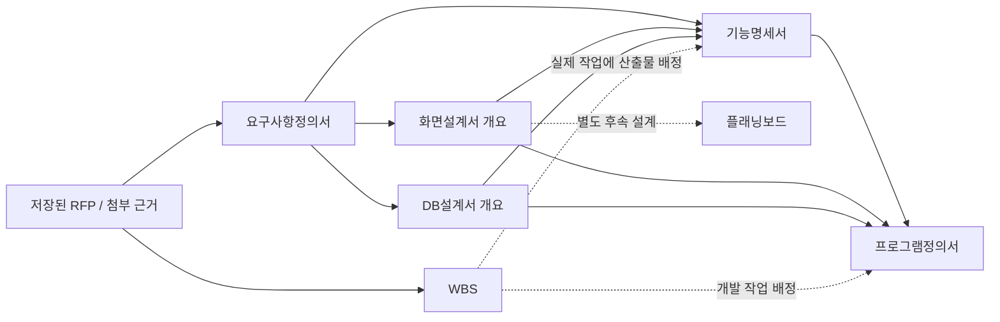

# RFP 기반 산출물 일괄 생성·기능명세서·연결 문서 탐색 설계

- 작성일: 2026-11-12 (한국시간, Asia/Seoul)
- 대상: hams-matrix 프로젝트 작업 공간, AI 생성, 산출물·출처 관리
- 상태: 사용자 검토용 설계안. 확정된 요청과 구현을 위한 권장안을 구분한다.
- 이번 작업: 현재 작업 트리의 소스를 읽고 이 문서와 HISTORY.md 링크만 작성한다. 애플리케이션 소스, SQL 파일, DB 스키마·데이터, 환경설정, 스토리지는 변경하지 않는다.
- 문서에서 제시하는 새 파일·테이블·API·필드명은 구현 제안이며 아직 존재하거나 적용된 기능이 아니다.

## 1. 요구사항과 범위

### 1.1 확정된 요청

1. 저장된 RFP 데이터 또는 첨부 문서를 근거로 **WBS, 요구사항정의서, 화면설계서, 기능명세서, DB설계서, 프로그램정의서**의 초기 데이터를 한 번에 만든다.
2. 초기 데이터에는 식별자, 문서 목적, 설명 또는 주요 구성과 문서 간 연결을 포함한다. 먼저 전체 흐름을 확인하고 각 탭에서 추가·수정·삭제하여 문서를 완성한다.
3. 화면설계서는 목록·목적·개요·연결을 먼저 만들고, 실제 화면 디자인은 이후 기존 플래닝보드에서 별도로 작성한다.
4. **기능명세서 탭을 프로그램 정의 탭 바로 앞에 추가**하고, 영속 저장 구조와 목록·등록·수정·삭제 화면을 제공한다.
5. 각 문서의 상세 보기에서 출처·근거가 되는 연결 문서를 확인하고 그 상세로 이동할 수 있어야 한다.
6. 상세 모달 헤더의 `←`, `→`로 **사용자가 방문했던 상세 화면**을 이전·다음으로 탐색한다.
7. 등록·수정·삭제 및 상세 모달은 프로젝트의 공통 스타일을 따른다.
8. 이번 단계에서는 문서만 작성한다. 사용자가 검토·수정한 문서를 기준으로 별도 구현을 요청한다.

### 1.2 설계상 해석

- 초기 생성 단위는 문서 파일 여섯 개가 아니라, 기존 탭에서 관리하는 **개별 산출물 항목**이다. 예를 들어 요구사항 10개, 기능 8개, 화면 5개, 테이블 4개 등이 각각 ID를 갖고 연결된다. 실제 Excel 파일 출력은 기존 내보내기를 확장한다.
- “한 번에”는 사용자의 한 번의 실행으로 여섯 종류의 데이터와 연결을 만드는 업무 흐름을 뜻한다. 내부적으로 AI 호출을 여러 단계로 나눌 수 있다.
- 권장 기본 동작은 **일괄 생성 완료 후 DB에 초안으로 저장하고 실제 연결 흐름을 표시**하는 것이다. 문서 완성·승인까지 자동 처리하지 않는다.
- 2번의 “DB와 화면”은 기능명세서의 저장 스키마·CRUD UI를 뜻하는 것으로 해석한다. DB설계서 항목을 생성하는 일과 애플리케이션의 실제 업무 DB에 DDL을 실행하는 일을 구분한다.
- 일괄 생성 대상은 요청된 여섯 종류다. 기존 아키텍처·검증/검수 탭은 유지하고 연결 가능한 참고 자료로 활용하되 이번 일괄 생성에 자동 포함하지 않는다.
- RFP 첨부 원본 한 개 정책은 유지한다. 일괄 생성의 추가 근거로 프로젝트 문서함 파일을 선택하는 기능은 별도로 설계한다.

## 2. 현재 구조와 소스 확인 결과

분석 기준은 HEAD만이 아니라 2026-11-12 현재 작업 트리다. 이미 진행된 CSS 이동·미사용 컴포넌트 정리·대시보드 변경과 기존 HISTORY.md 내용을 보존한다. 과거 설계 문서의 당시 상태보다 아래 실제 소스를 우선한다.

| 영역 | 확인한 파일 | 현재 구조 및 영향 |
| --- | --- | --- |
| 탭 정의 | `lib/project-tabs.ts`, `components/project-workbench.tsx` | 프로젝트 탭 14개. `database` 다음이 `program`이며 기능명세서 탭은 없다. `?tab=`과 컴포넌트 맵으로 선택한다. |
| 기존 specifications 의미 | `components/pages/specifications/specifications-page.tsx` | 이름과 달리 **프로그램정의서**를 표시하는 `ArtifactList kind="program"`이다. `/specifications`도 `program` 별칭이다. 새 기능명세서로 바꾸면 기존 URL 의미가 바뀐다. |
| 산출물 모델 | `lib/artifact-types.ts` | kind는 `wbs/architecture/requirement/screen/database/program/test` 7개. 공통 식별·상태·버전과 유형별 `fields`, 구조화 정보 `structure`, 기준 문서 ID 배열 `links`를 사용한다. |
| 영속화·검증 | `lib/artifacts.ts`, `lib/artifact-validation.ts` | 관리번호 서버 발급, 필수 필드·연결 대상·구조 검증, 버전 충돌, 논리 삭제, 리비전·감사 이력을 처리한다. 상태가 `초안`이어도 필수 필드를 생략할 수 없다. |
| 산출물 DB | `db/migrations/005_traceability.sql`, `006_integrated_deliverables.sql` | `project_artifacts`, `project_sequences`, `artifact_links`, `artifact_revisions` 기반. kind와 relation에 CHECK 제약이 있어 타입만 추가해서는 저장되지 않는다. |
| 저장된 RFP | `lib/rfp-types.ts`, `lib/rfp-server.ts`, `030_project_permissions_rfp.sql` | 별도 `project_rfp_documents`에 프로젝트당 활성 문서 한 개. 7개 장과 요구사항 목록을 JSON으로 저장하며 불변 `project_rfp_revisions`를 보존한다. 산출물 ID와 RFP 요구사항의 목록 ID는 서로 다르다. |
| RFP 첨부 | `components/pages/rfp/rfp-source.tsx`, `use-rfp-source.ts`, `lib/rfp-sources.ts`, `031_rfp_sources_generation.sql` | `project_files`의 한 파일을 `project_rfp_sources`로 연결한다. 생성 중 원본 변경 보호와 요청 상태·중지·재조회가 있다. |
| 파일 → RFP | `lib/ai/rfp-generation.ts`, `rfp-generation-prompt.ts`, `app/api/projects/[projectId]/rfp/generate/route.ts` | 첨부를 추출하여 **RFP 한 문서만** 생성·저장한다. 산출물 여섯 종류의 생성·연결 기능은 없다. |
| 탭별 AI | `lib/ai/page-data.ts`, `page-prompts.ts`, `page-tools.ts`, `app/api/ai/chats/route.ts` | 각 프로젝트 탭에 저장된 RFP를 제공한다. `save_artifact`는 현재 대상 kind만 저장하고, 임시 변경안을 검증한 뒤 최종 트랜잭션에서 반영한다. 일반 첨부 문서 본문을 선택해 일괄 생성하는 흐름은 없다. |
| DB 다건 등록 선례 | `lib/ai/database-batch.ts`, `database-batch-commit.ts` | DB 테이블의 `clientRef`와 신규 FK 별칭을 실제 ID로 치환하고 전체 그래프를 검증·저장한다. 여섯 kind 전체의 배치 기능은 아니다. |
| AI 제한·정책 | `lib/ai-server.ts`, `lib/ai/guardrail-types.ts`, `guardrail-policy.ts`, `token-usage.ts`, `generation-control.ts` | 기본 `maxChanges=3`. AI 호출 기본 최대 120초, 채팅 라우트 `maxDuration=180`. 여섯 종류를 한 무제한 호출로 만드는 가정은 맞지 않는다. |
| 공통 CRUD | `components/shared/artifact-list.tsx`, `artifact-dialogs.tsx`, `use-artifact-actions.ts`, `components/artifact-fields.tsx` | 목록 제목 클릭이 편집/상세 공용 모달을 연다. 기준 문서는 체크박스, 연결 문서는 관리번호 문자열이며 연결 상세 탐색·방문 기록은 없다. |
| 공통 모달 스타일 | `styles/dialog.css`, `styles/project-workbench.css` | 편집은 `matrix-dialog workspace-dialog admin-detail-dialog project-registration-dialog`, 공통 헤더·본문·푸터를 사용한다. 삭제는 현재 `matrix-dialog`를 사용한다. |
| 개요 흐름도 | `components/pages/project-overview/integration-overview.tsx`, `project-traceability.tsx` | 상위에서 artifacts를 받아도 실제 네트워크는 내부 고정 `NODES/LINKS`와 `DOC-01` 등의 예시 번호로 표시한다. **현재 프로젝트의 실데이터 흐름도가 아니다.** |
| 실제 추적표·검수 | `lib/traceability.ts`, `lib/integration.ts`, `components/pages/traceability/traceability-page.tsx` | 실제 요구사항→화면/DB→프로그램 관계, WBS 배정, 검수 baseline 등을 계산한다. 기능명세서와 외부 출처가 없다. 새 kind가 경로에서 빠지지 않도록 확장해야 한다. |
| 화면·플래닝보드 | `components/pages/screens/screens-page.tsx`, `lib/artifact-validation.ts`, `app/(editor)/planning-board/lib/server/board-service.ts` | 화면 artifact ID로 보드를 연다. 보드 편집·검토·완료와 screenVersion/version은 별도 관리한다. 기존 화면 수정 시 planningBoard 구조를 보존한다. |
| 문서함·파일 변경 | `lib/document-types.ts`, `lib/documents.ts`, `lib/onlyoffice.ts`, `app/api/projects/[projectId]/documents/files/[fileId]/route.ts` | 본문은 R2, 메타는 `project_files`. 삭제는 실제 파일 삭제다. OnlyOffice는 같은 파일 ID의 본문을 바꿀 수 있어 ID 또는 editor_version만으로 생성 당시 원본을 증명할 수 없다. |
| 추출 한계 | `lib/document-text.ts`, `lib/rfp-source-types.ts` | PDF/DOCX/TXT/MD, 파일당 20MiB, 추출 100,000자, PDF 50페이지. 스캔 PDF의 OCR은 제공하지 않는다. 추출 결과는 문자열이며 정확한 페이지·문단 위치를 반환하지 않는다. |
| 권한 | `lib/project-permission-model.ts`, `project-permissions.ts`, `030_project_permissions_rfp.sql` | 탭별 CRUD와 역할 상한. member는 WBS·아키텍처·RFP 쓰기 불가, admin도 RFP 쓰기 불가. 초기화된 정책에서 admin/member의 누락 행은 쓰기 불허다. |
| AI 대상 저장 | `lib/ai-target-pages.ts`, `lib/ai/conversation-targets.ts`, `036_ai_conversation_targets.sql` | 탭 목록에서 대상을 구성하지만 `ai_conversations.target_page` DB CHECK에는 기존 탭만 허용한다. 기능 탭을 AI로 사용하려면 DB도 확장해야 한다. |
| 조회·캐시 | `lib/query/keys.ts`, `components/shared/use-project-data.ts`, `use-artifact-actions.ts` | 사용자/workspace 범위의 TanStack Query. CRUD 후 artifacts·projects·dashboards를 무효화한다. 미저장 초안·현재 편집 세션을 서버 갱신으로 덮어쓰지 않는 원칙이 있다. |
| 내보내기·대시보드 | `lib/workbook.ts`, `lib/dashboard-model.ts`, `lib/dashboard-query.ts` | 문서별 출력, 추적표, 검수와 변경 영향 계산에 새 kind·초기 초안 상태가 함께 반영되어야 한다. |

### 2.1 구현상 핵심 제약

1. 현재 저장 검증으로는 ID·목적·설명만 있는 초기 항목을 저장할 수 없다. 특히 WBS 계획일·공수, 요구사항 상세, DB 물리명·컬럼 등이 필수다.
2. WBS의 `요약` 작업에는 산출물 배정 링크와 선행 의존성을 넣을 수 없다. 기존 RFP 기반 WBS 채팅은 요약 작업을 권장하므로 일괄 생성의 실제 작업 배정과 구분해야 한다.
3. `artifact_links`의 양 끝은 모두 project_artifacts다. RFP 문서 ID나 파일 ID를 그대로 links에 넣을 수 없다.
4. UI에서 기능명세서 탭만 추가하면 DB CHECK·권한 정책·AI 대상 저장·추적표·내보내기에서 누락 또는 실패한다.
5. 현재 편집 모달의 기본값과 연결 ID 배열만 재사용해서는 출처 탐색·이전/다음 방문 기록이 해결되지 않는다.

## 3. 권장 사용자 흐름

### 3.1 실행 진입점

- RFP 탭에 기존 “파일 → RFP 생성”과 구분되는 **“연계 문서 일괄 생성”** 동작을 추가한다.
- 원본 선택은 ① 저장된 RFP, ② 현재 RFP 첨부 원본, ③ 문서함에서 선택한 지원 파일로 구성한다. RFP와 보조 문서를 함께 선택할 수 있게 하되 실행 전 입력 목록을 명시한다.
- 문서함에도 “선택 문서로 연계 문서 생성” 진입을 제공하고 같은 공통 생성 모달을 연다. 문서함의 기존 AI 채팅 미지원 상태를 변경할 필요는 없다.
- 입력에 미저장 RFP 편집본을 암묵적으로 포함하지 않는다. 저장 후 진행하거나 저장본을 사용한다는 선택을 명확히 한다. 미저장 편집본을 자동 폐기하지 않는다.
- 원본 업로드·RFP 저장만으로 자동 생성하지 않는다. 사용자의 명시적인 일괄 생성 실행을 기점으로 한다.

```text
연계 문서 일괄 생성
  기준: 저장된 제안요청서 v3 / 원본.pdf / 추가 업무규칙.docx
  대상: WBS · 요구사항 · 화면 · 기능명세 · DB · 프로그램
  생성 수준: 목적과 개요 중심의 초기 초안
  기존 항목: 보존 / 중복 후보 확인
  [생성하여 초안 저장] [취소]

생성 중: 원본 확인 → 요구사항 도출 → 설계 항목·연결 생성 → 전체 검증·저장
완료: 유형별 생성 건수 / 확인 필요 항목 / [전체 흐름 보기]
```

### 3.2 생성과 후속 관리

1. 모델·원본·요청 범위·대상 유형 및 가능한 권한을 확인한다. 기본 대상은 여섯 종류다.
2. 기존 항목과 출처를 조회하여 중복을 줄이고, 입력 원본과 참조 버전을 고정한다.
3. 원본에서 명시된 사실, AI가 도출한 설계 제안, 확인이 필요한 사항을 구분하여 초기 항목과 연결을 만든다.
4. 모든 결과가 검증된 뒤 한 트랜잭션에서 산출물·연결·출처·리비전·완료 상태를 함께 저장한다.
5. 개요의 실데이터 흐름도에 저장된 관리번호와 연결을 표시한다. 연결이 없는 항목도 숨기지 않는다.
6. 문서를 선택하면 읽기 전용 상세 모달이 열린다. 상세에서 근거를 따라 이동하거나 명시적인 수정 동작으로 편집한다.
7. 각 탭의 공통 CRUD로 목적·개요·상세 구조·출처·연결을 완성한다. 사용자 수정을 일괄 재생성으로 덮어쓰지 않는다.
8. 화면 항목은 플래닝보드를 열어 별도로 설계한다. 일괄 생성이 보드 완료·검토·승인을 만들어내지 않는다.

### 3.3 재실행과 중복 처리

- 동일 requestId·동일 입력은 기존 상태/결과를 반환한다. 응답 유실 후 재전송해도 중복 생성하지 않는다. 같은 requestId의 다른 입력은 409다.
- 새 요청의 기본값은 기존 항목 보존이다. `RFP 문서 ID + 원본 목록 ID/출처 위치 + kind` 등을 후보 키로 사용하되 제목만으로 동일 항목을 확정하지 않는다.
- 기존 항목과의 매칭이 확실하면 연결 대상으로 재사용한다. 모호하면 “중복 후보”로 분리하고 전체 생성 완료로 가장하지 않는다. 검토 후 제외·재사용·신규 생성 선택으로 실행 입력을 확정한다.
- 보충 생성은 대상·근거 범위를 명시하여 수행한다. 재생성에 전체 삭제·전체 교체를 기본 포함하지 않는다. 기존 문서 수정이 필요하면 해당 탭에서 최신 버전으로 편집한다.
- 원본에 근거가 없는 문서 종류는 억지로 채우지 않는다. 예를 들어 화면이 필요 없는 배치 업무는 화면 0건과 그 이유를 표시한다. “여섯 종류 모두 검토됨”과 “종류마다 반드시 한 건 이상 생성됨”을 구분한다.

## 4. 공통 데이터와 초기 초안 모델

### 4.1 공통 항목

| 항목 | 권장 저장 방식 | 규칙 |
| --- | --- | --- |
| 내부 ID | 기존 `Artifact.id` UUID | 서버만 발급. 연결의 실제 키다. |
| 표시 ID | 기존 `code` | WBS-001, SFR-001, SCR-001, **FNC-001(제안)**, DB-001, PGM-001. 변경·삭제 후 재사용하지 않는다. |
| 명칭 | 기존 `title` | 항목의 업무상 이름. 길이 1~200자 유지. |
| 문서 목적 | 공통 `fields.purpose` 추가 | 이 항목이 왜 필요한지. 기존 자료는 비어 있어도 읽고 수정할 수 있어야 한다. |
| 설명/주요 구성 | 공통 `fields.summary` 추가 | 초기 흐름을 이해할 짧은 개요. 상세 definition·details·columns 등을 대신 확정하지 않는다. |
| 업무 상태 | 기존 `status` | 일괄 생성은 `초안`. 승인·실제 실행·완료 사실을 생성하지 않는다. |
| 작성 수준 | 신규 `detail_level = skeleton / detail` 제안 | `skeleton`: 초기 골격, `detail`: 기존 상세 검증을 거친 수준. 업무 상태와 별개다. |
| 연결 | 기존 `links`, 구조 관계 | 같은 프로젝트의 허용 kind만. UUID와 관리번호를 혼용하지 않는다. |
| 외부 출처 | 7절의 출처 테이블 | RFP·첨부 문서는 artifact 연결과 별도로 보존한다. |
| 상세 정보 | 기존 유형별 fields·structure | 탭별 편집으로 보완한다. 기존 구조를 요약 텍스트로 덮어쓰지 않는다. |
| 미완성 항목 | 서버 계산 `missingFields` 등 | 저장된 값과 현재 검증 규칙에서 계산. 빈 값을 완료로 간주하지 않는다. |

공통 필드 정의를 서버 검증·ArtifactFields·AI 필드 설명·저장 직렬화·내보내기가 동일하게 사용하도록 한다. 현재 `validateArtifactInput`과 폼 저장은 definitions의 필드만 순회하므로, UI에만 purpose/summary를 추가하면 저장 시 유실된다.

### 4.2 초기 골격과 상세 완성 검증

- `skeleton` 저장의 공통 필수값은 kind·명칭·목적·개요와 유효한 출처/설계 제안 구분이다. 요구사항은 관리번호 발급을 위한 category도 필요하다.
- 날짜·공수·물리명·컬럼 등 미확정 상세값은 빈 값으로 보존한다. 임의 날짜, 가짜 테이블 컬럼, 형식만 맞춘 기본값으로 필수 검증을 통과시키지 않는다.
- 값이 입력된 경우에는 skeleton이라도 날짜 형식·숫자 범위·옵션·길이·FK·연결 범위 등 무결성을 검사한다. 버전·권한·자기 참조·삭제 보호는 완화하지 않는다.
- `detail` 전환 시 현재 유형별 필수·구조 검증을 모두 적용한다. skeleton은 승인·진행 중·완료로 전환할 수 없고, 초안에서 계속 보완할 수 있게 한다.
- 상세 편집에도 “초기 초안 저장”과 “상세 검증 후 저장”을 구분하여, 부족한 항목을 조금씩 수정해 저장할 수 있게 한다. 브라우저 `required`와 서버 검증 수준을 일치시킨다.
- 기존 행은 기본 `detail`로 이관하되, 새로운 purpose/summary를 소급 필수로 강제하여 편집을 막지 않는다. 기존 상태가 실제로 검증되었다는 새 보증을 부여하지 않는다.
- 기존 detail 항목을 skeleton으로 내려 필수 검증을 우회하는 변경은 기본 불허한다. 별도 정책이 필요하면 결정 후 추가한다.

| 유형 | 초기 생성 내용 | 추후 작성/검증 내용 |
| --- | --- | --- |
| WBS | 단계별 목적·작업 범위·완료 기준 초안, 근거, 작업 계층 | 확정 계획일·공수·담당·진척·선후행 일정 |
| 요구사항 | 분류·목적·정의 요약·원본 요구사항 대응 | 상세 규칙·검수 기준·화면/DB 필요 여부 등 |
| 화면 | 화면 ID·목적·업무 개요·주요 입력/출력·관련 항목 | 세부 화면 정의와 플래닝보드 설계·검토 |
| 기능명세 | 기능 ID·목적·주요 처리·관련 요구사항·설계 | 입출력·업무 규칙·예외·권한 등 상세 명세 |
| DB | 논리 데이터 개체·목적·주요 속성의 설명 | 물리 테이블명·컬럼·PK/FK·도메인·인덱스 |
| 프로그램 | 프로그램 ID·목적·유형/역할 제안·기능 대응 | 모듈 경로·처리 로직·입출력·예외·테이블 CRUD |

### 4.3 WBS·ERD·검수 영향

- 일정 미확정 WBS는 별도 “일정 미정” 목록에서 보여주고 간트 축·지연·공수 집계·일정 이미지/발행 계산에서는 구분한다. 오늘 날짜나 0일 작업으로 바꾸지 않는다.
- 요약 WBS는 parent 관계로 하위 작업을 묶고, 산출물 배정은 실제 작업의 links에 둔다. 요약 작업의 출처는 외부 출처 참조로 표현할 수 있으나 산출물 links 허용 제한을 우회하지 않는다.
- 일정이 있는 WBS끼리는 현재 날짜 제약을 유지한다. 부모·선행 중 일정 미정이 있으면 검증 보류를 표시하고 확정 일정으로 전환할 때 전체 관계를 재검증한다.
- DB 골격은 ERD 목록에 논리 개체로 표시할 수 있지만 미정 컬럼·물리 FK를 만들어내지 않는다. 물리 ERD/DDL 성격의 출력에서는 미완성을 알린다. 실제 컬럼 확정 시 기존 도메인 메타와 FK 검증을 사용한다.
- 검수·대시보드는 골격 항목을 완성/승인으로 집계하지 않는다. 기능 누락은 새 정책으로 보완하되 기존 프로젝트의 검수 조건을 임의로 일괄 강화하지 않는다.

## 5. 기능명세서 탭과 CRUD

### 5.1 식별과 배치

- 새 ArtifactKind/ProjectTab 문자열은 `function`, 문서명은 `기능명세서`, 표시 관리번호 prefix는 `FNC`를 제안한다.
- 탭 순서: `… 요구사항 → 화면 설계 → DB 설계 / ERD → 기능명세서 → 프로그램 정의 → 검증 / 검수 …`.
- canonical URL은 `/projects/[projectId]?tab=function`. 기존 `/specifications`와 program 탭의 의미는 유지한다. 새 독립 별칭 URL은 필수 범위가 아니다.
- 기능은 업무 동작의 명세, 프로그램은 구현 단위의 명세다. 한 기능을 여러 API/배치가 구현하거나 여러 기능을 한 프로그램이 처리할 수 있는 다대다 연결을 허용한다.

### 5.2 권장 상세 필드

| 키(제안) | 표시명 | 상세 수준 필수 여부 |
| --- | --- | --- |
| purpose / summary | 문서 목적 / 설명·주요 구성 | 신규 생성 필수, 기존 문서 호환 규칙 적용 |
| definition | 기능 정의 | 필수 |
| functionType | 기능 유형 | 선택: 조회·등록·수정·삭제·처리·연계·배치·공통 등, 분류 확정 필요 |
| actor | 수행 주체 | 선택 |
| preconditions | 사전 조건 | 선택 |
| inputs / outputs | 입력 / 출력 | 선택, 업무상 해당 없음 명시 가능 |
| details | 주요 처리 흐름 | 필수 |
| businessRules | 업무 규칙 / 유효성 검증 | 선택 |
| exceptions | 예외 / 오류 처리 | 선택 |
| permissions | 접근 권한 / 보안 조건 | 선택 |
| acceptance | 완료 / 검증 기준 | 선택 |
| owner / notes | 담당자 / 비고 | 기존 공통 방식 |

- 목록은 공통 ArtifactList를 바탕으로 관리번호·명칭·목적/요약·작성 수준·상태·담당자·연결·버전을 보여준다.
- 명칭 클릭은 공통 상세 보기, 수정 버튼은 공통 편집 모달, 삭제 버튼은 공통 삭제 확인을 연다. 신규 등록도 기존 공통 입력·오류·버튼·헤더·본문 스타일을 사용한다.
- 연결 문서 선택은 요구사항·화면·DB·아키텍처를 대상으로 한다. 기능의 후행 프로그램은 program→function 연결의 역방향 조회로 표시한다.
- 별도 기능 전용 물리 테이블에 공통 필드를 중복 저장하지 않고 기존 project_artifacts의 function 행으로 관리한다.
- 삭제는 기존 버전 검사·논리 삭제·연결 해제 후 삭제 정책을 따른다. 참조 중인 기능 삭제를 조용히 cascade 처리하지 않는다.

## 6. 문서 간 연결과 실제 흐름도

### 6.1 관계 의미와 방향

기존 `links`는 **현재 산출물(source) → 참조하는 기준 문서(target)** 방향이다. 사용자에게 보여주는 도출 흐름은 **기준 → 후속 산출물**로 그리므로 저장 방향과 표시 화살표를 구분한다.



이 그림은 허용 관계의 개념도다. 모든 문서가 반드시 이 순서로 하나씩 존재하거나 연결되어야 한다는 뜻이 아니다. 화면 없는 배치·DB 없는 기능·복수 요구사항을 만족하는 기능 등을 허용한다. 탭 표시 순서와 생성 의존 순서도 동일할 필요가 없다.

| source kind | 허용하는 기준 문서 target kind 권장안 | 변경 |
| --- | --- | --- |
| wbs | architecture, requirement, screen, **function**, database, program, test | function 추가. 요약 작업 links 금지 유지 |
| architecture | 없음 | 유지 |
| requirement | requirement, architecture | 유지. 요구사항 간 참고를 도출 경로와 구분 |
| screen | requirement, architecture, database | 유지. 연결된 기능은 역방향에서 조회 |
| database | requirement, architecture | 유지. DB FK는 별도 structure 관계 |
| function | requirement, screen, database, architecture | 신규 |
| program | requirement, screen, database, **function**, architecture | function 추가 |
| test | requirement, screen, database, program, **function** | 기능 직접 검증 연결 추가 제안 |

- 외부 출처는 위 links에 섞지 않는다. WBS 계층/선후행, DB FK, 프로그램 테이블 CRUD도 일반 문서 근거와 다른 관계 유형으로 표시한다.
- 같은 프로젝트·workspace의 활성 항목만 새 연결에 사용한다. 자기 참조와 미해결 별칭은 거부한다.
- 일반 참고 관계나 DB 순환 FK를 모든 경우 금지하는 전역 DAG 검증은 추가하지 않는다. WBS 순환 검증 등 관계별 규칙을 유지하고 그래프 탐색에는 visited 집합을 사용한다.

### 6.2 실데이터 흐름도

- `project-traceability.tsx`의 고정 NODES/LINKS를 실제 artifacts·구조 관계·외부 출처 요약을 받는 모델로 전환한다. 가상의 DOC 번호 대신 저장된 code를 표시한다.
- 카드에는 관리번호·명칭·문서 목적·요약·작성 수준·상태를 표시한다. kind/상태/연결 누락 필터와 선택 항목 중심의 선행·후행 탐색을 제공한다.
- 항목 클릭은 8절 공통 상세를 연다. 연결 목록과 추적표에서도 같은 상세 진입을 사용한다.
- 삭제/연결 해제 후 새로고침하면 그래프에서도 빠져야 한다. 연결 없는 항목은 “미연결”로 남기며 예시 연결을 자동 보충하지 않는다.
- 기존 요구사항 추적표에 기능 ID를 추가하고 `요구사항→기능→프로그램`, 화면·DB 경유, 기능 미연결, 기존의 직접 요구사항→프로그램 경로를 모두 유지한다. 경로의 조합을 무작정 곱하여 실제 없는 연결 행을 만들지 않는다.
- 대량 문서는 유형별 집계와 선택한 노드 주변 관계를 우선 보여준다. 화면에서 일부만 표시했으면 전체 건수·표시 범위를 알린다.

## 7. 출처·근거 모델

### 7.1 서로 다른 대상을 구분

| 대상 | 식별 방법 | 상세에서 제공할 내용 |
| --- | --- | --- |
| 연결 산출물 | artifact ID, 필요 시 기준 version | 해당 문서의 현재 상세, 기준 버전과 달라졌는지 표시 |
| 저장된 RFP | RFP document ID + document version + 장/목록 위치 | 생성/연결 당시 불변 revision의 본문과 해당 위치, 현재 버전 이동 |
| 첨부 문서 | project_files ID + 생성 시 본문 hash/스냅샷 | 당시 파일명·추출 본문·발췌·근거 설명, 현재 파일이 있으면 별도 다운로드 |

요구사항의 기존 `fields.source/sourceId`, 다른 유형의 notes는 사람이 읽는 보조 설명이다. 제목이나 원본 요구사항 번호만으로 클릭 가능한 영속 관계가 생긴 것으로 간주하지 않는다.

### 7.2 권장 저장 구조

1. **`project_source_snapshots`(신규 제안)**: ID, workspace/project, source_type(rfp/file), 원본 RFP ID/version 또는 file ID, 원본 이름, 내용 hash, 고정된 JSON/추출 본문, 생성 시각·작성자, 관련 생성 요청 ID를 보관한다. 동일 생성에서 여러 문서가 같은 스냅샷을 공유한다.
2. **`artifact_source_references`(신규 제안)**: artifact ID, snapshot ID, 원본 내 위치(locator), 짧은 발췌, 근거 설명, origin(원문 명시/설계 도출/사용자 지정)을 보관한다. 복합 범위 키로 다른 프로젝트의 스냅샷 연결을 막는다.
3. artifact→artifact 연결은 기존 artifact_links를 사용한다. 외부 출처 테이블에 같은 연결을 다시 저장하여 두 관계가 어긋나게 하지 않는다.
4. 출처 추가·수정·해제도 artifact version을 올리고 같은 리비전·감사 트랜잭션에 포함한다. 리비전 snapshot에는 당시 출처 참조를 포함하여 이후 수정과 구분한다.
5. 스냅샷은 불변으로 보관한다. 원본 파일의 물리 삭제가 과거 근거까지 지우도록 cascade하지 않는다. 원본 식별자는 추적용으로 남기되 스냅샷 접근에도 현재 프로젝트와 대상 READ 권한을 검사한다.

권장 초기안은 **생성에 사용한 추출 본문/구조화 RFP를 보존하여 모달에서 읽을 수 있게 하는 것**이다. 원본 바이너리의 과거 버전 다운로드까지 보장하려면 R2의 불변 사본 보관·정리 정책을 추가해야 하며 결정 항목으로 남긴다. 현재 파일 다운로드와 생성 당시 원본 다운로드를 같은 버튼으로 표시하지 않는다.

### 7.3 위치와 변경 감지

- RFP는 장 경로와 목록 item ID/원본 번호를 함께 기록한다. 파일 기반 RFP 재생성은 목록 ID를 새로 발급하므로 RFP version 없이 item ID만 저장하지 않는다.
- 현재 추출기는 위치 정보가 없는 문자열만 반환한다. 초기 구현은 추출 본문 내 구간·발췌를 사용하고 정확한 PDF 페이지나 DOCX 문단 번호를 AI에게 만들어내게 하지 않는다.
- 정확한 페이지 탐색이 필요하면 추출 결과를 페이지/문단 단위 구조로 확장한 뒤 서버가 검증한 locator만 허용한다.
- 파일 변경은 editor_version 외에 object_key·크기·updated_at 및 실제 읽은 바이트의 hash로 확인한다. 원본 이름 변경과 본문 변경을 구분한다.
- 저장된 RFP/파일이 바뀌면 “생성 당시 근거와 현재 원본이 다름”을 표시한다. 후속 문서를 자동 재작성하지 않는다.
- 과거 문서의 텍스트 출처에서 ID를 확신할 수 없는 연결은 자동 생성하지 않고 “출처 연결 필요”로 보여준다. 편집 모달에서 기존 산출물·RFP 장·문서함 자료를 선택하여 수동 보완할 수 있게 한다.

## 8. 공통 상세 모달과 이전/다음 탐색

### 8.1 표시와 동작

읽기 전용 상세를 편집 폼과 분리하되, 프레임·필드 표시·구조 미리보기는 공통으로 재사용한다. 제목 클릭은 항상 상세, 수정은 명시적인 별도 동작으로 통일한다.

```text
┌─────────────────────────────────────────────────────────┐
│ [←] [→]  FNC-003 · 회원 등록            [수정] [닫기]     │
├─────────────────────────────────────────────────────────┤
│ 기능명세서 · 초기 초안 · v1                              │
│ 문서 목적 / 설명·주요 구성 / 유형별 상세                  │
│ 출처·근거: [RFP v3 > SFR-005] [업무규칙.docx > 발췌]      │
│ 기준 문서: [SFR-002] [SCR-001] [DB-001]                   │
│ 이 문서를 사용하는 문서: [PGM-004] [WBS-008]             │
│ 미작성 항목 / 근거 변경 안내                              │
└─────────────────────────────────────────────────────────┘
```

- `<dialog>`와 공통 `workspace-dialog admin-detail-dialog` 헤더·본문·닫기 버튼을 사용한다. 크기·색상·여백·스크롤·테마는 기존 토큰을 따른다.
- 헤더의 아이콘은 기존 Icon 또는 lucide의 ArrowLeft/ArrowRight를 재사용한다. `aria-label="이전 문서"`, `aria-label="다음 문서"`와 tooltip을 제공하고 기록이 없으면 disabled다.
- 기준 문서, 역방향 사용 문서, RFP/첨부 출처는 각각 실제 상세 페이지를 같은 모달 본문에서 연다. 모달을 여러 겹 쌓지 않는다.
- artifact의 structure(columns, tableOperations, WBS 관계 등)는 읽기 전용으로 표시한다. 화면 상세는 플래닝보드 실행/미리보기 링크를 유지한다. 새 창의 보드/다운로드는 모달 내부 방문 기록에 넣지 않는다.
- 수정 후 저장하면 현재 상세를 최신 버전으로 갱신하고 관련 조회를 무효화한다. 수정 중 연결 이동/닫기는 기존 미저장 보호를 적용한다. 상세에 돌아와도 방문 이력을 새로 한 번 더 push하지 않는다.
- Escape는 현재 모달 닫기, Tab은 모달 안 이동, 닫힌 뒤 원래 목록/그래프 버튼으로 포커스를 복원한다. 내부 문서 이동 후 제목에 포커스를 주고 변경을 알린다.

### 8.2 방문 기록 모델

- ProjectWorkbench 하위 공통 provider에 `entries[] + cursor`를 둔다. 각 항목은 `{workspaceId, projectId, targetType, id, version?, locator?, scrollPosition?}`로 식별한다.
- targetType은 artifact / rfpRevision / fileSnapshot 등이다. artifact는 기본 최신 상태, 출처는 고정 revision/snapshot을 연다. 동일 ID라도 서로 다른 RFP 버전은 다른 방문 대상이다.
- 처음 A 상세를 열면 `[A], cursor=0`. B→C를 열면 `[A,B,C], cursor=2`. 이전은 B, 다음은 C로 이동한다. 목록상 이전/다음 행이나 브라우저 전체 방문 기록을 뜻하지 않는다.
- B로 돌아온 상태에서 D를 새로 열면 `[A,B,D]`로 C 이후 기록을 잘라낸다. 현재 대상의 중복 클릭은 새 방문으로 추가하지 않는다.
- 직접 목록에서 새 상세를 열면 새 탐색 세션으로 시작한다. 모달 닫기·프로젝트/workspace/사용자 변경 시 기록과 캐시를 정리한다. 다른 탭의 연결 상세 이동만으로 프로젝트 선택/브라우저 URL을 변경하지 않는다.
- 삭제되거나 권한이 없어진 대상은 내용 없이 “확인할 수 없음”을 표시한다. 이전으로 복귀는 허용하고 기존 방문 항목을 다른 문서로 대체하지 않는다. 응답 순서가 뒤바뀌어도 최신 탐색 대상만 반영하도록 요청 취소 또는 세션 토큰을 적용한다.
- 캐시 키에 사용자/workspace/project/대상 유형/ID/version을 포함하고 상세 진입 시 현재 접근 권한을 확인한다. access 10초 폴링을 재도입하지 않는다.

## 9. 일괄 생성 API와 처리 설계

### 9.1 전용 서비스로 분리

기존 페이지 AI의 현재 탭 제한을 그대로 유지하고 **프로젝트 산출물 일괄 생성 전용 서비스**를 추가한다. 일반 채팅의 save_artifact를 모든 kind에 열거나 가짜 채팅방으로 우회하지 않는다. 기능명세서의 개별 AI 채팅만 기존 탭 AI 모델에 정상 추가한다.

| API(신규/확장 제안) | 역할 |
| --- | --- |
| `POST /api/projects/[projectId]/deliverable-generations` | requestId·원본 목록·대상·모델·scope·기준 버전 검증 후 요청 시작 |
| `GET /api/projects/[projectId]/deliverable-generations/[requestId]` | 단계·상태·오류·최종 생성 ID/code 조회, 응답 유실 복구 |
| `POST …/[requestId]/continue` | 저장된 checkpoint부터 다음 유한 생성 단계를 진행 |
| `POST …/[requestId]/stop` | 중지 요청. 완료한 결과를 삭제하는 동작이 아님 |
| `GET /api/projects/[projectId]/artifacts/[artifactId]` | 기존 PATCH/DELETE 경로에 상세 GET 추가. 기준·역방향 연결과 출처 요약 반환 |
| `GET /api/projects/[projectId]/source-snapshots/[snapshotId]` | 권한 검사 후 고정된 RFP/추출 본문 상세 반환 |

- 생성 입력은 파일명·임의 URL·클라이언트가 준 본문을 신뢰하지 않고 서버에서 프로젝트 범위와 실체를 확인한다.
- 중복 후보 선택이 필요한 경우 요청을 검토 대기 상태로 두고 선택 결과를 별도 version 검증 후 고정한다. 이미 분석한 입력을 조용히 변경하지 않는다.
- 상세 API는 구조화 데이터만 반환한다. R2 object_key, 인증 쿠키, 내부 정책 비밀값을 DTO에 포함하지 않는다.
- 외부 출처 추가·변경은 기존 산출물 CREATE/PATCH를 확장하여 artifact와 같은 버전·트랜잭션으로 처리한다. 근거만 바뀌는 수정도 UPDATE 권한을 검사한다.

### 9.2 요청 저장과 실행 방식

- `project_deliverable_generation_requests`를 추가하여 사용자/workspace/project, 정규화 입력 hash, 원본 스냅샷, 기준 버전, 모델·정책 버전, 상태·단계, 임시 결과, 최종 artifact 매핑, 오류, lease·시각을 저장한다.
- 권장 상태: `running → validating → finalizing → completed`, 별도로 `review_required / stop_requested / cancelled / failed`. 상태 전이는 서버의 조건부 UPDATE로 검사한다.
- 원본 확인→요구사항 정리→화면/DB/기능/프로그램 및 WBS 연결 계획→전체 검증을 여러 bounded 단계로 처리한다. 아직 저장되지 않은 항목은 clientRef만 사용한다.
- 현재 소스에 없는 영구 작업 큐가 이미 존재한다고 가정하지 않는다. 초기안은 클라이언트가 자동 continue 요청을 순차 호출하고 서버가 checkpoint·단계 lease를 보존하는 방식이다. 창을 닫으면 다음 단계 진행이 멈추며 재접속 후 이어갈 수 있다. 창 종료 후에도 계속 실행해야 한다면 별도 worker/queue가 필요하다.
- 요청을 중복 실행해도 단계별 lease 소유자만 결과를 반영한다. AI 대기 동안 DB write transaction을 열어두지 않는다. 단계별 출력에 complete·건수·coverage를 확인하고 출력 잘림을 성공으로 저장하지 않는다.
- `maxChanges`를 호출 수가 아니라 **최종 생성 산출물 수**로 계산한다. 기본 3건이면 여섯 종류 생성은 제한될 수 있으므로 실행 전 제한을 알리고 정책 변경이 필요한지 표시한다. 내부 continue 호출로 제한을 우회하지 않는다.
- 모델·토큰 한도·생성 중지·AI 사용 가능·입출력/원본 검사를 공통 기반에 연결한다. `rfp-generation.ts`의 일부 guard.inspect 호출은 현재 주석 처리되어 있으므로 그 경로를 복사했다고 검사까지 적용됐다고 간주하지 않는다. 새 서비스는 유효한 정책의 검사 단계를 명시적으로 실행한다.

### 9.3 원자 저장과 신규 ID 연결

1. 생성안의 모든 item에 유일한 clientRef와 kind·초안 필드·출처·연결 계획을 둔다. UI에서 임시 참조를 확정 관리번호로 보여주지 않는다.
2. 서버가 전체 kind/필드/원본 커버리지·허용 연결·WBS/DB 구조와 정책 한도를 검증한다. 같은 배치 신규 참조와 실제 기존 ID를 구분한다.
3. 짧은 최종 write transaction에서 현재 권한·원본 버전/hash·기존 참조 version·도메인 catalog revision·취소/lease 상태를 다시 검사한다. 불일치면 409로 거절한다.
4. 전체 신규 UUID와 project_sequences 관리번호를 할당하고, clientRef를 UUID로 변환한다. RFP 번호를 새 관리번호나 링크 ID로 사용하지 않는다.
5. 모든 artifact 행을 먼저 저장한 뒤 links·출처를 저장하고 전체 그래프를 재검증한다. 모든 revision과 생성 완료 상태·결과 ID 매핑도 같은 transaction에 기록한다.
6. 성공 시에만 completed와 최종 ID/code를 반환한다. 실패하면 산출물·연결·순번·리비전의 부분 저장을 롤백한다. 생성 요청의 실패 이력과 실제 사용 토큰 집계는 별도로 남을 수 있다.
7. finalizing 전에 stop이 반영되면 저장하지 않는다. 최종 commit이 먼저 완료되었다면 completed를 반환하고 취소 성공으로 표시하지 않는다. completed 요청을 재조회해 새 UUID를 다시 발급하지 않는다.

DB 다건 생성의 `applyDatabaseBatch`는 ID 치환·전체 검증·행 선저장 선례로 활용한다. 기존 mutateArtifact를 순차 호출하는 것만으로는 앞으로 생성될 항목 ID 참조와 마지막 단계 실패 시 원자성이 해결되지 않으므로, 공통 영속화·검증 함수를 활용한 별도 전체 배치 경로가 필요하다.

### 9.4 권한과 기존 편집 보존

- 저장된 RFP는 rfp READ, 파일은 documents READ, 생성 대상 각각은 해당 탭 CREATE가 필요하다. RFP를 읽어 산출물을 만드는 데 RFP UPDATE까지 요구하지 않는다.
- member의 WBS 쓰기 금지 등 현재 역할 상한을 유지한다. 여섯 종류 중 권한 없는 대상이 있으면 기본 전체 생성은 시작하지 않고 이유를 표시한다. 일부 유형만 생성하려면 사용자가 대상 범위를 명시적으로 조정해야 한다.
- function의 역할 상한은 requirement/program과 같은 owner/admin/member 쓰기, viewer 읽기를 제안한다. 기존 프로젝트의 admin/member function 권한은 program의 현재 설정을 역할 상한과 교차하여 이관하는 보수적 기본안을 제안한다.
- 일반 조회는 WorkspaceQueryRuntime 정책을 따른다. 생성/저장/계속 실행은 자동 재시도하지 않고, 동일 요청 상태 조회로 복구한다. 진행 중 생성 상태 조회와 access 조회를 구분한다.
- 일괄 생성·기능 CRUD·출처 수정 후 artifacts·projects·dashboards·상세/출처/흐름 관련 Query를 무효화한다. RFP/보드의 미저장 초안을 자동 덮어쓰지 않고 별도 변경 안내를 제공한다.
- 플래닝보드의 version·screenVersion 및 planningBoard 참조를 보존한다. 화면 개요 수정과 보드 변경이 충돌하면 기존 409 복구 절차를 따른다.

## 10. DB 변경 방향과 이관 영향

**이 절은 차후 구현 시 필요한 설계이며 이번 작업에서 SQL을 작성하거나 실행하지 않는다.**

| 대상 | 변경 방향 | 보존 조건 |
| --- | --- | --- |
| project_artifacts | kind CHECK에 function 추가, detail_level 추가 | 모든 기존 ID/code/status/버전/JSON/삭제 정보 유지 |
| project_role_tab_permissions | tab_key CHECK에 function 추가, 프로젝트별 신규 권한 행 이관 | 기존 역할 상한과 수동 정책 유지. 누락을 전체 쓰기 허용으로 복구하지 않음 |
| ai_conversations | target_page CHECK에 function 추가 | 대화 ID·현재 target/target_version·메시지·이미지·이력 보존 |
| project_sequences | FNC prefix 사용 | 기존 번호 불변, 삭제 번호 재사용 금지 |
| artifact_links / artifact_revisions | 기존 관계 구조 재사용, 출처 포함 snapshot 직렬화 확장 | 기존 복합 FK·relation CHECK·불변 revision 트리거 유지 |
| 신규 생성 요청 테이블 | 입력·단계·상태·임시 결과·최종 결과 저장 | 동일 requestId 멱등성, 프로젝트별 활성 작업 제어, lease 인덱스 |
| 신규 출처 snapshot/참조 테이블 | 고정 원본과 artifact 출처 연결 | workspace/project 범위, 원본 삭제 후 근거 보존, 불변성 |

- SQLite/Turso CHECK 변경은 단순 ALTER COLUMN으로 처리할 수 없으므로 테이블 재구성 이관을 검토한다. 기존 006을 수정·재실행하지 않고 다음 가용 번호의 새 migration을 작성한다. 현재 확인된 마지막 번호는 044이며 구현 시 다시 확인한다.
- 006 시점 이후 artifact를 참조하는 아키텍처 이미지/생성 테이블(012), 플래닝보드/리비전/AI 요청(032) 등이 추가되었다. 006의 rebuild SQL을 그대로 복사하면 이 관계를 놓칠 수 있다.
- ai_conversations의 후속 컬럼·타깃 범위 트리거(036) 및 ai_prompt_chats FK(009)도 보존해야 한다. 테이블·인덱스·트리거·FK를 현재 전체 migration 기준으로 목록화한다.
- 임시 DB에서 기존 데이터를 채운 뒤 이관 전후 행 수·식별자·필드·순번·불변 이력·보드·이미지·채팅을 대조하고 `foreign_key_check`와 무결성 검사를 수행한다.
- 과거 purpose/summary는 자동 AI 호출 없이 비워두거나 기존 definition을 읽기 표시의 대체값으로 사용한다. 과거 문서를 일괄 재작성하지 않는다.
- 롤백은 백업 복원 계획으로 준비한다. function 데이터가 생긴 뒤 예전 스키마로 단순 downgrade하면 데이터 손실이 발생하므로 삭제형 되돌리기를 기본 제공하지 않는다.

## 11. 변경 대상 파일

아래는 **구현 단계의 예상 대상**이다. 이번 문서 작성에서 변경한 소스 파일 목록이 아니다. 기존 파일과 신규 제안을 구분한다.

### 11.1 타입·저장·권한

| 기존 파일 | 변경 이유 |
| --- | --- |
| `lib/artifact-types.ts` | function kind·정의·허용 연결, 공통 목적/요약·작성 수준·출처 DTO |
| `lib/project-tabs.ts`, `components/project-workbench.tsx` | 탭 순서·라벨·페이지 매핑, 공통 상세/일괄 생성 상태 제공 |
| `lib/artifacts.ts`, `lib/artifact-validation.ts` | 골격/상세 검증, 출처 동시 저장, 상세 조회, batch 공통 함수, 기존 구조 보존 |
| `lib/project-permission-model.ts`, `lib/project-permissions.ts` | function 권한·정책 검증, 대상별 일괄 권한 확인 |
| `lib/query/keys.ts`, `components/shared/use-project-data.ts`, `use-artifact-actions.ts` | 상세/출처/생성 키, scope·세션 보호·캐시 무효화, 폼 직렬화 |
| `app/api/projects/[projectId]/artifacts/route.ts`, `artifacts/[artifactId]/route.ts` | 신규 필드/출처 저장, 상세 GET, 최신 버전 검사 |
| `lib/document-types.ts`, `lib/documents.ts`, `lib/document-text.ts` | 생성용 문서 선택 메타, 출처 추출/위치 모델. 정확한 페이지 탐색 채택 시 추출기 확장 |
| `lib/rfp-sources.ts`, `lib/onlyoffice.ts`, 문서 files 및 editor/callback API | 생성 중 원본 변경 감지·스냅샷 접근·원본 삭제/편집과 출처 보존의 일관성 검토 |

### 11.2 화면과 공통 모달

| 기존 파일 | 변경 이유 |
| --- | --- |
| `components/shared/project-page-context.tsx`, `artifact-list.tsx`, `artifact-dialogs.tsx` | 상세/수정 분리, 연결 상세 동작, 출처 선택, 골격 저장, 공통 모달 |
| `components/artifact-fields.tsx`, `components/shared/artifact-field-inputs.tsx`, `artifact-structure-editor.tsx` | 공통 목적/요약, 작성 수준별 required, 읽기/편집 구조 재사용 |
| `components/pages/rfp/rfp-page.tsx`, `rfp-source.tsx`, `use-rfp-source.ts` | 기존 RFP 생성과 별도인 일괄 생성 진입·원본 전달 |
| `components/pages/documents/documents-page.tsx` | 선택 문서의 공통 일괄 생성 진입 |
| `components/pages/project-overview/project-overview-page.tsx`, `integration-overview.tsx`, `project-traceability.tsx` | 고정 예시를 실데이터 흐름도로 전환·상세 연결 |
| `components/pages/requirements/requirements-page.tsx`, `screens/screens-page.tsx`, `database/database-page.tsx`, `specifications/specifications-page.tsx` | 공통 상세·목적/요약·작성 수준, 기능 연계, 보드 진입 보존 |
| `components/pages/wbs/wbs-page.tsx`, `wbs-schedule-chart.jsx`, `wbs-fields.tsx`, `wbs-form-state.tsx` | 공통 목록과 다른 WBS UI에도 상세 진입·일정 미정·골격 편집 지원 |
| `components/pages/database/database-diagram.tsx`, `database-erd-preview.tsx` | 초기 DB 골격과 물리 설계 미완성 구분 |
| `styles/dialog.css`, `styles/project-workbench.css` | 공통 모달·입력·목록 스타일 재사용, 필요한 공통 탐색 버튼만 확장 |
| `styles/pages/projects/tabs/overview/`, `wbs/` 등 기존 소유 CSS | 실제 흐름도·일정 미정 UI. 새 전용 CSS도 해당 탭 경로 규칙 준수 |

신규 파일 제안:

- `components/pages/functions/functions-page.tsx`: 기능명세서 탭. 공통 ArtifactList/CRUD를 재사용한다.
- `components/shared/artifact-detail-dialog.tsx`, `use-document-navigation.ts`: 공통 상세 프레임과 방문 기록.
- `components/shared/deliverable-generation-dialog.tsx`, `use-deliverable-generation.ts`: 일괄 생성 입력·진행·복구.
- `lib/source-references.ts`, `lib/source-reference-types.ts`: 출처 snapshot·조회·저장·DTO.
- 전용 CSS가 실제로 필요할 때만 `styles/pages/projects/tabs/function/` 또는 여러 탭 공유용 `styles/pages/projects/`에 추가한다. 빈 전용 CSS를 생성하지 않는다.

### 11.3 AI·추적·출력·검증

| 기존 파일 | 변경 이유 |
| --- | --- |
| `lib/ai/page-prompts.ts`, `page-data.ts`, `page-tools.ts` | function 개별 AI, 공통 목적/요약·출처·작성 수준, 관련 read 범위 |
| `lib/ai-target-pages.ts`, `lib/ai/resolve-target.ts`, `conversation-targets.ts` | function 대상 유효성·기존 대상/버전 보존 |
| `app/api/ai/chats/route.ts`, `components/ai/use-ai-target.ts` 등 | 기능 탭 실행·응답·캐시 갱신 확인, 현재 탭 제한 유지 |
| `lib/ai/database-batch.ts`, `database-batch-commit.ts` | 새 batch의 검증·영속화 공통 부분 재사용 여부 검토. 기존 DB batch 계약 보존 |
| `lib/traceability.ts`, `lib/integration.ts` | 기능 경유 추적, 역방향 연결, 검수·baseline 영향, skeleton 완성 여부 |
| `lib/workbook.ts`, `components/pages/traceability/traceability-page.tsx`, `deliverables/deliverables-page.tsx` | 기능명세서 시트·기능 ID 열·출처·작성 수준·연결 이동 |
| `lib/wbs-schedule.ts`, `wbs-schedule-server.ts`, `wbs-publications.ts`, `wbs-date-constraints.ts` | 일정 미정의 계산·발행·날짜 검증 영향 |
| `lib/dashboard-model.ts`, `dashboard-query.ts`, `dashboard-types.ts` | 새 kind 집계·미완성 구분·변경 영향. 대시보드 요약 DTO에 원문을 넣지 않음 |
| `scripts/test-rfp-source.mjs`, `test-project-permissions-rfp.mjs`, `test-ai-target-migration.mjs`, `check-artifacts.mjs`, `check-integrated.mjs` 등 | 기존 유형 수·탭 수·권한·이관·추적/출력 회귀 |
| `package.json`, `styles/README.md`, `docs/INTEGRATED_DELIVERABLES.md`, `docs/TRACEABILITY.md` | 필요한 테스트 명령과 실제 구조 문서 갱신 |

신규 파일/라우트 제안:

- `lib/ai/deliverable-generation.ts`, `deliverable-generation-prompt.ts`, `deliverable-batch-commit.ts`와 필요한 타입/검증 모듈.
- `app/api/projects/[projectId]/deliverable-generations/route.ts`, `[requestId]/route.ts`, `[requestId]/continue/route.ts`, `[requestId]/stop/route.ts`.
- `app/api/projects/[projectId]/source-snapshots/[snapshotId]/route.ts`.
- `db/migrations/`의 다음 가용 번호: kind/권한/AI 대상 확장, 작성 수준·생성 요청·출처 구조. 기존 migration은 수정하지 않는다.
- `scripts/test-deliverable-generation.mjs`, `test-artifact-detail-navigation-browser.mjs` 등 핵심 동작 검증 스크립트. 최종 파일 분리는 구현 시 조정한다.

## 12. 검증 방법과 완료 기준

### 12.1 이번 문서 작업의 검증

- 문서 경로가 `docs/history/2026-11-12/작업명.md`이고 HISTORY.md의 기존 목록을 보존하며 상대 링크와 작성일을 추가했는지 확인한다.
- 요구사항·현 구조·수정 방향·예상 파일·검증·결정 사항을 포함했는지 확인한다.
- 실제 소스에서 확인한 내용과 신규 제안을 구분하고, 사용하지 않는 옛 CSS/컴포넌트를 구현 대상으로 잘못 복원하지 않는지 확인한다.
- 작업 직전 파일 내용 기준으로 HISTORY.md와 이 문서 외 파일이 바뀌지 않았는지 확인한다. 이번 단계에서는 build/test/db:migrate와 DB 연결을 실행하지 않는다.

### 12.2 구현 단계 자동 검증

| 검증 대상 | 핵심 시나리오 및 기대 결과 |
| --- | --- |
| 일괄 생성 성공 | 저장 RFP, 첨부 원본, 문서함 자료 각각에서 여섯 종류 검토·생성·연결·초안 저장. 새로고침 뒤 실제 ID와 관계 유지 |
| 근거 충실성 | 원문 사실/설계 제안 구분, 범위 외 항목 제외, 화면 불필요 업무 0건 허용, 출력 잘림·coverage 누락은 완료로 처리하지 않음 |
| 원자성 | 중간 kind 검증 실패·마지막 연결 실패·취소·타임아웃 시 신규 artifacts/links/revisions/순번 부분 반영 없음 |
| 멱등성·동시성 | 중복 POST/continue·응답 유실 재조회는 같은 결과, 다른 입력의 동일 ID 409, 단계 lease 만료 및 재개, 완료 후 stop 경쟁 |
| 변경 충돌 | 생성 중 RFP/파일/참조 artifact/도메인 변경은 충돌 표시, 사용자 편집 보존, 현재 snapshot을 과거 근거로 바꾸지 않음 |
| 권한 | owner/admin/member/viewer와 guest, 탭별 CREATE 제한, 실행 도중 회수, 다른 프로젝트/사용자 요청 접근 차단 |
| 정책·한도 | maxChanges=3 및 상한 직전/초과, 전체 단계 누적 건수, 토큰 부족·중지·모델 오류, 내부 단계로 제한 우회 불가 |
| 골격/상세 | 날짜·컬럼 미정 골격 저장과 점진 수정 가능, 입력된 잘못된 날짜/FK 거부, detail 전환은 기존 필수 검증, skeleton 승인/완료 금지 |
| WBS·DB | 요약 WBS 링크 제한·하위 실제 작업 배정 유지, 일정 미정 별도 표시, 날짜 확정 후 전체 재검증, DB 골격에 가짜 컬럼 생성 없음 |
| 기능 CRUD | function 번호 자동 발급·수정 불가·번호 미재사용·수정 버전 충돌·참조 중 삭제 거절·논리 삭제와 이력 보존 |
| 상세 이력 | A→B→C→이전 B→다음 C, B에서 D 방문 시 C 분기 제거, 같은 문서 중복 방지, 다른 RFP 버전 구분, 닫기·프로젝트 전환 초기화 |
| 출처 수명주기 | 원본 변경·이름 변경·삭제 후 생성 당시 snapshot 표시, 현재 원본과 구분, 권한 없을 때 본문 비노출, 수동 출처 수정도 version 증가 |
| 기존 회귀 | 기존 program·specifications URL, 화면/보드·이미지·DB 메타·baseline·검수·기존 AI 타깃/대화 보존 |
| 흐름·추적·출력 | 고정 예시가 아닌 저장 관계, 미연결·다대다·순환 안전 탐색, 직접/기능 경유 추적, 기능 시트와 출처/작성 수준 출력 |
| 이관 | 합성 기존 데이터의 재구성 이관, 전체 FK/인덱스/트리거 보존, 불변 revision, 보드/이미지/채팅 데이터 동일 |

### 12.3 화면 검증

- 여섯 종류 생성 후 개요·각 탭의 건수·관리번호·연결이 일치하는지 확인한다.
- 기능명세서가 프로그램 정의 바로 앞에 나타나고, 신규/수정/삭제/상세가 공통 모달 스타일·라이트/다크/개인 테마를 따르는지 확인한다.
- 목록·WBS·흐름도·추적표에서 같은 상세를 열고 RFP와 파일 근거를 따라 이동한 뒤 이전/다음으로 복귀한다.
- 좁은 화면·긴 문서·긴 연결 목록에서도 헤더/닫기/이전/다음이 접근 가능하고 본문이 스크롤되는지 확인한다.
- 키보드 탐색·포커스 복구·미저장 변경 보호·이동 중 오류/삭제/권한 회수·재접속 상태 복구를 확인한다.
- 화면 항목에서 플래닝보드가 같은 screen ID로 열리고, 일괄 생성만으로 보드 설계나 완료 상태가 생기지 않는지 확인한다.

구현 후 기본 정적 검증은 `pnpm typecheck`, `pnpm lint`, `pnpm build`, `pnpm test:query-audit`로 수행한다. 관련 기존 RFP/권한/AI/DB 도메인/WBS/플래닝보드/대시보드 테스트와 신규 배치·탐색·이관 테스트를 변경 범위에 맞춰 실행한다. DB가 필요한 검증은 임시 SQLite와 합성 계정·파일로 수행하고 운영 DB·실제 R2 자료에 회귀 테스트를 실행하지 않는다.

## 13. 결정이 필요한 사항

아래 항목은 구현 착수 전 확정할 정책이다. 현재 단계에서 사용자 승인을 요청하거나 구현을 진행하지 않으며 검토할 수 있는 권장값을 함께 기록한다.

| 번호 | 결정 사항 | 권장안 | 선택에 따른 영향 |
| --- | --- | --- | --- |
| D1 | 일괄 생성 완료 시 저장 시점 | 명시적 실행 후 전체를 초안으로 원자 저장, 저장 후 흐름 확인 | 저장 전 미리보기/선택 반영을 원하면 임시 결과 검토와 commit API를 별도 확장 |
| D2 | 초기 생성의 상세 수준 | 목적·개요 중심 skeleton, 상세는 탭별 완성 | 일정·물리 DB가 필수라면 사전 입력이 늘고 부족한 원본에서는 생성 범위 제한 |
| D3 | 기능 식별자·분류 | kind=function, prefix=FNC, 프로그램 앞 탭 | 분류 enum·표시명·관리번호 최종 확정 필요 |
| D4 | 문서함 보조 자료 개수 | 초기 최대 3개·파일당 20MiB·합산 추출 본문 100,000자 제안 | 기존은 단일 원본 제한만 있음. 복수 입력 총량·추출/요약 전략 신규 필요 |
| D5 | RFP와 보조 자료 내용 충돌 | 저장 RFP를 기준으로 사용하고 불일치를 확인 필요로 표시 | 다른 우선순위 선택 시 생성·중복 판별·근거 표시도 함께 변경 |
| D6 | 기존 항목이 있는 재생성 | 기존 보존, 출처 기반 재사용·중복 후보 검토, 자동 삭제/교체 없음 | 전체 재생성을 원하면 대상별 UPDATE/DELETE 권한과 버전·차이 검토 설계 추가 |
| D7 | 기존 프로젝트의 기능 권한 | 현재 program 설정을 역할 상한 내에서 복사 | 전원 쓰기 허용 또는 기본 읽기 전용과 비교해 기존 권한 의도 보존 |
| D8 | 일괄 생성 maxChanges 정책 | 기존 관리자 정책을 준수하고 초과 시 실행 전 안내 | 기본 3건으로 대량 생성이 어려움. 정책 상한/전용 한도 도입은 별도 확정 필요 |
| D9 | 과거 원본 보관 수준 | RFP/추출 본문 snapshot과 발췌 보존 | 과거 바이너리 다운로드 필요 시 R2 사본·용량·보존/삭제 정책 추가 |
| D10 | 상세 모달 범위 | 요청 여섯 종류와 연결된 기존 artifact/RFP/첨부 근거에 공통 적용 | 이력·검수 결과 등 다른 업무 화면 전체를 재설계하는 범위는 별도 |
| D11 | 개요 흐름도 처리 | 고정 예시 대신 실데이터 표시, 개념도 필요 시 도움말로 분리 | 기존 개념도를 그대로 주 흐름으로 유지하면 실제 연계 확인 요구 미충족 |
| D12 | 기능 누락의 검수 기준 | 초기에는 연결 경고, 기존 프로젝트의 합격 조건 자동 강화 없음 | 기능명세 필수 검수를 원하면 프로젝트별 적용 시점·검수 정책 확정 |
| D13 | 창 종료 후 계속 생성 | 초기에는 checkpoint 재개 방식 | 완전한 백그라운드 생성은 worker/queue·배포/운영 범위 추가 |
| D14 | 출처 위치 정밀도 | 검증된 본문 발췌·RFP 장/항목부터 지원 | PDF 페이지/DOCX 문단 정확 이동은 추출기와 미리보기 확장 필요 |

## 14. 구현 순서 제안

1. D1~D14를 검토하여 저장 시점·골격 수준·권한·한도·출처 보존 정책을 확정한다.
2. 임시 DB에서 kind/권한/AI 대상 확장 및 작성 수준·출처/요청 테이블 이관을 검증한다.
3. function 공통 CRUD와 여섯 종류 골격 저장·상세 검증을 먼저 연결한다.
4. 출처 저장·공통 상세·방문 기록을 구현하여 수동 작성 자료에서도 연결 탐색이 되는지 확인한다.
5. 전용 일괄 생성의 단계·멱등성·ID 치환·원자 저장을 추가하고 기존 탭 AI 제한을 회귀 검증한다.
6. 실데이터 흐름도·추적표·검수/대시보드·Excel을 확장하고 WBS/ERD/플래닝보드 연동을 검증한다.
7. 합성 자료로 전체 생성→흐름 확인→근거 이동→탭별 수정/삭제→출력까지 확인한 뒤 구현 내역을 별도 작업 기록에 남긴다.

## 15. 관련 기존 문서

- [제안요청서 단일 첨부·문서함 연계·AI 생성 설계](../2026-11-03/제안요청서-단일첨부-문서함연계-AI생성-설계.md): 기존 단일 첨부 정책과 RFP 생성 설계. 이번 설계는 산출물 일괄 생성을 별도 경로로 추가한다.
- [플래닝보드 화면설계서 이식 설계](../2026-11-03/플래닝보드-화면설계서-이식-설계.md): 화면 artifact와 보드 경계 참고.
- [통합 산출물 구조](../../INTEGRATED_DELIVERABLES.md), [추적성 구조](../../TRACEABILITY.md): 기존 모델 참고. 현재 구현과 차이가 있는 세부 설명은 실제 소스를 우선한다.
- [스타일 위치 규칙](../../../styles/README.md), [프로젝트 작업 지침](../../../AGENTS.md): 공통 모달·화면별 CSS·Query scope·편집 보존 규칙.
