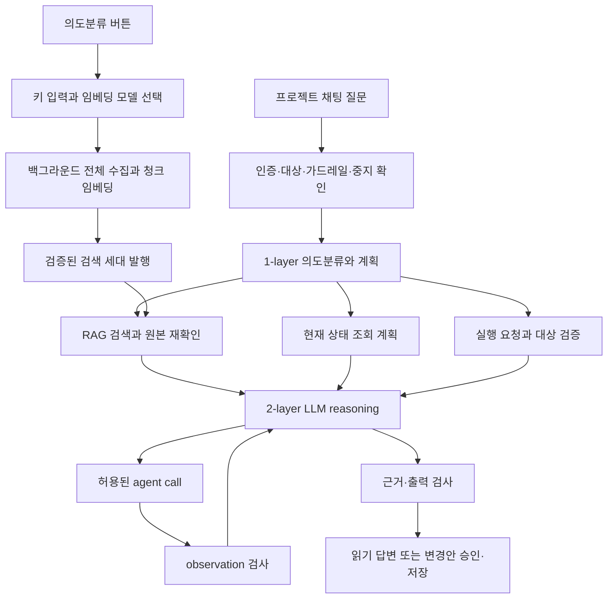

# AI 챗봇 2계층 오케스트레이션·프로젝트 벡터화 분석 및 설계

- 작성일: 2026-11-16 (한국시간, Asia/Seoul)
- 상태: 사용자 검토용 설계 초안. 검토·직접 수정 후 별도 구현 요청을 받아 적용한다.
- 분석 기준: 현재 작업 트리의 소스·마이그레이션·검증 스크립트와 OpenAI 공식 API 문서.
- 이번 작업 범위: 이 설계 문서 신규 작성과 `HISTORY.md` 항목 추가만 수행한다. 소스·DB·마이그레이션·환경 설정은 수정하지 않는다.
- 운영 DB 조회·변경, 실제 모델 목록 조회, 유료 AI 호출, 벡터화는 수행하지 않았다. DB의 실제 적용 버전·벡터 확장 지원 여부는 미확인이다.
- 아래 요구사항은 사용자 요청이며, 테이블/API 이름·권한·수치·기본값은 구현 검토를 위한 권장안이다. 미확정 사항은 12절에 모았다.

## 1. 요구사항과 완료 기준

| ID | 요구사항 | 구현 완료 기준 |
| --- | --- | --- |
| R1 | AI chatbot 채팅에 orchestration을 도입한다. | 기존 채팅 진입점에서 인증·가드레일을 거친 후 1-layer 분류 결과로 2-layer의 자료·도구 범위를 결정한다. |
| R2 | 1-layer는 real time api / rag / execution 의도분류를 수행한다. | 프로젝트 자료 질문, 현재 상태 조회, 명시적 변경 요청을 구분하고 복합·모호한 질문도 처리한다. 분류 정확도는 평가 자료로 검증한다. |
| R3 | 프로젝트 선택 시 해당 프로젝트의 벡터화된 RAG 데이터를 우선 활용하여 환각을 줄인다. | 다른 프로젝트 자료를 섞지 않으며 검색 근거·출처·버전을 제공한다. 근거 부족을 사실처럼 보완하지 않는다. |
| R4 | 2-layer는 현재처럼 LLM reasoning → agent call → observation을 수행한다. | 기존 Responses API 도구 반복, 중지, 시간·횟수 제한, 사용자 승인(HITL), 버전 검증·원자 저장을 보존한다. |
| R5 | 벡터화 저장을 위한 테이블을 설계한다. | 모델·차원·세대·원본·청크·벡터·작업 진행·사용 키 참조를 저장하고 프로젝트/workspace 격리를 강제한다. |
| R6 | 벡터화 시 AI 모델을 선택하고 벡터화 키를 입력한다. | 입력 키 기준으로 모델을 조회하며 OpenAI `text-embedding` 접두어 모델만 표시·검증한다. 채팅 모델과 임베딩 모델을 구분한다. |
| R7 | 대시보드 참여 프로젝트와 프로젝트 화면 상단 프로젝트 선택 selectbox 옆에 의도분류 버튼을 추가한다. | 참여 프로젝트 카드별 버튼과 프로젝트 상단 선택 상자 옆 버튼에서 동일 프로젝트의 전체 벡터화를 시작할 수 있다. |
| R8 | 벡터화 진행 후 버튼 옆에 AI 모델과 진행 날짜·시분초를 표시한다. | 마지막 성공 세대의 실제 임베딩 모델과 완료 시각을 `YYYY-MM-DD HH:mm:ss (KST)`로 표시하고 실행 중·실패와 구분한다. |
| R9 | 이번 단계에서는 문서만 작성한다. | 이 문서와 이력 링크 외에는 수정하지 않는다. |

### 1.1 용어와 해석

- **의도분류 버튼**: 사용자 요청의 화면 명칭을 유지한다. 실제 동작은 프로젝트 자료 수집·분할·임베딩·검색본 발행이다. 분류 모델을 학습하거나 채팅을 즉시 실행하는 버튼은 아니다. 모달 설명은 “프로젝트 데이터를 벡터화하여 AI 답변 근거로 사용합니다.”로 제안한다.
- **1-layer**: 매 채팅 요청의 의도를 판단하고 검색/조회/실행 경로를 계획한다. 임베딩 유사도만으로 등록·수정·삭제 권한을 결정하지 않는다.
- **2-layer**: 계획에 따라 근거를 사용하여 답변하고 허용된 도구를 반복 호출한다. RAG 경로도 최종 문장 생성은 2-layer에서 한다.
- **real time api**: 우선 “현재 시점의 업무 데이터·상태를 조회하는 허용된 서버 API/업무 함수”로 해석한다. 음성 대화를 위한 별도 OpenAI Realtime 연결 도입 여부는 확정되지 않았다.
- **벡터화 키**: 우선 OpenAI API 인증키로 해석한다. 데이터 암호화키와 다르다. 키의 소유·공유·보관 정책은 7절과 12절의 결정 대상이다.
- **전체 데이터**: 선택 프로젝트의 현재 업무 자료 전체를 기본 대상으로 제안한다. 과거 모든 버전·개인 대화·사용자 비밀정보까지 무조건 포함하는 뜻으로 확정하지 않는다. 포함·제외·미지원 범위는 5절에 명시한다.

R7은 대시보드의 **참여 프로젝트 카드별 버튼**과 프로젝트 작업 공간의 **선택 상자 옆 버튼**으로 해석했다. 대시보드 상단 선택 상자 옆에도 별도 버튼이 필요한지는 검토 항목이다. 대시보드의 “전체 프로젝트”를 선택했다고 모든 프로젝트를 한꺼번에 벡터화하지 않는다.

## 2. 현재 구조와 확인된 영향

### 2.1 채팅과 도구 실행

| 현재 파일 | 확인된 동작 | 변경 영향 |
| --- | --- | --- |
| `app/api/ai/chats/route.ts` | 방/프로젝트·대상 버전 확인, 승인 대기 검사, 모델·가드레일·요금제 확인, 생성 요청/잠금, 데이터 조회, `createPageAgent()`와 `generateAi()`, 결과 검사·저장을 처리한다. | 입력 가드레일 뒤, 답변용 context·도구를 구성하기 전에 orchestration을 삽입한다. 기존 인증·저장 경계를 우회하지 않는다. |
| `lib/ai-server.ts` | `generateAi()`가 `/v1/responses`를 호출한다. reasoning 관련 응답과 `function_call`을 받아 도구를 실행하고 `function_call_output`을 다음 회차에 전달한다. 기본 12회, 정책상 최대 40회다. | 2-layer의 실행 기반으로 유지한다. 임베딩 호출은 별도 모듈로 분리한다. 숨겨진 추론 원문을 사용자에게 공개하는 설계는 필요하지 않다. |
| `lib/ai/page-tools.ts` | `read_page`, 프로젝트 분석 상세 조회, 탭별 저장/일괄 저장 도구를 제공한다. 명시적 요청의 정규식, 탭 권한·허용 작업·버전 검증을 거쳐 pending 변경안을 만든다. | 경로별 읽기/쓰기 도구 제한과 RAG 검색 도구를 추가한다. 새 분류 결과가 기존 명시적 요청 검사를 대체하지 않는다. |
| `lib/ai/rfp-tools.ts` | RFP 전용 에이전트로 분기한다. | 일반 산출물과 동일하게 orchestration의 읽기/쓰기 제한을 적용한다. |
| `lib/ai/resolve-target.ts` | `project-analysis`는 조회 전용이다. `documents`는 기존 AI 미지원 대상이다. | 실행 의도라고 분석 대상에 쓰기 권한을 부여하거나 문서함 편집 AI를 자동 활성화하지 않는다. |
| `lib/ai/change-reviews.ts`, `lib/ai/user-settings.ts` | 사용자+workspace AI 설정, 기본 HITL 켜짐, 서버 보관 변경안의 승인 후 재검증·저장을 지원한다. | execution도 이 경로를 유지한다. 승인 전 변경안은 RAG 원본에 포함하지 않는다. |
| `lib/ai/generation-control.ts` | 실행 요청·중지·checkpoint를 관리한다. | 1-layer LLM·질문 임베딩·검색·2-layer를 모두 같은 요청 중지/기한 아래에서 처리한다. |

현재 `generateAi()` 자체는 foreground 기준 120초 한계를 두고, 채팅 route에는 요청 시작 기준 140초 deadline과 `maxDuration=180`이 있다. 1-layer를 추가하면서 단계마다 새 전체 기한을 부여하면 실제 지연이 늘어나므로 요청 전체 deadline을 공유해야 한다.

### 2.2 현재 프로젝트 자료 제공

`lib/ai/page-data.ts`는 `project-analysis`에 대해 `lib/ai/project-analysis.ts`의 `readProjectAnalysis()`를 호출한다. 현재 함수는 다음 자료를 직접 읽는다.

- 프로젝트 기본 정보, READ 가능한 `project_artifacts`, 해당 산출물 사이 `artifact_links`, 저장 RFP.
- RFP JSON이 20,000자를 넘으면 제목·식별자 위주로 축약한다.
- RFP를 포함한 본문 예산은 약 50,000자이고 catalog는 최대 300건, 연결은 최대 200건이다. 최종 직렬화 크기도 60,000자 아래로 줄인다.
- 문서함 원문·플래닝보드·이력은 현재 전체 분석 범위에서 제외된다.
- `read_project_artifact`, `read_project_rfp`는 ID·장·offset을 받아 12,000자 단위 상세 조회를 제공한다.

따라서 현재 구조는 **원본 DB 조회와 제한된 context 제공**이며 벡터 검색은 아니다. 이 함수를 그대로 벡터화 입력으로 사용하면 누락된 자료를 영구적으로 색인하지 못한다. 색인 전용 수집기는 모든 원본을 페이지 단위로 순회해야 한다.

현재 `lib/ai/guardrails.ts`에도 선택적 classifier가 있지만 보안 위협 판정용이다. 새 업무 의도분류와 모델·판정 결과·평가 목적을 분리한다.

### 2.3 모델·키·사용량·DB

| 현재 구조 | 확인 내용 | 설계에 미치는 영향 |
| --- | --- | --- |
| `lib/ai-server.ts: aiModels()` | 서버 `OPENAI_API_KEY`와 `OPENAI_MODELS` 또는 `/v1/models`를 사용한다. GPT 계열 필터는 임베딩 모델을 반환하지 않는다. | 기존 함수에 임베딩을 섞지 않고 입력 키 전용 모델 조회를 신설한다. |
| `app/api/ai/models/route.ts`, `components/query/use-ai-models.ts` | 채팅 모델과 이미지 모델 조회를 제공한다. | 임베딩 모델은 별도 계약과 query key를 사용한다. 키 자체를 query key에 넣지 않는다. |
| `lib/db.ts`, `package.json` | `@libsql/client`와 `TURSO_DATABASE_URL` 기반이다. | PostgreSQL/pgvector를 사용한다고 가정할 수 없다. 실제 libSQL 벡터 기능·인덱스 지원은 별도 검증이 필요하다. |
| `db/migrations/046_ai_project_analysis_reviews.sql` | 프로젝트 분석 대상·개인 AI 설정·사용자 승인 테이블이 있다. | 과거 설계 문서의 “미구현” 설명보다 현재 소스를 기준으로 분석한다. |
| `lib/ai/token-usage.ts`, `db/migrations/011_ai_token_usage.sql` | 호출별 예약/정산, `UNIQUE(request_id,call_index)`와 응답 중복 방지가 있다. `purpose`는 017에서 추가된다. | 분류·질문 임베딩·일괄 임베딩을 독립 호출로 기록하고 index 충돌을 방지해야 한다. |
| `lib/ai/token-types.ts`, `guardrails.ts` | purpose 타입은 generation/guardrail/title이며 보안 분류는 1000번대 turn을 사용한다. | orchestration용 call index를 단순히 0부터 다시 쓰면 충돌한다. purpose와 전역 호출 번호 할당을 확장한다. |
| `lib/ai/image-crypto.ts` | 이미지 전용 AES-256-GCM과 `AI_IMAGE_ENCRYPTION_KEY`를 사용한다. | 암호화 패턴은 참고하되 이미지 키·이미지 AAD를 API 인증키 저장용으로 그대로 재사용하지 않는다. |

현재 최신 마이그레이션 파일은 `047_notification_acknowledgements.sql`이다. 향후 SQL 파일 번호는 구현 시점의 최신 번호 다음으로 정한다. 이번에는 SQL 파일을 생성하거나 실행하지 않는다.

### 2.4 화면과 백그라운드 작업

- `components/pages/dashboard/dashboard-page.tsx`에는 상단 프로젝트 필터와 참여 프로젝트 카드가 있다. 카드별 `p.id`가 명확하므로 카드에 공통 버튼/상태 컴포넌트를 배치한다.
- `components/project-workbench.tsx`에는 `.matrix-project-picker` 선택 상자가 있다. 현재 `model.projectId`의 버튼/상태를 바로 옆에 둔다.
- 대시보드는 `lib/dashboard-query.ts`, `lib/dashboard-types.ts`의 최소 DTO를 사용한다. 여기에 벡터·원문·키를 넣지 않고 요약 상태만 추가한다.
- AI 선택 프로젝트와 실제 화면 `aiContext`는 분리되어 있다. 벡터화 버튼을 눌러도 기존 방의 `project_id`, AI 대상, 작성 중 질문을 자동 변경하지 않는다.
- 현재 `lib/ai/deliverable-worker.ts`와 `scripts/run-with-deliverable-worker.mjs`는 영속 DB 작업과 lease를 사용한다. 벡터화는 별도 작업 큐/작업자로 같은 운영 패턴을 따른다. 기존 산출물 작업 테이블에 벡터 작업을 섞지 않는다.
- `AGENTS.md`의 사용자/workspace query scope, 저장 자동 재시도 금지, access 폴링 금지, 화면별 CSS 위치 원칙을 유지한다.

## 3. 전체 구조



핵심은 “분류 → 프로젝트 근거 수집 → 기존 에이전트 실행”이다. RAG만 선택하면 읽기 도구만 제공하고, 실행 요청이면 RAG 근거를 함께 제공하면서 현재 원본·권한·버전을 다시 검사한다. 단순히 세 가지 중 하나를 선택했다고 나머지 자료를 사용할 수 없게 만들지 않는다.

## 4. 1-layer와 2-layer 상세 설계

### 4.1 의도 계약과 우선순위

권장 반환 구조는 다음과 같다. 아래는 데이터 계약 예시이며 실행 코드는 아니다.

```json
{
  "primaryIntent": "rag",
  "needsRag": true,
  "needsRealtime": false,
  "needsExecution": false,
  "needsClarification": false,
  "targetPage": "project-analysis",
  "reasonCode": "PROJECT_KNOWLEDGE",
  "classifierVersion": 1
}
```

| 경로 | 판단 기준/예시 | 근거와 허용 도구 |
| --- | --- | --- |
| `rag` | “이 프로젝트 보안 요구사항을 설명해 줘”, “결제 화면과 연결된 요구사항은?” | 프로젝트 검색 → 유효 출처 확인 → 상세 조회. 저장 도구는 제외한다. |
| `realtime` | “현재 WBS 진척률은?”, “지금 승인 상태는?”, “오늘 변경 건수는?” | 서버가 허용한 최신 조회/집계 함수. 필요하면 RAG의 정의·설명을 함께 사용한다. |
| `execution` | “이 WBS의 담당자를 변경해 줘”, “이 요구사항을 저장해 줘” | 명시 요청 + 작업 탭 + 권한 검증 후 기존 변경 도구. RAG·최신 조회를 선행하고 HITL을 적용한다. |
| 복합 요청 | “요구사항을 보고 현재 미완료 작업을 확인해서 WBS를 추가해 줘” | primaryIntent=execution, 나머지 needs 플래그로 자료 수집 순서를 표현한다. |
| 확인 필요 | “이거 처리해 줘”, 대상이 없는 삭제 요청 | `needsClarification=true`. 쓰기 도구 없이 대상·행위를 확인한다. |

명시적 변경 요청이 있고 대상이 확인되면 execution을 우선하며, 현재값·집계 정확도가 핵심이면 realtime, 나머지 프로젝트 지식 질문은 rag를 기본으로 한다. “삭제 정책 설명”, “저장 버튼 설계” 같은 단어 포함만으로 execution으로 판정하지 않는다. 후속 질문은 같은 방의 최근 사용자 문맥으로 대상을 보완하되 문서 본문·과거 AI 답변을 새 사용자 실행 명령으로 취급하지 않는다.

1-layer는 읽기 전용 규칙과 JSON 구조화 LLM 판정을 결합한다. 명확한 조회/집계는 규칙으로 빠르게 분류하고, 모호·복합 질문만 도구 없는 분류 LLM을 호출하는 방안을 권장한다. 분류 LLM은 우선 현재 선택 채팅 모델을 재사용하는 안이며 별도 경량 모델 사용은 결정 사항이다. 임베딩 모델은 답변 생성·업무 의도 판정 LLM을 대체하지 않는다.

분류 JSON의 enum·boolean·대상 일치 여부를 서버에서 검증한다. 분류기의 자기 평가 점수를 정확도나 확률로 간주하지 않는다. 출력 손상·기한 초과·지원하지 않는 의도는 읽기 전용 RAG/직접 조회 또는 확인 질문으로 처리한다. 실패를 이유로 모든 쓰기 도구를 열지 않는다.

### 4.2 프로젝트 RAG 우선 원칙

1. 방의 프로젝트와 서버가 검증한 실행 context를 검색 범위로 사용한다. 클라이언트가 보낸 임의 프로젝트 ID만 신뢰하지 않는다.
2. 기본 rag 질문은 활성 검색 세대의 **모델·차원·전처리 버전**으로 질문을 임베딩한다. 사용자가 채팅 모델을 바꿔도 기존 벡터 공간은 바뀌지 않는다.
3. 관리번호·정확한 제목·ID 조회는 원본 식별자 검색을 병행한다. 의미 유사도가 낮다는 이유로 정확한 ID 일치를 놓치지 않는다.
4. 검색은 top-K 후보를 가져오되 사용자의 현재 READ 권한, 원본 존재·삭제 여부, version/hash를 검사한 후 본문을 LLM에 제공한다. 무효 후보를 제거하면 추가 후보를 조회해 보충한다.
5. 관련 청크·출처 목록만 2-layer에 전달한다. 기존 프로젝트 전체 JSON과 RAG 본문을 항상 중복 주입하지 않는다. 기존 상세 도구는 추가 근거 확보에 재사용한다.
6. 근거가 부족하면 정확한 키워드·장별 상세·최신 원본을 추가 조회한다. 여전히 없으면 “현재 프로젝트 자료에서 확인할 수 없음”과 필요한 자료를 안내한다.
7. 질문이 프로젝트 사실이면 일반 상식으로 빈 내용을 메우지 않는다. 사용자가 요청한 일반 설명·설계 제안은 프로젝트에 저장된 사실과 구분해 표시한다.

초기 조정안은 청크 약 600토큰, 중첩 약 100토큰, 검색 후보 20건·최종 근거 6건이다. 상한·유사도 임계값·문맥 예산은 한국어 실제 자료로 조정한다. 모델·차원이 바뀌면 유사도 점수 분포도 다시 평가한다. 모든 벡터 자료를 매번 프롬프트에 넣는 방식은 사용하지 않는다.

### 4.3 최신 조회와 실행 경계

- realtime 경로는 현재 프로젝트에 한정된 읽기 업무 함수를 호출한다. HTTP API를 서버 내부에서 다시 호출하기보다 인증된 업무 함수를 재사용할 수 있다.
- 외부 실시간 정보가 필요하면 별도 허용 커넥터·인증·응답 계약을 정의한다. 현재 저장소에 범용 외부 실시간 커넥터가 구현됐다고 가정하지 않는다. 미연결이면 해당 정보를 확인할 수 없다고 안내한다.
- 실행 전 현재 원본을 반드시 읽어 ID·version·참조·도메인 catalog를 확인한다. 벡터 검색 결과의 과거 버전은 저장 조건으로 사용할 수 없다.
- `project-analysis`의 execution 판정은 작업 탭 선택 안내로 이어진다. 분류기가 자동으로 대상을 바꾸거나 프로젝트 전체 쓰기 권한을 얻지 않는다.
- 이력 미저장 대화는 기존처럼 조회·초안 전용이다. HITL 해제, 분류 성공, 높은 유사도는 이 제한을 해제하지 않는다.
- 2-layer의 도구 목록뿐 아니라 실제 execute 함수에도 경로별 허용 목록을 검사한다. LLM이 허용되지 않은 도구명을 만들어도 실행하지 않는다.
- 실행 후 성공적으로 commit된 원본만 다음 색인 대상에 반영한다. 승인 대기·거절·취소·실패 결과는 프로젝트 사실로 색인하지 않는다.

### 4.4 답변과 출처

답변 근거는 출처별 `sourceType/sourceId/version/hash/section/chunkId/indexedAt`과 원본 이동 정보를 가진다. 사용자에게는 제목·관리번호·자료 버전·관련 장과 열기 링크를 제공한다. 파일은 지원되는 장/offset으로 표시하고, 실제 추출하지 않은 페이지 번호를 만들어내지 않는다.

서버는 반환된 인용 ID가 이번 요청에 제공한 유효 근거에 속하는지 검사한다. 이 검사만으로 문장 전체의 사실성이 증명되는 것은 아니므로 근거 일치 평가는 별도로 한다. 원문 진술, 여러 자료에서 도출한 분석, 확인이 필요한 부분을 구분한다. 최신 상태 답변에는 조회 시각을 표시한다.

## 5. “프로젝트 전체 데이터”의 수집 범위

### 5.1 기본 포함 제안

| 데이터 | 실제 저장 구조/모듈 | 수집 방법 |
| --- | --- | --- |
| 프로젝트 기본 정보 | `projects` | 이름·설명·상태. 인적 정보는 필요한 담당자 표시 범위로 제한한다. |
| 저장 RFP | `project_rfp_documents`, `lib/rfp-server.ts` | draft의 모든 장을 구조적으로 분리한다. 현재 분석 함수의 20,000자 제한을 수집 한도로 재사용하지 않는다. |
| 전체 현재 산출물 | `project_artifacts` | WBS/architecture/requirement/screen/database/function/program/test의 제목·fields·structure·관리번호·버전. `deleted_at IS NULL`만 수집한다. |
| 산출물 연결 | `artifact_links` | 읽기 가능한 양 끝의 ID·관계와 해석 가능한 문장. 한 원본의 version만으로 변경을 감지하지 말고 연결 목록 hash도 계산한다. |
| 문서함과 RFP 원본 첨부 | `project_folders`, `project_files`, `project_rfp_sources` | 폴더 경로·파일명·지원 파일 본문. 같은 파일의 RFP 첨부/문서함 중복은 한 번 추출하고 참조 관계를 보존한다. |
| 현재 화면설계 보드 | `planning_boards` | 현재 `document_json`의 사용자 텍스트·화면/요소 설명·흐름. 스타일 속성·바이너리를 무의미하게 벡터화하지 않는다. |
| DB 도메인 메타 | `project_database_domains`, `project_database_domain_catalogs` | 현재 유효 도메인·DB 종류·자료형·설명·catalog revision. |
| 현재 자료의 출처 관계 | `artifact_source_references`, `project_source_snapshots` | 연결된 불변 출처 텍스트를 중복 hash로 식별한다. 현재값과 과거 출처임을 구분하고 원본 출처로 이동할 수 있게 한다. |

플래닝보드 댓글·메모·검토 기록, 프로젝트 멤버 정보, 과거 산출물/RFP/보드 revision 전체까지 포함할지는 확정이 필요하다. 권장 기본값은 현재 본문·현재 승인 상태와 현재 연결 출처이며, 과거 버전 전체는 별도 history 범위로 분리한다. 과거값이 최신값처럼 검색되지 않게 해야 한다.

AI 채팅 이력·업로드한 채팅 이미지·승인 대기 변경안·서버 로그·토큰 원장·API 키·결제/계정 정보는 공용 프로젝트 지식으로 자동 포함하지 않는다. 이들은 업무 본문과 접근 범위가 다르다. 사용자 요청의 “전체”를 이 범위까지 확장하려면 별도 데이터·권한 정의가 필요하다.

### 5.2 파일 처리와 완전성

`lib/document-text.ts`는 PDF·DOCX·UTF-8 텍스트 추출을 지원한다. 현재 파일당 추출 텍스트 100,000자, PDF 50페이지 제한과 DOCX 내부 파일·압축 해제 크기 제한이 있다. 스캔 PDF는 OCR 지원이 없다. 문서함 업로드 상한은 20MB다.

새 수집기가 기존 추출기를 활용하더라도 이 한도를 숨기거나 파일 전체 처리를 보장해서는 안 된다. 지원하지 않는 확장자·암호화·손상·추출 한도 초과·스캔 파일은 이유와 원본 ID를 남긴다. 이미지·영상·보드 이미지 OCR 및 기존 한도 확장은 별도 결정 사항이다.

작업 완료 정보는 전체 원본 수, 성공/변경 없음/미지원/실패/삭제 수와 청크 수를 포함한다. 하나라도 미지원이면 “지원 자료 벡터화 완료 · 제외 N건”으로 표시하며 “전체 자료 완료”라고 표시하지 않는다. 실패 원본이 있는 세대를 발행할지 여부는 기본 **발행하지 않음**으로 제안한다. 미지원 원본이 있는 제한적 발행은 사전에 정한 범위 정책과 화면 고지를 전제로 한다.

## 6. 데이터 모델 제안

### 6.1 저장소와 검색 방식

현재 libSQL을 기준으로 메타데이터·벡터를 같은 프로젝트 범위에 저장하는 방안을 우선 검토한다. 논리 벡터 컬럼은 `embedding BLOB`으로 정의하되 실제 인코딩과 인덱스 DDL은 지원 검증 후 정한다. 모델별 차원이 다를 수 있으므로 `model/dimensions`를 세대에 고정한다.

구현 착수 시 임시 환경에서 운영 libSQL의 벡터 연산/인덱스 지원, 복합 범위 필터, 거리 정렬, 차원 제한을 확인한다. 지원이 확인되면 해당 문법으로 SQL을 설계한다. 이번 문서에서는 특정 vector 함수가 배포 환경에서 동작한다고 확정하지 않는다.

기본 기능 검증 대안은 프로젝트의 유효 청크를 페이지 순회하며 애플리케이션에서 cosine을 계산하는 정확 검색이다. 이 경우 후보를 앞부분 N건으로 잘라 “전체 검색”으로 취급하지 않는다. 메모리·시간·프로젝트 규모 한계를 측정하며, 목표 규모에서 예산을 넘으면 libSQL 벡터 인덱스 또는 별도 벡터 저장소를 결정한 후 공개한다. 임의 전수 검색을 대규모 운영 방식으로 확정하지 않는다.

### 6.2 테이블

다음 표는 논리 스키마다. ID는 TEXT, 시각은 UTC ISO 8601 TEXT, 버전·건수는 INTEGER, 메타 JSON은 유효성 CHECK를 기본으로 한다. 키 원문은 어떤 JSON에도 넣지 않는다.

| 테이블 | 주요 컬럼 | 역할 |
| --- | --- | --- |
| `project_ai_credentials` | `id`, `workspace_id`, `project_id`, `provider`, `ciphertext`, `iv`, `auth_tag`, `encryption_version`, `key_id`, `key_fingerprint`, `created_by`, `version`, `revoked_at`, `created_at` | 프로젝트 임베딩용 API 키를 암호화 보관한다. fingerprint는 서버 비밀을 사용한 HMAC 식별값으로 제안한다. |
| `project_rag_configs` | `(workspace_id, project_id)` PK, `provider`, `model`, `dimensions`, `credential_id`, `chunker_version`, `scope_version`, `version`, `active_generation_id`, `last_attempt_job_id`, `updated_by`, `updated_at` | 다음 작업 설정과 현재 활성 검색본의 포인터. 설정 모델과 실제 활성 모델이 다를 수 있다. |
| `project_rag_generations` | `id`, `workspace_id`, `project_id`, `status`, `config_version`, `model`, `dimensions`, `chunker_version`, `scope_version`, `credential_version`, `manifest_hash`, `source_count`, `chunk_count`, `coverage_json`, `started_at`, `completed_at`, `published_at` | 발행 가능한 불변 검색본. status는 building/ready/retired/failed/cancelled. |
| `project_rag_sources` | `id`, `workspace_id`, `project_id`, `generation_id`, `source_type`, `source_id`, `source_version`, `content_hash`, `permission_tab`, `title`, `locator_json`, `extraction_status`, `extraction_error_code`, `chunk_count` | 세대별 전체 원본 manifest와 추출 결과. 미지원/실패 원본도 누락하지 않는다. |
| `project_rag_chunks` | `id`, `workspace_id`, `project_id`, `generation_id`, `source_record_id`, `chunk_no`, `section`, `content`, `content_hash`, `token_count`, `embedding`, `created_at` | 청크 본문과 벡터. 검색·인용의 최소 단위. |
| `project_rag_jobs` | `id`, `workspace_id`, `project_id`, `generation_id`, `requested_by`, `idempotency_key`, `input_hash`, `config_version`, `credential_id`, `credential_version`, `status`, `total_sources`, `processed_sources`, `total_chunks`, `completed_chunks`, `failed_sources`, `skipped_sources`, `cursor_json`, `attempt`, `lease_token`, `lease_until`, `heartbeat_at`, `error_code`, `created_at`, `finished_at` | 영속 백그라운드 작업과 복구·중지·진행률. status는 queued/running/stop_requested/publishing/completed/failed/cancelled. |
| `ai_orchestration_events` | `id`, `workspace_id`, `project_id`, `user_id`, `request_id`, `classifier_version`, `primary_intent`, `route_flags_json`, `reason_code`, `generation_id`, `source_refs_json`, `fallback_code`, `duration_ms`, `created_at` | 의도·경로·근거·fallback 진단. 원문 질문/키/추론 원문은 중복 저장하지 않는다. |

`ai_orchestration_events`는 이력 미저장 플랜에서 본문·검색 발췌를 보관하지 않는다. 진단 메타데이터의 보존 기간과 기존 사용량/가드레일 로그 정책과의 관계는 구현 전에 정한다. 임시 방은 영속 방 FK를 요구하지 않도록 한다.

### 6.3 관계와 제약

1. 신규 프로젝트 종속 테이블은 `(project_id, workspace_id)`로 `projects(id,workspace_id)`를 참조한다. 세대·원본·청크·작업·키·active 포인터에도 프로젝트/workspace를 포함한 복합 UNIQUE/FK를 두어 교차 프로젝트 참조를 금지한다.
2. `project_rag_sources`는 `(generation_id,source_type,source_id)` UNIQUE, `project_rag_chunks`는 `(source_record_id,chunk_no)` UNIQUE로 한다. 재시작 시 같은 청크를 중복 저장하지 않는다.
3. `project_rag_jobs`는 workspace/project/idempotency key UNIQUE를 두고 같은 key의 다른 input hash를 409로 거절한다. 활성 상태의 작업은 프로젝트당 하나인 부분 UNIQUE 인덱스를 둔다.
4. 조회 인덱스는 `(workspace_id,project_id,generation_id)`, 작업은 `(status,lease_until,created_at)`, 원본 재확인은 `(workspace_id,project_id,source_type,source_id)`를 기준으로 한다.
5. 벡터 차원·유한 숫자·0이 아닌 norm·응답 개수와 input index를 저장 전에 검증한다. dimension/model 일치 검사는 동일 세대 계약과 저장 함수로 보장하고 가능한 DB 제약도 추가한다.
6. 활성 세대는 ready 상태만 허용하며 동일 범위 포인터를 짧은 트랜잭션으로 바꾼다. building 자료는 검색하지 않는다. 암호화 키의 폐기/회전과 벡터 세대 폐기는 구분한다.
7. 원본은 문서/산출물 등 여러 테이블을 참조하므로 `source_type/source_id`는 다형 참조다. 원본 FK가 모두 보장된다고 가정하지 않고 검색·발행 시 원본 유효성을 검증한다.
8. 원본 삭제가 불변 업무 이력 삭제로 전파되지 않도록 신규 검색 데이터의 정리만 수행한다. 기존 revision/snapshot 테이블과 삭제 트리거를 변경하지 않는다.
9. 키·색인 데이터의 프로젝트 삭제 시 보존/정리는 현행 프로젝트 삭제 정책을 확인해 별도로 정한다. 자동 cascade를 기존 업무 이력에 확대하지 않는다.

### 6.4 사용량 기록

새 purpose는 `orchestration`, `embedding_query`, `embedding_index`를 제안한다. 기존 `generation/guardrail/title`과 함께 계상하며 같은 요청의 모든 호출에 서버에서 유일한 call index를 할당한다. 현재 1000번대 보안 classifier와의 충돌을 회귀 검증한다.

임베딩 응답은 `prompt_tokens/total_tokens` 형태이므로 Responses의 `input_tokens/output_tokens` parser에 그대로 전달하면 usage가 누락된다. 별도 adapter로 input=prompt_tokens, output=0, total 검증 후 기존 원장 형식에 맞춘다. 배치 호출을 청크 수만큼 중복 합산하지 않고 호출 한 번으로 기록한다. 작업 호출은 별도 request ID와 표시용 작업 context를 가지며 실제 채팅방이 있었다고 위장하지 않는다.

외부 호출 전 예약, 결과 확인 후 실제 사용량 정산, 사용량 미확인 상태 유지 원칙을 적용한다. 벡터화는 요청자, 질문 임베딩과 분류는 채팅 사용자로 기록하는 안을 제안한다. 개인이 제공한 키로 다른 참여자의 검색 비용을 부담하는 정책과 앱 요금제 토큰 차감 여부는 확정이 필요하다.

## 7. 임베딩 모델과 키 처리

### 7.1 모델 조회·실행

1. 모달에서 OpenAI 키를 password 입력으로 받거나 권한이 있는 관리자가 기존 저장 키를 사용한다.
2. 서버가 해당 키로 모델 목록을 조회하고 `id.startsWith("text-embedding")`만 반환한다. GPT·이미지·Realtime 모델은 제외한다. 기존 `OPENAI_MODELS`는 이 목록에 적용하지 않는다.
3. 목록 없음·401/403·요금/사용 한도·연결 오류를 구분한다. 실패할 때 임의 모델이나 서버 공용 키로 조용히 대체하지 않는다.
4. 시작 요청에서 모델/키/설정 버전을 다시 검증한다. 프런트엔드 필터만으로 충분하지 않다. 모델 목록에 있다는 사실과 실제 임베딩 호출 성공은 다르므로 첫 작업 응답의 차원·구조도 검사한다.
5. 임베딩은 별도 `/v1/embeddings` 클라이언트로 호출한다. 본문 청크와 질문은 활성 세대와 동일한 모델·차원·전처리 계약을 사용한다.
6. 청크별 빈 문자열·토큰 상한, 호출별 입력 수·총 토큰 상한을 확인한다. `dimensions`는 지원 모델에만 전달한다. 특정 기본 차원이나 모델을 전체에 하드코딩하지 않는다.

OpenAI 공식 [모델 목록 API](https://developers.openai.com/api/reference/resources/models/methods/list)는 인증 계정이 사용할 수 있는 모델 ID를 조회하는 근거이고, [임베딩 생성 API](https://developers.openai.com/api/reference/resources/embeddings/methods/create)는 문자열/복수 입력, 모델, 선택 차원, 벡터와 사용량 응답을 정의한다. `dimensions`는 지원 모델에만 사용할 수 있다. 접두어 필터는 이번 제품 요구에 따른 제한이며 목록만으로 모든 capability가 확인되는 것은 아니다. 상세 한도는 구현 시점의 공식 문서와 선택 모델에 맞춰 재검증한다.

### 7.2 키 보관 권장안

백그라운드 작업 재개와 이후 질문 임베딩에는 계속 사용 가능한 자격증명이 필요하다. 입력받은 키를 HTTP 처리 메모리에서만 폐기하면 워커 재시작과 이후 질문 검색을 처리할 수 없다.

권장안은 **프로젝트 공용 임베딩 자격증명을 암호화 저장**하고, 모달에서 “이 키를 프로젝트 벡터화와 참여자의 질문 검색에 사용”한다는 범위를 설명하는 것이다. 이 보관 정책은 사용자 검토 후 확정한다. 대안은 매 질문 키 입력 또는 별도 서버 관리 키 사용인데, 모두 사용자 흐름과 비용 주체가 달라진다.

- 서버 전용 `AI_CREDENTIAL_ENCRYPTION_KEY` 같은 별도 암호화 설정을 제안한다. 이미지 암호화키와 분리하고 키 식별자·회전 버전을 관리한다.
- AES-GCM의 AAD에는 credential ID/workspace/project/provider를 포함한다. ciphertext를 다른 프로젝트에 복사해도 복호화되지 않게 한다.
- 조회 DTO에는 `hasCredential`, 마스킹 표시와 수정 권한 정도만 반환한다. 원문·ciphertext·Authorization을 브라우저 캐시·로그·오류·프롬프트에 내보내지 않는다.
- 입력 키는 URL/query key/localStorage에 넣지 않는다. 키로 모델 조회하는 요청은 POST body와 `no-store`를 사용한다. 모델 조회만으로 영구 저장하지 않는다.
- 키 변경은 credential version을 올린다. 기존 작업은 고정 version을 사용하며 폐기된 키는 재사용하지 않는다. 회전 중 진행 작업을 중단할지 기존 키를 일시 유지할지는 운영 정책으로 정한다.
- 키를 폐기하면 검색본 자체는 유지하되 새로운 질문 임베딩은 사용할 수 없다고 표시한다. 별도 키로 같은 모델을 사용할 수 있는지 검증 후 전환할 수 있지만 모델·차원이 바뀌면 전량 재색인이 필요하다.
- API endpoint는 OpenAI의 고정 주소로 제한한다. 사용자가 URL을 입력하는 범용 프록시는 이번 범위에 포함하지 않는다.

권한은 프로젝트 owner/admin에게 설정·전체 벡터화·중지·키 변경을 허용하는 안을 제안한다. 현재 탭 CRUD만으로 프로젝트 전체 외부 전송 권한을 추론하지 않고 전용 `manageProjectRag` 정책을 정의한다. 실제 role·workspace·배정·플랜을 서버에서 재확인하며 UI 표시만으로 허용하지 않는다. 일반 참여자의 키 사용은 서버 검색 기능으로만 제한한다.

## 8. 벡터화 작업·검색본 발행·변경 감지

### 8.1 작업 흐름

1. 버튼 클릭 후 설정 모달에서 범위·예상 대상 수·미지원 안내, 키와 모델을 확인한다.
2. 서버가 관리 권한·AI 사용 가능 상태·자격증명·중복 요청을 검증한다. 짧은 트랜잭션으로 설정 version, 작업, building 세대를 만들고 202를 반환한다.
3. 워커가 조건부 lease를 획득하고 요청자의 현재 배정/권한과 설정을 재검증한다. 브라우저 종료는 취소로 처리하지 않는다.
4. 모든 원본의 ID/version/hash를 manifest로 고정한다. 가능한 DB 원본은 읽기 트랜잭션에서 목록·버전을 고정하되 파일 추출·외부 임베딩 동안 트랜잭션을 열어두지 않는다.
5. 원본을 페이지 단위로 수집·정규화·청크 분할하고 원본/청크 checkpoint를 저장한다. 문서·필드 경계를 우선하며 관리번호·제목·장 정보를 보존한다.
6. 배치 임베딩 후 결과 개수/index/차원을 검증해 저장한다. 처리 완료 청크는 lease 재획득 후 다시 호출하지 않는다. 응답 수신 직후 장애로 저장이 안 된 호출은 재호출 비용 가능성을 기록한다. 공급자가 exactly-once를 보장한다고 가정하지 않는다.
7. 원본 개수·처리 결과·manifest와 현재 원본을 대조한다. 작업 중 변경이 발생하면 관련 원본을 다시 처리하고 제한 횟수 안에 안정화되지 않으면 충돌로 실패시킨다.
8. 게시 트랜잭션에서 lease·작업/설정 version·현재 manifest·권한을 재확인하고 active_generation을 교체한다. UI 완료 모델·시각은 발행한 세대에서 읽는다.

기존 검색 세대는 새 세대 발행까지 유지한다. 실패/중지/발행 충돌이면 기존 세대를 덮어쓰지 않는다. 최초 작업 실패는 미구축 상태다. 활성 세대에 대한 조회 중 정리가 겹치지 않도록 이전 세대는 진행 조회가 끝난 뒤 또는 안전한 보존 유예 후 정리한다.

### 8.2 상태·복구

- 작업은 queued → running → publishing → completed로 이동한다. 중지 요청은 stop_requested → cancelled이며 이미 전송한 외부 요청의 미정산 여부를 기록한다.
- 네트워크 일시 오류·429·일부 5xx만 제한 횟수와 지수 backoff로 재시도한다. 권한 상실·키 인증 실패·차원 불일치는 반복하지 않는다.
- heartbeat와 lease token으로 동시 워커를 조정한다. 만료된 이전 워커는 완료 저장·발행을 할 수 없다.
- 중지·권한 상실·AI 비활성화·비용 한도는 배치 사이 checkpoint에서 확인한다. DB 쓰기 트랜잭션으로 외부 호출 대기를 감싸지 않는다.
- 원문/키를 뺀 오류 코드와 사용자 안내, 처리 카운트·실패 원본 목록을 남긴다.

### 8.3 데이터 변경과 오래된 색인

현재 소스에는 모든 RAG 원본을 대표하는 단일 revision이 없다. `projects.updated_at`만 보면 산출물·연결·파일·보드·도메인 변경을 놓칠 수 있다. 원본별 version/hash와 정렬한 manifest hash를 사용한다.

초기 정책은 **버튼으로 전체 대상 재검사·재벡터화**하는 방식으로 제안한다. 같은 모델/전처리와 동일 hash의 청크는 이전 벡터를 재사용할 수 있지만 모든 원본을 빠짐없이 대조한다. “전체 작업”과 “항상 모든 청크 유료 재호출”은 구분한다.

원본 변경 후 검색 시점에 manifest를 확인하거나 원본별 버전 재검증을 수행한다. 오래된 청크 본문을 2-layer에 전달하지 않고 원본 최신 조회 또는 재벡터화 안내로 이어진다. 신규 원본이 검색본에 없을 수 있으므로 검색 결과가 없다는 사실만으로 프로젝트 자료가 없다고 단정하지 않는다. 출처 재검증 후 최종 답변 직전에도 주요 버전을 확인하고 달라지면 재조회한다.

초기에는 상태 조회 시 원본 메타데이터 manifest를 비교하는 안으로 변경 범위를 제한할 수 있다. 대규모 프로젝트에서 느리면 CRUD·HITL 승인·일괄 생성 commit·파일/보드/도메인 변경에 outbox 또는 dirty revision을 추가하는 후속 설계가 필요하다. 자동 증분 색인을 도입하려면 이 모든 경로를 포함해야 하며 산출물 저장 한 곳만 감시해서는 안 된다.

## 9. 화면과 API 계약

### 9.1 화면

공통 `project-rag-control` 컴포넌트를 제안한다. 진입점별 프로젝트 ID를 명시적으로 받고 선택된 다른 화면/채팅 상태를 참조해 작업 대상을 바꾸지 않는다.

| 위치/상태 | 표시 및 동작 |
| --- | --- |
| 대시보드 참여 프로젝트 카드 | 카드별 의도분류 버튼, 해당 카드의 완료 모델·시각/상태. 새 작업 클릭이 카드 탐색 링크 클릭으로 전파되지 않게 한다. |
| 프로젝트 상단 선택 상자 옆 | 선택 프로젝트의 의도분류 버튼과 동일 상태. 미선택이면 비활성화한다. |
| 미구축 | `의도분류` · `벡터화 이력 없음`. |
| 처리 중 | `대기 중/벡터화 중 N/M`과 중지 기능. 이전 성공본이 있으면 해당 모델·완료 시각도 유지한다. |
| 완료 | 예: `의도분류  text-embedding-3-small · 2026-11-16 14:25:36 (KST)` — 형식 예시이며 실제 실행 기록이 아니다. |
| 일부 미지원 | 완료 모델·시각과 `제외 N건`·상세 원본 목록. 완전 색인과 구분한다. |
| 변경 감지 | 마지막 성공 모델·시각 + `자료 변경 · 재벡터화 필요`. |
| 실패/취소 | 최근 시도 상태와 원인. 기존 성공 모델·완료 시각을 실패 시각으로 바꾸지 않는다. |
| 관리 권한 없음 | 상태는 현재 접근 범위에서 제공하되 실행/키 변경 버튼을 제한하고 이유를 표시한다. |

완료 시각은 서버의 `published_at` 또는 성공 완료 시각 중 하나로 일관되게 정한다. 권장안은 발행이 끝난 `published_at`이다. DB 저장은 UTC, 화면은 `Asia/Seoul`과 초 단위 24시간제로 변환한다. 클릭 시각·브라우저 현재 시각·시작 시각을 완료 시각으로 사용하지 않는다. 요청 모델이 아닌 **활성 세대 모델**을 표시한다.

모달에는 프로젝트명, 포함 범위, 키 입력/기존 키 사용, 키 사용 범위, 모델 목록 새로 조회, 벡터화 시작, 진행 상세를 둔다. 프로젝트를 전환하면 이전 모달 요청을 취소/분리하고 비동기 응답이 새 프로젝트 상태를 덮어쓰지 않게 한다. 반응형 줄바꿈, 키보드 접근, 진행/오류의 status 알림을 적용한다.

### 9.2 신규 API 제안

| 메서드·경로 | 입력/응답·권한 |
| --- | --- |
| `GET /api/projects/[projectId]/rag` | 프로젝트 접근 확인 후 activeGeneration(model/dimensions/publishedAt/coverage), latestJob, stale, canManage, hasCredential 반환. 키·벡터·원문 없음. |
| `POST /api/projects/[projectId]/rag/models` | 관리 권한 + Origin 검사. 입력 키 또는 저장 credential 참조로 임베딩 모델 목록 조회. 원문 키를 저장하지 않으며 no-store. |
| `POST /api/projects/[projectId]/rag/jobs` | 관리 권한 + Origin 검사. model/key 또는 credential 참조, expectedConfigVersion, idempotencyKey. 설정과 키 보관 범위를 확정하고 202 job ID 반환. |
| `GET /api/projects/[projectId]/rag/jobs/[jobId]` | 접근·관리 정책에 따라 진행률·오류·coverage 조회. ID만 알아서 다른 프로젝트 작업을 조회할 수 없게 한다. |
| `POST /api/projects/[projectId]/rag/jobs/[jobId]/stop` | 관리 권한 + Origin 검사. 상태 version 확인 후 멱등 중지 요청. |

키 변경/폐기는 별도 credential API 또는 설정 저장 계약으로 분리할 수 있다. 삭제·회전 동작을 GET에 숨기지 않는다. 검색은 초기에는 채팅 서버 내부 함수로만 제공하고 인증 없는 범용 벡터 검색 endpoint를 만들지 않는다.

기존 `POST /api/ai/chats`는 내부 orchestration을 사용하고 기존 응답을 보존하면서 선택적 route 요약·출처 메타데이터를 추가한다. 클라이언트가 임의 route/권한/키를 보내 실행 방식을 강제하는 계약은 만들지 않는다.

### 9.3 Query·대시보드

- 사용자/workspace/project 범위를 포함한 `matrixKeys.projectRag(scope, projectId)`와 작업별 key를 제안한다.
- 실행·중지·키 저장은 자동 재시도하지 않는다. 모델 조회도 입력 키를 query key나 hydration에 포함하지 않는다.
- 대시보드에는 프로젝트별 요약 상태를 일괄 조회/결합하여 카드 수만큼 중복 요청하지 않는다. 본문·벡터를 기존 최소 DTO에 추가하지 않는다.
- active 작업에 한해 2~3초 간격 진행 조회를 제안한다. 완료·실패·닫힘에서는 종료하고 진입/명시 재조회로 상태를 갱신한다. 이 폴링을 project access 폴링으로 확대하지 않는다.
- 작업 완료 시 rag 상태·대시보드 요약을 무효화한다. 프로젝트 변경·workspace 변경 시 이전 요청 응답을 버리고 키 입력을 초기화한다.

## 10. 변경 대상 파일과 영향 범위

다음은 **향후 구현 대상 목록**이다. 이번 단계에서 아래 소스를 변경하지 않는다. 신규 명칭은 구현 시 조정할 수 있다.

| 구분 | 파일/경로 | 변경 내용 |
| --- | --- | --- |
| 수정 | `app/api/ai/chats/route.ts` | 1-layer/검색/2-layer 연결, 공통 deadline·중지·출처·저장 경계. |
| 신규 | `lib/ai/orchestration.ts`, `lib/ai/intent-classifier.ts`, `lib/ai/orchestration-types.ts` | 규칙·구조화 분류·복합 의도·fallback·계획 계약. |
| 신규 | `lib/ai/embeddings.ts`, `lib/ai/project-rag.ts`, `lib/ai/rag-retrieval.ts` | 키별 모델 목록·임베딩 요청, 설정/상태, 프로젝트 검색·원본 재검증. |
| 신규 | `lib/ai/rag-sources.ts`, `lib/ai/rag-chunks.ts`, `lib/ai/rag-jobs.ts`, `lib/ai/rag-worker.ts` | 전체 원본 순회·청크화·작업 큐·lease·manifest·발행. |
| 신규 | `lib/ai/credentials.ts` | 서버 전용 키 암복호화·회전·폐기. 이미지 전용 모듈과 분리. |
| 신규 | `lib/ai/project-rag-permissions.ts` | 프로젝트 전체 데이터 전송·공용 키 관리 권한. |
| 수정 | `lib/ai/page-tools.ts`, `lib/ai/rfp-tools.ts` | 경로별 허용 목록·검색 도구. 기존 실행 검증 유지. |
| 수정 | `lib/ai/page-prompts.ts`, `lib/ai/page-data.ts`, `lib/ai/project-analysis.ts` | 검색 근거 주입·추가 조회·부족 안내. 전체 JSON 중복 제거와 기존 직접 조회 fallback 정리. |
| 수정 검토 | `lib/ai-server.ts` | 기존 2-layer 반복을 유지하면서 호출 번호/추적 계약에 필요한 부분만 조정. 임베딩을 generateAi에 넣지 않는다. |
| 수정 | `lib/ai/token-types.ts`, `lib/ai/token-usage.ts`, 관련 guardrails/title 호출부 | 새 purpose·embedding usage adapter·유일 호출 번호·사용량 표시. |
| 수정 검토 | `lib/ai-context.ts`, `components/ai/ai-chatbot.tsx`, `ai-conversation-messages.tsx` | 선택적 orchestration/출처 응답 타입과 근거 링크 표시. |
| 신규 | `app/api/projects/[projectId]/rag/**/route.ts` | 9.2의 메서드별 route. lib에 URL dispatcher를 만들지 않는다. |
| 신규 | `components/ai/project-rag-control.tsx`, `project-rag-dialog.tsx`, `components/query/use-project-rag.ts` | 공통 버튼·모달·진행/상태·scope 격리. |
| 수정 | `components/pages/dashboard/dashboard-page.tsx` | 참여 프로젝트 카드별 버튼·완료 상태. |
| 수정 | `components/project-workbench.tsx` | 프로젝트 선택 상자 옆 버튼·모델·시각. |
| 수정 | `lib/dashboard-query.ts`, `lib/dashboard-types.ts`, `lib/query/keys.ts` | 카드별 최소 상태의 일괄 조회·타입·키. SSR 기존 필터와 범위를 일치시킨다. |
| 수정/신규 | `styles/pages/dashboard/dashboard-page.css`, `styles/project-workbench.css`, 신규 `styles/ai-project-rag.css` | 화면별 배치와 공유 모달/상태 스타일. |
| 신규 | `db/migrations/<다음번호>_project_rag_orchestration.sql` | 6절의 테이블·FK·인덱스·필요한 usage 확장. 번호는 구현 때 결정한다. |
| 신규/수정 | `scripts/rag-worker.mjs`, 관련 loader, `scripts/run-with-deliverable-worker.mjs`, `package.json` | 워커 실행·재시작·종료 관리와 서버리스 별도 상시 실행 방법. 현재 산출물 워커 동작을 보존한다. |
| 수정 검토 | `components/ai/ai-token-statistics.tsx`, 사용량 조회 DTO/집계 모듈 | 분류·벡터화 사용량 구분과 기존 한도/알림 정책 연동. |
| 신규/수정 | 임시 DB fixture·`scripts/test-project-rag.mjs`, `test-ai-orchestration.mjs`, 관련 브라우저 검증 | 범위·정확도·동시성·UI와 기존 AI 회귀. |

원본 수집 구현에서는 `lib/rfp-server.ts`, `lib/documents.ts`, `lib/document-text.ts`, `lib/database-domains.ts`, 플래닝보드 서버 모듈, `lib/ai/change-reviews.ts`·일괄 생성 모듈의 현재 권한/버전 계약을 재사용한다. 기본 manifest 비교 방식이면 이들 모든 저장 함수를 바꿀 필요는 없다. dirty revision/자동 증분 방식을 채택하면 각 commit 경로를 추가 변경 대상으로 확정한다.

## 11. 검증 방법과 구현 순서

### 11.1 검증 원칙

향후 검증은 임시 SQLite/libSQL DB·합성 사용자/프로젝트·모의 OpenAI 응답으로 수행한다. 운영 DB·실제 키로 회귀 테스트를 실행하지 않는다. 벡터 확장 호환성·실제 비용 확인은 구현 시 별도의 격리 환경에서 수행한다. 이번 문서 작성에서는 애플리케이션 테스트나 마이그레이션을 실행하지 않는다.

### 11.2 기능·보안·상태 검증

| 영역 | 필수 검증 |
| --- | --- |
| 분류 | rag/realtime/execution, 복합 요청, 부정문, “삭제 정책 설명”, 모호한 지시, 한국어 후속 질문, 분류 출력 손상·timeout. |
| RAG 품질 | 정답 원본·청크에 대한 recall@K, 정확 ID 검색, 긴 문서 끝부분·300건 초과 자료, 근거 없는 질문의 확인 불가 답변, 문서 지시문 주입. |
| 격리·권한 | 서로 다른 workspace/프로젝트/사용자, viewer의 작업 시작 거절, 권한 변경·배정 해제 후 검색/작업/출처 접근 차단. |
| 모델·키 | text-embedding 접두어만 노출, 악의적 모델 ID 직접 제출 거절, 입력 키별 목록 분리, 인증 실패·목록 없음·차원 불일치·키 회전, GET·로그·query cache의 비밀값 부재. |
| 전체 수집 | RFP 전체 장, 모든 산출물·연결, 지원 파일·보드·도메인·연결 출처, 미지원/손상/한도 초과 파일의 정확한 집계. |
| 원본 변경 | 작업 중 수정/신규/삭제, 연결만 변경, 파일 교체, 보드 content version·도메인 revision 변경, 답변 직전 버전 변경. |
| 작업·원자성 | 동시 시작, 중복 key·다른 input hash, 워커 재시작, lease 상실, 429 재시도, 중지, 실패 시 기존 active 세대 유지, 발행 전 청크 비노출. |
| 사용량 | 분류+검색+답변+가드레일 index 충돌 없음, 임베딩 adapter, 배치·중복 응답 정산, 불명 사용량·한도 초과. |
| 실행 회귀 | RAG/realtime 쓰기 차단, 분석 대상 쓰기 차단, 이력 미저장 제한, HITL pending/승인/거절·원본 충돌·전체 원자 저장. |
| UI | 카드별 올바른 ID, 선택 상자 옆 상태, 새로고침 후 복원, 프로젝트/workspace 전환 중 오래된 응답 차단, 완료 모델과 KST 초 표시, 실패·이전 성공본 병행 표시. |

### 11.3 정확도·환각 감소 평가

현재 구조를 기준선으로 저장하고 동일 질문/원본/모델 조건에서 변경 후 결과를 비교한다. 의도분류 성능과 검색 성능, 최종 답변의 근거 일치도를 분리해 측정한다.

- 사람이 정답을 붙인 한국어 프로젝트 질문 세트로 클래스별 precision/recall, macro-F1, 혼동행렬을 기록한다. 실행을 잘못 허용하는 오류는 별도로 집계한다.
- 근거 청크의 recall@K와 답변 인용 일치, 근거 없는 프로젝트 사실 진술 비율, 확인 불가 질문에서의 적절한 답변 비율을 측정한다.
- 최초 구축/재구축 시간, 청크 수, 호출/토큰 사용량, 1-layer·검색·전체 응답 p50/p95 지연을 기록한다. 단순 조회에 불필요한 LLM 분류가 반복되는지도 확인한다.
- 정답 세트는 규칙/임계값 조정용과 최종 평가용으로 나눈다. 분류기의 자체 confidence를 평가 점수로 사용하지 않는다.
- 권한 없는 쓰기·교차 프로젝트 정보 제공·존재하지 않는 출처 생성은 허용하지 않는다. macro-F1·검색 recall·지연/비용의 정량 합격선은 기준선 측정 후 사용자와 확정한다. RAG 도입만으로 환각이 제거됐다고 선언하지 않는다.

### 11.4 회귀 명령과 순서

구현 후 정적 검사 `pnpm typecheck`, `pnpm lint`, `pnpm build`와 새 orchestration/RAG 검증을 수행한다. 기존 `pnpm test:ai`, `pnpm test:ai-tool-execution`, `pnpm test:ai-settings-reviews`, `pnpm test:dashboard`, `pnpm test:query-audit`, `pnpm test:deliverable-background`를 영향 범위에 맞춰 실행한다. 브라우저 검증은 격리된 빌드·fixture에서 참여 프로젝트/프로젝트 상단/채팅 회귀를 확인한다.

권장 구현 순서는 (1) 12절 정책 확정 → (2) 임시 DB 벡터 호환성·스키마·키/모델 모듈 → (3) 전체 수집·작업·세대 발행 → (4) 버튼·상태 → (5) 1-layer/검색/기존 2-layer 연결 → (6) 근거·실행·사용량·브라우저 회귀와 기준선 비교다. 실제 DB 적용과 운영 전환은 별도 구현 요청 범위에서 수행한다.

## 12. 결정이 필요한 사항

| 결정 사항 | 권장 초안 | 확정이 필요한 이유 |
| --- | --- | --- |
| real time api 의미 | 현재 프로젝트의 최신 업무 조회. | OpenAI Realtime 음성 API 또는 외부 실시간 시스템 연동을 의미하면 연결·인증·UI 범위가 달라진다. |
| “전체”의 범위 | 5.1의 현재 본문·연결·지원 파일·보드·도메인·현재 출처. | 과거 전체 revision, 댓글·메모·검토 기록과 인적 정보까지 포함할지 정해야 한다. |
| 미지원 파일·부분 완료 | 실패 원본이면 새 세대 발행 보류, 미지원은 범위 고지 후 제한적 발행. | 전체 처리 요구를 어디까지 충족했다고 표시할지 결정해야 한다. OCR·대용량 추출 지원도 별도 비용이다. |
| 버튼 위치 | 참여 프로젝트 카드별 + 프로젝트 상단 선택 상자 옆. | 대시보드 상단 필터 옆 버튼도 필요한지, 전체 선택에서 동작할지 확정한다. 기본 전체 일괄 실행은 제공하지 않는다. |
| 완료 날짜 의미 | 성공 검색본 발행 완료 시각을 KST 초 단위로 표시. | 시작/마지막 시도/완료 중 표시 기준을 통일한다. |
| 키 의미·저장·비용 | OpenAI API 키를 프로젝트 공용으로 암호화 저장, 벡터화·질문 검색에 사용. | 개인 키의 프로젝트 참여자 공용 사용과 비용 부담, 폐기 시 대체 경로를 명시적으로 정해야 한다. |
| 관리 권한 | owner/admin 전용 manageProjectRag 정책. | 현재 탭별 CRUD에 프로젝트 전체 외부 전송 권한이 따로 정의되어 있지 않다. |
| 분류 모델 | 명확한 규칙 우선, 필요 시 선택 채팅 모델의 구조화 분류. | 별도 모델 설정 여부와 지연·품질·비용의 균형을 결정한다. |
| 벡터 검색 저장소 | 실제 libSQL 기능 검증 후 선택. 초기 정확 검색은 규모 한계 검증용 대안. | SQL 벡터 기능 지원과 목표 데이터 규모를 확인해야 운영 방식을 확정할 수 있다. |
| 갱신 방식 | 버튼으로 전체 재검사, 변경/삭제 시 최신 원본 확인과 오래된 색인 표시. | 자동 증분은 모든 commit 경로와 outbox·추가 워커 비용을 포함한다. |
| 인덱스 없음·키 실패 시 | 읽기 전용 직접 조회 + 범위 안내, 미확인 사실 추정 금지. | RAG 미구축 프로젝트의 채팅을 허용할지 완전히 막을지 정해야 한다. |
| 사용량·플랜 | 실제 사용량 기록, 호출자 기준 구분, 기존 quota 유지 방향. | 사용자 제공 키 비용과 앱 토큰 차감/개인 한도 알림·벡터화 이용 플랜을 확정해야 한다. |
| 보존·정리 | 활성본과 복구용 이전본, 진행 조회 보호 후 이전본 정리. | 벡터 원문·오류 manifest·분류 이벤트·폐기 키의 보존 기간과 삭제 정책이 필요하다. |
| 정량 목표 | 현재 기준선과 한국어 평가 자료를 만든 뒤 합격선 확정. | 정확도 향상과 환각 감소를 수치로 비교할 기준이 아직 없다. |

## 13. 문서 작성 단계의 확인

- 현재 소스를 읽어 이미 구현된 프로젝트 전체 분석·개인 AI 설정·HITL과 신규 RAG/업무 의도분류를 구분했다.
- 소스·DB·SQL·환경 설정·의존성·사용자 수정 파일을 변경하지 않는다. 기존 작업 트리의 `PROMPT.md` 수정은 이번 작업과 무관하며 그대로 둔다.
- 이 문서 신규 파일과 `HISTORY.md`의 상대 링크·작성일 추가만 변경 대상으로 한다.
- 문서 및 이력의 경로·UTF-8·기존 목록 보존·변경 파일 범위를 확인한다. 런타임 검증 결과로 오해할 수 있는 완료/성능 주장은 남기지 않는다.

## 14. 실패 후 새로 시작·이어서 시작 설계 변경 (2026-11-16)

이 절은 최초 설계 이후 사용자가 요청한 재시작 정책이며, 기존 실패 후 신규 생성만 하던 동작을 변경한다. 실패한 최신 작업의 모달에서 **새로 시작 / 실패 지점부터 이어서 시작**을 선택한다. 기본 선택은 이어서 시작이다.

| 선택 | 작업·검색 세대 | 이미 저장된 청크 | 모델 |
| --- | --- | --- | --- |
| 새로 시작 | 새 job과 새 generation 생성 | 실패 세대의 중간 청크를 이어서 사용하지 않는다. 기존 성공 세대의 동일 자료 재사용 정책은 유지한다. | 새로 조회·선택한다. |
| 실패 지점부터 이어서 시작 | 새 job을 생성하되 실패한 job의 generation·원본 레코드·청크를 유지한다. | 완료 원본과 저장된 `(source_record_id, chunk_no, content_hash)`를 건너뛰고 미저장 청크부터 처리한다. | 실패 세대 모델·차원·chunker/scope 버전을 유지한다. |

### 14.1 DB 변경

기존 048은 수정·재실행하지 않는다. `049_project_rag_resume.sql`을 신규 적용한다.

- `project_rag_jobs.restart_mode`: TEXT NOT NULL DEFAULT `new`, CHECK `new/resume`.
- `project_rag_jobs.resume_from_job_id`: 이전 실패 job ID, 자기 참조 FK. CHECK로 resume일 때만 값이 존재하도록 강제한다.
- 재개 계보 인덱스 `(workspace_id, project_id, resume_from_job_id)`를 추가한다.
- INSERT 트리거는 부모가 실패 상태이며 같은 workspace/project/generation인지 검사한다. 계보·범위·generation을 사후 변경하지 못하도록 트리거로 보호한다.
- 이전 job의 실패 상태·오류 코드·종료 시각·진행 수치는 유지한다. 새 job은 저장된 청크 개수를 이어받고 독립된 request ID/call index로 추가 호출만 정산한다. 같은 generation의 원본별 처리 상태는 재개 진행 상황으로 갱신된다.
- 완료되지 않은 generation만 building으로 되돌리고 마지막 성공 active generation은 유지한다. 재개 실패·중지 시에도 기존 성공 검색본을 덮어쓰지 않는다.

### 14.2 재개 API·검증

`POST /api/projects/[projectId]/rag/jobs/[jobId]/resume`를 추가한다. owner/admin 권한·Origin·AI 활성 상태·멱등키·expectedConfigVersion을 검사한다. 입력은 선택적인 apiKey와 설정 버전·멱등키이며 모델 변경 입력은 허용하지 않는다.

원본 manifest·청크 차원·모델·분할/범위 버전이 일치하고 해당 job이 최신 실패 작업인 경우만 재개한다. 중복 요청은 같은 재개 job을 반환하고 다른 활성 작업이 있거나 원본이 변경됐으면 409로 거절한다. 원본을 고친 뒤에는 새로 시작을 선택해야 한다. 다른 키로 동일 모델을 사용할 수 있다면 키만 암호화 교체하고 저장된 벡터를 보존할 수 있다.

HTTP가 끊긴 뒤 공급자 응답이 DB에 저장되지 않았다면 해당 미확정 배치는 다시 호출될 수 있다. 이미 DB에 저장된 청크를 재호출하는 것과 구분한다. 검증은 부분 배치 실패→재개, 재실패→추가 재개, 중복·동시 요청, 권한/프로젝트 격리, 원본 변경 거절, 새 세대 생성 선택, 기존 실패 이력·청크 ID·요금 원장 보존을 포함한다.

## 14. 실패 후 새로 시작·이어서 시작 설계 변경 (2026-11-16)

이 절은 최초 설계 이후 사용자가 요청한 재시작 정책이며, 기존 실패 후 신규 생성만 하던 동작을 변경한다. 실패한 최신 작업의 모달에서 **새로 시작 / 실패 지점부터 이어서 시작**을 선택한다. 기본 선택은 이어서 시작이다.

| 선택 | 작업·검색 세대 | 이미 저장된 청크 | 모델 |
| --- | --- | --- | --- |
| 새로 시작 | 새 job과 새 generation 생성 | 실패 세대의 중간 청크를 이어서 사용하지 않는다. 기존 성공 세대의 동일 자료 재사용 정책은 유지한다. | 새로 조회·선택한다. |
| 실패 지점부터 이어서 시작 | 새 job을 생성하되 실패한 job의 generation·원본 레코드·청크를 유지한다. | 완료 원본과 저장된 `(source_record_id, chunk_no, content_hash)`를 건너뛰고 미저장 청크부터 처리한다. | 실패 세대 모델·차원·chunker/scope 버전을 유지한다. |

### 14.1 DB 변경

기존 048은 수정·재실행하지 않는다. `049_project_rag_resume.sql`을 신규 적용한다.

- `project_rag_jobs.restart_mode`: TEXT NOT NULL DEFAULT `new`, CHECK `new/resume`.
- `project_rag_jobs.resume_from_job_id`: 이전 실패 job ID, 자기 참조 FK. CHECK로 resume일 때만 값이 존재하도록 강제한다.
- 재개 계보 인덱스 `(workspace_id, project_id, resume_from_job_id)`를 추가한다.
- INSERT 트리거는 부모가 실패 상태이며 같은 workspace/project/generation인지 검사한다. 계보·범위·generation을 사후 변경하지 못하도록 트리거로 보호한다.
- 이전 job의 실패 상태·오류 코드·종료 시각·진행 수치는 유지한다. 새 job은 저장된 청크 개수를 이어받고 독립된 request ID/call index로 추가 호출만 정산한다. 같은 generation의 원본별 처리 상태는 재개 진행 상황으로 갱신된다.
- 완료되지 않은 generation만 building으로 되돌리고 마지막 성공 active generation은 유지한다. 재개 실패·중지 시에도 기존 성공 검색본을 덮어쓰지 않는다.

### 14.2 재개 API·검증

`POST /api/projects/[projectId]/rag/jobs/[jobId]/resume`를 추가한다. owner/admin 권한·Origin·AI 활성 상태·멱등키·expectedConfigVersion을 검사한다. 입력은 선택적인 apiKey와 설정 버전·멱등키이며 모델 변경 입력은 허용하지 않는다.

원본 manifest·청크 차원·모델·분할/범위 버전이 일치하고 해당 job이 최신 실패 작업인 경우만 재개한다. 중복 요청은 같은 재개 job을 반환하고 다른 활성 작업이 있거나 원본이 변경됐으면 409로 거절한다. 원본을 고친 뒤에는 새로 시작을 선택해야 한다. 다른 키로 동일 모델을 사용할 수 있다면 키만 암호화 교체하고 저장된 벡터를 보존할 수 있다.

HTTP가 끊긴 뒤 공급자 응답이 DB에 저장되지 않았다면 해당 미확정 배치는 다시 호출될 수 있다. 이미 DB에 저장된 청크를 재호출하는 것과 구분한다. 검증은 부분 배치 실패→재개, 재실패→추가 재개, 중복·동시 요청, 권한/프로젝트 격리, 원본 변경 거절, 새 세대 생성 선택, 기존 실패 이력·청크 ID·요금 원장 보존을 포함한다.
