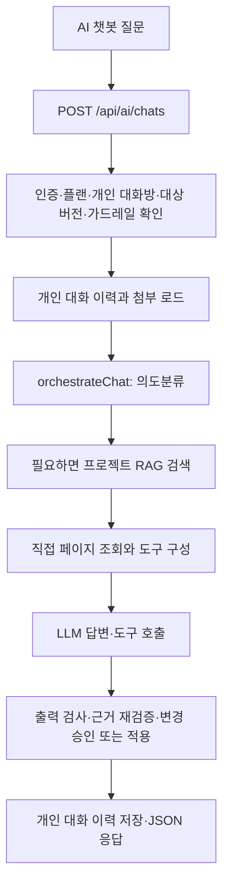
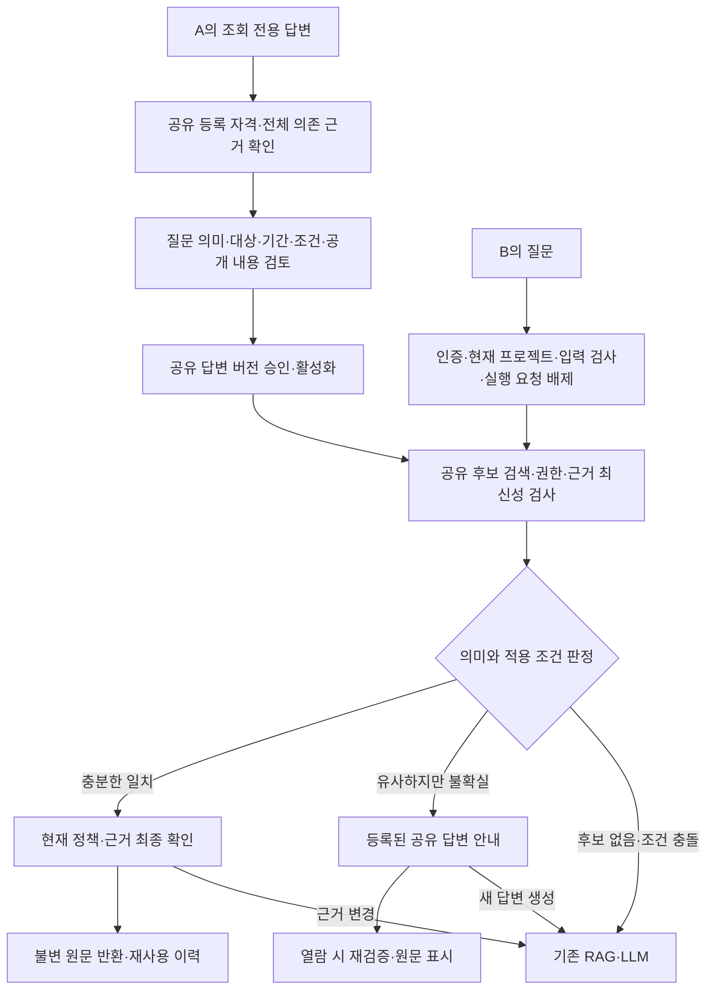

# AI 공유 답변 등록·의미 및 적용 조건 매칭·재사용 설계

- 작성일: 2026-11-17 (한국시간, Asia/Seoul)
- 상태: 현재 소스 분석에 근거한 검토용 설계. 구현 요청 전이며 아래 신규 구조·API·정책은 제안이다.
- 이번 변경: 이 문서 작성 및 `HISTORY.md` 링크 추가만 수행한다. 소스·설정·마이그레이션·DB는 수정하지 않는다.
- 분석 범위: 작업 디렉터리의 현재 파일. 운영 DB·외부 AI·실제 배포 상태는 조회하지 않았다. 기존 미커밋 변경을 포함한 현재 소스를 기준으로 한다.

## 1. 요구사항

### 1.1 사용자 흐름

1. A가 질문하고 생성된 답변을 확인한다.
2. 만족한 답변에서 **공유 답변으로 등록**을 선택한다.
3. B가 질문하면 기존 RAG·답변 생성보다 먼저 공유 답변 후보를 검색한다.
4. 질문의 의미·대상·기간·조건이 충분히 일치하고 권한·최신성 검사를 통과하면 등록된 답변을 그대로 반환한다.
5. 관련성은 있으나 자동 반환 기준에 못 미치면 **등록된 공유 답변이 있습니다** 안내와 열람 동작을 제시한다.
6. 적합한 답변이 없거나 사용자가 새 답변을 원하면 기존 RAG·LLM 경로를 사용한다.

핵심은 **질문을 정확한 공유 답변에 연결하는 판정**이다. 연결 이후에는 LLM으로 답변을 재작성·요약·개인화하지 않는다. 문장 유사도나 같은 화면이라는 사실은 재사용 자격이 아니다.

### 1.2 필수 제약

| 구분 | 요구사항 |
| --- | --- |
| 격리 | 동일 workspace의 동일 프로젝트 내부에서만 검색·열람·반환한다. 프로젝트 없는 전체 대시보드·팀 화면 답변은 초기 대상에서 제외한다. |
| 권한 | 요청자에게 현재 프로젝트 접근권한과 답변의 모든 근거 자료에 대한 조회권한이 있어야 한다. 등록자의 권한으로 대신 조회하지 않는다. |
| 의미 | 대상 엔터티·업무 의도·질의 범위·수치의 정의·기간·필터·전제·출력 요구가 호환되어야 한다. |
| 시간 | 현재/지난주/특정 기준일을 구분한다. 상대 날짜는 서버의 요청 시각과 한국시간으로 해석한다. |
| 최신성 | 근거가 변경·삭제되거나 집계 대상이 추가되는 등 의존 범위가 변하면 재사용을 중단하고 다시 검토한다. |
| 개인정보 | 개인 대화·개인 첨부·개인 설정·개인별 조회 결과·개인정보에 의존한 답변은 공용으로 등록하거나 재사용하지 않는다. |
| 원문 보존 | 반환 본문은 승인된 공유 답변 버전의 원문과 같다. 출처·등록일·조회일·공유 표시 등은 별도 메타데이터로 제공한다. |
| 실행 격리 | 수정·등록·삭제·승인 등 업무 실행 요청을 공유 답변으로 대체하거나 과거 실행을 반복하지 않는다. |

### 1.3 확정 요구와 권고안의 구분

위 흐름과 필수 제약은 사용자 요구다. 다음은 구현 범위를 정하기 위한 권고안이며 10절에서 검토한다.

- 초기에는 저장된 조회 전용 답변 중 **개인 이력·첨부 없이 공용 프로젝트 근거만 사용했고 의존 범위를 완전히 추적할 수 있는 답변**만 등록한다.
- 과거 답변은 근거 추적 정보가 충분하지 않으므로 일괄 등록하거나 소급 추정하지 않는다.
- `current` 등 실시간 값은 최초 버전의 자동 재사용 대상에서 제외한다. 고정 기간의 질문도 그 기간을 입증할 데이터가 있어야 한다.
- A는 등록 요청과 공개될 내용을 확인하고, 프로젝트 owner/admin의 검토를 통과한 버전만 검색에 노출한다. 등록 즉시 활성화 여부는 미확정이다.
- 유사 후보가 있을 때는 후보를 먼저 제시하고 B가 열람 또는 새 답변 생성을 고른다. 대기 중에는 LLM 답변 생성과 장시간 생성 잠금을 유지하지 않는다.

## 2. 현재 구조와 소스 분석

### 2.1 현재 질문·답변 처리



| 파일·주요 함수 | 현재 확인한 동작 | 설계에 미치는 영향 |
| --- | --- | --- |
| `components/ai/ai-chatbot.tsx`의 `generate()` | 대상 권한을 확인하고 `/api/ai/chats`에 질문·모델·방·대상 버전·첨부를 전송한다. 응답의 `chat`, `conversation`, `actions`를 처리한다. | 후보 제시로 끝나는 응답을 처리하는 별도 상태가 필요하다. 현재는 생성 완료를 전제로 한다. |
| `components/ai/ai-conversation-messages.tsx` | 답변 본문·RAG 참조·변경 검토와 결과 크게 보기/다시 사용 버튼을 제공한다. | ‘다시 사용’은 질문·첨부 입력 복원 동작이며 다른 사용자에게 승인된 답변을 반환하는 기능이 아니다. |
| `app/api/ai/chats/route.ts`의 `POST()` | 인증·플랜·대상·가드레일·모델 검증, 생성 등록과 방 lease, 이력 로드, 오케스트레이션, 직접 조회, LLM, 출력 검사, 트랜잭션 저장을 담당한다. 결과는 스트리밍이 아닌 JSON이다. | 중간에 단순 조기 반환을 넣으면 검사·중지·저장·잠금 해제가 누락될 수 있다. 공통 마무리 경계를 재사용해야 한다. |
| `lib/ai/orchestration.ts`의 `orchestrateChat()` | `classifyIntent()` 후 `retrieveRag()`를 수행하고 처리 계획·근거를 `ai_orchestration_events`에 기록한다. | 의도 판정과 일반 RAG 검색이 현재 묶여 있다. 공유 검색을 일반 RAG보다 앞에 넣으려면 두 단계를 분리하거나 명시적인 조기 분기를 둔다. |
| `lib/ai/intent-classifier.ts` | `rag/realtime/execution`, 확인 질문 필요 여부를 규칙과 제한된 LLM으로 판정한다. ‘진행률’도 실시간 단서에 포함한다. | 질문의 대상 ID·기간·집계 정의·필터가 일치하는지를 판정하는 기능은 아니다. 기존 분류만으로 공유 재사용을 허용할 수 없다. |
| `lib/ai/rag-retrieval.ts` | 활성 세대와 현재 manifest를 비교하고 벡터·제목 기반으로 후보 청크를 고른다. 최대 6개 근거를 반환한다. 저장 전 `validateRagEvidence()`로 manifest를 재확인한다. | 현재 청크 검색 점수 기준 0.2와 제목 가산점은 자료 탐색용이다. 공유 답변의 자동 반환 임계값으로 재사용하면 안 된다. |
| `lib/ai/rag-sources.ts`의 `collectRagSources()` | 프로젝트·RFP·산출물·연결·폴더·파일·화면 보드·도메인·연결된 출처 snapshot을 수집하고 권한을 확인한다. type/id/version/hash로 manifest를 만든다. | 현재 원본의 존재·권한·변경 검증을 재사용할 수 있다. 개인 대화를 색인에 추가해서 공유 기능을 만드는 방식은 사용하지 않는다. |
| `lib/ai/page-data.ts`, `page-tools.ts`, `project-analysis.ts` | 화면과 도구를 통해 RFP·산출물·연결·도메인·집계·이력 등을 직접 조회한다. 일부 결과에는 생략·건수·조회 범위가 있다. | RAG 외의 실제 답변 입력도 근거 추적 대상이다. 생략된 범위를 전체 근거처럼 취급하지 않는다. |
| `lib/ai/conversations.ts` | `workspace_id + user_id + project_id + conv_id`로 개인 대화방·답변을 조회한다. 최근 최대 20개 이력과 과거 캡처를 답변 문맥에 전달한다. | 질문만 독립적이어도 기존 생성에 개인 문맥이 전달되었을 수 있다. 개인정보가 결과에 보이는지만 검사해서는 부족하다. |
| `lib/ai-context.ts`의 `AiChat` | 본문·모델·RAG 참조·이미지·검토 상태·대상 정보를 표현한다. | 공유 여부, 공유 버전, 등록 가능 이유, 전체 의존 근거와 매칭 결과 타입이 없다. |

### 2.2 현재 저장 구조와 권한

- `db/migrations/007_ai_prompt_chats.sql`에서 개인 질문/답변 테이블을 만들고 이후 대화방·대상 정보 등을 추가한다. `048_project_rag_orchestration.sql`은 `rag_references_json` 및 RAG 세대·소스·청크·오케스트레이션 이력을 추가한다.
- `RagReference`(`lib/ai/rag-types.ts`)는 청크 ID, 자료 type/id, version/hash, 제목·절·링크·색인 시각을 보유한다. **선택된 RAG 근거의 목록**이지 답변이 참고한 모든 입력의 의존 목록은 아니다.
- 개인 이력은 항상 사용자 ID로 제한된다. 공유를 위해 다른 사용자의 `ai_prompt_chats`를 직접 읽도록 이 조건을 제거해서는 안 된다.
- `projectPermissionAccess()`는 현재 workspace 플랜·프로젝트 배정·역할·탭 권한을 조회한다. `ragAccess()`의 관리 권한은 현재 프로젝트 owner/admin이다.
- 현재 `project-permission-model.ts`와 `readProjectPolicy()`는 역할별 탭 `READ`를 `true`로 제공한다. 현행에 없는 개별 파일 ACL을 이미 지원하는 것으로 가정하지 않는다. 공유 경로에서도 현재 권한 API를 사용하고, 향후 자료별 제한이 추가되면 같은 검증기에 연결한다.
- `lib/query/keys.ts`는 사용자/workspace scope를 제공한다. 권한은 작업 직전에 서버에서 재확인하며 access 폴링을 추가하지 않는 기존 규칙을 지킨다.
- 검색한 `app`, `lib`, `components`, `db`, `scripts`에는 공유 답변 전용 등록·검색·의미/조건 판정 구현이 없다.

### 2.3 현 구조의 한계와 영향

1. **근거 추적 부족:** RAG 참조만 저장되므로 직접 조회와 도구의 반환 자료·집계 범위·개인 문맥 사용을 나중에 증명하기 어렵다.
2. **시간 의미 부족:** 기존 분류기는 실시간 단어를 찾을 뿐 ‘지난주 말 기준’과 ‘지난주에 변경된 항목’을 구분하지 않는다. 현재 DB 결과를 과거 진행률의 증거로 사용할 수 없다.
3. **집합 변화 감지 필요:** 답변 근거에 포함된 행의 버전만 확인하면 새 항목 추가·삭제·집계 범위 변화를 놓친다.
4. **기존 답변 등록 위험:** 과거 `rag_references_json`이 존재해도 개인 문맥·직접 조회 영향이 없었다는 뜻이 아니다.
5. **재사용 이력의 재노출:** 공유 답변을 B의 개인 이력에 복사한 뒤 권한이 철회되면 저장 당시 권한만으로는 보호되지 않는다. 다시 여는 시점도 검증해야 한다.

## 3. 수정 방향과 전체 흐름

### 3.1 공용 답변을 별도 자원으로 관리

공유 답변은 일반 RAG 청크나 개인 대화 공개 설정이 아닌 **프로젝트 소속의 검토된 불변 답변 버전**으로 관리한다. 질문 후보 검색용 표현과 반환할 답변 원문을 분리한다. 개인 대화 원본의 상세 조회 URL·방 ID·개인 첨부를 B에게 제공하지 않는다.



여기서 공유 후보 검색은 **일반 프로젝트 RAG와 답변 생성보다 앞선다**. 인증·권한·입력 정책 검사와 실행 의도 확인을 생략한다는 뜻은 아니다. 공유 답변 경로는 업무 쓰기 도구를 만들거나 `agent.commit()`을 실행하지 않는다.

### 3.2 등록 과정

1. 서버가 A의 현재 프로젝트 권한과 개인 소유 원본 `chatId`를 확인한다. 클라이언트가 보낸 답변·근거·안전성 플래그를 원본으로 신뢰하지 않는다.
2. 신규 생성 시 저장한 근거 추적 정보로 등록 자격을 판정한다. 근거 누락·개인 문맥·첨부·개인정보·업무 실행/변경 검토 답변·범위 불명은 거부하고 구체적인 이유를 표시한다.
3. 등록 창에서 질문 표현, 대상 ID/이름, 고정 기간, 필터, 집계 정의, 전제, 근거 목록, 기준 시각, 공유될 원문을 확인한다. 미확인 값을 ‘전체’나 조건 없음으로 자동 채우지 않는다.
4. 질문 표현은 다듬거나 별칭을 추가할 수 있지만 답변 의미나 적용 범위를 넓히는 변경은 재검토한다. LLM이 뽑은 조건은 제안일 뿐 서버가 검증해야 한다.
5. 답변 원문은 서버에 저장된 최종 `result`를 복사하고 `answerHash`를 저장한다. 개인정보를 제거해야 하는 답변은 원문을 몰래 가공하여 공유하지 않고 등록을 막는다. 공용 근거만으로 새 답변을 만드는 별도 작업이 필요하다.
6. 중복 제출은 사용자·workspace·프로젝트·멱등키와 입력 hash로 방지한다. 같은 키의 다른 내용은 409로 거절한다.
7. 승인/활성화 시 현재 근거·권한·정책·버전을 다시 검증한다. 장시간 검토·임베딩 호출 동안 DB 쓰기 트랜잭션을 열어두지 않는다.

초기 자격은 보수적으로 정한다. 이전 개인 대화가 생성 입력에 하나라도 전달되었으면 등록 불가로 처리한다. 추후 개인 문맥 없이 별도로 검증하는 흐름을 추가할 수 있지만, 결과를 보고 ‘개인정보 없음’으로 추측해 등록하는 방식은 사용하지 않는다.

## 4. 의미·적용 조건 매칭 설계

### 4.1 구조화한 질문 계약

| 필드 | 예시와 검증 기준 |
| --- | --- |
| scope | 서버가 확정한 workspaceId/projectId. pathname·화면 제목은 보조 정보만 사용한다. |
| operation | 조회/설명/집계. 실행 요청은 공유 자동 반환을 배제한다. |
| subject | entity type + canonical ID 목록. ‘회원관리’처럼 동명이면 화면·산출물 ID로 확정한다. |
| metric | 진척률/변경 건수/검수율 등 지표와 계산 규칙·분모·가중치·단위. 같은 ‘진행률’도 산식이 다르면 불일치다. |
| temporal | none / fixed_range / as_of / current / rolling. 시작·끝·기준 시각·timezone·시간 의미를 기록한다. |
| conditions | 상태·담당 조직·단계·대상 종류·제외 조건·사용한 문서 판 등 정규화된 필터. 명시적 ‘전체’와 미지정을 구분한다. |
| presentation | 한국어/표/요약 등 답변이 충족해야 할 형식과 상세 수준. 추가 설명·번역 요청은 기존 원문으로 충족되지 않으면 새로 생성한다. |
| contextDependency | 개인 문맥·첨부·개인 설정·미승인 변경·추정으로 채운 조건 여부. 알 수 없으면 자동 반환 금지다. |
| completeness | 각 필드의 확정/미지정/충돌 및 추출기·정규화기 버전. 모델의 단일 confidence로 대체하지 않는다. |

질문 추출에는 현재 B의 질문과 허용된 프로젝트 식별 정보만 사용한다. 초기에는 개인 대화가 있어도 질문 자체가 독립적으로 확정되는 경우만 후보 판정을 진행한다. ‘그 문서’, ‘아까 말한 일정’처럼 이전 대화로만 대상을 알 수 있으면 확인 질문 또는 기존 대화 생성 경로로 보낸다.

### 4.2 후보 탐색과 자동 반환 판정 분리

1. **사전 제외:** 프로젝트 없음, 실행·개인화·첨부 의존·미확정 대상·미지원 실시간 질문은 자동 반환 후보에서 제외한다.
2. **격리 검색:** workspace/project/active를 서버 필터로 고정한 뒤 정규화 질문 hash·검토된 질문 별칭·키워드·질문 임베딩으로 후보를 찾는다. 다른 프로젝트 후보를 모델에 보낸 다음 제거하지 않는다.
3. **노출 전 자격 검사:** 모든 근거의 현재 권한·존재·최신성과 공유 상태를 검사한 후에만 제목·질문 요약도 노출한다. 제목 자체에 민감한 정보가 있을 수 있다.
4. **조건 비교:** canonical ID, 지표 정의, 절대 기간, 필터와 전제가 충돌하면 불일치다. 문자열에서 날짜·부정·숫자를 제거해 같은 질문으로 합치지 않는다.
5. **의미 확인:** 강제 조건이 맞는 후보에 한해 ‘등록된 원문이 새 질문 전체에 답하는가’를 평가한다. 필요하면 도구 없는 판정 모델에 최소한의 질문 계약·승인된 본문만 전달하고 구조화 결과를 받는다. 모델은 권한이나 강제 조건을 완화할 수 없다.
6. **복수 후보 확인:** 같은 계약에 서로 다른 활성 답변이 존재하거나 상위 후보 간 판정이 모호하면 즉시 반환하지 않는다. 충돌한 답변의 임의 우선순위 대신 검토/선택 흐름을 제공한다.
7. **최종 검증:** 선택 버전·상태·원문 hash·현재 정책·근거를 응답 확정 직전에 재확인하고 원문을 반환한다.

질문 문장이 완전히 같아도 기간·대상·현재 자료가 다르면 재사용하지 않는다. 반대로 화면이 달라도 같은 프로젝트의 같은 대상·조건이고 모든 검사를 통과하면 재사용할 수 있다.

| 판정 | 조건 | 사용자 동작 |
| --- | --- | --- |
| exact | 모든 강제 조건 확정·일치, 의미 일치, 유효 근거, 충돌 없음, 자동 반환 허용 시간 유형 | 본문 즉시 반환. ‘공유 답변’과 원래 기준 시각을 본문 밖에 표시한다. |
| suggested | 노출 자격·최신성 통과, 관련성 충분, 알려진 조건 충돌 없음, 일부 의미/조건을 자동 확정할 수 없음 | 안내·적용 조건·열람/새 답변 생성 버튼. 열람은 자동 매칭 확정이나 적용 범위 확장이 아니다. |
| miss | 조건 충돌·범위 외·개인 의존·무효 근거·관련성 부족·판정 실패 | 기존 RAG·LLM. 권한 없는 후보의 존재나 제외 이유를 B에게 누설하지 않는다. |

임계값은 평가 데이터로 결정한다. 현행 RAG 점수나 임의의 ‘0.9 이상’을 안전한 의미 일치 기준으로 확정하지 않는다. 자동 반환 임계값·suggested 임계값·후보 간 점수 차이·판정기 버전을 따로 관리하고, 점수보다 강제 조건을 우선한다.

### 4.3 기간과 최신 상태

- 한국시간 2026-11-17에 ‘지난주’를 **월요일 시작 달력 주간**으로 해석하는 권고안을 적용하면 `[2026-11-09 00:00, 2026-11-16 00:00)`이다. 이는 최근 7일과 다르다. 주 시작일과 기준은 10절에서 확정한다.
- 11월 10일에 등록한 ‘지난주’와 11월 17일의 ‘지난주’는 다른 절대 기간이므로 불일치다.
- ‘지난주 변경 건수’는 기간 내 변경 이벤트 집계이며 ‘지난주 말 진행률’은 과거 시점 상태다. 저장 이력·발행 snapshot 등 실제 근거가 없으면 과거 진행률을 추정하거나 재사용하지 않는다.
- `current/rolling`은 원본 버전이 같아도 시간이 지나면 답이 달라질 수 있다. TTL만으로 재사용 안전성을 보장하지 않는다. 초기에는 기존 최신 조회 경로로 보내고 현재 수치 답변의 공유 활성화를 제한한다.
- 향후 실시간 재사용을 허용하려면 지표별 기준 시각, 의존 집합, 시계 변화, 허용 신선도와 최신 결과 동일성까지 검증해야 한다. 이때도 본문을 동적으로 수정하지 않고 조건이 충족될 때만 원문을 반환한다.

### 4.4 대표 판정 예시

| 등록 질문 → B 질문 | 판정·이유 |
| --- | --- |
| ‘REQ-001 승인 조건은?’ → ‘REQ-001이 승인되려면 어떤 조건이 필요한가?’ | 같은 프로젝트·자료 버전·조건이고 의미 판정을 통과하면 exact 가능. |
| 같은 화면의 ‘현재 진행률’ → ‘지난주 진행률’ | miss. 화면이 같아도 기간·조회 의미가 다르다. |
| 프로젝트 P의 ‘회원가입 범위’ → 프로젝트 Q의 동일 문장 | 검색 범위 밖. Q에서 P 후보를 노출하지 않는다. |
| ‘개발 단계 전체 진행률’ → ‘개발 단계 중 미완료 항목 진행률’ | miss. 필터·분모가 다르다. |
| ‘2026-11-09~15 변경 건수’ → ‘지난주 변경 건수’ | 요청일·시간대·주 정의와 집계 조건이 같고 해당 이력이 유효할 때만 exact 가능. |
| ‘내 담당 항목과 지난 대화 기준 우선순위’ | 개인 의존. 등록 거부 및 자동 반환 제외. |
| ‘REQ-001 승인 조건’ → ‘그 요구사항 설명해줘’ | 대상/요구 범위 불명. 확인 질문 또는 기존 경로. |
| 같은 의미·조건이지만 근거 RFP가 v3 → v4 | 재검토 전까지 miss. 새 버전의 내용이 비슷해도 자동 활성화하지 않는다. |
| 동일 계약의 활성 답변 두 개가 서로 다른 결론 | 자동 반환 중지. 충돌을 해결하거나 후보 선택으로 보낸다. |
| 기존 질문에 ‘영어 표로 바꿔서’ 추가 | 원문이 형식 요구를 충족하지 못하면 exact 불가. 재작성은 기존 LLM 경로다. |

## 5. 근거 추적·권한·재검토

### 5.1 신규 답변 생성부터 근거 추적

공유 등록 버튼만 추가해서는 충분하지 않다. 답변 생성 때 다음 입력과 조회 의존성을 서버에서 기록해야 한다.

- RAG로 LLM에 실제 전달한 모든 자료 type/id/version/hash. 본문에 인용된 일부만 저장하지 않는다.
- 최초 `readAiPage()`와 이후 `read_page`, `read_project_artifact`, `read_project_rfp`, 도메인 등 도구 조회에서 사용한 자료와 권한 요구사항.
- 집계·목록의 필터, 전체 대상 집합의 fingerprint 또는 범위 revision, 연결·정렬·계산 규칙 버전, 데이터 생략 여부.
- 개인 이력·이미지·개인 설정·현재 사용자별 자료가 입력되었는지 여부와 `provenanceComplete`.
- 답변 생성 시각, 지표 기준 시각, 정책/정규화 버전. 비밀키·개인 이력 본문·암호문은 공유 메타데이터에 기록하지 않는다.

추적되지 않은 도구나 입력이 하나라도 있으면 `provenanceComplete=false`로 처리하고 등록을 막는다. 근거 메타데이터에서 개인정보 검사를 빼지 않으며, 공용 프로젝트 자료에 들어 있는 개인정보도 공유 적합성 검사에 포함한다. 가드레일 통과만으로 공용 등록이 승인되지는 않는다.

### 5.2 최신성 판정 단위

1. **개별 자료:** 서버의 현재 원본에서 type/id와 version/hash/존재를 비교한다. 현재 READ를 모두 확인한다. 청크 ID나 색인 세대 ID만 비교하지 않는다.
2. **집합·연결:** 추가·삭제·관계 변경을 포함한 scope fingerprint를 비교한다. 기존 근거 행이 그대로여도 총합·‘없음’ 답변은 무효가 될 수 있다.
3. **파일:** 현재 `rag-sources.ts`의 파일 hash는 메타데이터·object key 등을 기반으로 한다. 외부 객체 본문이 같은 key로 덮어써질 수 있다면 메타데이터 hash만으로 무변경을 보장할 수 없다. 파일을 근거로 허용하려면 불변 객체 규칙 또는 실제 콘텐츠 digest/버전을 검증해야 한다. 미보장 파일 근거는 초기 등록에서 제외한다.
4. **과거 snapshot:** 불변 snapshot이 남아 있어도 원본이 바뀐 사실을 숨기는 용도로 사용하지 않는다. 현재 상태를 설명한 답변은 원본 변경 시 재검토한다. 고정 과거판을 설명한 답변은 질문 계약에 해당 판을 명시하고 원본 상태 변화도 검토 사유로 관리한다.
5. **실패·부분 검증:** 자료 검증 실패, 시간 예산 초과, 지원하지 않는 source type은 재사용 불가다. 일부 근거만 확인한 결과를 전체 통과로 간주하지 않는다.

초기에는 현재 `collectRagSources()`/manifest 검증 방식을 활용해 **프로젝트 공용 자료 전체 manifest + 개별 직접 조회 의존성 + 조회 범위 fingerprint**를 보수적으로 확인한다. 이 방식은 무관한 자료 변경에도 재검토가 늘 수 있다. 이후 완전한 의존 집합을 입증한 질문 유형부터 검증 범위를 줄인다. 현재 RAG manifest에는 포함되지 않는 이력/외부 원본은 별도 검증기가 없으면 제외한다.

전체 manifest는 최신성 검사용으로 사용한다. 본문이 의존하지 않은 자료의 제목이나 내용을 권한 검사·클라이언트 응답에 불필요하게 포함하지 않는다.

### 5.3 상태와 검토

```text
pending_review → active → needs_review → 새 버전 검토 → active
pending_review → rejected
active / needs_review / pending_review → revoked
```

- `needs_review`·`revoked`는 자동 반환과 일반 후보 노출에서 제외한다. 관리자/등록자는 권한을 갖춘 관리 화면에서 검토 이유를 확인한다.
- 자료 변경 이벤트가 있으면 영향 답변을 무효화하는 최적화를 추가할 수 있다. **반환 시 원본 재검증을 최종 기준**으로 삼아 이벤트 누락도 방어한다.
- GET은 안전성 검사와 결과 필터만 수행하고 상태 갱신은 명시된 처리 경로에서 수행한다. 무효화 기록의 성공 여부와 관계없이 검증 실패 본문은 반환하지 않는다.
- 등록 승인·재검토 승인에는 expectedVersion과 불변 본문 hash를 사용한다. 근거가 바뀌면 단순 ‘확인’ 버튼으로 최신 상태를 보증하지 않고 현재 자료와 답변 내용을 실제로 검토한다.
- 본문이 그대로여도 새 근거를 승인하면 새 공유 버전을 만든다. 이전 버전과 재사용 이력을 보존하고, 기존 B의 과거 답변을 새 본문으로 덮어쓰지 않는다.
- B의 일시적 권한 부족은 그 사용자에게만 노출을 차단한다. 이를 전체 공유 답변의 오류나 전역 폐기로 처리하지 않는다.

### 5.4 반환 직전 및 재열람 보호

- 짧은 트랜잭션에서 프로젝트 권한·공유 활성 버전·근거 버전을 재확인하고 B의 개인 이력과 재사용 이벤트를 원자 저장한다. 외부 AI/임베딩 호출은 이 트랜잭션 밖에서 수행한다.
- 재검증 중 자료가 바뀌면 후보를 폐기하고 기존 경로로 한 번 전환한다. 권한 철회·401/403/404·중지·명시적 정책 차단을 일반 miss로 삼아 우회하지 않는다. 필요한 범위만 현재 권한으로 처리한다.
- 후보 상세 열람, 최종 사용, B의 저장된 공유 답변 이력 조회에서도 현재 근거 조회권한을 확인한다. 권한이 없으면 본문과 민감한 근거를 숨긴다.
- 자료 변경 이후 B 자신의 과거 이력은 ‘당시 답변·현재 근거 변경’ 표시로 보존할 수 있으나, 새 질문에 대한 유효 답변으로 재사용하지 않는다. `revoked`의 과거 이력 노출 정책은 10절에서 확정한다.
- 서버/브라우저 응답은 `private, no-store`를 사용한다. Query cache는 사용자/workspace/project scope를 유지하고 계정·workspace 전환 시 이전 후보·본문·선택 토큰을 정리한다. 장기 캐시를 권한 확인의 대체물로 사용하지 않는다.

## 6. 제안 저장 구조

아래는 논리 모델이며 이번 작업에서 SQL이나 마이그레이션 파일을 만들지 않는다. 물리 컬럼·제약·마이그레이션 번호는 구현 시 기존 최신 스키마를 재확인하여 결정한다.

| 논리 자원 | 주요 정보 | 원칙 |
| --- | --- | --- |
| `project_shared_answers` | id, workspaceId, projectId, 상태, activeVersionId, 관리 version, 등록자, 승인/철회자·시각 | 프로젝트 복합 FK와 서버 scope 검사. 한 활성 버전만 가리킨다. |
| `project_shared_answer_versions` | answerId, version, 불변 answerText/answerHash, 검토된 대표 질문·질문 계약, 근거 manifest, 추적 완전성, 정책 버전, 검토 상태·시각 | 원문/계약/근거 수정은 새 버전이다. 내부 sourceChatId는 권한 제한 감사용이며 공개 DTO에서 제외한다. |
| `project_shared_answer_evidence` | answerVersionId, 자료 type/id, version/hash, 필요한 탭/권한, 집합 scope fingerprint, 시간 기준 | 모든 자료와 집계 의존성을 확인한다. 특정 RAG 청크의 수명에 종속되지 않는다. |
| `project_shared_answer_questions` | answerVersionId, 승인된 질문 별칭·정규화 hash, embedding, model/dimensions/normalizerVersion, 인덱스 상태 | 모델/차원이 다른 벡터를 비교하지 않는다. 답변 본문을 일반 RAG 자료로 다시 색인하지 않는다. |
| 개인 답변의 근거 추적 메타데이터 | chatId, read dependencies, provenanceComplete, 개인 문맥/첨부 여부, 실행 여부, 시간·계산 규칙 | 새 답변만 정확하게 기록한다. 과거 답변은 unknown 기본값으로 등록 불가다. |
| 개인 답변의 공유 출처 메타데이터 | responseSource, sharedAnswerId/version, matchVersion, reusedAt | B 이력의 원문은 당시 공유 버전과 동일하다. A의 전체 대화를 참조하도록 공개하지 않는다. |
| 공유 등록·재사용 감사 이벤트 | requestId, actor, scope, 판정 코드·버전, 선택한 공유 버전, 처리 시간, 성공/실패 | 전체 개인 질문·개인 이력·후보 본문을 불필요하게 복제하지 않는다. 보존기간은 정책 결정이 필요하다. |

중복 관리 키는 정규화 질문 문자열 하나가 아닌 **질문 계약 hash**를 포함한다. 단, 같은 계약의 중복·상충 답변을 DB unique만으로 숨기지 않고 등록 시 검토할 수 있어야 한다.

재벡터화는 검색 후보 생성용 데이터만 교체한다. 승인된 원문·의존 근거·재사용 이력을 덮어쓰지 않으며, 기존 프로젝트 RAG job/worker에 공유 답변까지 자동 포함하지 않는다. 키/모델 미설정 시 검토된 질문 hash·별칭 검색은 제공할 수 있지만 의미 판정을 생략하고 자동 반환 범위를 넓히지는 않는다.

## 7. API·UI·기존 처리와의 연결

### 7.1 제안 API

| 경로 | 용도·주요 계약 |
| --- | --- |
| `POST /api/projects/[projectId]/shared-answers` | A의 chatId, 질문 계약 확인값, 멱등키로 등록 요청. 본문은 서버 원본에서 복사한다. |
| `GET /api/projects/[projectId]/shared-answers` | 역할에 맞는 목록. 일반 사용자는 유효 후보, 관리자는 허용된 상태와 검토 이유를 조회한다. |
| `GET /api/projects/[projectId]/shared-answers/[answerId]` | 버전·근거 권한과 최신성 확인 후 최소 상세 반환. 개인 원본 대화는 반환하지 않는다. |
| `POST /api/projects/[projectId]/shared-answers/[answerId]/review` | 승인/반려·재검토 승인. expectedVersion과 신규 근거 기준 검증. |
| `POST /api/projects/[projectId]/shared-answers/[answerId]/revoke` | 등록자 또는 관리자의 철회. 관리 권한·expectedVersion·멱등성 검사. |
| 기존 `POST /api/ai/chats` 확장 | 기본은 공유 답변 우선 검색. `prefer_shared / use_shared / generate_fresh` 등의 의도를 명시적으로 처리한다. |

상세·등록 자격·관리 조회도 서버에서 현재 권한을 확인한다. Origin 검사·요청 크기 제한·속도 제한·RequestError status/code/details 보존은 기존 관례를 따른다. 정확한 권한 역할은 10절의 정책 결정에 맞춘다.

### 7.2 채팅 응답 계약

기존 생성 완료 JSON에 구별 가능한 discriminator를 추가한다.

```text
kind = answered
  chat.responseSource = generated | shared_answer
  chat.result = 생성 원문 또는 승인 공유 버전 원문
  chat.sharedAnswer = { id, version, originallyAnsweredAt, verifiedAt }
  actions = []  // 공유 반환인 경우

kind = shared_candidates
  candidates = [{ id, version, 공개 질문 요약, 적용 조건, 기준 시각 }]
  selectionToken, expiresAt
  chat 없음, 생성 완료 이력 없음
```

- 후보 응답 시 **등록된 공유 답변이 있습니다**를 먼저 표시한다. 요약과 조건만 보고 열람하거나 **새 답변 생성**을 선택한다. 질문·모델·첨부 입력과 현재 방을 유지한다.
- selectionToken은 사용자/workspace/project/질문 계약 hash/대화 대상 버전/후보 버전/만료에 결합한다. 브라우저가 보낸 candidateId만으로 안전 판정을 우회할 수 없다. token은 동의나 권한의 대체물이 아니며 클릭 시 다시 검사한다.
- 열람은 공유 상세 확인일 뿐 B의 질문에 맞는 최종 답변 저장이 아니다. 명시적 사용 시 조건을 다시 검사하고 불일치하면 새 답변을 안내한다. 모호한 조건을 사용자의 클릭만으로 ‘동일’ 처리하지 않는다.
- 새 답변 생성은 별도의 요청 ID로 `generate_fresh`를 보내 공유 추천 루프를 건너뛴다. 인증·정책·기존 RAG/LLM 검사는 그대로 수행한다. 첨부를 포함한 요청 전체를 클라이언트가 scope 안에서 유지한다.
- 후보 제시만 한 요청은 짧게 정리하고 방 lease를 해제한다. 사용자 선택 대기 중 생성 요청·가드레일 세션·DB 트랜잭션·사용량 폴링을 계속 열어두지 않는다. 중지와 중복 클릭에 대한 상태 전이도 정의한다.
- 공유 본문에는 접두 문구·각주를 덧붙이지 않는다. ‘공유 답변’, 원래 기준일, 검증 시각, 근거 패널은 UI 별도 영역에서 표시한다. 서버 반환 문자열과 저장된 answerHash가 동일한지 확인한다.

### 7.3 공통 정책·사용량·장애

- 공유 검색·반환에도 기존 로그인·플랜·프로젝트 대상·AI 활성 정책·입력/출력 가드레일을 적용하는 것을 권고한다. 승인 당시 정책과 다르면 현재 정책으로 다시 검사하며 차단된 본문은 그대로 제공하지 않는다.
- 정확히 연결된 뒤 답변 생성 LLM은 호출하지 않는다. 다만 질문 임베딩·의미 판정·가드레일·제목 생성에는 비용이 생길 수 있다. ‘공유 재사용은 토큰 0’이라고 표시하거나 과거 A의 사용량을 B에게 복제하지 않는다.
- `AiCallEvent.purpose`에 공유 검색/판정 구분이 필요하면 타입·저장·사용량 API·통계를 함께 검토한다. 실제 호출만 기존 추적기에 기록한다. 외부 호출 없는 재사용은 별도 이벤트로 집계한다.
- 공유 검색/판정의 기술 장애·시간 초과는 원문을 추측하여 반환하지 않고 기존 생성으로 넘어간다. 인증·권한 실패·중지·가드레일 차단은 오류 의미를 보존한다. 생성까지 실패하면 기존 오류를 표시한다.
- 공유 검색용 키를 A 개인 자격증명에 연결하지 않는다. 프로젝트 임베딩 자격증명 재사용 여부·검색 기능 사용 자격은 정책 확정 후 적용한다.
- 같은 날짜의 [의도분류 권한·워커 설계](의도분류-Business-owner-권한과-워커-실행제한-설계.md)는 별도의 미구현 설계다. 그 문서의 Business owner 제한을 이미 적용된 현재 정책으로 간주하거나 이번 기능에 자동 상속하지 않는다. B가 공유 답변을 사용할 수 있는 범위를 명시적으로 결정해야 한다.

## 8. 변경 대상 파일과 영향 범위

이 절은 **향후 구현 대상 목록**이다. 이번 단계에서는 아래 소스를 변경하지 않는다. 신규 이름은 제안이며 구현 시 책임 단위에 맞춰 확정한다.

| 기존/신규 | 파일·범위 | 변경 내용 |
| --- | --- | --- |
| 기존 | `app/api/ai/chats/route.ts` | 공유 우선 분기, 후보 응답, 공통 finalization/저장, 공유 실행 방지, 요청 정리·중지·최종 재검증. |
| 기존 | `lib/ai/orchestration.ts`, `intent-classifier.ts` | 의도 확인과 일반 RAG 검색 경계를 분리한다. 기존 execution/HITL 권한을 보존한다. |
| 신규 | `lib/ai/shared-answer-types.ts`, `shared-answers.ts` | 공유 자원 DTO·등록·불변 버전·검토/철회·저장·원문 hash. |
| 신규 | `lib/ai/shared-answer-matching.ts` | 질문 정규화·조건 비교·후보 탐색·exact/suggested/miss 판정·판정 버전. |
| 신규 | `lib/ai/answer-provenance.ts`, `shared-answer-evidence.ts` | 실제 입력/조회 의존성 추적, 개인정보/개인 의존 판정, 자료·집합·시간·권한 검증. |
| 기존 | `lib/ai/page-data.ts`, `page-tools.ts`, `project-analysis.ts` | 직접 조회·도구 조회에 근거 추적 연결. 미지원/생략된 범위 명시. |
| 기존 | `lib/ai/rag-retrieval.ts`, `rag-sources.ts`, `rag-types.ts` | 자료 수집·hash/version 검증 재사용 경계 정리. 공유 답변 자체를 일반 RAG 입력에 포함하지 않는다. |
| 기존 | `lib/ai/conversations.ts`, `lib/ai-context.ts` | 공유 출처·등록 자격·근거 추적 DTO, 개인 이력 저장/재열람 보호. 기존 사용자별 조회 조건은 유지한다. |
| 기존 검토 | `lib/project-permissions.ts`, `lib/ai/project-rag-permissions.ts`, `lib/plans.ts` | 현재 권한 검증 재사용. 공유 등록/승인/사용 정책은 별도로 명시하며 기존 탭 쓰기 권한을 무단 확장하지 않는다. |
| 신규 | `app/api/projects/[projectId]/shared-answers/**/route.ts` | 목록·등록·상세·검토·철회 route. HTTP 처리는 route, 업무 처리는 lib에 둔다. |
| 기존 | `components/ai/ai-chatbot.tsx`, `ai-conversation-messages.tsx`, `use-ai-conversation.ts` | 공유 등록·후보 선택·원문 표시·scope 변경 정리·이력 메타데이터·무효 상태. |
| 신규 | `components/ai/shared-answer-dialog.tsx`, `shared-answer-candidates.tsx` | 등록/검토 창과 후보 카드. 기존 공통 대화상자·접근성·테마를 사용한다. |
| 기존 | `lib/query/keys.ts` | 사용자/workspace/project/공유 자원/질문 계약 scope. 원문 개인 질문·선택 토큰·키를 query key에 넣지 않는다. |
| 기존 검토 | `styles/ai-chatbot.css` 및 소유 화면 CSS | 기존 AI 영역 안에서 버튼·카드·검토 창 표시. 전역 스타일 영향 방지. |
| 기존 검토 | `lib/ai/token-types.ts`, `token-usage.ts`, 사용량 API/통계 | 공유 판정 호출 목적과 실제 사용량 표시. 공급자 호출이 없으면 가짜 사용량 행을 만들지 않는다. |
| 신규 | `db/migrations/<다음번호>_project_shared_answers.sql` | 논리 자원·근거/버전·인덱스·감사·개인 답변 메타데이터. 현재 기존 답변은 등록 불가 기본값. 이번에는 생성·적용하지 않는다. |
| 신규/기존 | `scripts/test-shared-answers.mjs`, `scripts/test-shared-answers-browser.mjs`, 기존 AI/RAG 회귀 | 격리 fixture와 모의 공급자로 아래 검증. 실행 명령은 구현 때 `package.json`에 등록한다. |
| 기존 | `components/ai/README.md`, 운영 문서 | 공유와 ‘다시 사용’ 차이, 자격·재검토·비용·운영 중단 동작 설명. |

일반 RAG 세대·워크 큐·기존 마이그레이션을 공유 답변 기능 때문에 전면 교체할 필요는 없다. 영향은 채팅 입출력 계약과 근거 추적, 별도 공유 자원, 권한/최신성 검증, 이력 재열람에 집중된다.

## 9. 검증 방법

### 9.1 구현 시 기능·안전성 검증

운영 DB와 실제 개인 자료는 사용하지 않는다. 임시 SQLite, 합성 사용자 A/B/C, 서로 다른 workspace·프로젝트, 모의 임베딩·판정·LLM으로 실제 route/업무 함수를 검증한다.

| 검증 | 기대 결과 |
| --- | --- |
| A 등록 → 승인 → B 의미 동일 질문 | 승인 원문과 `chat.result`의 문자열·hash 동일. 답변 생성 LLM·쓰기 도구 호출 0회, 실제 부가 호출만 사용량 기록. |
| 같은 화면, 다른 프로젝트/workspace | 후보 제목·본문·개인 원본 ID를 모두 반환하지 않음. |
| 프로젝트 배정 없음·탈퇴·guest·만료 플랜 | 현행 권한/플랜 오류 유지. 다른 사용자 권한으로 fallback하지 않음. |
| 자료별 READ 제한을 모의 주입 | 근거 중 하나라도 불가하면 후보/상세/재사용/저장 이력에서 본문 차단. 현행 READ 고정 정책은 임의 변경하지 않음. |
| 현재 vs 지난주·지난주 vs 최근 7일·한국시간 자정·주 경계 | 기간/시간 의미 충돌로 자동 반환하지 않음. 동일 절대 기간만 허용. |
| 대상 동명이인·ID 차이·상태/필터/부정/단위/산식 차이 | 높은 벡터 유사도나 같은 문자열이어도 miss. |
| 근거 변경/삭제·항목 추가·연결 변경·파일 본문 교체 | 검토 전 자동 반환 중단. 집계/없음 답변도 무효화. |
| RAG 세대만 교체, 원본 불변 | 청크 수명에 의존하지 않는 근거 검증. 본문/근거 승인 버전을 자동 변경하지 않음. |
| 개인 대화·과거 캡처·개인 첨부·내 담당·프로젝트 자료 내 개인정보 | 초기 등록 거부. 클라이언트 안전 플래그로 우회 불가. |
| 과거 답변/미추적 도구/근거 없음 | unknown/불완전 추적으로 등록 거부. |
| 실행 요청·pending/applied 변경 검토 결과 | 공유 자동 반환 및 공용 등록 배제. 기존 HITL·원자 저장 경로 유지. |
| 유사 후보 | 안내 먼저 표시, 클릭 전 본문 최소화, 열람 재검증, 새 답변 선택 시 추천 반복 없이 기존 생성. |
| 후보 제시 후 자료/권한/대상/공유 버전 변경 | 이전 토큰·캐시로 원문 재사용 불가. 적절한 충돌/권한 처리. |
| 동시에 등록·승인·철회·재사용 | 멱등성·expectedVersion·최종 상태 확인, 중복 이력/반복 적용 없음. |
| 후보 목록/공유 이력 저장 실패·중지·요청 취소 | 본문 부분 확정·중복 완료·남은 방 lease·사용량 폴링 없음. |
| 모델/키 없음·임베딩 차원 불일치·판정 오류·검색 예산 초과 | 오답 재사용 대신 제한된 정확 검색 또는 기존 경로. 정책 차단은 우회하지 않음. |
| 공유 원문의 악성 명령·정책 개정·XSS/링크 | 저장된 명령을 실행하지 않음, 현재 출력 정책 검사, 안전한 기존 렌더링 유지. |
| B 이력 재조회·페이지 이동·계정/workspace/방 변경 | 공유 출처 복원, 권한 재검증, 이전 scope 후보·본문·선택 정보 노출 없음. |

### 9.2 매칭 품질 평가

- 실제 개인정보 대신 합성 업무 질문 쌍을 만들고 exact/suggested/miss 정답과 충돌 이유를 사람이 검토한다.
- 동의어·어순·오탈자 양성 사례와 다른 기간·대상·필터·부정·산식·개인화·동일 화면의 음성 사례를 균형 있게 포함한다.
- 평가용 질문은 임계값 조정용 데이터와 분리한다. 자동 반환 오수락률, 정확도, 후보 노출 정확도/재현율, miss 후 생성 비율, 지연·비용을 측정한다.
- 최초 배포는 판정만 기록하고 실제 반환은 기존 경로로 하는 검증 모드를 권고한다. 검토 표본에서 조건 충돌 자동 반환 0건을 필수 기준으로 삼고, 전체 자동 반환 정확도 목표·표본 수는 10절에서 확정한다. 표본 0건이 모든 상황의 무오류 보장을 뜻하지는 않는다.
- 승인된 질문 별칭부터 자동 반환을 제한적으로 활성화하고, 판정기/정규화기/임베딩 모델을 바꿀 때 같은 평가 세트를 다시 검증한다.

### 9.3 기존 회귀 및 이번 문서 작업 검증

구현 후 격리 환경에서 `pnpm test:project-rag`, `pnpm test:ai`, `pnpm test:ai-tool-execution`, `pnpm test:ai-settings-reviews`, `node scripts/test-ai-chat-pagination.mjs`, `pnpm test:dashboard`, `pnpm test:query-audit`를 변경 영향에 맞춰 실행한다. 브라우저 검증은 공유 등록/후보/원문/접근성/방 전환과 기존 AI 대상·중지·이전 이력 스크롤 보존을 포함한다. 신규 명령은 현재 존재하는 것으로 간주하지 않는다.

이번 단계는 문서 전용이므로 애플리케이션·DB 테스트나 마이그레이션을 실행하지 않는다. 문서의 필수 항목, 참조 경로, HISTORY 상대 링크·날짜·중복, 기존 목록 보존, 이번 작업에서 문서 외 파일을 변경하지 않았는지를 확인한다. 기존 작업 중인 소스 변경은 이번 문서 작업의 결과로 기록하지 않는다.

## 10. 결정이 필요한 사항

| 항목 | 권고안 | 결정 시 영향 |
| --- | --- | --- |
| 등록/승인 권한 | 조회 가능한 사용자는 등록 요청, owner/admin은 활성화 승인. viewer의 등록 요청 허용은 별도 결정. | 역할 정책, 등록 버튼, 관리 API. 기존 RAG 관리 권한과 자동으로 동일시하지 않음. |
| A의 등록 클릭 즉시 공개 여부 | 초기에는 검토 후 공개. 일반 사용자 흐름은 ‘등록 요청 완료’와 활성 상태를 구분. | 승인 UI·알림 필요 여부·활성화 지연. |
| 공유 기능 사용 플랜 | 동일 프로젝트의 자격 있는 B에게 조회·검색 허용. Business owner 관리/자동 분류 정책과 독립 확정. | 다른 설계와 정책 충돌, 플랜 오류와 키 사용 범위. |
| 초기 등록 가능한 근거 | 공용 근거만 사용, 개인 이력/첨부 없음, provenance 완전, 파일 불변성 보장, 조회 전용. | 기존 답변 재등록 제한과 지원 범위. |
| 최신 상태 질문 | 최초 `current/rolling` 자동 재사용 및 공유 활성화 제외. | 현재 진행률 등은 최신 조회를 계속 수행. 후속 지표별 검증 필요. |
| 주/기간의 정의 | Asia/Seoul, 월요일 시작 주, 시작 포함·끝 제외. ‘기준 시점’과 ‘기간 중 이벤트’를 분리. | 질문 정규화·사용자 표시·평가 정답. |
| 유사 후보 UX | 후보 안내로 일단 종료하고 열람/새 답변 생성 선택. 알려진 조건 충돌 후보는 제외. | 추가 클릭과 비용 절감의 균형. 후보를 보여주며 바로 새 답변도 만들지는 선택 필요. |
| 초기 최신성 범위 | 공용 프로젝트 전체 manifest와 직접 조회/집계 의존성 병행. | 안전성 우선, 무관한 자료 변경에 따른 재검토 증가. |
| 복수/상충 답변 | 자동 반환 금지. 관리자가 대표 버전을 정리하며 병합 이력 보존. | 중복 계약 정책·관리 화면 필요. |
| 철회 후 과거 이력 | 신규 사용 즉시 차단. 과거 B 이력은 현재 근거 권한을 확인하고 철회 상태 표시, 민감 사유면 본문 숨김 권고. | 개인정보 대응·보존 정책·이력 DTO. |
| 원본 개인 대화 삭제 | 활성 공유 원문은 독립 보존, 개인 원본 연결은 삭제/비식별 가능. 등록 철회와 대화 삭제를 별도로 안내. | 삭제 정책과 FK 설계. 사용자의 삭제 기대를 제품 문구로 명확히 해야 함. |
| 공개 개인정보 허용 범위 | 초기에는 개인정보 의존 답변 제외. 담당자 실명·연락처 등 업무 자료 내 항목의 판정 기준도 확정. | 가드레일만으로 해결할 수 없는 등록 심사 기준. |
| 비용·키·응답 정책 | 프로젝트 임베딩 키 사용 여부와 의미 판정 모델 지정, 실제 호출 과금, 현재 가드레일 적용. | 키 회수·정책 차단·모델 없음 시 동작. |
| 자동 반환 품질 목표 | 음성 사례의 오수락 최소화 우선. 평가 표본 수·정확도 목표·응답 지연 예산 확정 후 확대. | 임계값과 단계적 활성화·운영 모니터링. |
| 감사·보존기간 | 최소 메타데이터만 기록하고 원문 질문 추가 수집은 제한. | 삭제/다운로드 범위·운영 통계·개인정보 보존기간. |

## 11. 구현 순서 제안

1. 10절의 등록·승인·사용 자격, 시간 유형, 노출/보존 정책을 확정한다.
2. 새 조회 답변의 근거 추적과 등록 가능 판정을 구현하고 불완전한 답변의 차단부터 검증한다.
3. 별도 공유 자원·불변 버전·등록/검토/철회·권한/최신성 검증을 구현한다.
4. 검토된 질문 계약·별칭 검색과 후보 안내를 연결하고 실제 사용자 선택 흐름을 검증한다.
5. 의미 검색·구조화 조건 비교·판정 모델을 검증 모드로 평가한다.
6. 확정된 질문 유형에 한해 자동 반환을 켜고 원문 동일성·이력 재열람·정책 변경·운영 중단을 검증한다.

문서 검토 및 사용자의 직접 수정 이후 별도 구현 요청을 받는 단계에서만 소스·마이그레이션 작업을 시작한다.
