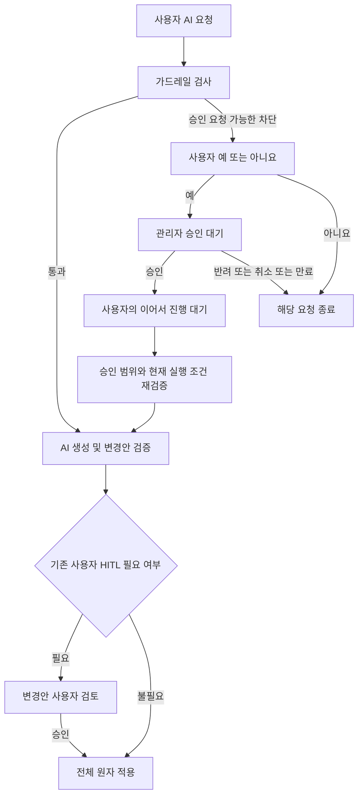

# 가드레일 관리자 승인 요청 및 실행 재개 설계

- 작성일: 2026-11-23 (한국시간)
- 상태: 소스 조사에 근거한 검토용 설계. 구현·마이그레이션·DB 적용 전.
- 관련 화면: [Guardrail_Control_Tower_화면설계](Guardrail_Control_Tower_화면설계.md)
- 이번 변경 산출물: 이 문서, 관련 화면 설계, `HISTORY.md` 링크만 작성한다.

## 1. 요구사항과 해석

| 번호 | 요청 사항 | 설계상 동작 |
| --- | --- | --- |
| R1 | 팀사용자의 AI 실행 중 가드레일 탐지 시 HITL로 예/아니요 선택 | 차단한 정책명을 포함한 질문을 표시하고, 사용자의 명시적인 예 선택 후 관리자 요청을 생성한다. |
| R2 | 예 선택 후 관리자에게 요청하고 이어서진행/취소를 남긴 채 대기 | 요청을 영속화하고 AI 호출·HTTP·생성 lease·쓰기 트랜잭션을 종료한다. UI에는 상태와 두 버튼을 유지한다. |
| R3 | 관리자 승인 후 사용자가 이어서진행 클릭 | 서버에서 승인 및 실행 조건을 다시 확인하고, 승인받은 해당 요청의 중단 지점부터 재개한다. 승인만으로 자동 실행하지 않는다. |
| R4 | 가드레일 컨트롤타워 새 창 | 관리자설정 → AI 가드레일 관리 → `컨트롤타워 이동`으로 선택 workspace의 별도 화면을 연다. |
| R5 | 현재 단계는 문서 작성만 | 소스·DB·마이그레이션을 수정하거나 실행하지 않는다. 구현은 사용자 검토 및 수정 후 별도 요청으로 진행한다. |

사용자 문구의 `어이서진행`, `이어서진행`은 화면에서 **이어서 진행**으로 통일하는 안이다. 질문 문구는 다음과 같이 고정하고 대괄호 안만 서버 판정값으로 채운다.

> [사용자 지정 차단 문구] 가드레일 정책으로 인해 해당 작업에 대해 관리자에게 승인 요청을 하시겠습니까?

관리자 승인은 정책 전체 해제나 사용자 권한 상승을 뜻하지 않는다. 해당 사용자·workspace·프로젝트·대화·프롬프트·검사 대상·정책 버전에 묶인 실행 예외다. 같은 텍스트를 새로 입력해도 별도 요청이며 승인을 재사용하지 않는다.

## 2. 현재 구조와 확인 근거

아래 경로는 모두 `hams-matrix/` 기준이다. 운영 DB를 조회하지 않고 소스만 확인했다.

| 영역 | 확인 파일 | 현재 동작과 영향 |
| --- | --- | --- |
| 관리자 진입 | `app/(workspace)/admin/settings/page.tsx` | `members`, `guardrails`, `system`, `history` 탭. `master`, `biz_admin`, `team_admin` 계정을 구분한다. |
| 구 가드레일 URL | `app/(workspace)/admin/ai-guardrails/page.tsx` | 권한 확인 후 `/admin/settings?tab=guardrails`로 리다이렉트한다. 독립 컨트롤타워가 아니다. |
| 상품/workspace 선택 | `components/admin/product-admin.tsx` | 선택 workspace마다 `GuardrailAdmin`을 생성하고 admin/super-admin endpoint에 `workspaceId`를 전달한다. |
| 정책 편집 UI | `components/admin/guardrail-admin.tsx` | 정책 설정·글로벌 규제 준수·정책 테스트·적용/검사 이력. 새로고침과 초안 보호가 있으며 승인 대기 목록은 없다. |
| 관리자 범위 | `lib/guardrail-admin-access.ts`, `lib/product-access.ts`, `lib/master-workspace-admin.ts` | master의 현재 workspace 관리, 상품 관리자, 슈퍼관리자 상품 관리가 다르다. 단순 프로젝트 owner/admin 검사로 대체하면 안 된다. |
| 정책 모델 | `lib/ai/guardrail-types.ts`, `lib/ai/guardrail-policy.ts` | workspace별 단일 활성 정책 버전과 초안. 정책명 속성은 없고 규칙 ID·severity·검사 단계가 존재한다. 기본 버전은 0이다. |
| 검사 | `lib/ai/guardrails.ts` | input/context/tool/tool-result/output 검사. 이벤트를 저장한 후 차단이면 `GuardrailBlocked(requestId)`를 던진다. 예외에는 이벤트 ID·규칙 목록이 전달되지 않는다. |
| 차단 응답 | `app/api/ai/chats/route.ts` | `422 {error, requestId}` 반환. `finally`에서 생성 상태/finished_at을 기록하고 대화 lease를 해제한다. 승인 상태는 없다. |
| 클라이언트 처리 | `components/ai/ai-chatbot.tsx` | POST의 JSON 응답을 받고 실패 시 `RequestError(status, code, details, requestId)`를 만든다. 현재 차단 응답에는 code/details가 없어 정책명 및 복구 UI를 구성할 수 없다. |
| 실행 식별/중지 | `lib/ai/generation-control.ts` | 동일 requestId 재등록을 거부하고 running/stop_requested/cancelled 등을 처리한다. 같은 ID로 단순 재전송하면 재개가 되지 않는다. |
| 모델 도구 루프 | `lib/ai-server.ts` | messages, 호출 순서, 도구 응답을 함수 내부에서 관리한다. 프로세스 종료 뒤 도구 중간 지점부터 재개할 영속 checkpoint가 없다. |
| 변경안 | `lib/ai/page-tools.ts`, `lib/ai/rfp-tools.ts` | 변경은 미리보기와 pending에 모으고 최종 원자 저장한다. `exportChanges`/`restoreChanges`가 있다. 일부 정책 제한은 `GuardrailBlocked`가 아닌 일반 HttpError다. |
| 기존 사용자 HITL | `lib/ai/change-reviews.ts`, `components/ai/ai-change-review.tsx`, `db/migrations/046_ai_project_analysis_reviews.sql` | 생성 완료 후 사용자가 변경안을 승인/거절한다. 24시간 만료·원본/정책 버전 검증·원자 적용이 있다. 관리자 가드레일 예외 승인과 다른 단계다. |
| 저장 구조 | `db/migrations/017_ai_guardrails.sql` | configs/policies/events와 generation의 정책 버전. 이벤트는 원문 없이 규칙·판정·시간을 기록한다. 승인·보류 실행 본문 저장소는 없다. |
| 알림 | `lib/header-notifications.ts`, `components/header-notifications.tsx`, `app/api/me/notifications/` | 카운터 15초, 상세는 패널 열 때 조회. 팀 신청·AI 토큰 초과와 확인 상태를 사용하며 가드레일 승인 알림은 없다. |

### 2.1 실제 검사 적용 범위와 문서 불일치

`docs/AI_GUARDRAILS.md`에는 과거 경로/권한/적용 범위 설명이 포함되어 있다. 이번 설계의 현재 구조 판정은 다음 실제 호출 여부를 우선한다. import만으로 적용 중이라고 판단하지 않는다.

| 실행 경로 | 확인한 소스 상태 | 승인/재개 설계 적용 |
| --- | --- | --- |
| AI 챗봇·프로젝트 분석·챗봇 내부 도구 | `app/api/ai/chats/route.ts` 및 도구에서 검사 호출 활성 | 우선 구현 대상. 모든 검사 단계의 중단/재개를 지원해야 한다. |
| 아키텍처 Mermaid 생성 | `lib/ai/architecture-mermaid.ts` 입력·출력 검사 활성 | 공통 판정은 공유하지만 별도 작업 adapter 및 해당 화면의 대기 UI가 필요하다. |
| DB ERD AI 배치 | `lib/ai/database-erd-images.ts` 입력·출력 검사 활성 | 위와 동일. 챗봇 resume endpoint만 추가해서 지원됐다고 볼 수 없다. |
| 공유 답변 상세/목록 출력 검증 | `lib/ai/shared-answer-output.ts` 검사 활성 | 조회 시 검증이다. 개인 요청의 승인을 공용 답변 전체 공개 승인으로 전파하지 않는다. 직접 생성 흐름과 구분해 적용 여부를 결정한다. |
| RFP 원본 생성 | `lib/ai/rfp-generation.ts` 세션 생성 및 input/context/output 검사 호출 주석 처리 | 현재 차단 이벤트가 생성된다고 가정하지 않는다. 검사 복구와 전용 재개 adapter 포함 여부를 결정한다. |
| 산출물 일괄 생성 | `lib/ai/deliverable-generation.ts` 세션 생성 및 검사 호출 주석 처리 | 기존 백그라운드 continue와 승인 후 resume를 구분한다. 검사 복구는 별도 변경 범위다. |
| RAG worker | `lib/ai/rag-worker.ts` 추출 자료 검사 블록 주석 처리 | 문서 색인 작업으로 일반 프롬프트 실행과 다르다. 자동 승인 대상에 포함하지 않는다. |
| sample HITL/agent-stream | `app/api/(sample)/human-in-the-loop/route.ts`, `app/api/(sample)/agent-stream/route.ts` | 샘플. 운영 권한/버전/원자 저장 체계를 대체하는 근거로 사용하지 않는다. |

권고 순서는 챗봇 전체 검사 단계 → 활성 독립 생성 경로 → 검사 비활성 경로의 복구 및 연동이다. 다만 “AI 실행”을 모든 경로로 해석할지 결정해야 하며, 챗봇만 구현하고 전체 요구가 완료되었다고 처리하지 않는다.

### 2.2 기존 사용자 HITL과의 관계

개인 AI 설정의 `hitl_enabled=false`여도 관리자 예외 승인은 생략하지 않는다. 반대로 관리자 승인 후에도 기존 사용자 변경안 검토가 필요한 경우 그대로 남긴다. 관리자 승인 테이블을 `ai_change_reviews`에 합치지 않는다.

## 3. 수정 방향

### 3.1 정책명 및 승인 가능 범위

현재 없는 자유 입력 정책명을 곧바로 DB에 추가하기보다, 서버 규칙 카탈로그에 `ruleId`, `displayName`, `approvalEligibility`를 정의하는 안을 권고한다. UI에는 규칙명과 활성 정책 버전을 함께 표시한다. 사용자 지정 정책 세트 이름이 필요하면 별도 속성과 기존 버전 표시 방식을 추가로 설계한다.

| 규칙/제약 예시 | 표시명 예시 | 권고 처리 |
| --- | --- | --- |
| `custom_blocked_term` | 사용자 지정 차단 문구 | 승인 검토 가능 후보 |
| `external_link` | 외부 링크 제한 | 승인 검토 가능 후보 |
| `instruction_override`, `sensitive_data`, `classifier_*` | 지시 변경 탐지 / 민감정보 / AI 위험 분류 | 무조건 허용하지 않고 승인 가능 카탈로그 포함 여부를 검토한다. |
| `server_secret`, `unsafe_markup` | 서버 비밀정보 보호 / 위험한 마크업 차단 | 예외 불가 권고 |
| `global_human_review_required`, `global_untrusted_boundary` | 사람 검토 보장 / 신뢰 경계 보호 | 현재 상시 critical 통제 유지 권고 |
| `classifier_unavailable`, 검사 크기/횟수/이미지 검사 실패 | 필수 검사 실패 / 검사 한도 | 복구 또는 요청 축소 안내. 승인으로 검사를 성공 처리하지 않는다. |
| 인증·소속·프로젝트 권한·스키마·AI 사용 중단 | 권한/실행 조건 | 가드레일 예외 승인으로 우회하지 않는다. |
| allowedActions·maxChanges·imageMode·도구 왕복 한도 | 작업 유형/건수/이미지/단계 제한 | 현재 일반 오류나 도구 제한인 항목이다. 예외 대상으로 전환할지는 별도 결정한다. |

**결정 필요:** 원요구는 가드레일 차단 전반에 예/아니요를 제시한다. 위 예외 불가 분류는 기존 보호를 유지하기 위한 제안이며 확정 요구가 아니다. 모든 차단에 요청을 허용할 경우에도 “검토 요청 가능”과 “실제 예외 실행 가능”은 구분해야 한다. 검토 후 반려만 가능한 항목을 요청 UI에서 어떻게 안내할지 검토한다.

복수 규칙이 동시에 차단하면 해당 차단의 전체 규칙을 표시한다. 문구에는 `[정책명1, 정책명2]`를 사용하고 상세에 규칙별 승인 가능 여부를 둔다. 하나라도 필수 차단이면 실행 예외를 부여하지 않는 안이다. `monitor` 판정에는 승인 질문을 띄우지 않는다.

### 3.2 사용자의 선택과 대기

1. 차단 시 서버가 최소한의 challenge와 재개 checkpoint를 저장하고 `422`, `code=GUARDRAIL_APPROVAL_REQUIRED`, `details`를 반환한다. 아직 관리자 요청이나 알림은 생성하지 않는다.
2. 클라이언트는 일반 오류 처리 전에 해당 code/details를 확인하여 정책명 질문과 `예(Yes)`/`아니요(No)`를 표시한다. 예외 불가 차단은 별도 code로 안내한다.
3. 예: 서버의 challengeId로 승인 요청을 생성한다. 사용자 입력의 규칙/정책명/대상은 권한 근거로 신뢰하지 않는다. 성공을 확인한 뒤에만 “관리자 승인 요청을 보냈습니다.”를 표시한다.
4. 아니요: challenge를 종료하고 실행하지 않는다. 기존 입력 초안은 보존하되 대기 카드에는 “승인 요청하지 않음”을 표시한다.
5. 요청 성공 후 `이어서 진행`과 `취소`를 유지한다. pending에서는 이어서 진행을 비활성화하고 “관리자 승인 후 진행할 수 있습니다.”를 함께 표시한다. 승인되면 활성화한다.
6. 취소는 관리자 승인 전후 모두 가능하되 재개를 선점한 뒤에는 생성 중지 동작으로 전환한다. 요청 취소가 완료되기 전 UI만 닫아 성공으로 표시하지 않는다.
7. 대기 중 프롬프트·첨부·대상은 수정할 수 없다. 수정하려면 기존 요청을 취소하고 새 요청을 제출한다. 같은 대화의 다른 생성도 보류하여 history/target 변동을 막는다. 다른 대화는 사용 가능하다.

### 3.3 관리자 처리와 권한

**관리자 확인·승인 화면은 컨트롤타워의 `승인 대기` 탭에 만든다.** 진입 경로는 `관리자설정 → AI 가드레일 관리 → 컨트롤타워 이동(새 창) → 승인 대기 목록 → 요청 한 건 선택 → 승인 요청 상세·처리`다. 상세에서 사용자의 실제 작업 요청, 탐지된 내용·정책, 승인 후 진행할 작업을 확인하고 `이 요청 승인` 또는 `반려`를 처리한다. 화면 위치와 단계별 연결은 [화면 설계의 관리자 승인 화면 위치](Guardrail_Control_Tower_화면설계.md#관리자-승인-화면의-위치)에 명시한다.

사용자가 예를 선택해 생성된 승인 요청 ID를 관리자 목록 행·상세·결정 API·사용자 대기 카드가 공통으로 사용한다. 관리자 승인은 선택한 그 요청에 기록되고, 사용자는 같은 ID의 상태가 approved가 된 뒤 이어서 진행한다. 컨트롤타워의 요청 목록은 필수 기능이며 헤더 알림 추가 여부와 무관하게 사용할 수 있어야 한다.

- 일반 관리자는 기존 `guardrailAdminUser`와 상품/workspace 검증을 재사용한다. 프로젝트 owner/admin 역할만으로 승인하지 않는다.
- 팀사용자 여부는 `accountRole=user` 하나가 아니라 활성 상품 소속·플랜·workspace·현재 배정을 함께 검증한다. Team만인지 Business 사용자도 포함할지는 결정 사항이다.
- 관리자 요청 목록·건수·상세·승인·반려 각각에서 범위를 검증한다. 생성/재개/취소는 요청자 본인만 가능하다.
- 슈퍼관리자는 별도 super-admin 경로에서만 명시적으로 범위를 확장한다. URL의 workspaceId나 superMode 값만으로 권한을 얻을 수 없다.
- 승인 시 처리자 ID·시간·의견·버전·전체 승인 규칙 범위를 기록한다. 반려 사유는 필수, 승인 의견은 필수로 하는 안을 권고한다. 요청자의 자기 승인은 금지하는 안이다.
- 관리자가 없거나 상품이 정지/만료되면 대기 사실과 처리 불가 사유를 표시한다. 임의 다른 상품 관리자에게 넘기지 않는다.
- 승인/반려는 `status=pending AND version=expectedVersion` 조건부 갱신으로 선점한다. 다른 관리자의 선처리는 409와 최신 상태를 반환한다.

### 3.4 실제 재개와 중복 실행 방지

**권고안은 서버 checkpoint로 실제 중단 지점부터 재개하는 방식이다.** 현재 구조에는 이 기능이 없으므로 `generateAi`와 도구 실행 루프의 분리가 필요하다. 브라우저가 원래 POST를 다시 보내거나 단순히 `approved=true`를 보내는 방식으로 구현하지 않는다.

| 차단 단계 | 반드시 보관할 상태 | 재개 동작 |
| --- | --- | --- |
| input | 원본 프롬프트·모델·첨부 참조·실행 대상 및 해시 | 승인된 동일 입력 검사 뒤 다음 단계로 이동 |
| context | 전달 예정 history/프로젝트/RAG 자료의 참조·버전·해시 및 커서 | 자료가 같은지 확인하고 승인된 검사 객체만 허용 |
| tool | 모델 응답·call_id·호출 순서·차단된 인자·기존 pending 변경안 | 동일 도구 인자를 재검증하고 아직 실행하지 않은 호출부터 진행 |
| tool-result | 실행된 조회/미리보기 결과·도구 호출 완료표·대기 중인 결과 메시지 | 도구를 중복 호출하지 않고 동일 결과를 모델에 전달한 뒤 진행 |
| output | 최종 답변·pending 변경안·출처 및 버전 | 재생성 없이 검증 후 기존 사용자 HITL 또는 최종 저장으로 진행 |

checkpoint에는 모델 messages/응답 ID, 도구 루프 turn·총 호출 수·검사 횟수·seen 집합·변경안·출처 추적 상태·실행 예산도 포함한다. 재개로 maxChanges/maxToolRounds/검사 횟수를 초기화하지 않는다. 제목 생성처럼 같은 output 단계가 여러 번 호출되는 경우 구분할 수 있는 operationKey와 검사 순번을 둔다.

재개 절차는 다음과 같다.

1. 요청자·workspace·상품·프로젝트 및 문서/대화 접근, AI 사용 허용, 대상 targetVersion, 정책 버전, 모든 원본·참조·history·첨부 해시, checkpoint 형식 버전, 만료를 재검증한다.
2. 정책/원본/대상이 달라졌으면 `invalidated`로 종료하고 새 요청을 안내한다. 새 정책에 오래된 승인을 자동 이식하지 않는다.
3. 짧은 트랜잭션에서 `approved → resuming` 전이와 새 실행 attempt를 생성한다. 원 requestId와 새 attemptRequestId를 연결하고 하나만 실행한다. 같은 멱등키 재호출은 기존 attempt를 돌려준다.
4. 승인 예외는 approvalId·logicalRequestId·requesterId·workspaceId·policyVersion·stage·operationKey·inspectionHash·ruleIds·checkpointHash에 묶는다. 클라이언트에 범용 우회 토큰을 주지 않는다.
5. 승인된 동일 검사 객체/규칙에만 예외를 적용한다. 새 규칙이나 다른 자료가 탐지되면 새 승인 challenge를 만들고 다시 멈춘다. 기존 승인을 프롬프트 전체의 모든 향후 검사에 포괄 적용하지 않는다.
6. 대기 시간에는 실행 기한을 소모하지 않되 실제 실행 누적 한도는 보존한다. 공급자 중지 미확인 상태는 재개 불가다. 별도 새 실행 예산 부여는 결정 후 명시한다.
7. 완료 시 기존 원자 저장을 사용한다. 개인 HITL이 켜져 있으면 결과를 사용자 검토 대기로 연결하고, 관리자 승인 이력과 사용자 변경안 적용 이력을 별도로 표시한다.

새로고침·연결 끊김·이중 클릭은 기존 attempt 상태를 조회해서 복구한다. 실패 이후 같은 승인으로 무제한 실행하지 않는다. 외부 부작용이 없는 단계의 기술적 재시도만 서버의 동일 논리 실행과 멱등성 기록 안에서 허용하고, 작업 결과가 불명확하면 확인 후 진행하도록 차단한다.

**대안:** 원 프롬프트를 새 attempt에서 처음부터 재실행하는 구현은 변경량을 줄일 수 있으나 결과·검사 대상·토큰 비용이 달라진다. 이는 실제 중간 재개와 다르며 선택 시 UI에 재실행임을 알리고 새로 생성된 내용은 별도 검사/승인해야 한다. 사용자 검토 전 기본안으로 확정하지 않는다.

## 4. 상태와 데이터 설계안

### 4.1 상태 전이

| 대상 | 상태 | 허용 전이 |
| --- | --- | --- |
| challenge | awaiting_choice | 예 → 승인 요청 pending, 아니요 → declined, 시간 경과 → expired |
| 승인 요청 | pending | 관리자 → approved/rejected, 요청자 → cancelled, 만료/조건 변화 → expired/invalidated |
| 승인 요청 | approved | 요청자 재개 → resuming, 요청자 취소 → cancelled, 만료/조건 변화 → expired/invalidated |
| 승인 요청 | resuming | 완료 → completed, 새 차단 → reblocked, 실패 → failed, 중지 확인 → cancelled |
| 종료 상태 | rejected/cancelled/expired/invalidated/completed/reblocked/failed | 재승인으로 되돌리지 않는다. 새 차단은 부모 ID가 연결된 새 challenge를 만든다. |

취소와 승인, 취소와 재개가 경합하면 DB 조건부 전이를 먼저 완료한 쪽을 기준으로 한다. 이미 resuming이면 취소 요청은 stop_requested로 연결하고, 중지가 확인되기 전 cancelled라고 표시하지 않는다. 원자 저장이 먼저 완료되었으면 완료 결과를 반환한다.

### 4.2 신규 저장소 후보 — 이번에는 생성하지 않음

| 저장소 후보 | 주요 필드 및 제약 |
| --- | --- |
| `ai_guardrail_challenges` | challenge_id, logical_request_id, origin_request_id, requester/workspace/product/project/conv, source_kind, event_id, policy_version, stage, operation_key, rules_json, inspection_hash, checkpoint_id, status, version, created_at, expires_at. 요청자 소유권 필수. |
| `ai_guardrail_approval_requests` | approval_id, challenge_id UNIQUE, status, version, requested_at, decided_by/at, decision_comment, approved_rules_json, approved_checkpoint_hash, expires_at, resumed_attempt_id. 승인 범위는 서버가 생성한다. |
| `ai_execution_checkpoints` | checkpoint_id, logical_request_id, format_version, encrypted_payload 또는 암호화 객체 참조, payload_hash, source_versions, execution_counters, lease/attempt 식별. 공개 목록 DTO와 분리한다. |
| `ai_execution_attempts` | attempt_request_id UNIQUE, logical_request_id, approval_id, idempotency_key, status, lease_until, started_at, finished_at, usage 연결. 동일 승인 요청의 동시 활성 attempt는 하나만 허용한다. |
| `ai_guardrail_approval_events` | 요청/승인/반려/취소/만료/무효화/재개/재차단 이력, actor, 이전/다음 상태, version, timestamp, 관련 attempt/event ID. 원문은 복제하지 않는다. |

기존 ai_generation_requests에는 보류 상태를 추가할지 원 실행을 paused로 끝내고 별도 논리 작업으로 연결할지 스키마 제약을 확인한 뒤 결정한다. 어느 안이든 현재 `finally`의 무조건 outcome 기록이 보류를 실패로 덮어쓰지 않게 수정해야 한다. 기존 ai_guardrail_events는 차단 사실로 보존하고 승인 후 allow로 바꾸지 않는다. 정책 불변 버전 및 기존 이벤트 구조도 보존한다.

이벤트에 eventId를 반환하고 `GuardrailBlocked`가 eventId/stage/findings를 전달하도록 변경한다. 별도 승인 이벤트에는 실제 실행 예외 사용 내역도 기록한다. workspace+status+requested_at, requester+conv+active, logical_request_id 인덱스와 조건부 전이/중복 생성 제약이 필요하다.

### 4.3 원문·개인정보·보존

정확한 재개에는 현재 로그에 없는 프롬프트·모델 중간 결과 보관이 필요하다. 일반 감사 이벤트는 기존대로 규칙/ID만 기록하고, 재개 본문은 접근 통제된 별도 암호화 저장소에 한정한다. 관리자에게는 기본적으로 마스킹된 요청·차단 근거·변경 예정 요약만 보여준다. API 키·원본 첨부·대화 전체를 관리자 목록으로 전송하지 않는다.

현재 정책으로 출력 검증할 때 승인 심사 화면 자체가 다시 같은 승인 요청을 만드는 재귀를 피해야 한다. 심사 전용 DTO는 서버가 허용한 마스킹 발췌와 구조화 사유만 제공하고, 그 내용도 생성 지시로 실행하지 않는다.

만료 기본값은 기존 사용자 HITL과 같은 24시간을 제안하되 별도 결정한다. 승인 후에도 무기한 대기하지 않으며 만료는 서버가 판정한다. checkpoint 본문은 종료/만료 후 정해진 유예 기간 뒤 삭제하고 최소 감사 메타데이터만 보존한다. 삭제 실패 재시도와 보존 기간을 구현 전에 확정한다.

선택 전 challenge는 30분, 승인 요청은 최초 요청 시점부터 24시간을 제안하며 승인으로 만료를 자동 연장하지 않는다. checkpoint 암호화 키의 관리·교체, 실행 본문/첨부 크기 상한 및 활성 요청 수 제한도 정한다. 저장 실패나 크기 초과 시 부분 checkpoint를 재개 가능한 상태로 제공하지 않는다. 실제 서버 비밀정보가 탐지된 객체는 재개 본문으로 저장하지 않는 안이다.

정리 작업은 실행 attempt의 lease를 확인해 진행 중 본문을 삭제하지 않는다. 종료 뒤 응답 유실 복구에 필요한 최소 결과·멱등 기록의 유예 기간과 감사 메타데이터 보존 기간을 분리한다. 사용자·대화·프로젝트 삭제 시 FK와 암호화 객체 정리 방식도 마이그레이션 전에 확정한다.

이력 미저장 대화는 기존의 조회·초안 전용을 유지한다. 재개 본문을 새로 보관하는 것이 사용자 설정과 충돌할 수 있으므로 동의 문구와 단기 보관 정책이 필요하다. 미지원 시 승인 재개 대상에서 제외한다는 명시적 결정이 필요하며 몰래 대화 이력을 생성하지 않는다.

## 5. API 계약안

아래는 신규 경로 제안이며 현재 존재하는 API가 아니다. URL별 route.ts가 HTTP·Origin·권한·응답을 담당하고, lib는 상태 전이·checkpoint 업무 함수를 담당한다. lib에 메서드 dispatcher를 만들지 않는다.

| 메서드/경로 | 용도 및 계약 |
| --- | --- |
| 기존 `POST /api/ai/chats` | 차단 시 `422 {code:"GUARDRAIL_APPROVAL_REQUIRED", requestId, details:{challengeId, policyVersion, policies:[{ruleId,displayName}], stage, approvalEligible, expiresAt}}`. 원문/checkpoint 본문은 반환하지 않는다. |
| `POST /api/ai/guardrail-challenges/[id]/decision` | `{decision:"request_approval"|"decline", expectedVersion, idempotencyKey}`. 예에서만 승인 요청 생성. 중복 클릭은 같은 요청 반환. |
| `GET /api/ai/guardrail-approvals?convId=...` | 요청자의 현재 대화 대기/처리 상태 복구. 페이지 제한 및 사용자 scope 적용. |
| `GET /api/ai/guardrail-approvals/[id]` | 요청자용 최신 상태와 canResume/canCancel 및 사유. 서버 판정이다. |
| `POST /api/ai/guardrail-approvals/[id]/cancel` | expectedVersion·멱등키로 취소 또는 실행 중지 연결. |
| `POST /api/ai/guardrail-approvals/[id]/resume` | 승인 요청을 선점하고 새 attempt ID 반환. prompt/approved 플래그로 승인 범위를 바꾸지 않는다. |
| `GET /api/ai/execution-attempts/[id]` | 재개 실행 결과/실패/재차단/사용자 검토 상태 조회. 요청자 본인만 조회. |
| `GET /api/admin/ai-guardrail-approvals?workspaceId=...` | 관리자 목록·서버 필터·커서 페이지. 목록에 프롬프트 원문 제외. |
| `GET /api/admin/ai-guardrail-approvals/count?workspaceId=...` | 관리 가능한 해당 범위 대기 건수만 조회. |
| `GET /api/admin/ai-guardrail-approvals/[id]?workspaceId=...` | 마스킹 상세·승인 범위·이력·현재 처리 가능 여부. |
| `POST /api/admin/ai-guardrail-approvals/[id]/decision?workspaceId=...` | `{decision:"approve"|"reject", expectedVersion, comment, idempotencyKey}`. 짧은 트랜잭션 안에서 최신 권한·만료·정책·checkpoint를 검증한다. |

슈퍼관리자까지 포함하기로 하면 위 관리 계약에 대응하는 `/api/super-admin/...` route를 별도로 둔다. 일반 경로에 superMode 입력을 추가해 권한을 확장하지 않는다.

승인 요청 생성·관리자 결정·재개 접수는 201/200/202를 구분하고, 미승인·경합·변경 무효화는 409, 만료는 410, 권한 없음은 403 또는 소유권 비노출용 404를 사용한다. 필수 차단은 `GUARDRAIL_HARD_BLOCKED`로 구분한다. 모든 응답은 private/no-store이며 클라이언트가 code/details를 보존한다. 쓰기·생성 자동 재시도는 끄고, 멱등키로 사용자의 명시적 재요청만 안전하게 처리한다.

resume는 짧게 접수 후 서버 작업자로 실행하고 상태를 조회하는 안이다. 웹 프로세스의 응답 종료 후 비보장 비동기 작업에 의존하지 않는다. 기존 일괄 생성 worker의 실행 수명 관리 원칙은 참고하되 job 테이블/continue를 그대로 혼용하지 않는다. 신규 실행 작업자와 배포 방식은 변경 범위에 포함한다.

## 6. 알림·조회·복구

- 관리자 요청 생성 및 결정은 DB 상태를 기준으로 알림 목록에 반영한다. 외부 메일/메신저 전송은 이번 기본 설계에 포함하지 않는다.
- 일반 헤더 배지의 기존 미확인 팀 신청·AI 초과 구조에 승인 알림을 추가할지는 결정 사항이다. 추가 시 알림 확인과 실제 승인/반려를 분리하고 중복 차감하지 않는다.
- 승인 대기 카드와 컨트롤타워에는 명시 새로고침을 제공한다. 대기 중인 작업이 있고 화면이 보일 때만 상태를 제한적으로 조회하는 안(기본 15초)이며 최종 상태에서 중단한다.
- 신규 조회는 사용자/workspace/query key scope를 지킨다. 기존 project access 폴링이나 focus/reconnect 자동 권한 조회를 재도입하지 않는다. 실제 작업 전 서버 권한 검증은 항상 수행한다.
- 새 창 간 신호를 쓰더라도 상태 무효화 힌트로만 사용한다. postMessage/BroadcastChannel payload나 opener 상태를 승인 근거로 사용하지 않는다.
- 서버 재시작 후 checkpoint와 attempt lease로 복구한다. 작업자 장애를 감지한 경우 모델/저장 완료 여부를 확인해 중복 유료 호출과 이중 저장을 막는다.

## 7. 변경 대상 파일

아래는 후속 구현 후보다. 이번 작업에서는 변경하지 않는다. `(신규)` 이름은 제안이며 구현 시 최종 확정한다.

| 파일/영역 | 변경 내용 |
| --- | --- |
| `lib/ai/guardrail-types.ts`, `guardrails.ts` | 판정 메타데이터·eventId·구조화 오류·서버 승인 범위 적용. |
| `lib/ai/guardrail-rule-catalog.ts` (신규) | 규칙 표시명·승인 가능 분류·알 수 없는 규칙의 기본 차단 처리. |
| `lib/ai/guardrail-approvals.ts`, `execution-checkpoints.ts`, `execution-attempts.ts` (신규) | challenge/승인/취소/재개 상태 전이, 암호화 본문, 버전·멱등성·lease. |
| `lib/ai-server.ts` | 직렬화 가능한 messages/도구 커서·checkpoint 저장/복구 경계. 기존 호출자는 선택 기능 없이 기존 동작 유지. |
| `app/api/ai/chats/route.ts` | 실행 준비·계속 진행 함수 분리, 보류 응답, finally 보류 상태 보호, 논리 요청/attempt 연결. |
| `lib/ai/page-tools.ts`, `rfp-tools.ts`, `generation-control.ts` | pending/seen/실행 카운터 복구, 취소·재개 경합, 필수 권한/검증 유지. |
| `lib/ai/change-reviews.ts` | 관리자 승인과 기존 사용자 검토의 연결 식별. 기존 사용자 승인 권한/버전 계약 유지. |
| `components/ai/ai-chatbot.tsx`, `use-ai-conversation.ts` | 오류 분기, 예/아니요, 대기 카드, 새로고침 후 복원, 동일 대화 생성 제한. |
| `components/ai/ai-guardrail-approval.tsx` (신규), `styles/ai-chatbot.css` | 정책명·대기·반려·만료·재개·취소 UI와 접근성. |
| `app/api/ai/guardrail-challenges/`, `guardrail-approvals/`, `execution-attempts/` (신규) | 사용자 API 계약 구현. |
| `app/api/admin/ai-guardrail-approvals/` (신규) | 관리자 목록/상세/건수/결정 route. super-admin은 범위 결정 시 추가. |
| `lib/guardrail-admin-access.ts`, `lib/product-access.ts`, `lib/master-workspace-admin.ts` | 기존 검증 재사용. 트랜잭션 안 최신 권한 재검증에 필요한 executor 지원 여부 점검. |
| `lib/query/keys.ts`, 관련 Query hook (신규) | scoped 목록·상태·건수와 무효화. 공통 브라우저 오류 구조 유지. |
| 관리자 화면·컨트롤타워 | [별도 화면 설계의 파일 목록](Guardrail_Control_Tower_화면설계.md#8-변경-대상-파일) 참조. |
| `lib/header-notifications.ts`, `components/header-notifications.tsx`, `app/api/me/notifications/` | 헤더 연계 선택 시에만 건수·목록·확인 계약 확장. |
| `db/migrations/<다음번호>_ai_guardrail_approvals.sql` (추후 신규) | 검토된 승인/checkpoint/attempt/이력 구조와 제약·인덱스. 현재 마지막은 050이나 실제 구현 시 재확인한다. |
| `scripts/ai-execution-worker.mjs` (신규), 실행 서비스, `package.json` | 재개 작업자·개발/운영 실행 수명·배포 및 검증 명령. |
| `scripts/test-ai-guardrail-approvals.mjs`, 브라우저 테스트 (신규) | 임시 DB·모의 AI·합성 사용자만 사용. |
| `docs/AI_GUARDRAILS.md`, API/운영 문서 | 실제 적용 범위, 권한, 예외 승인 및 보존·작업자 운영 갱신. |

RFP 원본/일괄 생성/RAG 및 독립 이미지·Mermaid 경로는 2.1절의 범위를 확정한 후 해당 서비스·route·UI·worker 검증을 추가한다. 주석 해제는 이번 문서 작업의 일부가 아니다.

## 8. 검증 방법

### 8.1 구현 후 합격 시나리오

| 구분 | 검증 및 기대 결과 |
| --- | --- |
| 기본 흐름 | 승인 가능한 차단 → 정확한 정책명과 예/아니요 → 예 → 요청 1건 → 관리자 승인 → 사용자 이어서 진행 → 해당 중단 작업만 진행. |
| 선택/요청 실패 | 아니요는 관리자 알림/요청 없음. 예 API 실패 시 전송 성공 안내 없음. 동일 예 재클릭은 중복 요청 없음. |
| 대기 | 승인 전 실행 불가. HTTP·모델 호출·lease·쓰기 트랜잭션이 대기 동안 유지되지 않음. |
| 승인 범위 | 동일 문장 새 요청·다른 사용자/대화/프로젝트·다른 첨부/규칙/검사 객체에 승인 재사용 불가. |
| 검사 단계 | input/context/tool/tool-result/output 각각에서 재개. 같은 output의 최종 답변·제목 검사도 구분. 완료한 도구 재호출 및 pending 중복 없음. |
| 필수 보호 | 예외 불가 규칙/알 수 없는 규칙·권한 실패·AI 중단·검사 장애는 승인으로 우회되지 않음. monitor는 질문 없음. |
| 사용자 HITL | 개인 설정 해제와 무관하게 관리자 승인 필요. 관리자 승인 이후 기존 변경안 검토·승인·거절 및 원자 적용 정상. |
| 경합 | 두 관리자 결정, 사용자 두 창 재개, 취소/승인, 취소/재개, 중지/저장 경합에서 허용된 상태 전이와 최종 저장 1회. |
| 변경/만료 | 정책·원본·history·첨부·대상 버전·상품 소속 변동 및 만료 시 무효화/만료. 재개 API 직접 호출도 동일 판정. |
| 복구 | 페이지/서버/worker 재시작, 응답 유실, 중지 미확인, 실행 lease 만료 시 상태 복원 및 중복 호출/저장 방지. |
| 보안/정보 | 다른 workspace의 목록·건수·상세 노출 없음. 목록·로그·알림·query cache에 원문/첨부/키 없음. 심사 DTO 재귀 차단 없음. |
| 비용/한도 | 중단 전 사용량 보존, 재개 attempt별 사용량 추적, 논리 요청 합산, 실행 단계/변경 건수/검사 한도 초기화 없음. |
| UI/접근성 | 키보드 선택·초점·상태 안내, 반려/취소/만료/대기/재차단 문구, 새로고침/대화 변경 복원, 테마 및 좁은 화면. |

### 8.2 실행할 검사와 이번 단계의 검증

후속 구현은 임시 SQLite·모의 AI·모의 저장소·합성 사용자로 새 단위/통합/브라우저 검증을 수행한다. 관련 기존 명령은 `pnpm test:ai`, `pnpm test:ai-tool-execution`, `pnpm test:ai-settings-reviews`, `pnpm test:product-administration`, `pnpm test:query-audit`, `pnpm typecheck`, `pnpm build`다. 범위 확장 시 `test:rfp-source`, `test:deliverable-generation`, `test:deliverable-background`, `test:project-rag`, `test:architecture-mermaid`, `test:database-erd-images`, `test:shared-answers`를 추가한다.

이번 단계는 소스·마이그레이션 정의의 정적 확인, 문서 경로/상호 링크/필수 항목 및 HISTORY 기존 내용 보존 확인만 수행한다. 애플리케이션 실행·테스트·DB 접속·마이그레이션은 하지 않는다. 기존 작업 중인 `PROMPT.md`는 변경하지 않는다.

## 9. 결정이 필요한 사항

| 우선순위 | 결정 항목 | 권고안/선택에 따른 영향 |
| --- | --- | --- |
| 필수 | 팀사용자 범위 | 활성 Team 상품 일반 사용자 우선인지 Business 및 관리자 본인 요청까지 포함할지 확정. 계정 문자열만으로 판정 불가. |
| 필수 | AI 실행 범위 | 챗봇 우선 구현과 전체 완료 범위를 분리. 활성 독립 경로, 공유 조회, 주석 처리 검사 복구를 포함할지 확정. |
| 필수 | 정책명의 의미 | 규칙명+정책 버전 권고. 별도 정책 세트 이름이 필요하면 설정 UI/스키마 범위 확대. |
| 필수 | 승인 가능한 규칙 | 모든 차단 요청 허용 여부, 필수 차단 예외 불가 목록, 복합 규칙 및 allowedActions/maxChanges 예외 여부 확정. |
| 필수 | 이어서 진행 의미 | 정확한 checkpoint 재개 권고. 처음부터 재실행을 택하면 결과/검사 대상/비용 변화 안내가 필요. |
| 필수 | 승인자와 자기 승인 | 기존 상품 관리자 범위 재사용, 자기 승인 금지 권고. master 대리 처리·관리자 부재 시 처리 경로 확정. |
| 필수 | 개인 대화 심사와 보관 | 마스킹 최소 공개, 원문 열람 허용 범위, 이력 미저장 대화 처리, checkpoint 암호화/만료 후 삭제 기간 확정. |
| 중요 | 만료 및 재개 실패 | 요청/승인 유효기간 24시간 제안. 장애 재시도·추가 실행 예산·정책 변경 시 재신청 정책 확정. |
| 중요 | 대기 중 다른 작업 | 같은 대화 생성 보류 권고. 대상 변경/대화 삭제 시 취소 또는 무효화 정책 확정. |
| 중요 | 알림과 상태 갱신 | 컨트롤타워 목록+가시 상태 한정 조회를 기본으로 하고 헤더 알림 추가 여부 확정. 외부 메시징은 별도 요청. |
| 중요 | 컨트롤타워 범위 | 선택 workspace 기준 권고. 상품 전체 통합 조회·다중 승인·정책 직접 편집은 후속 확장 여부 결정. |

위 권고는 검토용이며 미결정 항목을 승인된 구현 사양으로 간주하지 않는다. 검토 후 이 문서를 수정한 최종 내용에 맞춰 소스/DB 변경을 별도 수행한다.
