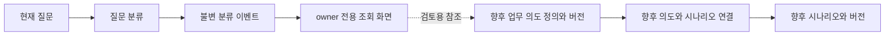

# 의도분류 조회 화면·새창 이동·프로젝트 owner 권한 설계

- 작성일: 2026-11-23 (한국시간, Asia/Seoul)
- 상태: 현재 작업 트리의 소스를 분석한 검토용 설계. 구현 전
- 대상: 의도분류 결과 조회, 벡터화 모달 진입점, 가드레일 컨트롤타워 새창 권한
- 이번 단계의 변경: 이 문서와 `hams-matrix/HISTORY.md`만 작성한다. 소스·DB·마이그레이션·설정은 수정하거나 실행하지 않는다.
- 분석 기준: 미커밋 변경을 포함한 현재 파일이다. 운영 DB와 배포 환경은 조회하지 않았으므로 테이블의 실제 적용 여부·운영 데이터 건수는 확인하지 않았다.

## 1. 요구사항

### 1.1 요청 사항

1. 의도분류한 내용을 조회할 수 있는 독립 화면을 만든다. 이후 시나리오 빌더와 연결할 수 있는 구조로 설계한다.
2. 현재 의도분류 모달의 **좌측 하단**에 `의도분류 화면 이동 ↗` 버튼을 추가한다. 클릭하면 해당 모달을 닫고 가드레일 컨트롤타워와 같은 방식의 새창으로 이동한다.
3. 가드레일 새창과 의도분류 새창은 **대상 프로젝트의 owner만** 열 수 있다. owner가 아니면 이동 버튼을 비활성화하고 새창을 생성하지 않는다.
4. 이번에는 설계 문서만 작성한다. 사용자가 문서를 검토·수정하고 구현을 요청한 뒤 개발한다.

### 1.2 설계의 기본 해석

- `onwer`는 프로젝트 `owner`로 해석한다. workspace owner, 프로젝트 admin, 상품 관리자, master 계정과 구분한다.
- 조회 대상은 우선 **채팅 질문을 `rag / realtime / execution`으로 분류한 이벤트**로 제안한다. 현재 ‘의도분류’ 모달의 실제 기능은 벡터화이므로 두 기능을 혼동하지 않도록 화면 용어를 구분한다.
- owner 제한은 이번 요청의 **새창 진입과 해당 화면 조회**에 적용한다. 기존 벡터화 모달의 관리 권한, 팀원의 자동 질문 분류·RAG 검색, 일반 채팅의 사용 조건까지 일괄 변경하지 않는다.
- 가드레일은 현재 별도의 관리자 권한이 필요하다. 권고안은 **기존 관리자 권한과 프로젝트 owner 조건을 모두 요구**하는 것이다. owner라는 이유만으로 상품 관리·승인 권한을 새로 부여하지 않는다.
- 의도분류 조회는 읽기 전용으로 시작한다. 재분류·수동 수정·시나리오 편집·실행은 후속 범위다.

위 해석 중 조회 대상, 가드레일 권한 조합과 조회 범위는 9절의 검토 사항이다. 확인되지 않은 제품 정책을 기존 구현 사실로 간주하지 않는다.

## 2. 현재 구조와 소스 확인 결과

### 2.1 의도분류 모달과 진입점

| 현재 파일 | 확인한 동작 | 설계에 미치는 영향 |
| --- | --- | --- |
| `components/ai/project-rag-control.tsx` | `ProjectRagControl → RagControl → RagDialog` 구조다. 프로젝트가 있으면 ‘의도분류’ 버튼으로 벡터화 모달을 연다. | 새 조회 화면은 기존 모달과 별도 기능이다. 모달 footer에 이동 버튼을 추가한다. |
| 같은 파일의 `RagDialog` | 키 입력·임베딩 모델 조회·전체 벡터화·실패 후 재개·중지·실패 원본 확인을 제공한다. footer에는 닫기와 시작 버튼이 있다. 닫기 시 요청 AbortController를 정리한다. | 새창 이동 시 키·모델 선택 등 모달 로컬 상태의 처리와 진행 중 요청을 고려해야 한다. |
| `components/project-workbench.tsx` | 선택 프로젝트 ID와 이름을 `ProjectRagControl`에 전달한다. | 작업 화면 진입점에 동일한 owner 판정이 적용되어야 한다. |
| `components/pages/dashboard/dashboard-page.tsx` | 프로젝트 카드마다 같은 컴포넌트를 사용하고 `initial={p.rag}`를 전달한다. | 대시보드에서도 새 버튼이 동일하게 제한되어야 한다. |
| `lib/ai/project-rag-permissions.ts` | `ragAccess()`는 프로젝트 접근을 확인하고 `owner/admin`에 `canManage=true`를 부여한다. | `canManage`는 owner 전용 새창 권한으로 재사용할 수 없다. |
| `lib/ai/rag-types.ts` | `RagSummary`에는 `canManage`가 있지만 owner 전용 화면 진입 capability는 없다. | 별도 접근 판정값 또는 기존 project access 조회가 필요하다. |
| `lib/dashboard-query.ts` | RAG 요약을 일괄 조회하고 owner/admin 여부로 `canManage`를 직접 계산한다. | 권한 필드를 RAG DTO에 추가한다면 단건 요약과 이 경로를 함께 수정해야 한다. 권고안은 기존 access를 사용해 이 변경을 피한다. |
| `styles/ai-project-rag.css`, `styles/dialog.css` | 모달 전용 스타일과 공통 `project-registration-footer` 배치 규칙을 사용한다. | 왼쪽 이동 버튼/오른쪽 기존 동작 배치는 의도분류 모달로 범위를 제한한다. |

활성 RAG 작업은 `queued/running/publishing/stop_requested`일 때 2.5초 간격으로 조회한다. 이 작업 진행 조회와 프로젝트 접근 권한 조회는 다른 목적이다. 새창 도입을 이유로 access 폴링을 추가하지 않는다.

### 2.2 실제 질문 분류와 저장 데이터

| 현재 파일 | 확인한 동작 |
| --- | --- |
| `lib/ai/intent-classifier.ts` | `ruleIntent()`로 우선 분류하고 모호한 경우 LLM을 호출한다. `IntentPlan`은 주 의도, RAG/현재 조회/실행/확인 질문 필요 여부, 사유 코드, 분류기 버전을 가진다. LLM 분류만으로 명시적 쓰기 권한을 만들지 않는다. |
| `lib/ai/orchestration.ts` | `orchestrateChat()`에서 분류·필요한 RAG 검색 후 프로젝트가 있으면 `ai_orchestration_events`에 이벤트를 저장한다. 이후 단계의 답변 저장·실제 실행 성공을 의미하지 않는다. |
| `app/api/ai/chats/route.ts` | `journalStep("chat-plan", …)` 안에서 분류를 호출한다. 재개 시 저장된 단계 결과를 복원할 수 있다. 분류 결과와 기존 권한 등을 조합해 실제 쓰기 가능 여부를 제한한다. |
| `db/migrations/048_project_rag_orchestration.sql` | `ai_orchestration_events` 테이블과 `(workspace_id, created_at)` 인덱스를 정의한다. `request_id`는 UNIQUE다. |
| `lib/ai/conversations.ts` | 개인 대화는 user/workspace/project/conv 범위로 조회한다. 프로젝트 owner라고 다른 구성원의 개인 대화를 조회하도록 구현되어 있지 않다. |

현재 이벤트 필드는 다음과 같다.

| 저장 필드 | 조회 화면에서의 사용 | 한계 |
| --- | --- | --- |
| `id`, `workspace_id`, `project_id` | 불변 이벤트 ID와 조회 범위 | ID만 알고 있어도 현재 권한을 다시 검사해야 한다. |
| `user_id`, `request_id` | 기록 주체·요청 식별 | 기본 화면에 이메일이나 개인 대화 원문을 추가하지 않는다. |
| `classifier_version`, `primary_intent` | 분류기 버전, `rag/realtime/execution` 유형 | 업무별 재사용 의도 사전이나 시나리오 ID가 아니다. |
| `route_flags_json`, `reason_code` | 처리 필요 여부와 판정 사유 | 필요하다는 계획이며 실제 도구 실행·검색 성공 보장은 아니다. |
| `generation_id`, `source_refs_json` | 사용 검색본 ID와 참조 ID·버전·청크 ID | 참조에는 저장된 제목·전체 원문·당시 URL이 없다. |
| `fallback_code`, `duration_ms`, `created_at` | 검색 대체 사유, 분류·검색 단계 소요 시간, 기록 시각 | `duration_ms`를 분류 LLM만의 시간이나 전체 답변 시간으로 표시하면 안 된다. |

**현재 없는 데이터:** 질문 원문·질문 요약·대화방 ID·대상 화면·시나리오 연결·분류 신뢰도·명시적인 규칙/LLM 판정 방식 필드. `reason_code`로 일부 경로를 설명할 수 있지만 별도 confidence 값을 만들어 표시하지 않는다.

현재 소스 검색에서 이 이벤트의 전용 목록/상세 조회 API와 조회 화면, 시나리오 빌더 구현은 확인되지 않았다. 데이터 생성 경로가 있으므로 화면을 위해 질문을 다시 분류하거나 유료 AI 호출을 할 필요는 없다.

### 2.3 가드레일 새창

| 현재 파일 | 확인한 동작 | 필요한 변화 |
| --- | --- | --- |
| `components/admin/product-admin.tsx` | 가드레일 탭에서 대상 workspace를 선택하고 `GuardrailAdmin`을 렌더링한다. 기존 `projectId` 상태는 회원/이력 검색용이다. | 새창 자격 확인용 프로젝트 선택은 이 검색 상태와 구분해야 한다. |
| `components/admin/guardrail-admin.tsx` | `workspaceId`가 있으면 새창 버튼과 대체 `<a target="_blank">`를 노출한다. `window.open()`은 `_blank`, `noopener,noreferrer,popup`, 최대 1440×960, resize/scroll 옵션을 사용한다. | 버튼과 대체 링크 모두 owner 판정이 필요하다. 현재 props에 프로젝트 ID가 없다. |
| `app/(control-tower)/admin/guardrail-control-tower/page.tsx` 및 `super-admin` 대응 경로 | 같은 `GuardrailControlTowerPage`를 사용한다. | 양쪽 경로에서 우회 진입을 차단해야 한다. |
| `components/admin/guardrail-control-tower-page.tsx` | workspace·approval·view query를 읽고 `guardrailAdminUser()`로 서버 권한을 검사한다. | 현재 owner 판정용 프로젝트 context가 없다. |
| `lib/guardrail-admin-access.ts` | 상품 관리자/관리 가능한 workspace/master 범위를 검증하고 대상 workspace의 사용자 context를 반환한다. | 프로젝트 owner 조건을 추가하되 기존 관리 범위를 보존한다. |
| `lib/ai/guardrail-approvals.ts` | 관리자 목록·건수·상세·결정 함수가 기존 관리 권한을 검사한다. 목록 `projectId`는 선택적 검색 필터다. | 단순 검색 필터를 진입 권한의 근거로 신뢰해서는 안 된다. |
| `lib/ai/guardrail-control-tower-overview.ts` | workspace 전체 검사/차단·승인 현황·최근 이벤트를 조회한다. | owner 제한이 곧 프로젝트별 통계라는 뜻은 아니다. 조회 범위를 명시해야 한다. |
| `app/(control-tower)/layout.tsx` | 로그인·guest·온보딩을 검사하고 Query boundary·PreferencesRuntime을 제공한다. | 새 조회 화면에도 독립 셸·개인 테마를 재사용할 수 있다. |

가드레일 정책과 통계는 **workspace 범위**다. `ai_guardrail_events`에는 `project_id`가 없고, 승인 요청에는 nullable `project_id`가 있다. 프로젝트별 전체 가드레일 통계를 원한다면 이벤트 귀속 설계가 추가로 필요하다.

현재 자기 요청 승인 예외는 기존 관리자 범위 안에서 해당 프로젝트 owner/admin인 요청자를 대상으로 구현되어 있다. 이번 새창 진입 제한과 승인 가능 조건은 별도다. 기존 `canDecide`, 필수 의견·확인, 요청자 재개, HITL을 임의로 변경하지 않는다.

### 2.4 프로젝트 owner 판정

- `lib/project-permissions.ts`의 `projectPermissionAccess()`는 현재 workspace 플랜, 프로젝트와 workspace 소속, 프로젝트 배정, guest/온보딩 상태를 확인한다. `projectRole`, `ownerId`, `permissionVersion`, 탭별 권한을 반환한다.
- `lib/team-permissions.ts`의 `projectRoleSql`은 실제 `projects.owner_id`와 사용자가 같으면 owner로 계산한다. `requireProjectOwner()`도 존재하지만 새창에서는 플랜·workspace 배정까지 검증하는 기존 접근 검사와 함께 사용해야 한다.
- `GET /api/projects/[projectId]/access`는 `userId/workspaceId/projectId`를 포함하는 응답을 `private, no-store`로 제공한다.
- `lib/query/project-access.ts`는 scope 일치를 검사하며 staleTime 0, retry false, focus/reconnect/refetchInterval false를 적용한다. `latestProjectAccess()`로 작업 직전 최신 권한을 확인할 수 있다.
- `components/shared/use-project-access.ts`는 명시적 권한 변경 이벤트와 storage 알림을 처리한다. 이벤트 payload를 권한값으로 믿지 않고 서버를 재조회하는 패턴을 유지한다.

## 3. 수정 방향: 의도분류 조회 화면

### 3.1 화면 주소와 구성

신규 주소를 `/projects/[projectId]/intent-classifications`로 제안한다. 파일은 기존 독립 창 route group 아래의 `app/(control-tower)/projects/[projectId]/intent-classifications/page.tsx`에 둔다. route group 이름은 URL에 포함되지 않는다.

서버 페이지는 로그인·현재 workspace·프로젝트 접근·실제 owner 여부를 확인한 뒤 최소 프로젝트 정보만 내려준다. 데이터 없는 프로젝트도 정상 진입하며 ‘분류 이력이 없습니다’를 표시한다. 다른 workspace 프로젝트는 URL만으로 열람하지 못한다.

| 영역 | 표시·동작 |
| --- | --- |
| 상단 | ‘의도분류 조회’, 프로젝트명, 현재 workspace, 명시 새로고침, 공통 ThemeToggle |
| 검색 | KST 시작/종료일, 주 의도 3종, 확인 질문 필요 여부, 대체 처리 여부 |
| 목록 | 기록 시각(KST), 주 의도, 확인 필요, 판정 사유, 단계 소요 시간, 참조 수 |
| 상세 | 이벤트 ID·분류기 버전·각 route flag·사유/대체 코드·검색본 ID·참조 식별자/버전 |
| 보조 정보 | 현재 RAG 검색본 모델·발행 시각·자료 변경 여부는 기존 요약으로 제공 가능. 본문의 분류 이력과 구분한다. |
| 상태 | 로딩·빈 결과·필터 결과 없음·권한 상실·통신 오류·삭제된 참조를 구분한다. |

- 기본 정렬은 `created_at DESC, id DESC`, 페이지 크기는 20건으로 제안한다. 상세는 행 선택 후 패널로 표시하며 좁은 화면에서는 목록 아래에 배치한다.
- 초기 검색 기간은 KST 최근 7일로 제안하고 필터를 URL query에 보존한다. 종료일은 다음 날 00:00 KST 미만으로 변환한다.
- 화면 선택 상태는 `eventId`로 직접 진입을 지원한다. 필터를 바꾸면 목록 커서와 상세 선택을 정리한다.
- 주 의도 표시는 ‘프로젝트 지식 검색(RAG) / 현재 데이터 조회 / 변경 실행 요청’으로 설명한다. `needsExecution=true`를 ‘실행 완료’로 표시하지 않는다.
- 전체 통계 카드는 1차 필수에서 제외한다. 추가할 경우 같은 필터의 서버 집계를 사용하고 현재 20개 행으로 전체 통계를 계산하지 않는다.
- 질문 내용이 없으므로 질문 검색·질문 미리보기는 1차에서 제공하지 않는다. 표시를 위해 개인 채팅을 JOIN하거나 다른 사용자의 대화 조회 API를 열지 않는다.
- 참조 제목·바로가기는 현재 원본 접근을 검사해 확인 가능한 경우에만 보강한다. 삭제되거나 버전이 달라진 원본은 ‘원본 없음/현재 버전 변경’으로 표시하며 과거 원문을 복원했다고 표현하지 않는다.

### 3.2 조회 API와 서비스

| 신규 API(가칭) | 계약 |
| --- | --- |
| `GET /api/projects/[projectId]/intent-classifications` | 날짜·유형·확인 필요·대체 여부·커서를 검증하고 목록 DTO, `nextCursor`를 반환한다. |
| `GET /api/projects/[projectId]/intent-classifications/[eventId]` | 같은 workspace/project 범위의 단일 이벤트와 정규화한 참조 DTO를 반환한다. |

공통 읽기 서비스는 `lib/ai/intent-classifications.ts`, 클라이언트 공유 타입은 `lib/ai/intent-classification-types.ts`로 분리하는 안을 제안한다.

1. 매 요청에서 requireUser와 현재 프로젝트 접근 검사를 수행하고 `ownerId === user.id` 및 owner 역할을 확인한다. 브라우저 capability나 쿼리의 ownerId를 신뢰하지 않는다.
2. 목록/상세 SQL은 `workspace_id = 현재 검증 workspace`와 `project_id = 경로 projectId`를 항상 결합한다. 상세의 eventId가 다른 프로젝트에 속하면 반환하지 않는다.
3. 날짜와 enum, boolean, 커서 길이·구조를 서버에서 검증한다. SQL은 바인딩 변수를 사용하며 필드명/정렬은 고정한다. 잘못된 필터는 400, 인증 실패는 기존 인증 정책, 비owner는 403, 존재하지 않거나 범위 밖 상세는 404로 처리한다.
4. 커서는 `(created_at, id)`를 담고 동일 시각의 결과 누락·중복을 막는다. 커서가 검색 범위를 정할 수 없으며 workspace/project는 별도 서버 조건으로 강제한다.
5. 목록은 최소 DTO만 반환하고 참조 전체 JSON은 상세에서만 정규화한다. 알려지지 않은 reason/fallback 코드도 원래 코드를 보존해 표시한다. 예전 데이터의 누락 필드는 ‘기록 없음’으로 처리한다.
6. 목록·상세에 `Cache-Control: private, no-store`를 적용한다. Query key에는 사용자·workspace·project·검색 조건·커서 또는 eventId를 포함한다.
7. 일반 데이터 조회는 WorkspaceQueryRuntime 정책을 사용하되 권한 판정은 기존 access 예외 정책을 따른다. 목록의 기본 주기 조회는 추가하지 않는다. 새로고침으로 데이터를 갱신하며 권한 상실 시 기존 상세·목록을 즉시 숨긴다.
8. 화면 조회로 이벤트를 추가하거나 분류·임베딩·원문 수집 전체 작업을 실행하지 않는다.

### 3.3 기존 기록과 DB 영향

- 1차 조회는 기존 `ai_orchestration_events`를 사용하며 필수 신규 테이블/컬럼 없이 구현 가능하다.
- 과거 기록에 없는 질문·대상 화면·대화방 연결을 임의로 역추정하거나 채우지 않는다. 분류 전 차단·프로젝트 없는 대화 등은 기록이 없을 수 있으므로 ‘모든 AI 요청 이력’이라고 표현하지 않는다.
- 목록 성능은 향후 합성 대량 데이터와 쿼리 계획으로 확인한다. 필요하면 `(workspace_id, project_id, created_at DESC, id DESC)` 인덱스를 선택적 후속 마이그레이션으로 검토한다. 이번 문서 작성 중 생성·적용하지 않는다.
- 향후 질문 원문/요약이 꼭 필요하면 수집 목적·다른 구성원의 열람 범위·보존/삭제 정책부터 결정하고 별도 스키마·저장 경로를 설계한다. 기존 개인 대화의 user scope를 제거하는 방식은 사용하지 않는다.
- 재개 시 `chat-plan`의 journal 복원과 `request_id`의 유일성을 보존한다. 조회 기능 때문에 이미 끝난 분류를 반복 실행하거나 같은 논리 요청을 중복 통계로 세지 않는다. 이벤트 수를 사용자 질문 수와 동일하다고 단정하지 않는다.

## 4. 수정 방향: 모달 좌측 하단에서 새창 이동

### 4.1 배치와 상태

```text
┌ 의도분류 · 프로젝트명 ────────────────────────────┐
│ 기존 키·모델·벡터화·진행 상태                      │
├──────────────────────────────────────────────────┤
│ [의도분류 화면 이동 ↗]      [닫기] [벡터화 시작]    │
└──────────────────────────────────────────────────┘
```

- `RagDialog` footer를 왼쪽 이동 그룹과 오른쪽 기존 동작 그룹으로 나눈다. 충분한 너비에서는 한 줄, 좁으면 자연 줄바꿈한다. `.project-rag-dialog` 내부 CSS로 한정해 다른 등록 모달 배치를 바꾸지 않는다.
- 이동 버튼은 owner 미확인·조회 중·비owner·요청 처리 중이면 disabled다. 상태 문구는 ‘프로젝트 owner만 새창을 열 수 있습니다’ 또는 ‘권한 확인 중’으로 제공한다. 단순 색상이나 hover tooltip만으로 이유를 전달하지 않는다.
- 기존 모달을 여는 ‘의도분류’ 버튼과 벡터화 권한 자체는 이번에 owner 전용으로 바꾸지 않는다. admin은 기존 허용된 벡터화를 관리할 수 있어도 새 조회 화면으로 이동할 수는 없다.
- 권한은 모달 열기·프로젝트 변경·명시 갱신/권한 변경 이벤트에서 확인한다. 대시보드 initial DTO의 `canManage`만으로 이동을 허용하지 않는다.

### 4.2 권한 재확인과 팝업 차단 대응

비동기 권한 확인 후 자동 `window.open()`을 호출하면 브라우저의 사용자 동작 인정이 끊길 수 있다. 반대로 먼저 빈 창을 만들면 비owner에게도 새창이 잠깐 생길 수 있어 요구사항과 맞지 않는다. 다음 흐름을 권고한다.

1. 첫 렌더에서는 버튼을 막고 기존 access를 읽어 실제 owner를 확인한다.
2. 클릭하면 **창을 생성하기 전에** `latestProjectAccess()` 등으로 최신 서버 권한을 확인한다. 중복 클릭을 막는다.
3. 실패·권한 회수·scope 불일치면 새창을 만들지 않고 모달 안에서 안내한다. 모달은 유지한다.
4. 검증에 성공하면 사용자 클릭에서 이어진 새창 열기를 시도한다. 가드레일과 같은 크기·resize/scroll·noopener/noreferrer 옵션을 사용하고 URL에는 projectId 등 식별자만 담는다.
5. 브라우저에 따라 추가 클릭이 필요한 경우 ‘권한을 확인했습니다. 새창 열기’ 버튼을 제공한다. 이 버튼은 확인된 동일 scope에서만 활성화하고, 그 직접 클릭에서 창을 연다. 확인 후 프로젝트·계정·권한 이벤트가 바뀌면 확인 상태를 폐기한다.
6. 허용된 이동 동작에서 모달을 닫는다. 키 입력 등 로컬 상태는 기존 unmount 정책대로 폐기하고 서버에서 접수한 벡터화 작업은 계속 실행한다. `pending` 중 이동을 막아 시작 요청 취소와 접수 성공의 경합을 줄인다.

`noopener` 옵션을 사용한 `window.open()`은 반환 handle이 없을 수 있으므로 `null`만으로 팝업 차단/성공을 단정하지 않는다. 브라우저별 동작을 실제 검증해 재클릭 안내를 확정한다. 직접 클릭과 서버의 최종 화면 검증 사이에 권한이 회수되면 데이터 열람은 서버에서 차단한다. 빈 창 선생성으로 이 경합을 해결하지 않는다.

모달을 닫고 이동한 뒤 팝업이 보이지 않는 환경도 고려해 원래 페이지의 컨트롤 근처에 재시도 동작을 제공한다. 재시도도 같은 owner 검사와 scope 무효화 규칙을 따른다. opener/postMessage로 API 키나 권한값을 전달하지 않는다.

## 5. 수정 방향: 두 새창의 owner 제한

### 5.1 공통 권한 기준

| 사용자 상태 | 의도분류 새창 | 가드레일 새창(권고안) |
| --- | --- | --- |
| 현재 프로젝트 owner + 기존 가드레일 관리자 | 허용 | 허용 |
| 현재 프로젝트 owner + 가드레일 관리 권한 없음 | 허용 | 차단: 기존 관리자 조건 필요 |
| 프로젝트 admin/member/viewer | 차단 | 가드레일 관리자여도 차단 |
| workspace owner/상품 관리자/master지만 대상 프로젝트 owner 아님 | 차단 | 차단 |
| 프로젝트 미선택·미배정·타 workspace·플랜/상품 접근 불가 | 차단 | 차단 |
| guest·미인증·온보딩 미완료 | 기존 인증·접근 정책에 따라 차단 | 기존 인증·접근 정책에 따라 차단 |

owner의 근거는 서버가 확인한 실제 소유자와 현재 배정이다. master 예외는 기본적으로 추가하지 않는다. 가드레일의 서버 검사 순서는 기존 관리 범위 해석 후, 그 대상 workspace에서 프로젝트 접근과 owner를 검사하는 방식으로 제안한다.

공통 helper(가칭 `lib/ai-console-access.ts`)로 owner 검사와 최소 capability를 제공한다. 의도분류 조회는 현재 로그인 workspace를 사용하고, 관리자 화면은 `guardrailAdminUser()`가 이미 검증한 대상 workspace context를 사용한다. URL의 workspaceId를 임의로 사용자 객체에 덮어써 접근을 허용하지 않는다.

### 5.2 가드레일에서 owner를 확인할 프로젝트 선택

현재 가드레일 관리 화면에는 owner를 판별할 프로젝트가 없다. **대상 workspace 안의 ‘새창 진입 확인 프로젝트’ 선택**을 추가하는 안을 권고한다.

- 신규 capability API 예: `GET /api/admin/ai-console-access?workspaceId=...&entryProjectId=...`, 슈퍼관리자는 대응 `/api/super-admin/...` 경로를 사용한다.
- API는 기존 관리 범위를 우선 검증하고 해당 workspace 안에서 사용자가 실제 owner이면서 배정된 프로젝트 후보만 최소 ID/이름으로 반환한다. 프로젝트를 지정하면 현재 owner 여부·가드레일 진입 가능 여부·차단 사유를 반환한다. `private, no-store`, staleTime 0/retry 0을 적용한다.
- owner 프로젝트가 없으면 버튼을 막고 이유를 표시한다. 여러 프로젝트가 있으면 사용자가 선택한다. 첫 프로젝트를 조용히 골라 관리 scope를 정하지 않는다.
- workspace를 변경하면 프로젝트 선택·capability·재클릭 확인 상태를 초기화한다. 기존 회원/이력의 `projectId` 검색 상태와 별도로 관리한다.
- 현재 관리자 overview의 프로젝트 배열은 ID/이름만 있으며 상품 여러 workspace를 포함할 수 있다. 이를 그대로 owner 후보로 사용하지 않고 대상 workspace와 현재 소유/배정을 서버에서 제한한다. 이 방식이면 공용 관리자 overview DTO를 확대할 필요가 없다.
- 창 주소 예: `/admin/guardrail-control-tower?workspaceId=...&entryProjectId=...`. `super-admin`에도 같은 조건을 적용한다. `view`, `approvalId`는 계속 지원한다.
- `entryProjectId`는 **새창 진입 자격 확인용**이다. 기존 목록 검색의 `projectId`와 혼용하지 않는다. 어떤 프로젝트의 owner라는 사실만으로 다른 workspace로 이동하지 못한다.

### 5.3 버튼·대체 링크·서버 검사

1. 가드레일 버튼의 disabled 조건과 클릭 처리, 대체 `<a>` 모두 같은 capability를 사용한다. 비owner에게는 클릭 가능한 href/target을 남기지 않는다. CSS의 `pointer-events`만으로 막지 않는다.
2. 두 독립 페이지는 서버에서 다시 검사한다. URL 직접 입력·북마크·다른 사용자의 링크·변조한 query로 진입해도 비owner에게 데이터가 렌더링되지 않아야 한다.
3. 가드레일 전용 목록/건수/상세/결정/overview API도 `entryProjectId`를 필수로 받고 동일 권한을 확인하는 방향을 제안한다. 값 누락 시 workspace 전체로 fallback하지 않는다. `super-admin` 재수출 route도 함께 확인한다.
4. 가드레일 클라이언트의 endpoint, Query key, 상세/결정 URL과 대시보드 overview URL 모두 검증용 context를 유지한다. 현재의 단순 `replace("?", ...)` 조립도 추가 query가 보존되는지 검증한다.
5. 승인·반려 쓰기 트랜잭션 안에서도 owner 조건을 다시 확인한다. 클릭 시점과 처리 시점 사이 소유권/배정이 바뀌면 처리하지 않는다. 기존 버전·상태·canDecide 조건도 유지한다.
6. 기존 요청자용 `/api/ai/guardrail-*` 흐름과 정책 편집 API의 권한에 무조건 owner 조건을 넣지 않는다. 전용 접근 helper를 사용해 새창 기능의 제한이 일반 채팅·승인 요청·재개를 함께 막지 않도록 한다.
7. 권한 변경 이벤트와 API의 401/403/404를 받으면 표시 데이터를 비우고 버튼을 잠근다. scope가 바뀐 이전 비동기 응답은 무시한다. 새 access 폴링이나 focus/reconnect 자동 재조회는 도입하지 않는다.

### 5.4 가드레일 조회 범위와 기존 링크

1차 권고안은 **진입 자격은 프로젝트 owner로 제한하되, 진입 후 조회 범위는 기존 관리자 workspace 범위를 유지**하는 것이다. 화면에 ‘워크스페이스 전체 관제 · 진입 확인 프로젝트: ○○’를 구분해 표시한다. 기존 관리 권한과 owner를 모두 요구하므로 일반 owner에게 workspace 전체를 새로 공개하는 안은 아니다.

‘자신이 소유한 프로젝트의 가드레일만 조회’가 목적이라면 추가 설계가 필요하다. 승인 목록·건수·상세·처리·프로젝트 후보·overview를 모두 프로젝트로 제한하고, `project_id`가 없는 검사 이벤트의 신규 귀속 저장과 과거 미분류 처리, 정책 테스트/프로젝트 없는 요청의 제외 방식을 정해야 한다. 목록 필터 하나로 전체 대시보드가 제한된 것처럼 구현하지 않는다.

기존 `entryProjectId` 없는 북마크는 바로 데이터를 표시하지 않는다. 진입 확인 프로젝트 선택 화면을 먼저 제공하고, `approvalId`를 보존해 자격 확인 후 이동하는 안을 제안한다. 자동으로 approval의 프로젝트를 추정해 권한을 부여하거나 owner 확인을 생략하지 않는다. 프로젝트가 없는 요청도 workspace 전체 관제안을 선택한 경우에만 기존 관리자 범위에서 확인할 수 있다.

## 6. 향후 시나리오 빌더 연결을 위한 경계

현재 `rag/realtime/execution`은 질문 처리 경로 3종이다. ‘주문 취소’, ‘요구사항 등록’ 같은 업무 의도 정의나 시나리오 노드와 동일하지 않다.



- 1차 DTO는 안정적인 `eventId`, `classifierVersion`, 의도 코드와 flags를 유지하고 한글 표시 문구와 분리한다. 분류 이벤트 자체를 수정 가능한 설정 레코드로 만들지 않는다.
- 조회 컴포넌트와 데이터 서비스를 분리해 후속 빌더가 같은 읽기 계약으로 이벤트를 참조할 수 있게 한다. 현재 화면에 동작하지 않는 ‘시나리오 연결’ 버튼을 필수로 추가하지 않는다.
- 후속 구현에서는 업무 의도 정의와 버전, 시나리오와 버전, 프로젝트 범위의 연결 리소스를 별도로 설계한다. 하나의 intent에 여러 조건/버전이 연결될 수 있으므로 지금 이벤트 테이블에 `scenario_id` 하나를 넣어 관계를 확정하지 않는다.
- 연결은 workspace/project가 같은 자원으로 제한하고 현재 owner·버전 충돌·삭제/비활성 상태를 확인한다. 이벤트를 학습 예시로 전환하려면 개인 질문 공개 여부를 별도로 검토한다.
- 분류 또는 시나리오 연결은 실행 허가를 뜻하지 않는다. 실제 도구 실행은 현재 사용자 명시 요청·탭별 권한·가드레일·HITL·원본/참조 버전 검증을 계속 통과해야 한다.
- 이번 구현 예상 범위에서도 시나리오 실행 엔진·분류 규칙 편집·모델 교체·워커 운영 제한은 추가하지 않는다.

## 7. 변경 대상 파일과 영향 범위

아래는 **향후 구현 시의 대상**이며 이번 문서 작성 단계에서는 변경하지 않는다. 신규 파일명과 API 경로는 제안이다.

### 7.1 의도분류 화면과 모달

| 구분 | 파일 | 변경 내용 |
| --- | --- | --- |
| 수정 | `components/ai/project-rag-control.tsx` | 모달 좌측 하단 이동 버튼, owner capability, 최신 확인·오류·scope 무효화·새창 이동·닫기 처리 |
| 수정 | `styles/ai-project-rag.css` | 의도분류 모달 footer 좌우 그룹과 반응형 배치 |
| 신규 | `app/(control-tower)/projects/[projectId]/intent-classifications/page.tsx` | owner 서버 검사, 독립 조회 페이지 진입 |
| 신규 | `components/ai/intent-classifications-page.tsx` | 목록·필터·상세·빈 결과·권한 오류 UI |
| 신규 | `app/api/projects/[projectId]/intent-classifications/route.ts` | 목록 GET |
| 신규 | `app/api/projects/[projectId]/intent-classifications/[eventId]/route.ts` | 상세 GET |
| 신규 | `lib/ai/intent-classifications.ts`, `lib/ai/intent-classification-types.ts` | 범위가 제한된 읽기 서비스·최소 DTO |
| 신규 | `styles/pages/projects/intent-classifications/intent-classifications.css` | 조회 화면 전용 CSS |
| 수정 | `lib/query/keys.ts` | 분류 목록/상세·capability의 사용자/workspace/project별 key |
| 수정 | `styles/README.md` | 신규 화면 CSS 소유 위치 등록 |
| 재사용·검증 | `components/project-workbench.tsx`, `components/pages/dashboard/dashboard-page.tsx` | 두 진입점에서 동일한 이동/권한 동작 확인. 기존 scope로 처리 가능하면 별도 props 변경 없음 |
| 재사용·검증 | `lib/query/project-access.ts`, `lib/project-permissions.ts` | 현재 owner·scope·플랜 접근 검사 재사용 |
| 조건부 수정 | `app/(control-tower)/layout.tsx` | 셸을 재사용하되 로딩 안내가 가드레일에만 맞춰져 있으면 공통 문구로 정리 |

`lib/ai/intent-classifier.ts`, `lib/ai/orchestration.ts`, 채팅 저장·journal·RAG 워커와 기존 DB 스키마는 1차 조회 구현에서 변경할 필요가 없다. 과거 데이터 보강이나 질문 저장을 선택하면 이 범위는 다시 산정한다.

### 7.2 가드레일 owner 제한

| 구분 | 파일 | 변경 내용 |
| --- | --- | --- |
| 신규 | `lib/ai-console-access.ts` | 실제 owner 검사, 새창 capability, 관리자 대상 workspace와 일반 workspace 경계 |
| 신규 | `app/api/admin/ai-console-access/route.ts`, `app/api/super-admin/ai-console-access/route.ts` | owner 프로젝트 후보 및 새창 진입 capability |
| 수정 | `components/admin/product-admin.tsx` | 선택 workspace에 연동된 진입 확인 프로젝트 상태/선택, 기존 검색 상태와 분리 |
| 수정 | `components/admin/guardrail-admin.tsx` | 프로젝트 context props, 버튼·대체 링크 차단, 이동 직전 최신 자격 확인 |
| 수정 | `components/admin/guardrail-control-tower-page.tsx` | entryProjectId 검증, 기존 링크의 선택 단계, 검증된 context 전달 |
| 수정 | `components/admin/guardrail-control-tower.tsx`, `components/admin/guardrail-control-tower-dashboard.tsx`, `components/admin/guardrail-approval-detail.tsx` | 모든 조회/결정 URL·Query scope에 진입 context 보존, 권한 오류 시 데이터 숨김 |
| 수정 | `lib/guardrail-admin-access.ts` | 기존 관리자 resolver와 별도로 새창 전용 owner 제한을 조합. 정책 편집 경로에 무조건 전파하지 않음 |
| 수정 | `app/api/admin/ai-guardrail-approvals/route.ts`, `count/route.ts`, `[id]/route.ts`, `[id]/decision/route.ts` | 목록·건수·상세·결정 요청의 owner 검사와 context 전달 |
| 수정 | `app/api/admin/ai-guardrail-control-tower/overview/route.ts` | overview에도 같은 owner 접근 검사 |
| 수정 | `lib/ai/guardrail-approvals.ts` | 새창 전용 처리 context 유지, 승인/반려 트랜잭션 안 owner 재검증 |
| 검토·검증 | `lib/ai/guardrail-control-tower-overview.ts` | 기존 workspace 통계 유지 여부 확인. 프로젝트 범위안을 선택하면 별도 집계 변경 필요 |
| 검토·검증 | `app/(control-tower)/admin/guardrail-control-tower/page.tsx`, `super-admin` 대응 페이지와 `app/api/super-admin/ai-guardrail-*` 대응 route | 공통 구현/재수출 경로도 동일 제한 적용 |
| 조건부 수정 | `styles/pages/admin/settings/guardrail-admin.css`, `styles/pages/admin/guardrail-control-tower/guardrail-control-tower.css` | 프로젝트 선택·차단 안내·진입 범위 표시 |

### 7.3 회귀 검증 대상

- `scripts/test-ai-guardrail-approvals.mjs`, `scripts/guardrail-approval-browser.mjs`: 관리자이면서 owner인 허용 fixture와 관리자이지만 비owner인 차단 fixture를 구분하고 기존 직접 링크 검증에 프로젝트 context를 반영한다.
- `scripts/test-project-rag.mjs`, `scripts/test-ai-settings-reviews.mjs`: 기존 owner/admin 벡터화·일반 채팅 권한이 이번 새창 제한 때문에 달라지지 않는지 확인한다.
- 신규 `scripts/test-intent-classifications.mjs`, `scripts/test-intent-classifications-browser.mjs`(가칭): 목록/상세의 데이터 범위와 두 모달 진입점·팝업 동작을 검증한다.
- 필요 시 `package.json`에 신규 검증 스크립트를 등록한다. 지금은 수정하지 않는다.

## 8. 검증 방법과 완료 기준

### 8.1 이번 문서 단계

1. 소스와 migration 정의만 읽어 구조를 분석한다. 개발 서버·워커·migration·운영 DB 조회/테스트는 실행하지 않는다.
2. 이 문서 경로와 KST 작성일을 확인하고 `HISTORY.md`에 기존 내용을 보존한 링크 한 줄을 추가한다.
3. 문서/HISTORY 이외의 파일이 이번 작업으로 바뀌지 않았는지 확인한다. 기존 작업 트리 변경은 되돌리거나 덮어쓰지 않는다.

### 8.2 구현 후 자동 검증

임시 SQLite·합성 계정·합성 질문만 사용한다. 조회 화면은 유료 AI 없이 저장 fixture로 검증할 수 있다.

| 영역 | 필수 검증 |
| --- | --- |
| owner 판정 | 실제 owner 허용, 프로젝트 admin/member/viewer 차단, workspace owner만인 사용자 차단, 상품 관리자/master 비owner 차단 |
| 가드레일 권한 조합 | owner+기존 관리자 허용, owner만인 일반 사용자 차단, 다른 상품/workspace의 관리 권한을 이용한 우회 차단 |
| 데이터 격리 | 다른 project/eventId/workspace 변조, entryProjectId 누락·변조, 목록 커서 재사용에도 현재 scope 밖 데이터 미반환 |
| 목록 정확성 | 세 의도·확인 필요·대체 코드 필터, KST 자정/종료일 경계, 동일 timestamp 다건의 커서 페이지 누락/중복 없음 |
| 상세 | route flag 의미, 알려지지 않은 코드, 삭제/변경된 참조 처리, 원문·키·암호문·다른 사람 개인 대화 미포함 |
| 기존 링크 | view=dashboard/queue/history 및 approvalId 유지, 프로젝트 context 없는 링크에서 선택 단계 후 진입, 비owner 데이터 미노출 |
| 처리 중 권한 변경 | owner 이전·프로젝트 배정 제거·workspace 변경·계정 변경 뒤 늦은 응답 무시, 다음 조회/승인 트랜잭션에서 차단 |
| 회귀 | 기존 admin 벡터화 관리, 실패 재개·중지, 개인 채팅, 요청자 승인 선택/재개·HITL·canDecide 정책 유지 |

가드레일은 다음 우회 경로를 각각 검사한다: 주 버튼, 대체 링크, URL 직접 입력, API 직접 호출, 목록/건수/overview, 상세 GET, 결정 POST, super-admin 재수출 route. 승인 POST는 최신 owner·버전·상태를 동일 트랜잭션 안에서 확인해야 한다.

### 8.3 구현 후 브라우저 검증

1. 프로젝트 작업 화면과 대시보드 카드 양쪽에서 모달 footer의 좌측 이동 버튼을 확인한다. 좁은 화면·키보드·스크린리더 안내·자연 줄바꿈도 확인한다.
2. 비owner·권한 로딩·조회 실패에서 버튼/대체 링크가 막히고 **브라우저 새 페이지가 생성되지 않는지** 관찰한다. DOM disabled 여부만 검사하고 끝내지 않는다.
3. owner 클릭에서 최신 권한 확인, 모달 닫힘, 정확한 project URL·독립 창 크기/스크롤·개인 테마를 확인한다. API 키나 입력값이 URL/opener에 남지 않아야 한다.
4. 팝업 차단 허용/차단 환경에서 재클릭 안내와 재시도, 중복 클릭, noopener로 handle이 없는 경우를 확인한다. 빈 창을 먼저 생성하지 않아야 한다.
5. 가드레일에서 workspace 전환 후 이전 프로젝트 자격으로 열리지 않는지 확인한다. 관리자이지만 비owner인 계정도 별도로 확인한다.
6. 서버가 접수한 벡터화 작업은 모달을 닫아도 계속되고, 일반 화면의 access 폴링이 새로 생기지 않는지 확인한다.

구현 후 기본 정적 검증은 `pnpm typecheck`, 변경 파일 lint, `pnpm test:query-audit`, 필요 빌드로 수행한다. 기능 검증은 신규 조회 테스트와 기존 `pnpm test:project-rag`, `pnpm test:ai-settings-reviews`, `pnpm test:ai-tool-execution`, `pnpm test:ai-guardrail-approvals`, 빌드 후 `pnpm test:ai-guardrail-approvals-browser` 중 영향 범위에 맞춰 수행한다. 이번 단계에서는 실행하지 않는다.

## 9. 결정이 필요한 사항

| 항목 | 권고안 | 다른 선택 시 영향 |
| --- | --- | --- |
| ‘의도분류한 내용’의 정확한 대상 | 질문별 분류 이벤트를 주 화면으로, 현재 검색본 상태를 보조 표시 | 벡터화한 원본/청크 목록을 뜻한다면 `project_rag_sources/chunks` 조회가 중심이 되므로 API·필터·원문 노출 범위를 재설계해야 한다. |
| 가드레일 owner 조건과 기존 관리자 권한 | 두 조건을 모두 충족해야 진입 | 모든 프로젝트 owner에게 허용하려면 프로젝트 전용 관제 권한을 신설하고 workspace 전체 자료·정책·승인 범위를 다시 설계해야 한다. |
| 가드레일 진입 후 조회 범위 | 기존 관리자 workspace 전체 범위를 유지하고 진입 확인 프로젝트와 구분해 표시 | owner 프로젝트만 보게 하려면 모든 API/집계와 프로젝트 미귀속 이벤트 처리·저장 구조를 함께 바꿔야 한다. |
| owner 확인 대상 프로젝트 선택 | 가드레일 탭에서 대상 workspace의 소유 프로젝트를 명시 선택 | 소유 프로젝트가 하나라도 있으면 workspace 전체 진입 허용하는 방식은 별도 정책이며, 프로젝트 특정이 모호해진다. |
| master/super-admin 예외 | 예외 없이 실제 owner 조건 적용 | 운영자 예외가 필요하면 사용자 요구의 예외로 명시하고 별도 검증해야 한다. |
| 프로젝트 구성원 전체의 분류 메타데이터 열람 | owner에게 해당 프로젝트의 기존 이벤트 메타데이터만 공개, 질문·개인 대화 제외 | 본인 이벤트만 조회하려면 `user_id` 조건을 추가한다. 구성원 이름 표시·질문 공개는 별도 결정한다. |
| 질문 원문·요약 표시 | 1차 제외 | 신규 저장·열람 동의/범위·보존/삭제·비식별 정책과 마이그레이션이 필요하다. 과거 원문 보강을 전제하지 않는다. |
| Business 전용 제한 | 이번 요청은 owner 새창 제한만 반영 | 2026-11-17 문서의 Business owner·워커/API 제한까지 함께 구현할지는 별도 확정해야 한다. 현재 소스에는 그 전체 정책이 반영되어 있지 않다. |
| 모달 미저장 입력 | 이동으로 닫힐 때 키/모델 로컬 선택 폐기, pending 중 이동 차단 | 입력 보존이 필요하면 비밀키의 보관 범위·수명을 먼저 정해야 한다. localStorage에 키를 저장하지 않는다. |
| 팝업 사용자 동작 경계 | 최신 권한 확인 우선, 필요하면 권한 확인 후 직접 재클릭 | 한 번의 클릭만 강제하려면 지원 브라우저별 검증·추가 창 수명/통신 설계가 필요하다. 비owner 빈 창 선생성은 채택하지 않는다. |
| 시나리오 연결 단위 | 향후 업무 의도 정의/버전과 시나리오/버전을 별도 연결 | 개별 이벤트를 시나리오에 바로 연결할지, 별도 의도 사전을 먼저 만들지 후속 빌더 설계에서 정한다. |

## 10. 권고 구현 순서와 관련 문서

1. 9절에서 조회 대상과 가드레일 권한 조합/범위를 확정한다.
2. 공통 owner 접근 검사·가드레일 후보/capability API·조회 API를 구현하고 직접 호출 차단을 검증한다.
3. 의도분류 독립 조회 화면과 목록/상세를 구현한다.
4. 기존 모달 이동 버튼과 가드레일의 프로젝트 선택·버튼/대체 링크 제한을 연결한다.
5. 직접 링크·재개·승인·팝업 차단·권한 변경·두 기존 모달 진입점을 검증하고 구현 기록을 작성한다.

관련 설계/구현 기록:

- [의도분류 Business owner 권한 및 워커 실행·API 호출 제한 설계](../2026-11-17/의도분류-Business-owner-권한과-워커-실행제한-설계.md): 별도 검토 정책이며 현재 구현과 구분한다.
- [AI 챗봇 2계층 오케스트레이션·프로젝트 벡터화 설계](../2026-11-16/AI챗봇-2계층오케스트레이션-프로젝트벡터화-설계.md)
- [가드레일 컨트롤타워 관제 화면 개편 설계](가드레일-컨트롤타워-관제화면-개편-설계.md)
- [가드레일 컨트롤타워 승인·재개 구현](../../work/2026-11-23/가드레일-컨트롤타워-승인재개-구현.md)
- [가드레일 프로젝트 관리자 자기 요청 승인 변경](../../work/2026-11-23/가드레일-프로젝트관리자-자기요청승인.md)

이 문서는 구현 요청이 아니다. 검토 후 확정한 내용으로 소스 변경과 필요한 DB 변경 여부를 다시 결정한다.
