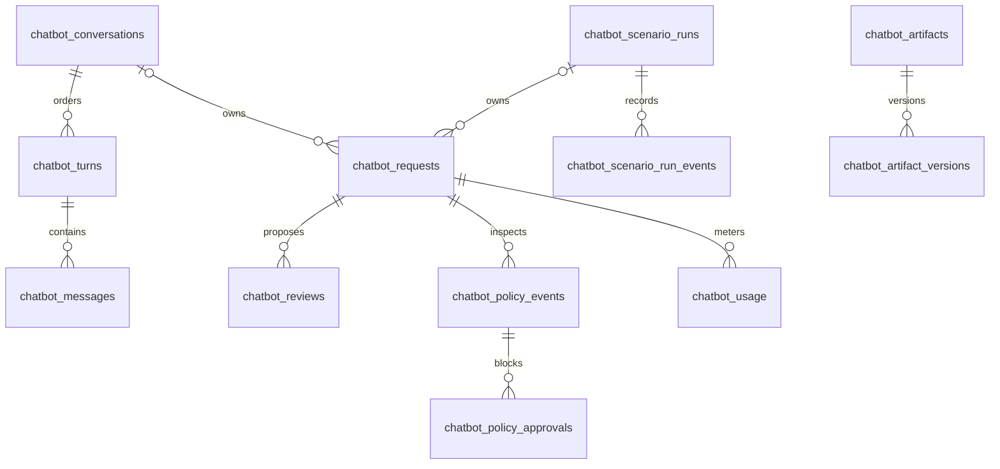

# 독립 챗봇 레이어 팝업 및 시나리오 실행 설계

- 작성일: 2026-11-25 (Asia/Seoul)
- 상태: 소스 분석을 바탕으로 작성한 검토용 설계. 사용자가 수정한 최종 문서를 기준으로 후속 구현한다.
- 작업 범위: 이 문서 신규 작성과 `HISTORY.md` 링크 추가만 수행한다. 소스·설정·패키지·DB·마이그레이션은 변경하지 않는다.
- 경로 표기: 별도 설명이 없는 경로는 `hams-matrix/` 기준이다. 아래 신규 파일·테이블·API는 모두 후속 구현 후보이며 현재 존재하는 기능을 뜻하지 않는다.

## 1. 요구사항과 설계 기준

| ID | 요구사항 | 구현 완료 판단 기준 |
| --- | --- | --- |
| R1 | `public/layout/chatbot` 시안을 읽고 기존 AI Chat과 다른 챗봇 구성 | 시안의 헤더·이력·메시지·설정·명칭 수정·입력 메뉴를 새 `components/chatbot/`에서 구현 |
| R2 | 기존 AI Chat과 DB 설계 분리 | 신규 대화·메시지·첨부·생성물·승인·실행·사용량을 `chatbot_*`에 저장하고 `ai_*` 대화 테이블에 기록하지 않음 |
| R3 | Matrix 테마와 독립된 자체 테마 | Matrix 밝기·강조색을 바꿔도 챗봇의 색상은 유지. 챗봇 설정 저장·취소가 본문과 모든 하위 레이어에 반영 |
| R4 | `/api/ai/*`를 재활용하지 않고 `app/api/chatbot`에 API 신설, HITL 지원 | 브라우저와 서버 모두 기존 AI Chat route를 호출·import하지 않고 신규 승인·거절·재개·충돌 처리가 동작 |
| R5 | 입력 왼쪽 `☰` 메뉴에 이미지 생성·파일 생성 | tooltip이 각각 `시각화 및 수정`, `문서 및 수정`. 선택 시 입력 맨 앞의 색상 있는 모드 텍스트와 사용 모델이 함께 변경 |
| R6 | Matrix 전체 화면 우측 하단 원형 버튼 → 위쪽 메뉴 → 새 채팅 → 레이어 팝업 | 인증된 주요 화면에서 동일한 실행 버튼을 사용하고, 버튼/메뉴를 여는 것만으로 대화방을 만들지 않음 |
| R7 | 빌더 시뮬레이터도 동일한 챗봇 팝업, 자동 실행, 좌측 이력 숨김, 실행 이력 별도 기록 | Flow·View 양쪽에서 선택한 그래프를 자동 시작. 일반 대화 이력 조회·저장 없이 시뮬레이션 전용 실행/이벤트를 저장 |

이 설계에서 “hams-matrix 전체 화면”은 전체화면 API가 아니라 **주요 화면 어디서든 챗봇에 접근할 수 있음**으로 해석한다. 기본 노출 대상은 로그인·온보딩을 마친 사용자의 업무 화면이다. 로그인·회원가입·게스트·공개 페이지 노출은 11절에서 검토한다.

“시나리오빌더가 자동 실행”은 **빌더에서 시뮬레이터를 선택하면 해당 시나리오 실행 엔진이 시작 노드부터 자동 진행**하는 것으로 해석한다. 빌더 편집 화면을 별도 창으로 다시 열거나 그래프를 저장·발행·배포하는 동작은 포함하지 않는다. 자동 진행은 사용자 입력·폼 제출·HITL이 필요한 노드에서 멈춘다.

## 2. 시안 분석

실제 확인한 이미지 4장은 다음과 같다. 화면 크기와 색상은 시안 관찰값이며 최종 CSS 수치는 구현 중 반응형·대비 검증으로 조정한다.

| 이미지 | 관찰한 구조 | 설계 반영 |
| --- | --- | --- |
| [메인.png](../../../public/layout/chatbot/메인.png) | 약 1101×708, 왼쪽 약 238px 이력, 오른쪽 주황 헤더, 연한 회색 본문, 흰 메시지 카드, 하단 고정 입력 | 일반 채팅에서 Scenario/Chat 섹션을 구분하고 선택·접기·더 보기 지원. 메시지와 입력은 독립 스크롤/고정 영역으로 배치 |
| [설정창.png](../../../public/layout/chatbot/설정창.png) | 헤더 톱니 아래 설정 레이어, 8개 테마 타일, 한국어/English, 일반/표시 설정, Cancel/Save | 챗봇 자체 설정 레이어와 저장 전 미리보기·취소 복원. 8개 테마 토큰은 시안에 맞춰 새로 정의 |
| [채팅방명수정.png](../../../public/layout/chatbot/채팅방명수정.png) | 이력 항목의 인라인 입력, 취소·확인, 항목 수정·삭제 아이콘 | 인라인 제목 수정, 서버 검증·버전 충돌·실패 시 초안 보존, 삭제 확인 |
| [커멘드레이어패널.png](../../../public/layout/chatbot/커멘드레이어패널.png) | 입력 바로 위 흰 레이어, 자체 세로 스크롤, 명령/설명 목록 | 패널 위치·외형을 참고하고 초기 필수 메뉴는 이미지 생성·파일 생성으로 구성. 시안의 기존 업무 명령은 자동 도입하지 않음 |

메인 시안에 Recommendation/Process/Analysis/Related Information/Action/Form 섹션과 피드백 아이콘이 보인다. 이를 모든 답변에 강제하는 고정 모델 출력 규격으로 사용하지 않는다. 일반 답변은 텍스트/Markdown, 생성물은 미리보기 카드, 시나리오는 메시지·선택지·폼을 표현하는 공통 메시지 렌더러로 표시한다. 실제 출처·폼이 없을 때 빈 섹션이나 가짜 데이터를 만들지 않는다.

설정 시안의 즐겨찾기 질문·Fast/Deep·Personal/Chatbot·피드백·도움말 옵션은 후속 범위 결정 대상이다. 화면만 있는 무효한 토글을 구현 완료로 취급하지 않는다. 테마·언어·긴 답변 접기·입력 placeholder는 기본 구현안에 포함하고 나머지는 11절에서 결정한다.

## 3. 현재 소스 구조와 제약

### 3.1 기존 AI Chat

| 현재 경로 | 확인한 역할 | 신규 챗봇에 대한 영향 |
| --- | --- | --- |
| `components/workspace-shell.tsx` | `AiChatbotToggle`, `AiWorkspaceLayout`과 기존 AI 메뉴 연결 | 이 파일에만 버튼을 붙이면 독립 빌더/편집기 등에 노출되지 않음 |
| `components/ai/ai-chatbot.tsx` | `useWorkspace`의 aiContext/aiProject/aiConversation, 기존 모델·채팅·승인 API 사용 | 새 UI의 내부 상태 기반으로 사용하지 않음 |
| `components/ai/use-ai-conversation.ts`, `ai-conversation-menu.tsx`, `ai-conversation-dialog.tsx`, `use-ai-window.ts` | 방 선택·페이지네이션·기존 floating/panel 배치 | 동작 참고 자료. 기존 전용 훅을 그대로 호출하면 API/상태가 결합됨 |
| `components/ai/ai-change-review.tsx`, `ai-guardrail-approval.tsx` | 사용자 변경안 승인과 정책 관리자 승인 UI | 새 챗봇에도 두 종류의 승인을 구분해야 함 |
| `app/api/ai/chats/route.ts`, `app/api/ai/conversations/**`, `reviews/**`, `guardrail-approvals/**` | 기존 생성·이력·방·승인·재개 | 신규 route에서 호출하거나 기존 POST export를 import하는 방식 금지 |
| `lib/ai/conversations.ts`, `change-reviews.ts`, `guardrail-approvals.ts`, `generation-control.ts`, `execution-journal.ts`, `token-usage.ts` | 기존 대화/FK/잠금/승인/checkpoint/사용량에 결합 | 이름만 바꾼 HTTP 어댑터로 분리 완료할 수 없음. 새 저장소와 실행 상태가 필요 |
| `db/migrations/007~011`, `046`, `048`, `051`, `052` | `ai_prompt_chats`, `ai_chat_images`, `ai_conversations`, `ai_token_usage`, `user_ai_settings`, `ai_change_reviews`, `ai_guardrail_approvals`, `ai_conversation_turns` 등 | 신규 대화자료의 저장·조회·자동 이전 대상에서 제외 |

기존 `change-reviews.ts`는 `requireConversation`과 `ai_change_reviews`를 사용하고, `token-usage.ts`는 `ai_token_usage`에 INSERT한다. 따라서 공통처럼 보이는 함수도 저장 부작용을 확인해야 한다. 기존 `lib/ai-server.ts`와 가드레일도 journal/실행 문맥에 연결되어 있어 신규 챗봇의 기본 실행기로 직접 사용하지 않는다.

### 3.2 `/api/chatbot` 샘플 경로 점유

- `app/api/(sample)/chatbot/route.ts`가 이미 존재한다. route group `(sample)`은 URL에 포함되지 않으므로 현재 주소는 `/api/chatbot`이다.
- `app/(sample)/sample/componets/tabs/skeleton-chatbot.tsx`가 해당 URL로 POST한다. 현재 route는 SDK를 직접 호출하는 샘플 스트리밍이며 로그인·대화 저장·HITL이 구현되어 있지 않다.
- 새 `app/api/chatbot/route.ts`까지 만들면 동일 URL이 충돌한다. 하위 route만 만드는 경우에도 샘플과 새 제품의 namespace 소유권이 혼재한다.
- **후속 구현 권고:** 샘플 route를 `app/api/(sample)/sample/chatbot/route.ts` → `/api/sample/chatbot`으로 옮기고 샘플 호출부를 함께 변경한다. `/api/chatbot` namespace는 새 챗봇이 소유한다. 이번 문서 단계에는 두 파일 모두 변경하지 않는다.

### 3.3 빌더 실행 경로가 두 갈래임

| 진입점 | 현재 실행 UI/엔진 | 확인 사항 |
| --- | --- | --- |
| `app/(builder)/react-flow/scenario-flow/ScenarioFlow.tsx` | `components/modals/ScenarioSimulatorModal.tsx` → `components/emulator/ScenarioEmulator.tsx` | MUI Dialog, 왼쪽 slot 패널, 오른쪽 실행 UI. `definitionOverride`로 미저장 nodes/edges/startNodeId 전달 |
| `app/(builder)/react-flow/scenario-view/ScenarioView.tsx` | 우측 패널 `components/ChatbotSimulator.jsx` → `components/controllers/hooks/useChatFlow.js` | 별도 UI/상태/폼 처리와 외부 API·LLM 호출 경로가 존재 |
| 빌더 실행 기능 | `components/controllers/hooks/useBuilderExecution.ts` | 편집기 실행 상태/로그와 연결. 시뮬레이터 외 실행 도구까지 일괄 대체하지 않도록 호출 관계 구분 필요 |
| Flow 자동 진행 | `components/emulator/hooks/useScenarioAutoRunner.ts` | message/branch/form/slot/API 등의 자동/대기 분기. React effect 기반 실행이므로 서버 멱등 실행을 추가해야 함 |
| Flow API/LLM | `components/emulator/runners/runApiNode.ts`, `runLlmNode.ts` | API는 브라우저 직접 fetch. LLM은 `Builder LLM execution is not configured.` 출력 후 false 반환 |
| Flow 이력 | `components/emulator/store.ts`, `logging.ts` | store는 메모리 전용이고 unmount 시 실행을 정리. logger는 no-op이므로 DB 실행 이력으로 볼 수 없음 |
| 시나리오 정의 | `server/repository.ts`, `db/migrations/053_builder_storage.sql` | `builder_scenarios`, 불변 버전/배포 등 6개 테이블. 시뮬레이터 실행/이벤트 전용 테이블은 없음 |

두 시뮬레이터에 공통 팝업 외형만 씌우면 이력·LLM·HITL의 차이가 남는다. 이번 요구를 충족하려면 **두 진입점 모두 새 팝업 + 같은 서버 실행 계약으로 연결**해야 한다. 기존 폼/선택지/분기/중첩 시나리오 기능을 목록화하고 동등성 검증 후 활성 시뮬레이터 경로를 교체한다.

### 3.4 인증·테마·스타일 경계

- `app/layout.tsx`는 전역 CSS와 Matrix 테마 초기화 스크립트를 적용한다. `app/providers.tsx`는 QueryClientProvider를 제공하지만 인증 사용자나 업무 화면별 권한 경계는 아니다.
- `(workspace)`, `(builder)`, `(database)`, `(control-tower)`, `(editor)/planning-board`는 별도 layout과 인증 초기화를 가진다. 빌더/독립 편집기는 `WorkspaceShell` 밖에서도 실행된다.
- Matrix 개인 테마는 `user_preferences`, `PreferencesRuntime`, `stores/theme.ts`, `styles/themes.css` 등에 연결된다. 신규 챗봇은 이 밝기/강조색 값을 자기 테마의 기준으로 사용하지 않는다.
- 전역 요소 스타일과 body portal은 CSS Module만으로 완전히 차단되지 않는다. 챗봇 루트의 색상·타이포·입력·포커스 및 모든 portal 표면을 함께 지정해야 한다.
- `lib/db.ts`는 Turso/libSQL 연결 기반이다. 이를 공용 인프라로 쓰면서 테이블·repository·자료 수명을 분리할 수 있다. 기본안은 같은 DB의 별도 `chatbot_*` 테이블이며 별도 물리 DB 사용 여부는 11절에서 결정한다.
- 프로젝트 `AGENTS.md`에 따라 공통 CSS는 `styles/`에 두고, 빌더 복사 UI/코어는 `app/(builder)` 안에 유지한다. 신규 챗봇 CSS는 여러 화면에서 사용하는 `styles/chatbot*.css`로 두며, 챗봇 컴포넌트 위치는 사용자 지정 `components/chatbot/`을 따른다.

## 4. 목표 구조와 분리 원칙

```text
인증된 각 화면의 ChatbotHost (한 화면에 1개)
  ├─ 우측 하단 원형 버튼 → 위쪽 LauncherMenu → 새 채팅
  └─ ChatbotPopup
       ├─ chat: 좌측 Scenario/Chat 이력 + 대화 + Composer + Settings
       └─ simulation: 이력 UI/조회 없음 + 시나리오 대화/폼 + 실행 상태
                ↓ 신규 전송 모듈만 사용
          /api/chatbot/**
                ↓
          lib/chatbot/** (인증·모드/모델·실행·HITL·repository)
             ├─ chatbot_* 테이블 / 챗봇 전용 저장소 prefix
             └─ 빌더 정의 조회·순수 전이 어댑터 (미리보기 접근권한 검사)
```

### 4.1 허용하는 공통 기반과 분리하는 업무 기능

| 구분 | 방향 |
| --- | --- |
| 인증·workspace·현재 역할·프로젝트 권한 | 기존 공통 인증/권한 함수를 재사용. 챗봇 API가 서버에서 매번 검사 |
| DB 연결·트랜잭션·Origin 검사·오류 DTO·Query 전송 기반 | 기존 공통 기반 재사용 가능. 새 API/쿼리 키/DTO를 사용 |
| 기존 AI Chat 대화·설정·사용량·승인·checkpoint | 읽기/쓰기/상태 공유하지 않음. 신규 repository와 상태 머신 사용 |
| AI 공급자 호출 | `lib/chatbot/providers/`에서 챗봇 전용 어댑터 구성. 서버 비밀값 기반이며 모델 ID를 브라우저에 하드코딩하지 않음 |
| 암호화·바이너리 검증 | 범용 원시 함수는 부작용이 없음을 확인한 경우에 한해 재사용. AAD에는 `chatbot`과 owner/자료 ID를 포함 |
| R2 저장 | 공통 `lib/r2.ts` 전송 계층 사용 가능. `chatbot/{workspaceId}/{userId}/...` prefix와 신규 소유권 메타데이터 사용 |
| 정책 정의 | 기존 관리자 정책을 읽기 전용 기준으로 사용하는 안을 권고. 정책 버전은 신규 요청에 고정하고 이벤트/승인/journal은 신규 테이블에 기록. 기존 stateful 가드레일 함수는 직접 호출하지 않음 |
| 시나리오 정의 | 기존 `builder_*`의 권한 검증된 정의/버전을 참조. 시나리오 원본과 실행 이력은 구분 |
| 쿼터 | 상품의 공통 예약·정산 기반을 통해 제한을 유지하되 예약 ID를 챗봇 namespace로 분리. 상세 사용량은 `chatbot_usage`에만 기록 |

공통 기반을 재사용한다는 이유로 `/api/ai/chats`를 서버 내부 fetch하거나 POST export를 import하지 않는다. `components/ai/use-ai-*`, `useWorkspace.ai*` 상태도 신규 UI의 의존성으로 사용하지 않는다. 기존 AI Chat은 별도 제품 동작으로 유지한다.

### 4.2 컴포넌트 및 상태

| 신규 후보 | 책임 |
| --- | --- |
| `components/chatbot/chatbot-host.tsx` | 사용자/workspace 경계, launcher/popup 호스팅, 로그아웃·범위 변경 정리 |
| `chatbot-launcher.tsx`, `chatbot-launcher-menu.tsx` | 원형 버튼, 버튼 위 메뉴, 새 채팅/이력 진입 |
| `chatbot-popup.tsx`, `chatbot-header.tsx` | 동일 팝업 프레임, 제목·설정·닫기, chat/simulation 레이아웃 |
| `chatbot-history.tsx`, `chatbot-conversation-title.tsx` | 일반 채팅의 Scenario/Chat 구분, 페이지네이션, 인라인 제목 수정 |
| `chatbot-messages.tsx`, `chatbot-composer.tsx`, `chatbot-command-menu.tsx` | 구조화 메시지·생성물·HITL 카드와 입력·첨부·모드 선택 |
| `chatbot-settings.tsx`, `chatbot-theme-provider.tsx` | 자체 설정 초안·미리보기·저장·취소와 portal 테마 |
| `chatbot-review-card.tsx`, `chatbot-policy-approval-card.tsx` | 사용자 변경 승인과 정책 승인 요청을 구분 |
| `chatbot-artifact-preview.tsx`, `chatbot-scenario-session.tsx` | 이미지/문서 버전 미리보기와 시나리오 폼/선택지/실행 상태 |
| `use-chatbot-conversation.ts`, `use-chatbot-scenario.ts` | 서로 다른 이력/실행 API 사용, 자동 재시도 없는 쓰기·복구 |

런처·팝업 열림/위치, 선택 방/run, 입력 초안과 첨부는 챗봇 전용 context/store에 둔다. owner key는 `userId:workspaceId`이며 방/run 전환 시 초안을 scope별로 보존한다. 사용자/workspace 변경 시 이전 데이터·Query 캐시·object URL·스트림·요청을 정리한다. 초기에는 비밀값이나 대화 본문을 localStorage에 저장하지 않는다.

팝업의 크기/위치 변경과 설정 레이어 열기로 메시지·입력 DOM을 다시 생성하지 않는다. 공통 상태는 빌더 Redux/Zustand store와 공유하지 않으며 일반 업무 화면에서 BuilderRuntime이 필수가 되지 않도록 한다.

## 5. 사용자 동작과 화면 설계

### 5.1 전역 실행 버튼과 팝업

1. 허용된 업무 화면 우측 하단에 원형 버튼을 표시한다. safe-area·모바일 키보드·기존 토스트·하단 편집 도구와 겹치지 않는 위치를 사용한다.
2. 클릭하면 버튼 위에 메뉴를 표시한다. 필수 항목은 `새 채팅`이며 `최근 대화`/`설정`은 보조 항목 후보다.
3. 메뉴를 여는 것만으로 대화방/실행을 생성하지 않는다. `새 채팅`을 선택할 때 신규 API로 방을 만들고 성공 후 해당 방의 팝업을 연다. 실패하면 메뉴/오류를 유지하고 자동 재전송하지 않는다.
4. 팝업은 브라우저 `window.open`이 아닌 DOM 레이어다. 기본 너비는 시안 비율을 참고하되 `viewport - 여백`을 상한으로 하고 좁은 화면은 화면 내 가용 영역을 사용한다. 본문 스크롤과 입력 고정을 분리한다.
5. ESC/바깥 클릭은 최상위 하위 메뉴부터 닫는다. 팝업 닫기 시 포커스를 실행 버튼/빌더 실행 버튼으로 복원한다. 팝업과 레이어의 modal/focus 범위·z-index를 정해 승인 카드·설정·기존 MUI Dialog가 서로 가리지 않게 한다.
6. 일반 채팅 생성 중 닫기는 서버 중단 요청과 결과 상태 확인을 제공한다. 숨겼다는 이유로 서버 요청이 취소되었다고 표시하지 않는다. 승인 대기는 서버에 남아 재열기 시 복원한다.

**마운트 권고:** 인증된 각 layout의 공통 Query/사용자 경계 안에 `ChatbotHost`를 하나씩 배치한다. `(workspace)`뿐 아니라 `(builder)`, `(database)`, `(control-tower)`, `(editor)/planning-board`를 포함한다. 호스트를 `WorkspaceShell`과 layout 양쪽에 중복 장착하지 않는다. 루트 `Providers`에 빌더/챗봇 권한 초기화를 무조건 추가하지 않는다. route group 이동으로 호스트가 remount되어도 저장된 방·실행 상태로 복원한다.

### 5.2 일반 대화 이력

- 왼쪽 `Chat`은 `chatbot_conversations`만, `Scenario`는 일반 챗봇에서 수행한 시나리오 실행 요약만 조회한다. 빌더 시뮬레이션은 일반 이력에 포함하지 않는다.
- 섹션 접기·스크롤·더 보기는 독립 동작이다. 서버 정렬 키는 안정적인 커서와 ID를 사용하고 메시지는 서버 seq 순서를 따른다.
- 방 생성은 `새 채팅`, 제목은 `새 채팅`으로 시작하고 첫 유효 질문으로 자동 제목 후보를 만들 수 있다. 사용자 수동 수정 이후 자동 제목으로 덮어쓰지 않는다.
- 인라인 제목은 trim 후 1~100자, Enter 저장·ESC 취소, 버튼 접근성 이름을 제공한다. `expectedVersion` 충돌은 최신 제목과 초안을 안내한다.
- 방 삭제 시 생성 중/승인 대기 처리, 이력 보존 및 저장소 정리는 7.4절을 따른다. 다른 제품의 이력은 삭제하지 않는다.

### 5.3 입력 `☰` 메뉴와 모드/모델 전환

| 선택 | 표시 텍스트 | tooltip | 요청 mode | 필요한 모델 capability |
| --- | --- | --- | --- | --- |
| 기본 | 모드 접두어 없음 | 해당 없음 | `chat` | `text` |
| 이미지 생성 | 입력 맨 앞 `이미지 생성` | `시각화 및 수정` | `image` | 신규 생성 `image.generate`, 수정 `image.edit` |
| 파일 생성 | 입력 맨 앞 `파일 생성` | `문서 및 수정` | `file` | `text`와 구조화 문서 출력 |

- textarea는 일부 글자만 별도 색상으로 표현하기 어렵다. **같은 입력 컨테이너의 맨 앞에 색상 있는 비편집 접두어를 두고 실제 prompt와 분리**하는 안을 권고한다. 요구한 문구는 입력 영역 안 첫 요소로 보이며 줄바꿈/좁은 화면에서도 가려지지 않아야 한다. 실제 contenteditable의 부분 서식이 필요하면 별도 결정한다.
- 색상은 Matrix 강조색이 아닌 `--chatbot-mode-image`, `--chatbot-mode-file`을 사용한다. 문구도 함께 표시해 색상만으로 구분하지 않는다.
- `mode`, `modelId`, 접두어, 수정 대상 `artifactVersionId`를 하나의 상태 전이로 변경한다. 기본→이미지→파일 전환 시 prompt·첨부를 지우지 않는다. 미지원 첨부가 있으면 명시 안내 후 전송을 막는다.
- 모델 목록은 `/api/chatbot/models?mode=...`로 조회한다. 모드별 서버 기본값 또는 이전에 선택한 호환 모델을 사용한다. 서버는 허용 목록·capability·현재 자격을 재검증하며 이미지 요청을 텍스트 모델로 묵시 처리하지 않는다.
- 모델 조회 중/접근 가능한 모델 없음/실패를 구분하고 전송을 비활성화한다. 잘못된 모델을 임의 선택해 성공처럼 표시하지 않는다. 구체적인 모델명은 구현 시 실제 구성과 접근 가능 목록으로 확정한다.
- 선택 후 메뉴를 닫고 입력 포커스를 유지한다. 접두어의 해제 버튼/ESC 동작으로 기본 모드로 돌아간다. 이미 전송된 요청과 승인 대기 요청은 해당 요청의 mode/model을 고정하며 현재 초안의 모드 변경에 영향을 받지 않는다.
- simulation 모드에서는 노드 입력·폼 제출이 시나리오 계약을 따른다. 이미지/파일 메뉴는 기본 비활성화하고 현재 실행에 임의의 일반 생성 요청을 섞지 않는다. 별도 생성은 새 일반 채팅으로 열도록 안내한다.

### 5.4 이미지·파일 생성 및 수정

- 이미지 생성: prompt/허용 첨부 검증 → 모델 호출 → 바이너리 형식·크기 검사 → 챗봇 전용 자산 저장 → 메시지의 미리보기/다운로드. 이미지 수정은 소유한 기존 버전 또는 허용한 참조 첨부를 명시하고 새 버전으로 저장한다. 단순 텍스트 설명을 이미지 생성 성공으로 표시하지 않는다.
- 파일 생성: text 모델이 구조화 내용을 생성하고 서버 exporter가 실제 다운로드 파일을 만든다. 기본안은 UTF-8 `.md`·`.txt`이며 `.docx`·`.xlsx`·`.pptx`·PDF는 필요한 형식 확정 후 serializer/검증을 추가한다. 확장자만 바꾼 텍스트를 Office/PDF 파일로 제공하지 않는다.
- 파일 수정은 `artifactId + baseVersion`을 받고 기존 본문/현재 권한을 확인한 뒤 새 버전 후보를 만든다. 문서의 이전 버전은 보존하고 제목·포맷·hash·생성 모델·수정 관계를 기록한다.
- **HITL 기본안:** 신규 생성은 요청한 대화 내 개인 생성물로 저장한다. 기존 생성물의 현재 버전을 교체하거나 프로젝트 자료·외부 시스템에 반영하는 동작은 변경 전/후를 보여 주고 명시 승인 후 적용한다. 더 엄격하게 모든 신규 생성물의 공개까지 승인할지는 결정 사항이다.
- 생성 후보와 공개 가능한 결과를 구분한다. 정책 검사 전/승인 전 임시 결과를 정상 다운로드로 노출하지 않는다. 기존 파일 원본을 외부 모델로 보낼 때 서버의 첨부·소유권·허용 MIME·용량 검사를 통과해야 한다.
- 기존 AI Chat의 architecture/WBS/ERD 이미지 API와 산출물 일괄 생성 API를 이 메뉴의 생성기로 사용하지 않는다.

### 5.5 자체 설정과 테마

- `chatbot_user_settings`의 사용자+workspace 범위에 `themePreset`, `language`, `truncateLongResponses`, `inputPlaceholder`, `version` 등을 저장한다. 기존 `user_preferences`/`user_ai_settings`에 컬럼을 추가하거나 값을 덮어쓰지 않는다.
- 초기 기본은 시안의 주황 헤더/밝은 배경이다. 8개 테마는 시안의 색상 조합을 기준으로 `lib/chatbot/theme-presets.ts`에 정의하고 Matrix 프리셋 ID와 분리한다. 각 테마의 텍스트/표면/상태/모드/경계/포커스 색상을 완결해 정의한다.
- `data-chatbot-theme`와 `--chatbot-*` 토큰을 popup·launcher menu·settings·tooltip·승인 상세·이미지/파일 미리보기의 실제 portal 루트에 전달한다. `color-scheme`, 입력/버튼/선택/포커스 스타일도 로컬 범위로 지정한다. `html[data-theme]`나 Matrix 전역 CSS 변수를 변경하지 않는다.
- MUI를 사용하는 하위 UI에는 챗봇 전용 ThemeProvider와 portal container/props를 사용한다. BuilderRuntime의 MUI theme에 의존하지 않는다. 전역 CssBaseline을 추가하지 않는다.
- 설정 열기 시 저장본을 복사한 초안으로 미리보기한다. Cancel/ESC는 저장본으로 복원하고 Save 성공 후에만 확정한다. 저장 실패·충돌 시 초안을 보존하고 서버 최신 버전을 덮어쓰지 않는다.
- GET 설정은 없을 때 기본 DTO만 반환하며 행을 만들지 않는다. 다른 계정/workspace·오래된 응답이 현재 초안을 덮어쓰지 않도록 owner/version/generation 검사를 한다. Matrix 테마 이벤트와 별도이며 권한 폴링을 새로 만들지 않는다.

## 6. 챗봇 전용 API 계약

모든 업무 API는 `app/api/chatbot/**/route.ts`에 명시적으로 둔다. 다음 표는 URL 계약이며 각 route는 입력/메서드·인증·Origin·응답을 담당하고 `lib/chatbot/`의 업무 함수를 호출한다. 범용 catch-all HTTP dispatcher나 기존 AI route 프록시는 만들지 않는다.

| API 후보 | 역할/핵심 입력 |
| --- | --- |
| `GET /api/chatbot/models?mode=chat` | `mode`는 `chat`, `image`, `file` 중 하나. 허용 모델·capabilities·defaultModel 반환 |
| `GET /api/chatbot/settings`, `PATCH /api/chatbot/settings` | 자체 설정/기본값, `expectedVersion` 기반 저장 |
| `GET /api/chatbot/conversations`, `POST /api/chatbot/conversations` | 사용자/workspace 내 커서 목록, `clientRequestId` 기반 명시 생성 |
| `PATCH /api/chatbot/conversations/[conversationId]`, `DELETE ...` | 제목·버전 수정, 논리 삭제·활성 실행 충돌 |
| `GET /api/chatbot/conversations/[conversationId]/messages` | `beforeSeq` 기반 페이지 조회, 신규 승인/생성물 상태 포함 |
| `POST /api/chatbot/conversations/[conversationId]/messages` | `clientRequestId`, `prompt`, `mode`, `modelId`, `attachmentIds`, 선택한 수정 대상/baseVersion |
| `GET /api/chatbot/requests/[requestId]`, `POST .../stop` | 단절 후 상태/결과 복구, 중단 요청 |
| `POST /api/chatbot/attachments`, `GET/DELETE .../[attachmentId]` | 업로드 검증·scope 연결·미사용 업로드 정리 |
| `GET /api/chatbot/artifacts/[artifactId]/versions/[versionId]` | 권한 확인 후 미리보기 메타데이터/이전 버전 |
| `GET /api/chatbot/artifacts/[artifactId]/versions/[versionId]/download` | 실제 파일/이미지, `private, no-store`, 정리된 파일명 |
| `GET /api/chatbot/reviews/[reviewId]`, `POST .../decision` | 변경 전/후, `approve` 또는 `reject`, `expectedVersion`, 서버 보관 payload 적용 |
| `GET /api/chatbot/policy-approvals/[approvalId]`, `POST .../request` | 정책 차단 카드 조회, 사용자의 관리자 승인 요청 선택 |
| `POST /api/chatbot/policy-approvals/[approvalId]/cancel`, `POST .../resume` | 요청 취소·동일 logical request 재개 |
| `GET /api/chatbot/admin/policy-approvals`, `GET .../[approvalId]`, `POST .../[approvalId]/decision` | 챗봇 전용 관리자 대기열·최소 상세·정책 승인/반려 |
| `POST /api/chatbot/scenario-runs` | `source`는 `builder-simulation` 또는 `chatbot`, 시나리오 식별/버전 또는 preview snapshot, `clientRequestId` |
| `GET /api/chatbot/scenario-runs` | source/시나리오별 실행 이력. 서버에서 조회자 범위를 제한 |
| `GET /api/chatbot/scenario-runs/[runId]`, `GET .../events` | 실행 상태와 seq 커서 이벤트 |
| `POST /api/chatbot/scenario-runs/[runId]/inputs`, `POST .../stop` | `expectedRunVersion`, `nodeId`, 선택/폼/텍스트, 멱등키; 중단 |
| `GET /api/chatbot/usage` | 챗봇 사용량만 조회. simulation 구분 필터 제공 |

공통 계약:

- `userId`·`workspaceId`는 세션에서 결정한다. 클라이언트가 보낸 owner 필드를 신뢰하지 않는다. 프로젝트 ID가 있으면 현재 접근·배정·기능 권한까지 서버에서 확인한다.
- 생성·승인·재개·시나리오 시작·입력·삭제는 자동 재시도하지 않는다. 네트워크 단절은 먼저 request/run을 조회해 상태를 복구한다.
- 같은 scope/작업의 `clientRequestId`와 payload hash가 같으면 기존 결과를 반환하고 다르면 409로 거부한다. 같은 요청의 중복 클릭이 중복 방/유료 생성/외부 호출을 만들지 않도록 한다.
- 일반 조회는 공통 Query 정책을 적용하고 `matrixKeys` 안에 `chatbot` 분류를 추가한다. 키에 사용자/workspace와 방/run을 포함한다. 기존 AI query key를 무효화하지 않는다.
- 응답 오류는 `{code, message, requestId?, details?}`로 정규화하고 400/401/403/404/409/413/415/422/429/503을 구분한다. provider 오류 원문·키·저장소 경로는 반환하지 않는다.
- 기본 완료 계약은 request ID + 상태 조회이며 진행 전송은 SSE를 추가할 수 있다. 스트림은 `accepted`, `delta`, `artifact`, `review_required`, `policy_approval_required`, `completed`, `failed` 등 타입을 구분한다. `delta`는 임시 표시이며 서버 저장 상태가 최종 기준이다.
- 오래 걸리는 이미지/문서 생성은 요청 상태를 먼저 보관하고 서버 수명에 맞는 실행 작업자 계약을 둔다. 브라우저 연결 유지에만 의존하지 않는다. 프로세스 중단 후 결과 확인 없이 유료 호출을 자동 반복하지 않는다.
- 이미 활성인 요청/run에 대한 제한적 상태 조회만 허용한다. 프로젝트 권한의 focus/visibility/reconnect 폴링은 도입하지 않으며 작업 직전에 서버에서 확인한다.

## 7. DB 논리 설계

### 7.1 저장 경계와 테이블

기본안은 기존 Turso에 **신규 테이블만 추가**한다. 공통 `users`, `workspaces`, `workspace_members`, 선택적 `projects`, 시나리오 정의 `builder_*`를 참조할 수 있지만 기존 `ai_*` 방·메시지·승인으로의 FK는 만들지 않는다. 기존 자료 자동 이전·공유·이중 저장도 하지 않는다.

| 신규 테이블 후보 | 주요 컬럼/키 | 용도와 제약 |
| --- | --- | --- |
| `chatbot_conversations` | `id`, `workspace_id`, `user_id`, nullable `project_id`, `create_request_id`, `create_payload_hash`, `title`, `title_source`, `version`, `next_seq`, `deleted_at`, timestamps | 일반 방. 소유 범위/프로젝트는 생성 후 임의 변경 금지, owner+create_request_id 유일 |
| `chatbot_turns` | `id`, owner, `conversation_id`, `seq`, `logical_request_id`, `mode`, `model_id`, `status`, `version` | 질문/답변/승인 카드의 안정적인 순서. `UNIQUE(conversation_id,seq)` |
| `chatbot_messages` | `id`, owner, `conversation_id`, `turn_id`, `role`, `content_json`, timestamps | user/assistant 메시지. 모델 문맥과 UI 상태 카드 직렬화를 분리 |
| `chatbot_requests` | `id`, owner, `conversation_id` 또는 `run_id`, nullable `turn_id`, `logical_request_id`, `operation`, `client_request_id`, `payload_hash`, `mode`, `model_id`, `status`, `lease_owner`, `lease_until`, `provider_response_id`, `deadline_at`, timestamps | 일반 생성·시나리오 노드 실행의 시도/멱등성/중단. conversation/run 중 정확히 하나 소유 |
| `chatbot_attachments` | `id`, owner, conversation/run 소유, `kind`, `mime_type`, `size_bytes`, `sha256`, `storage_key`, `status`, `expires_at` | 검증된 업로드. 수정 참조와 실제 파일 저장 위치를 관리 |
| `chatbot_artifacts` | `id`, owner, conversation/run 소유, `kind`는 `image` 또는 `file`, `title`, `current_version_id`, `version`, `deleted_at` | 논리 생성물. 승인 적용 시 현재 버전 포인터 원자 교체 |
| `chatbot_artifact_versions` | `id`, owner, `artifact_id`, `version_number`, `base_version_id`, `request_id`, `format`, `mime_type`, `size_bytes`, `sha256`, `storage_key`, `status`, timestamps | 후보/확정 버전. 내용 불변, 이전 버전 보존, 버전 번호 유일 |
| `chatbot_user_settings` | `workspace_id`, `user_id`, `theme_preset`, `language`, `settings_json`, `version`, `updated_at` | 자체 테마/표시 설정. 복합 PK `(workspace_id,user_id)` |
| `chatbot_reviews` | `id`, owner, `request_id`, `kind`, `status`, `version`, `payload_json`, `payload_hash`, `source_versions_json`, `policy_version`, `expires_at`, 결정 메타데이터 | 사용자 변경안 HITL. 서버 보관 후보만 승인 적용 |
| `chatbot_policy_events` | `id`, owner, `request_id`, `stage`, `policy_version`, `rule_codes_json`, `operation_hash`, `redacted_excerpt`, `created_at` | 신규 가드레일 검사·차단 감사. 기존 AI 이벤트에 저장하지 않음 |
| `chatbot_policy_approvals` | `id`, owner, `request_id`, `logical_request_id`, `event_id`, `status`, `version`, `checkpoint_ciphertext`, `checkpoint_hash`, `expires_at`, 결정 메타데이터 | 정책 관리자 승인과 재개 checkpoint. 제한된 승인 범위 기록 |
| `chatbot_approval_events` | `id`, owner, `review_id` 또는 `policy_approval_id`, `actor_id`, `event_type`, `comment`, `created_at` | 사용자 검토/관리자 결정의 append-only 감사. 둘 중 하나만 참조 |
| `chatbot_scenario_runs` | `id`, owner, `source`, `create_request_id`, `create_payload_hash`, nullable `conversation_id`, nullable `scenario_id`, `scenario_title`, `definition_source`, `definition_hash`, `snapshot_ciphertext`, `version_ref`, `status`, `current_node_id`, `checkpoint_ciphertext`, `version`, timestamps | 일반 실행과 빌더 시뮬레이션의 독립 이력. builder-simulation은 conversation_id 없음, owner+create_request_id 유일 |
| `chatbot_scenario_run_events` | `id`, owner, `run_id`, `seq`, `node_id`, `node_attempt`, `event_type`, `payload_json`/암호화 참조, `request_id`, `created_at` | 노드 진입·대기·입력·출력·승인·오류·종료. append-only, `(run_id,seq)` 유일 |
| `chatbot_usage` | `id`, owner, `request_id`, `call_index`, `purpose`, `provider`, `model_id`, nullable token 수/`image_count`, `status`, timestamps | 챗봇 전용 사용량. 호출 시작/실패/미확인 포함, `(request_id,call_index)` 유일 |

이미지 비용·출력 단위가 토큰과 다르면 별도 단위로 보존한다. 확인하지 못한 사용량을 0으로 저장하지 않는다.

### 7.2 관계와 범위 무결성



- 사용자 자료의 루트에 `UNIQUE(workspace_id,user_id,id)`를 두고 자식에서 owner 포함 복합 FK를 사용한다. 단일 ID의 존재만 확인하는 FK로 다른 사용자의 방/run에 연결되지 않도록 한다.
- conversation/run 둘 중 하나가 필요한 자료에는 XOR CHECK를 둔다. turn은 해당 conversation 소유를 검증한다. run 내부 request의 turn_id는 비워 두고 노드 식별은 run event로 연결한다.
- `builder-simulation`은 일반 conversation을 생성하지 않는다. `source=chatbot`인 실행만 해당 방의 Scenario 섹션에 연결할 수 있다. 조회 API에서 source 조건을 서버가 강제한다.
- scenario_id는 저장된 시나리오일 때만 설정한다. 미저장 신규 그래프도 실행할 수 있도록 nullable이며 임의의 `builder-preview` 문자열을 FK로 저장하지 않는다. snapshot/hash/title/source를 별도 보존한다.
- scenario_id를 참조할 때 workspace를 포함한 `builder_scenarios` 복합 FK를 사용한다. 프로젝트가 있는 자료는 workspace와 현재 접근 범위를 함께 검증한다. NULL 비교 의미와 복합 FK의 NULL 통과를 고려해 API·트리거로 소유 불일치를 차단한다.
- 모든 JSON에 유효성·크기·스키마 검사를 적용한다. `status`, `mode`, `role`, `source`, `kind`는 CHECK/허용 목록을 사용하고 version/seq는 양의 정수로 검증한다.
- 대화 turn seq 할당·요청 생성은 한 트랜잭션으로 처리한다. 실행 lease는 만료 가능하고 실제 실행에만 사용하며 승인/사용자 입력 대기 때 해제한다.
- 대화별 실제 생성은 1건, run별 전이는 1건을 기본으로 제한한다. 사용자 변경안 pending은 소유 세션별 1건으로 시작하고 정책 대기는 logical request별로 구분한다. 대기 중에도 일반 읽기 질문은 허용할 수 있으나 같은 대상의 상충하는 쓰기는 막는다.
- 요청 멱등 키는 `(workspace_id,user_id,operation,client_request_id)` 수준으로 유일하게 설계한다. operation 분류는 실제 DDL에 명시해 서로 다른 API의 키가 충돌하지 않게 한다. 방/run 생성은 부모 행의 create_request_id/hash로 별도 보호하고 부모·초기 실행 기록을 같은 트랜잭션에서 생성한다.

### 7.3 인덱스·저장 보안·쿼터

- 방 목록: `(workspace_id,user_id,deleted_at,updated_at DESC,id DESC)`.
- turn/메시지: `(workspace_id,user_id,conversation_id,seq)` 및 turn 연결 인덱스.
- run 목록: `(workspace_id,user_id,source,scenario_id,created_at DESC,id DESC)`; 이벤트 `(run_id,seq)`.
- 요청 상태/정리: `(status,lease_until)`, `(owner,conversation_id,status)`, `(owner,run_id,status)`.
- 승인 대기열: `(workspace_id,status,created_at,id)`; 만료 정리 `(status,expires_at)`.
- 사용량: `(workspace_id,user_id,created_at,purpose)`와 요청 호출 유일 키.
- checkpoint에는 최초 문맥·완료 모델 결과·노드/slot/form 상태가 들어가므로 인증된 암호화로 저장한다. AAD에 제품 구분·workspace·user·request/run ID·포맷 버전을 포함한다. 키/암호문/개인 대화 원문은 이력 목록·URL·문서·로그에 넣지 않는다.
- 객체 저장소와 DB는 단일 트랜잭션이 아니므로 임시 객체 업로드 → 검증 → DB 확정 → 공개 순서와 실패 객체 정리 작업을 둔다. 파일 다운로드는 서버 소유권 검사 후 제공한다.
- 기존 `lib/quotas.ts`의 상품 공통 제한을 사용할 때 예약 ID에 `chatbot:`을 붙이고 모델 호출 전 예약, 후 정산/해제를 한다. `ai_token_usage`에 복제 기록하지 않는다. 기존 AI 통계는 기존 범위를 유지하며 상품 전체 합산 화면이 필요하면 읽기 집계 어댑터로 구분 제공한다.

### 7.4 삭제·보존·마이그레이션

- 일반 방은 우선 논리 삭제한다. 활성 생성 중 삭제는 409로 제한하고 중단 완료 후 다시 처리한다. 승인 대기는 취소·만료 상태를 기록한 뒤 방을 숨긴다.
- 승인 감사/실행 이벤트/생성물 버전은 원칙적으로 불변이다. 보존기간이 정해지면 명시적인 만료 정리 절차로 처리하고 일반 방 삭제에서 무조건 CASCADE 삭제하지 않는다. 개인정보 삭제와 감사 보존의 경계는 11절 결정 사항이다.
- 사용하지 않은 첨부·실패 생성물·만료 checkpoint를 청소하는 신규 챗봇 정리 작업을 둔다. 기존 AI cleanup이 신규 테이블을 정리하게 만들지 않는다.
- 현재 migration 파일의 최신 번호는 `053_builder_storage.sql`이다. 후속 후보는 `054_chatbot_storage.sql`이지만 실제 구현 시 최신 번호를 다시 확인한다. 기존 007~053을 수정하거나 관련 없는 pending migration을 일괄 적용하지 않는다.
- 초기에는 기존 AI 대화 이전 없이 빈 챗봇 저장소로 시작한다. 임시 DB에서 제약/보존/정리/동시성을 검증한 후 후속 구현 요청의 적용 대상에 맞춰 신규 migration만 적용한다. 이번 단계에는 SQL 파일 생성·DB 접속·DDL 실행을 하지 않는다.

## 8. HITL 및 재개 설계

### 8.1 사용자 변경 승인

1. 모델/시나리오가 기존 자료 변경·생성물 현재 버전 교체·외부 부작용 작업을 제안하면 실행하지 않고 `chatbot_reviews.pending`으로 서버에 저장한다.
2. 해당 turn 또는 run 이벤트 위치에 대상·변경 전/후·예상 영향·승인/거절 버튼을 표시한다. 새 질문 입력과 승인 대상 payload는 분리한다.
3. 승인 POST는 review ID·expectedVersion·결정만 받는다. 클라이언트가 보낸 수정 payload/approved 플래그로 작업하지 않는다.
4. 서버가 현재 사용자/workspace/프로젝트/실행 권한, 정책 버전, 고정 문맥, 원본·참조·파일 baseVersion, review 만료를 다시 확인한다. 바뀌었으면 409/invalidated로 종료하고 최신 초안을 새로 요청한다.
5. DB 변경은 검증·실제 반영·포인터 교체·감사 이벤트·상태 전이를 한 트랜잭션에 둔다. 동시에 두 번 승인해도 한 번만 적용한다. 거절은 원본을 유지한다.
6. 외부 API는 DB와 원자 처리할 수 없으므로 실행 전 의도를 기록하고 외부 멱등키/결과 확인을 사용한다. timeout 후 성공 여부가 불명확하면 `unknown`으로 남기고 자동 재실행하지 않는다.

HITL 기본은 켜짐이다. 사용자 UI에서 끄는 옵션은 초기 범위에 두지 않는다. 자동 시작되는 시나리오도 부작용 노드의 승인을 생략하지 않는다. 단순 메시지 표시·순수 slot 계산·허용된 읽기는 불필요하게 승인 대기로 만들지 않는다.

### 8.2 정책 관리자 승인과 사용자 재개

- 정책 차단은 사용자 변경 승인과 다른 카드/상태다. 허용 가능한 정책 예외에만 “관리자 승인 요청” 선택을 제공하며, 사용자가 요청한 뒤에만 챗봇 전용 관리자 대기열에 노출한다.
- 서버는 기존 제품의 실제 관리자 범위·프로젝트 진입 자격을 현재 정책대로 검증한다. UI의 관리자 여부나 프로젝트 역할 하나로 권한을 넓히지 않는다. 자기 요청 승인 허용 여부도 기존 권한 정책과 맞춰 확정한다.
- 관리자가 승인해도 즉시 모델/도구/시나리오를 실행하지 않는다. 요청자가 `이어서 진행`을 눌러 신규 resume API를 호출한다. 사용자 변경안 승인이 남아 있으면 그 단계에서 다시 대기한다.
- checkpoint에는 최초의 완료 대화 문맥·첨부 ID/hash·완료 모델/도구 결과·pending 변경안·시나리오 snapshot/hash·정책/권한/자료 버전을 고정한다. 재개 때 새 질문·현재 입력·나중에 추가된 이력을 섞지 않는다.
- 승인 범위는 같은 logical request의 검사 단계/operation hash에 한정한다. 자료·모델 대상·정책·권한이 변경되면 무효화하고 재검토한다. 완료된 유료 모델 호출을 반복해 이전 결과를 새로 만들지 않는다.
- 대기 중 HTTP·DB 쓰기 트랜잭션·실행 lease를 유지하지 않는다. 만료·취소·거절·재차 차단·재개 실패를 독립된 종료 상태로 저장하고 버튼을 그 상태에 맞게 표시한다.
- 기존 Guardrail Control Tower의 AI Chat 대기열에 새 레코드를 억지 연결하지 않는다. 새 `components/chatbot/` 관리자 화면/레이어와 위 신규 관리자 API를 기본으로 한다. 관제센터 통합이 필요하면 `source=chatbot` 읽기 어댑터와 신규 결정 API를 명시적으로 설계한다.

## 9. 시나리오빌더 연동과 별도 실행 이력

### 9.1 진입·자동 시작·정의 고정

1. Flow/View에서 시뮬레이터를 선택하면 신규 host의 `openSimulation`에 현재 그래프·제목·시작 노드·저장된 경우 scenario ID/revision을 전달한다.
2. 신규 `/api/chatbot/scenario-runs`가 현재 빌더 권한을 `assertBuilderAccess`와 동등하게 검사한다. 일반 챗봇 사용자에게 미저장 그래프/관리자 preview 권한을 제공하지 않는다.
3. 서버에서 그래프 크기·시작 노드·노드/edge 참조·허용 노드 타입·폼 스키마·중첩 호출을 검증하고 `source=builder-simulation` run과 불변 snapshot/hash를 생성한다. API 키·자격증명은 snapshot에서 제거하고 서버 참조 ID로 대체한다.
4. 팝업을 simulation 모드로 연 뒤 **한 번만 자동 시작**한다. Strict Mode·리렌더·노드 로딩·열기 중복 클릭으로 run/노드 부작용이 중복 실행되지 않도록 서버 멱등키를 사용한다.
5. 시작부터 message/조건/순수 계산은 진행하고 slot 입력·선택지·폼·HITL에서 대기한다. 실제 실행은 클라이언트 effect가 아니라 서버의 run version/lease와 허용 전이에 의해 확정한다.
6. 실행 중 원래 편집 그래프가 바뀌어도 현재 run의 snapshot은 변경하지 않는다. 새로 실행/리셋은 새 run을 만들고 원래 실행과 연결해 이력을 보존한다.

기존 빌더 preview의 미저장 그래프 지원을 유지한다. 저장된 버전 실행은 immutable 버전을 고정하고, 미저장 그래프를 실행했다는 이유로 builder 저장·Publish·배포를 호출하지 않는다.

### 9.2 좌측 이력 숨김과 진단 정보

- simulation에서는 `showHistory=false`로 Scenario/Chat 이력 컴포넌트를 **마운트하지 않고 관련 목록 API도 호출하지 않는다**. 일반 대화방/turn/message 행을 만들지 않는다.
- 시안의 좌측 이력과 현재 Flow 모달의 좌측 slot 패널은 다른 영역이다. 이력은 반드시 숨기고, slot/form 진단은 상단 `실행 정보` 보조 패널로 옮기는 안을 권고한다. 기본 팝업은 대화/폼에 공간을 사용한다.
- 창을 닫아도 서버 run/event 이력은 보존한다. 기본안은 닫기 시 중단 요청을 보내고 `cancelled` 또는 중단 확인 중 상태를 기록하는 방식이다. 닫힘/단절을 완료로 기록하지 않는다. 다시 실행하면 새 run, 과거 실행 선택은 읽기 전용으로 연다.
- 브라우저 단절 시 lease 만료와 중단 복구 정책으로 `interrupted`/`unknown`을 남기며 자동 외부 재호출을 하지 않는다. 새로고침 후 이어서 진행을 지원할지는 실행 안전성과 함께 결정한다.

### 9.3 실행기와 기존 기능 호환

- 빌더 코어/순수 전이 어댑터는 `app/(builder)` 내부를 유지한다. `lib/chatbot/scenario-service.ts`가 서버에서 호출할 수 있는 순수 정의 검증/전이를 사용하고 UI·BuilderRuntime 의존 코드를 가져오지 않는다.
- 기존 `@chatbot/scenario-core`/로컬 코어의 src와 dist, Flow 자동 진행, View `useChatFlow`는 동등하다고 가정하지 않는다. message·조건/선택 branch·form·slotfilling·setSlot·delay·중첩 scenario·API 성공/실패·LLM의 지원표를 만들고 단일 서버 실행 계약으로 매핑한다.
- 지원하지 않는 노드는 시작 전 명시 오류로 차단한다. 빈 응답/성공 분기로 건너뛰지 않는다. 종료 조건·순환/중첩 깊이·최대 노드 수·총 실행 시간 예산을 둔다.
- API·LLM 노드는 브라우저 직접 호출을 새 팝업으로 옮기지 않는다. 서버에서 허용 URL/메서드·응답 크기·시간 제한·자격증명·정책·HITL을 검사하고 호출한다. URL 검증은 redirect/사설망/메타데이터 주소 우회도 포함한다.
- 단순 GET이라는 이유만으로 무조건 안전한 읽기로 간주하지 않는다. 노드별 허용 connector/operation의 부작용 분류를 기준으로 승인 필요 여부를 결정한다. 시뮬레이터 외 기존 편집기 실행 기능까지 임의로 바꾸지 않는다.
- 일반 채팅에서도 시나리오 실행을 제공한다면 발행/배포된 허용 시나리오만 신규 챗봇 API로 조회/실행한다. preview 관리 API를 일반 사용자에게 노출하지 않는다. 이 범위는 11절에서 확정한다.

### 9.4 실행 상태와 이력

```text
created → running → waiting_input → running → completed
                  → waiting_review → running
                  → waiting_policy_approval → resumable → running
                  → failed / cancelled / interrupted / unknown
```

- run은 실행 출처, 시나리오 제목/ID, snapshot hash, 정의 버전, 시작·종료 시각, 실행자, 현재 노드, 결과 상태를 보관한다.
- event는 서버 seq 순서로 노드 진입/종료·사용자 입력·검증 실패·메시지/폼 출력·분기·API/LLM 시도와 결과·승인 대기/결정·중단을 저장한다. 같은 노드 재방문은 `node_attempt`를 달리해 정상 반복과 중복 전송을 구분한다.
- slot/form 값은 허용 필드만 기록하고 민감 값은 마스킹 또는 암호화한다. URL의 자격증명/query 비밀값·헤더 토큰·원본 전체 응답을 로그에 그대로 저장하지 않는다.
- `inputs`는 currentNodeId·expectedRunVersion·폼 스키마·멱등키를 검증한다. 이전 노드의 늦은 제출이나 중복 Submit은 추가 전이를 만들지 않는다.
- 빌더에 `시뮬레이션 실행 이력` 진입점을 추가하고 시나리오별 run 목록과 이벤트 상세를 제공한다. 기존 편집기 `Execution Log`와 새 DB 이력의 의미를 명확히 구분한다. 실행 이력을 일반 Chat 목록으로 조회하지 않는다.

## 10. 변경 대상 파일과 영향 범위

다음은 후속 구현 목록이다. 이번 단계의 실제 수정 파일은 마지막 두 항목 중 설계 문서와 `HISTORY.md`뿐이다.

| 구분 | 신규/수정 후보 | 변경 내용과 영향 |
| --- | --- | --- |
| 챗봇 UI 신규 | `components/chatbot/**` | 시안 기반 독립 host/launcher/popup/history/composer/settings/HITL/생성물/실행 UI |
| 상태 신규 | `stores/chatbot.ts` 또는 챗봇 전용 context | ai* store와 별도 owner·방/run·초안·팝업 상태 |
| 타입·서버 신규 | `lib/chatbot/{types,access,repository,conversation-service,settings-service,request-service,artifact-service,review-service,policy-service,scenario-service,usage-service}.ts`, `lib/chatbot/providers/**` | 신규 저장/모델/실행/승인 경계. server-only 적용 |
| 자체 테마 신규 | `lib/chatbot/theme-presets.ts`, `styles/chatbot.css`, `styles/chatbot-theme.css` | 전용 토큰·반응형·portal, Matrix 전역 테마 변경 없음 |
| API 신규 | `app/api/chatbot/**/route.ts` | 6절의 신규 업무 route, 개별 권한/Origin 검증 |
| 샘플 이동 | `app/api/(sample)/chatbot/route.ts` → `app/api/(sample)/sample/chatbot/route.ts`, `app/(sample)/sample/componets/tabs/skeleton-chatbot.tsx` | `/api/chatbot` 소유권 정리와 샘플 호출 URL 변경. 외부 사용 여부도 검색 |
| 전역 호스트 | `app/(workspace)/layout.tsx`, `app/(builder)/layout.tsx`, `app/(database)/layout.tsx`, `app/(control-tower)/layout.tsx`, `app/(editor)/planning-board/layout.tsx` | 인증 완료 경계 내 host 단일 마운트. 공통 권한/Provider 구조 유지 |
| 셸 조정 조건부 | `components/workspace-shell.tsx` | 기존 AI Chat와 새 버튼의 위치 충돌/표기 조정이 필요할 때만 변경. 기존 메뉴 제거는 기본 범위 아님 |
| 빌더 진입 수정 | `app/(builder)/react-flow/scenario-flow/ScenarioFlow.tsx`, `react-flow/scenario-view/ScenarioView.tsx` | 두 시뮬레이터 실행 버튼에서 공통 popup/API 실행. 우측 패널/기존 모달의 활성 연결 해제 |
| 기존 시뮬레이터 어댑터 | `app/(builder)/components/modals/ScenarioSimulatorModal.tsx`, `components/ChatbotSimulator.jsx`, `components/emulator/**`, `components/controllers/hooks/useChatFlow.js` | node/폼 표시 호환, 상태/로깅 대체. 참조가 남은 코드를 즉시 삭제하지 않음 |
| 실행기 신규/보완 | `app/(builder)/core/scenario-core/**`, 신규 서버 전이 어댑터 | 순수 코어 재사용 가능성 확인, 브라우저 실행/키 제거, 단일 전이 계약. 코어 수정 시 src/dist 일치 검증 |
| 빌더 이력 신규 | `app/(builder)/components/modals/ScenarioRunHistoryModal.tsx` 등 | source=builder-simulation 별도 목록/이벤트 상세 |
| Query 신규/보완 | `lib/query/keys.ts`, 챗봇 query hooks | 사용자/workspace/방/run 분리. 기존 조회 정책·쓰기 retry=false 유지 |
| DB 신규 | `db/migrations/054_chatbot_storage.sql` 후보 | 7절 신규 테이블/FK/CHECK/인덱스/불변 제약. 번호 재확인 후 선택 적용 |
| 작업자/정리 조건부 | `scripts/chatbot-worker.mjs`, `scripts/cleanup-chatbot.mjs`, `package.json` | 장기 생성·만료 lease/checkpoint/임시 객체 정리. 배포 수명에 따라 확정 |
| 후속 검증 신규 | `scripts/test-chatbot.mjs`, `scripts/test-chatbot-browser.mjs` 등 | 격리 DB·모의 공급자·브라우저 시나리오 |
| 현재 설계 신규 | `docs/history/2026-11-25/독립챗봇-레이어팝업-시나리오실행-설계.md` | 요구·현재 구조·수정 방향·결정·검증 기록 |
| 현재 목록 수정 | `HISTORY.md` | 기존 목록 보존, 이 문서의 상대 경로와 2026-11-25 추가 |

기본 영향 범위에서 제외하는 사항:

- 기존 `/api/ai/*`, `components/ai/*`, 기존 대화/승인/이미지 테이블의 기능 변경·자료 이전.
- Matrix 전체 테마 개편, 빌더 편집 화면의 자체 테마 전환, 기존 개인 설정 스키마 변경.
- 기존 BAPS/Firebase/FastAPI/Orkes 재연결이나 다른 프로젝트 수정.
- 검토 전 실제 모델 호출·DB migration 적용·의존성 설치. 파일 포맷 등에 새 의존성이 필요하면 후속 구현에서 별도 근거와 범위를 제시한다.

## 11. 결정이 필요한 사항

이미 확정된 별도 컴포넌트/DB 테이블/API/자체 테마/HITL/전역 버튼/빌더 팝업/이력 숨김은 결정 대기 항목이 아니다. 아래는 사용자가 문서를 검토·수정하면서 확정할 운영·상세 UX 항목이다.

| 항목 | 권고안 | 결정할 내용/대안 |
| --- | --- | --- |
| DB 분리 수준 | 같은 Turso의 별도 `chatbot_*` 테이블과 저장소 prefix | 물리적으로 별도 Turso가 필요하면 연결/마이그레이션/공통 사용자 참조/트랜잭션/쿼터 계약 변경 필요 |
| 전역 버튼의 노출 대상 | 인증된 업무 화면 5개 layout 범위 | sample/게스트/온보딩/공개 페이지 포함 여부, 기능별 상품/역할 조건 |
| 기존 AI Chat와 공존 | 기존 메뉴·동작 유지, 새 챗봇은 별도 명칭/버튼 | 기존 진입점을 나중에 숨길지, 두 챗봇을 사용자가 어떻게 구분할지 |
| 팝업 UX | 하나의 DOM 레이어 프레임, chat/simulation 모드 분리 | 기본 크기·최소 크기·드래그/리사이즈·배경 조작 허용·여러 창 동시 실행 여부 |
| 입력 접두어 | 입력 컨테이너 안의 비편집 색상 텍스트 | 실제 편집 문자열/부분 서식이 꼭 필요한지. 기본 모드 복귀 동작과 시뮬레이터 메뉴 제한 |
| 모델·키·사용량 | capability 기반 서버 설정, 기존 상품 공통 쿼터 + 신규 상세 원장 | 챗봇 전용 공급자 키 필요 여부, 프로젝트 키 사용 여부, 이미지/파일 별도 비용 한도, 전체 통계 표시 |
| 테마 세부 | 시안의 8개 독립 프리셋, 기본 주황 | 정확한 팔레트/다크 프리셋 구성, 최초 로딩 기본 표시 정책 |
| 시안 설정 전체 구현 | 테마·언어·긴 답변 접기·placeholder 우선 | 즐겨찾기/Fast·Deep/Personal·Chatbot/피드백/도움말의 실제 기능·저장 정책 및 우선순위 |
| 파일 형식 | `.md`, `.txt` 우선, 실제 다운로드/버전 수정 포함 | 최초부터 필요한 Office/PDF 종류, 기존 프로젝트 문서로 내보내기, OnlyOffice 연동 여부 |
| HITL 적용 범위 | 원본 변경·현재 버전 교체·외부 부작용에 필수 | 신규 개인 생성물도 공개 전 검토가 필요한지. 사용자 임의 해제는 기본 비허용 |
| 정책 관리 | 기존 정책 정의 읽기 재사용, 신규 승인/검사 기록 | 챗봇 정책 자체를 분리할지, 기존 관제센터에 source 탭으로 통합할지, 자기 요청 승인 규칙 |
| 일반 챗봇의 시나리오 | 배포된 허용 시나리오만 실행하는 방향 | 초기부터 Scenario 이력을 실제 운영 기능으로 제공할지, 시나리오 탐색/실행 권한과 목록 메뉴 |
| 빌더 실행 의미 | 현재 선택 그래프 snapshot을 팝업 열기 시 자동 시작 | “빌더 자동 실행”이 별도 빌더 화면 열기를 뜻하는지 검토. 현재 안은 실행 엔진 자동 시작 |
| 닫기/재개 | simulation 닫기는 중단 후 이력 보존, 재실행은 새 run | 일반 채팅 백그라운드 지속 여부, 새로고침 시 simulation 이어서 진행 허용 여부 |
| 실행 이력 열람 | 실행자 본인, 현재 빌더 권한 검사 | workspace 관리자 전체 열람 허용 여부, 민감 입력 노출 범위/보존기간 |
| 보존·삭제 | 방 논리 삭제·버전/감사 불변·만료 자산 청소 | 실제 보존기간, 개인정보 삭제 시 감사 최소 메타데이터와 본문 정리 방식 |
| 장기 실행 환경 | 서버 request 상태 + 챗봇 전용 작업자 | 현재 배포가 상시 Node인지 서버리스인지에 따른 작업자 실행/배포 계약 |

이 목록은 현재 문서 작성 도중 작업을 중단하거나 추가 승인을 요청하기 위한 것이 아니다. 사용자 검토 후 구현 요청에 포함될 결정을 정리한 것이다.

## 12. 구현 순서 제안

1. 사용자가 직접 수정한 최신 문서를 다시 읽고 분리 수준·파일 형식·정책/키·실행/보존 정책을 확정한다. 구현 전 해당 Next.js 설치 문서를 확인한다.
2. 샘플 `/api/chatbot` 점유를 정리하고 새 타입·owner 범위·API·마이그레이션 계약을 만든다. 격리 DB에서 신규 스키마를 검증한다.
3. 자체 테마·host·시안 레이아웃·설정/이력/제목·입력 메뉴와 모델 전환을 연결한다. 모든 인증 layout의 단일 마운트를 확인한다.
4. 일반 채팅·첨부·생성 요청/중단/복구·이미지/파일 생성과 버전 저장을 신규 경로로 완성한다.
5. 사용자 변경 HITL·정책 승인/재개·고정 문맥·원자 반영·쿼터 정산을 검증한다.
6. 빌더 두 진입점의 node/폼 동등성을 확보하고 서버 시나리오 실행·자동 시작·좌측 이력 미조회·별도 run/event 기록으로 교체한다.
7. 단위/계약·브라우저·기존 AI Chat 회귀를 완료하고 실제 적용 대상에 맞춰 신규 migration/작업자를 배포한다. 적용/미적용·모의/실제 검증을 구분한 구현 기록을 남긴다.

## 13. 검증 방법과 이번 단계의 결과

### 13.1 후속 구현 검증

| 분류 | 필수 검증 |
| --- | --- |
| 경로/분리 | 샘플 URL 정상, 중복 route 없음. 신규 UI/서버에서 `/api/ai/*` 호출·route import·기존 ai store/대화 repository 의존 없음 |
| DB 격리 | 임시 DB에 신규 migration 적용 후 FK/integrity 검사. 새 채팅·승인·파일·simulation 전후 기존 `ai_*` 대화/승인/사용량 row count·hash 보존 |
| 소유권 | 다른 사용자/workspace/프로젝트의 방·첨부·생성물·review·run ID 주입, 직접 API 접근, 세션 만료, 권한 철회 모두 서버 차단 |
| 저장 동시성 | 멱등키 재요청/다른 payload, seq 순서, 방 제목 충돌, run 입력 중복/늦은 제출, 생성 lease 만료와 결과 복구 |
| 모델 전환 | 기본→이미지→파일→해제, 문구/색상/모델 동시 변경, prompt/첨부 보존, 모델 없음/로딩/오류, 잘못된 capability 거부 |
| 생성/수정 | 실제 이미지/파일 다운로드·MIME·hash·바이너리 검증, 이전 버전 보존, 잘못된 파일명/포맷, 저장소 실패와 임시 객체 청소 |
| HITL | 승인 전 원본 미변경, 승인 1회 적용·거절·만료·동시 승인, 원본/참조/정책/권한 변경 시 무효화, 외부 timeout unknown 처리 |
| 정책 승인 | 사용자 요청 전 관리자 큐 미노출, 관리자 승인만으로 미실행, 요청자 재개, 후속 질문/첨부 미혼합, 완료 모델/도구 미반복, 결과가 원래 turn/run 위치에 표시 |
| 전역 버튼 | workspace·builder·database·planning-board·control-tower 직접 진입/이동/새로고침, host 중복 없음, 메뉴 열기만으로 방 생성 없음 |
| 테마/설정 | Matrix light/dark/강조색 변경에도 챗봇 유지, 자체 8개 프리셋·portal·툴팁·MUI·승인/미리보기, Save/Cancel/충돌/사용자 전환 |
| 시뮬레이터 | Flow/View 양쪽이 같은 팝업 사용, 미저장 snapshot·설정 시작 노드 자동 시작, 반복 리렌더 시 유료 호출 1회, 이력 DOM/API/일반 대화 저장 없음 |
| 시나리오 기능 | message/branch/form/slot/setSlot/delay/중첩/API 성공·실패/LLM, 폼 검증·분기·종료·순환 제한, 부작용 HITL, unsupported node 명시 오류 |
| 별도 이력 | 실행 시작/입력/승인/완료/실패/중단 이벤트 seq 보존, 닫기/단절/재실행 별도 상태, source 필터·민감 값 마스킹 |
| 접근성/반응형 | 키보드·ESC 단계별 닫기·포커스 복귀·스크린리더 이름, 모바일 키보드/safe-area/스크롤, 대비·모션 감소 |
| 기존 기능 회귀 | 기존 AI Chat의 방/모델/이미지/승인·일반 Matrix 테마/빌더 편집·저장/Publish/배포/Execution Log 보존 |

후속 검증은 임시 SQLite/libSQL·합성 계정·모의 AI/외부 API를 사용한다. 기존 명령 후보는 `pnpm test:ai-guardrail-approvals`, `pnpm test:ai-settings-reviews`, `pnpm test:ai-tool-execution`, `pnpm test:query-audit`, `node scripts/test-builder.mjs`, 빌드 후 `node scripts/test-builder-browser.mjs`이다. 신규 챗봇 계약/브라우저 테스트를 추가하고, 변경 파일 정적 검사·타입 검사·빌드를 수행한다. 기존 환경 장애와 신규 변경으로 생긴 실패를 구분한다.

### 13.2 이번 문서 작업에서 수행한 것

- `public/layout/chatbot` 이미지 4장을 직접 열어 확인했다.
- 프로젝트 `AGENTS.md`, 기존 AI Chat UI/API/승인/저장 구조, 샘플 API 호출부, 테마/인증 layout/Query 경계, 빌더 Flow/View 시뮬레이터·자동 실행·이력/코어 경로와 migration 파일을 읽었다.
- `/api/chatbot`의 기존 샘플 점유, 두 시뮬레이터 경로 차이, 메모리 전용 이력/no-op logger, Flow LLM 미구성을 현재 소스에서 확인했다.
- 이번 단계에는 설계 문서와 `HISTORY.md`만 작성한다. DB 접속/쿼리/DDL·실제 AI 호출·개발 서버·빌드·회귀 테스트·패키지 설치는 수행하지 않는다. 개발 실행 스크립트가 산출물 작업자를 함께 실행하므로 조사 목적으로 실행하지 않는다.
- 기존 사용자 작업인 `PROMPT.md` 변경과 `public/layout/chatbot/` 이미지들은 그대로 보존한다.

이 문서는 구현 완료 보고가 아니다. API·테이블·컴포넌트·검증 시나리오의 설계이며, 사용자의 검토와 직접 수정 후 구현 요청을 기준으로 작업한다.
