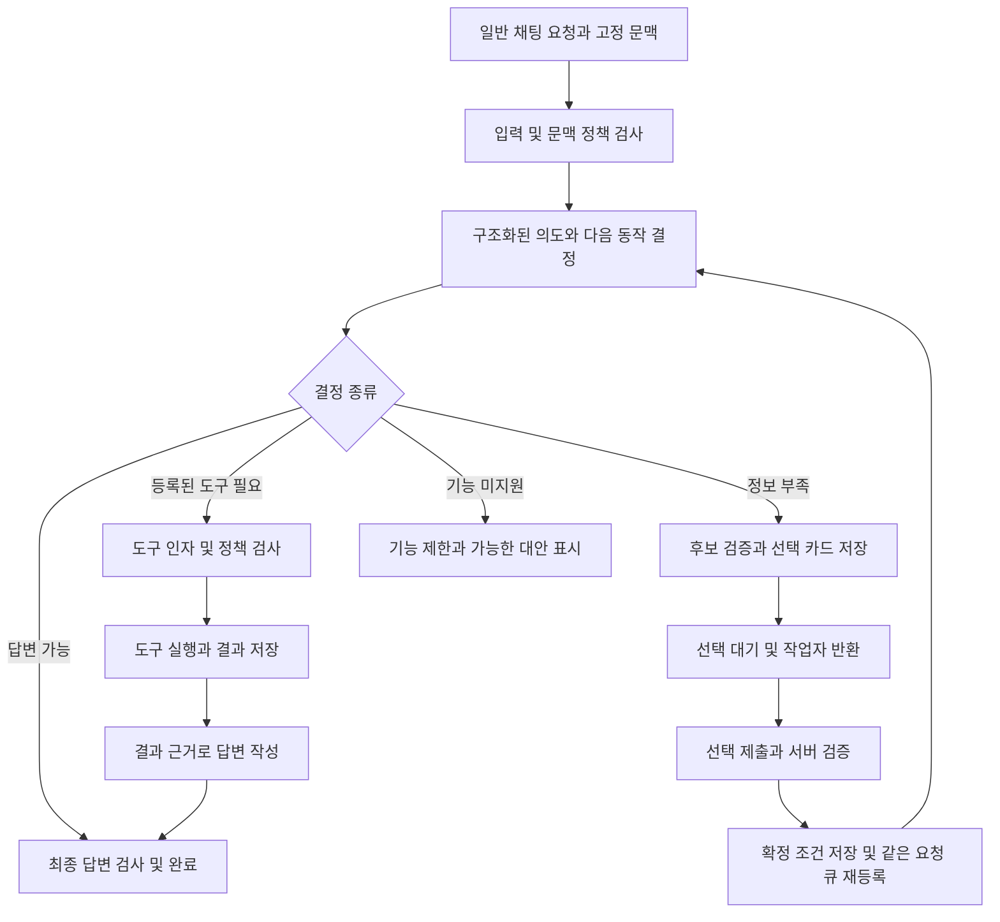

# 챗봇 모호한 질문의 선택형 HITL 설계

- 작성일: 2026-11-25 (Asia/Seoul)
- 상태: 현재 소스를 확인해 작성한 검토용 설계. 사용자가 수정한 최신 문서를 기준으로 후속 구현한다.
- 이번 변경 범위: 이 설계 문서 신규 작성과 `HISTORY.md` 링크 추가만 수행한다. 소스·DB·migration·설정·패키지·작업 기록은 변경하지 않는다.
- 대상: `components/chatbot`, `lib/chatbot`, `/api/chatbot`을 사용하는 독립 챗봇. 기존 AI Chat(`/api/ai/*`)과 대화/승인 저장소를 섞지 않는다.
- 아래 신규 파일·API·테이블·상태명은 구현 제안이며 현재 제공되는 기능을 의미하지 않는다.

## 1. 요구사항과 완료 기준

| ID | 요구사항 | 완료 판단 기준 |
| --- | --- | --- |
| R1 | 모호하거나 필수 조건이 빠진 자연어 질문을 파악 | 의도와 실행에 필요한 미확정 항목을 구조화해 식별한다. 명확한 질문에는 불필요한 선택을 요구하지 않는다. |
| R2 | 텍스트 재질문으로 끝내지 않고 선택을 유도 | 원래 질문의 응답 위치에 짧은 안내와 두 개 이상의 버튼을 표시한다. 사용자가 채팅 문장을 다시 작성하지 않아도 진행한다. |
| R3 | 선택 후 같은 질문을 이어서 처리 | 선택을 원래 request/turn에 기록하고 기존 문맥·첨부·선택 결과를 고정해 재개한다. 버튼 문구를 새 사용자 채팅으로 전송하는 방식은 사용하지 않는다. |
| R4 | 한 번의 선택으로 구체화되지 않는 경우 단계적으로 진행 | `서울 외 지역` 선택 시 지역 목록/검색/직접 입력을 카드 안에서 제공한다. 구체적인 지역을 정하기 전 기온을 추정하거나 임의 지역으로 조회하지 않는다. |
| R5 | HITL이 새로고침과 중복 클릭에도 유지 | 선택 대기 상태·카드·선택 이력을 서버에 저장한다. 새로고침으로 복원하고 중복 실행·오래된 선택·타인의 요청 접근을 차단한다. |
| R6 | 기존 승인 기능 보존 | 정보 보완, 생성물 변경 승인, 정책 관리자 승인, 시나리오 입력을 구분한다. 지역 선택이 정책 차단이나 변경 승인을 우회하지 않는다. |
| R7 | 실제 사용 가능한 기능으로 이어짐 | 필요한 정보가 모이면 답변/등록된 도구 실행으로 이어진다. 실시간 조회 기능이 없는 상황과 질문이 모호한 상황을 구분한다. |

사용자가 말한 “추론”은 **의도·필요한 입력·선택 후보를 결정하는 처리**로 해석한다. 모델의 상세 내부 사고 과정이나 장문의 추론 원문을 사용자에게 노출하거나 별도 저장하는 요구로 해석하지 않는다.

## 2. 현재 구조와 발생 원인

| 현재 파일/영역 | 확인한 동작 | 이번 요구와의 차이 |
| --- | --- | --- |
| `lib/chatbot/providers.ts`의 `callModel` | 일반 채팅은 질문에 답하는 지침으로 Responses 요청을 보내고 `output_text`를 합쳐 `ModelResult.text`로 반환한다. | `answer / clarification / tool`을 구분하는 구조화 응답 계약이 없다. 텍스트 속 재질문도 일반 답변으로 처리된다. |
| `lib/chatbot/generation.ts`의 `executeMessage` | 입력/문맥 검사 → 모델 실행 → 암호화 결과 저장 → 출력 검사 후, `chat`이면 `finishRequest(..., 'completed', { text })`로 종료한다. | 정보 보완 대기를 만드는 분기나 선택 이후의 실행 단계가 없다. |
| `lib/chatbot/types.ts`의 `Message` | 텍스트, 생성물, `review`, `approval`을 표현한다. | 선택형 질문/선택지/답변 상태 DTO가 없다. |
| `components/chatbot/chatbot-panes.tsx` | 텍스트와 생성물, `ReviewCard`, `PolicyCard`, 시나리오 입력을 렌더링한다. | 일반 채팅용 정보 보완 카드가 없다. |
| `lib/chatbot/repository.ts` | request/turn 생성, 완료 이력 snapshot, 생성물/정책 카드 조회를 담당한다. 이력은 완료 turn의 텍스트를 중심으로 구성한다. | 원래 질문에 연결된 선택 회차와 확정된 조건을 조회·문맥화하는 처리가 없다. |
| `lib/chatbot/policy.ts` | 정책 검사로 대기하고 관리자 승인 후 요청자가 재개한다. 검사 결과와 완료 응답을 보존한다. | 사용자에게 필요한 정보를 고르게 하는 범용 질문 엔진은 아니다. |
| `lib/chatbot/scenarios.ts` | 정해진 그래프의 slot/form 입력을 `waiting_input`으로 대기하고 버전/노드 검증 후 재개한다. | 설계된 시나리오에는 입력 대기가 있으나 일반 자연어 채팅에서 필요한 항목을 동적으로 구성하지 않는다. |
| `lib/chatbot/worker.ts` | `queued`만 실행하고 처리 불명확 상태는 자동 재실행하지 않는다. 기존 검토/정책 대기 만료를 정리한다. | 선택 대기의 생성·만료·재개와 단계별 결과 저장 처리가 필요하다. |
| `lib/chatbot/connector.ts` | 시나리오 API용 허용 HTTPS 호스트, DNS/사설망 차단, 서버 인증을 제공한다. | 일반 채팅이 사용할 도구 목록이나 날씨 지역/관측값 계약은 없다. |
| `db/migrations/054_chatbot_storage.sql` | request 상태 CHECK에 `queued/running/waiting_review/waiting_policy_approval/completed/failed/cancelled/unknown`이 있다. | `waiting_clarification`은 현재 저장할 수 없다. 상태 문자열만 코드에 추가해서는 동작하지 않는다. |

따라서 “버튼을 만들어 답하라”는 프롬프트 추가만으로는 해결되지 않는다. 모델의 구조화 결정, 서버의 대기 상태, 선택 API, 재개 checkpoint, 화면 카드가 함께 필요하다. 자유 텍스트를 정규식으로 분석해 버튼처럼 꾸미는 방식은 실행 문맥과 선택 무결성을 보장하지 못하므로 채택하지 않는다.

현재 일반 채팅에는 실시간 날씨 조회 도구가 없다. 선택 UI를 추가해도 실제 기온 조회 능력이 자동으로 생기지 않는다. **선택형 HITL과 날씨 도구 연동은 별도 기능이며, 예시를 실시간 답변까지 완성하려면 둘 다 필요하다.**

## 3. 사용자 흐름

### 3.1 날씨 질문 예시

```text
사용자: 오늘 날씨가 엄청 춥네 몇도야?

[지역 선택]
현재 기온을 확인할 지역을 선택해 주세요.
[서울] [서울 외 지역] [취소]

서울 선택:
  확정 조건: 지역=서울의 지정 대표 지점, 조회 종류=현재 기온
  → 등록된 날씨 도구 조회
  → 지역/관측 시각/출처/기온을 표시한 답변

서울 외 지역 선택:
  [부산] [인천] [대구] [다른 지역 찾기]
  또는 카드 안 지역 검색/직접 입력 → 목록에서 실제 지역 확정
  → 같은 요청으로 날씨 도구 조회 → 답변
```

- `서울` 우선 버튼은 사용자 예시에 따른 제안이다. 사용자의 실제 위치를 추정해 확정한 값이 아니다. 서울이 모든 인구 통계 기준에서 가장 크다는 사실 주장이나 인구 순위 자동 산정도 이 설계에 포함하지 않는다.
- 첫 행의 지역 후보 구성은 설정/검증된 지역 목록에서 관리한다. `서울 외 지역`은 분기이며 조회 가능한 단일 지역 값으로 처리하지 않는다.
- 카드의 짧은 안내는 허용하되, “어느 지역인가요?”라는 텍스트 메시지만 남기고 완료 처리하지 않는다.
- 브라우저 위치 권한·IP 위치 조회·장기 위치 저장을 자동으로 추가하지 않는다. 최초 범위는 사용자가 명시적으로 선택한 지역이다.
- 대표 지점 관측값이면 `서울 대표 지점 기준`처럼 범위를 밝힌다. 임의의 동네까지 정밀하게 알 수 있는 것처럼 표현하지 않는다.

### 3.2 다른 질문에 적용

| 질문 유형 | 정보가 충분한 경우 | 정보가 부족한 경우 |
| --- | --- | --- |
| 일반 지식 질문 | 바로 답변 | 의미가 실제로 갈릴 때만 의도 선택 카드 |
| “이 내용을 요약해줘” + 현재 첨부 | 합리적인 기본 길이로 바로 요약 | 참조할 자료가 여러 개여서 구분이 필요하면 대상 자료 선택 |
| “비교해줘” | 비교 대상이 명확하면 진행 | 비교 대상/기준 중 가장 필요한 항목부터 선택 |
| 날씨 질문 | 지역·시점·조회 기능이 모두 있으면 조회 | 누락된 지역 등 필수 조건을 선택으로 보완 |
| 문서/이미지 생성 | 현재 생성 모드와 조건으로 진행 | 공통 카드 확장 시 목적/대상/비율 등을 선택 가능하게 할 수 있음. 적용 범위는 11절에서 결정 |

매 요청마다 선택을 강제하지 않는다. 말투나 표현이 짧다는 이유만으로 중단하지 않고, 필요한 정보가 없거나 잘못 추정할 때 결과가 달라지는 경우에만 확인한다. 모델의 자신감 수치 하나만을 기준으로 삼지 않는다.

## 4. 제안 구조

### 4.1 처리 순서



대기 중 DB 트랜잭션·모델 요청·도구 HTTP 연결·worker lease를 유지하지 않는다. 선택 제출과 실제 실행은 분리하고 선택 API는 큐 등록 후 반환한다.

### 4.2 구조화 결정 계약

개념상 다음 공통 필드와 판별 가능한 종류를 사용한다. 아래는 내부 계약 예시이며 특정 공급자 API의 정확한 요청 문법을 지정한 것은 아니다.

```json
{
  "kind": "clarify",
  "intent": "weather.current",
  "missingFields": ["region"],
  "clarification": {
    "field": "region",
    "title": "지역 선택",
    "message": "기온을 확인할 지역을 선택해 주세요.",
    "options": [
      { "id": "seoul", "label": "서울", "value": "KR-SEOUL" },
      { "id": "other-region", "label": "서울 외 지역", "action": "choose-region" }
    ]
  }
}
```

- 종류는 `answer`, `clarify`, `tool`, `capability_unavailable`로 구분한다. 모델은 실행을 요청할 수 있으나 실행 권한을 부여하지 않는다.
- `answer`에는 사용자에게 보여 줄 답변만 담는다. `clarify`에는 짧은 이유와 필요한 항목만 담고 상세 내부 추론은 요구하지 않는다.
- 공급자의 구조화 출력과 서버 스키마 검증을 함께 적용한다. 종류 혼합, 누락 필드, 과도한 크기/깊이, HTML, 중복 선택 ID, 등록되지 않은 도구/값을 거부한다.
- 서울 등 정형 지역 값과 동작 ID는 서버 목록에서 검증/확정한다. 모델이 임의 URL, 함수명, 지역 좌표, 관리자 승인 플래그를 만들어 실행하게 하지 않는다.
- 명확한 일반 질문은 구조화 응답의 `answer`로 바로 완료해 매번 분류 모델+답변 모델을 두 번 호출하지 않도록 한다. 도구 결과를 바탕으로 답변을 작성하거나 사용자 선택으로 문맥이 바뀐 경우에는 별도의 후속 호출이 발생할 수 있다.
- 선택된 일반 채팅 모델의 구조화 출력 지원을 검증해야 한다. 미지원 모델을 자유 텍스트 파싱으로 조용히 대체하지 않는다. 지원 모델 제한 또는 별도 내부 판단 모델 사용 여부는 구현 전 결정한다.

### 4.3 선택 카드

- 원래 turn의 상태 영역에 `ClarificationCard`를 표시한다. 새 전역 모달이나 챗봇 전체를 막는 화면을 만들지 않는다.
- 권고 기본값: 한 카드에서 한 필수 항목, 선택지 2~6개, 단일 선택. 버튼을 누르면 별도의 채팅 전송 없이 제출한다.
- 단순 값 확정 버튼과 `서울 외 지역` 같은 하위 목록 열기 버튼을 타입으로 구분한다. 하위 목록은 값이 확정될 때까지 도구를 실행하지 않는다.
- 권고는 `서울 외 지역` 버튼으로 서버가 허용한 하위 목록을 조회/표시만 하고, 최종 지역 ID가 정해졌을 때 answers API를 호출하는 방식이다. 서버는 최종 값이 해당 카드에서 허용한 지역 목록의 하위 값인지와 목록 버전을 검증한다. 단순 목록 열기에 모델 호출이나 요청 큐 등록을 하지 않는다.
- 자유로운 후보 생성이 어려우면 `직접 지정`을 제공하되 **카드 안 입력/지역 검색**으로 받는다. 사용자가 새 채팅 문장으로 다시 질문할 필요는 없다.
- `취소`는 요청 종료, 목록의 `뒤로`는 선택 단계 이동이다. 둘을 같은 동작으로 처리하지 않는다.
- 제출 중 해당 카드만 잠그고, 처리 중/완료/만료/취소/다른 탭에서 처리됨을 표시한다. 완료된 선택은 비활성 요약으로 남긴다.
- 키보드 Tab/Enter/Space, 명확한 포커스, 스크린리더 안내, 모바일 버튼 줄바꿈, 독립 테마를 지원한다.
- 초기 권고: 정보 보완은 최대 3회. `서울 외 지역` 목록 펼치기 같은 화면 이동은 모델 재질문 회차로 세지 않는다. 한도를 넘으면 필요한 항목을 카드 안에서 직접 지정하거나 취소하도록 제공하고 텍스트 재질문을 무한 반복하지 않는다.

## 5. 상태와 데이터 설계

### 5.1 요청 상태

권고는 별도 `waiting_clarification`을 추가하는 것이다. 기존 `waiting_review`를 사용자 정보 보완 용도로 혼용하지 않는다.

```text
queued → running → completed
                 → waiting_clarification → queued → running → ...
                 → waiting_policy_approval → 기존 승인/재개
                 → waiting_review → 기존 생성물 승인/거절
waiting_clarification → cancelled / 만료에 따른 종료
running → failed / unknown / cancelled
```

- 같은 logical request/turn을 유지한다. 선택마다 새 일반 대화 request/turn을 만들지 않는다.
- 선택 대기에서는 `lease_until`을 해제하고 `finished_at`은 완료 시각처럼 기록하지 않는다. 대기 시각과 종료 시각을 구분한다. 현재 `finishRequest`는 `finished_at`을 설정하므로 대기 생성에 그대로 사용하지 말고 전용 상태 전이를 설계한다.
- `ClarificationPaused` 등 명시적 대기 결과를 worker가 정상적인 일시 정지로 처리한다. 일반 오류로 잡아 `unknown/failed`로 바꾸지 않는다.
- 한 요청에는 활성 선택 카드 한 개만 허용한다. 한 대화방의 여러 요청이 각각 선택 대기하는 것은 허용하는 방향을 권고한다.
- 현재 `chatbot_active_room`의 `queued/running` 실행 한 개 제약을 유지한다. 선택 재개 시 다른 요청이 실행 중이면 카드 결정을 소비하지 않고 409로 알린다. 선택 저장과 큐 재등록은 한 트랜잭션으로 처리한다.
- 선택 대기 중 새 질문을 허용해도 재개 문맥에 이후 질문의 초안/메시지를 자동 혼합하지 않는다. 사용자/workspace 변경 시 이전 범위의 카드를 즉시 폐기한다.

### 5.2 신규 저장소 후보

| 후보 테이블 | 주요 필드 | 목적/제약 |
| --- | --- | --- |
| `chatbot_clarifications` | id, workspace_id, user_id, conversation_id, request_id, turn_id, round, field_key, intent, status, version, input_hash, checkpoint_hash, payload_ciphertext, selected_ciphertext, expires_at, created_at, resolved_at | 질문/후보/선택/확정 조건을 암호화 저장. request별 round 유일성, 활성 pending 한 개, owner 복합 FK, 상태/버전 검증. |
| `chatbot_clarification_events` | id, owner 범위, clarification_id, request_id, event_type, client_request_id, payload_hash, event_ciphertext, created_at | 제시/선택/취소/만료/무효화 감사와 멱등 처리. 소유 범위+작업 종류+client_request_id 유일성. 기록은 append-only. |
| `chatbot_request_steps` | id, owner 범위, request_id, step_key, kind, round, input_hash, status, output_ciphertext, usage_call_index, started_at, completed_at | 의도 판단·도구 조회·최종 답변 단계를 분리 저장. request+step_key 유일성, 완료 출력 불변, 불명확 실행 자동 반복 금지. |

- owner 복합 FK만으로 같은 소유자의 다른 방/turn/request 조합까지 일치하는 것은 아니다. 카드의 request·conversation·turn 조합을 서버 트랜잭션에서 검증하고, 부모 복합 UNIQUE/FK 또는 동일성 제약을 설계해 잘못된 연결을 차단한다.
- 상태 예: clarification은 `pending/answered/cancelled/expired/invalidated`, step은 `started/completed/failed/unknown`. 카드 선택과 요청 최종 완료를 같은 상태로 취급하지 않는다.
- checkpoint에는 원래 prompt/이력/첨부 hash, 선택한 모델/모드, 정책 버전, 확정된 slots, 현재 단계, 도구 등록/지역 목록 버전을 포함한다. 현재 입력 암호화/AAD 방식을 확장해 workspace/user/request/card 범위를 묶는다.
- `chatbot_requests.result_ciphertext`는 기존 최종 결과 계약을 유지한다. 선택 질문을 최종 답변 캐시에 넣으면 재개 시 질문을 답변으로 오인하므로 판단 결과는 단계 저장소에 분리한다.
- 상세 내부 사고 과정, 비밀키, 토큰, 인증 헤더는 후보/이벤트/DTO에 넣지 않는다. 도구 결과는 필요한 정규화 값과 출처만 보관한다.
- 최종 완료 메시지에는 최소한의 `resolvedContext`를 함께 남길 수 있게 한다. 다음 질문이 “그럼 부산은?”일 때 이전에 선택한 지역/시점을 문맥으로 활용하되 원시 버튼 DTO나 미완료 다른 요청의 조건을 모델 이력으로 직렬화하지 않는다.

### 5.3 migration 영향

- **이번에는 DB를 수정하지 않는다.** 후속 구현에서는 기존 054를 편집하지 않고 새 migration을 추가해야 한다. 현재 파일 목록의 마지막은 054이며 번호는 구현 시 다시 확인한다.
- request 상태는 SQLite CHECK에 묶여 있으므로 새 테이블 생성만으로 부족하다. 상태 CHECK 변경, 관련 인덱스·FK·트리거 보존 방안을 별도로 검증한다.
- 테이블 재작성 필요 시 `chatbot_requests`를 직접 참조하는 reviews/versions/policy/usage 등과 turn/message를 포함한 간접 FK 그래프를 먼저 점검하고 Turso/libSQL에서 지원하는 절차를 임시 DB에서 검증한다. 단순 DROP/RENAME이나 FK 비활성화에 의존하는 일괄 변경을 바로 운영 DB에 적용하지 않는다.
- 기존 request/검토/정책 대기/생성물/사용량의 건수와 원본 hash를 보존하고, migration 전후 FK 검사·integrity·인덱스·트리거·유일성 검증을 수행한다.
- 배포 순서에는 이전 worker 정지, migration, 새 API/worker 배포, 대기 상태 복원 검증을 포함한다. 새 상태를 모르는 구버전 worker와 혼용하지 않으며 rollback의 데이터/상태 호환성을 먼저 확인한다.
- 대안으로 기존 request 상태와 별도 대기 테이블을 조합할 수 있으나 상태 의미가 갈라져 모든 조회/worker/cleanup에서 파생 상태를 처리해야 한다. 초기 권고는 명시적 상태이며, 운영 DB 제약 때문에 대안을 선택할 경우 문서를 수정한 뒤 구현한다.

## 6. 선택 API와 재개 계약

기존 `/api/chatbot`의 개별 `route.ts` 원칙을 유지한다. 신규 경로 후보:

| API | 역할 |
| --- | --- |
| `GET /api/chatbot/clarifications/{id}` | 현재 소유자 카드/버전/만료/선택 요약 조회. GET은 상태를 생성하거나 실행하지 않는다. |
| `POST /api/chatbot/clarifications/{id}/answers` | `expectedVersion`, `clientRequestId`, `optionId` 또는 허용된 typed value를 받아 선택 확정과 큐 등록. |
| `POST /api/chatbot/clarifications/{id}/cancel` | 원래 요청과 활성 카드를 취소하고 이력을 추가. |
| `GET /api/chatbot/clarifications/{id}/options?...` | 필요한 경우에만 하위 지역 목록/검색. 원래 카드 범위와 선택 타입을 검증하며 조회만 수행. |

`conversations/{id}/messages`는 기존 `review/approval`과 함께 독립 `clarification` DTO 및 필요한 회차 요약을 반환한다. request 상태 조회도 선택 대기를 일관되게 표현한다.

현재 메시지는 turn별 user/assistant 한 행 제약이 있고 최종 답변을 upsert한다. 따라서 중간 선택 카드를 assistant 텍스트 한 행에만 넣지 않고 별도 카드/이벤트에서 조회한다. 최종 답변이 저장돼도 앞서 제시한 질문과 선택 요약을 복원할 수 있어야 한다.

선택 처리 순서:

1. 로그인·Origin·현재 workspace/member·플랜·방/요청/카드 소유권을 검사한다.
2. 동일 clientRequestId의 처리 결과를 확인한다. 같은 payload 재전송은 같은 결과를 반환하고 다른 선택으로 재사용하면 409를 반환한다.
3. pending 여부, expectedVersion, expires_at, 원본/정책/checkpoint/첨부/도구 목록 버전을 확인한다.
4. optionId를 서버 보관 후보에서 해석한다. 클라이언트가 보낸 label/value/허가 플래그/URL을 그대로 실행하지 않는다. 직접 입력은 타입/길이/카탈로그와 정책 검사를 통과해야 한다.
5. 방 실행 한도 확인 후 선택 event/카드/slots/다음 단계/request queued를 원자적으로 저장한다. 유일성 충돌이면 전체 rollback한다.
6. 202 응답 후 worker가 재검증해 계속 진행한다. 사용자 선택만으로 외부 변경을 승인한 것으로 취급하지 않는다.

이중 클릭·다른 탭·응답 유실 이후 재전송에도 후보가 한 번만 소비되어야 한다. 대기 중 정책이나 대상이 바뀌면 이전 선택으로 강행하지 않고 카드를 무효화하거나 최신 선택을 다시 제시한다. 기존 critical 차단과 관리자 정책 승인 흐름을 유지한다.

## 7. 실행 결과 보존과 복구

- 의도 판단 결과를 저장한 뒤 카드를 제시한다. 새로고침/동일 선택 재전송/관리자 승인 재개로 같은 완료 판단 호출을 반복하지 않는다.
- 사용자가 새 조건을 제공한 후 그 조건을 반영한 다음 판단/답변 호출은 새로운 단계다. 이것을 과거 유료 호출 재생과 구분해 사용량에 기록한다.
- 단계별 `input_hash`는 원래 고정 문맥, 확정 slots, 정책/기능 버전으로 계산한다. 동일 step_key에 다른 입력을 덮어쓰지 않는다.
- 정책 검사의 operation hash에도 해당 단계/회차/선택 입력을 반영한다. 공통 검사 stage는 현재 지원 값에 매핑하고 독립 챗봇의 단계 식별자를 함께 전달하는 방향으로 설계한다. 기존 AI Chat의 stage/승인 동작을 일괄 변경하지 않는다.
- 완료한 도구 결과와 최종 답변을 별도로 보관한다. 출력 정책 승인 때문에 멈췄다면 완료된 같은 단계 결과를 사용한다.
- 모델/도구 호출 결과가 불명확한 상태에서 worker가 종료되면 현재처럼 `unknown`으로 남긴다. 진행 중 단계를 자동으로 새 유료 호출/외부 호출로 바꾸지 않는다.
- 새 카드가 생겼을 때 기존 원문/첨부, 다른 방의 초안, 현재 입력창의 편집 내용은 변경하지 않는다.

## 8. 날씨 도구 설계와 범위

사용자가 제시한 날씨 예시의 실시간 답변까지 구현하려면 등록된 read-only 도구가 필요하다. 모델에 임의 웹 탐색/임의 HTTP 실행 권한을 주는 것으로 해결하지 않는다.

- `weather.current` 같은 서버 등록 도구와 `regionId`, 조회 날짜/종류의 스키마를 정의한다. 등록 도구의 필수 값 검증은 모델의 추정과 별개로 서버가 수행한다.
- 지역 ID를 검증된 관측 지점/좌표로 변환하는 adapter를 둔다. 공급자·관측소/격자 체계·API 계약·키 보관·쿼터/비용은 구현 전 결정한다. 이 문서는 특정 공급자가 현재 연결돼 있다고 전제하지 않는다.
- 기존 connector의 HTTPS 허용 호스트·DNS/사설망/리다이렉트 제한·서버 인증 원칙을 활용한다. 공급자가 query key만 지원하면 URL/로그 비밀값 차단 원칙과 충돌하므로 안전한 adapter/중계 설계를 먼저 확정한다. 검사 규칙을 통째로 완화하지 않는다.
- “오늘”은 한국시간과 원래 요청 시점을 기준으로 해석한다. 대기 중 날짜가 바뀌면 과거 날짜를 오늘로 바꿔치기하지 말고 날짜 확인/요청 갱신을 제공한다.
- 응답은 지역, 관측/발표 시각, 실제 관측값 또는 예보 구분, 출처를 포함한다. 단위 변환과 누락값은 adapter에서 처리하며 모델이 현재 기온을 지어내지 못하게 한다.
- 권고 freshness 기본값은 5분으로 두되 공급자 갱신 주기에 따라 확정한다. 이는 실제 날씨 데이터의 갱신 주기 주장이나 확정 운영 값이 아니다. 오래된 완료 조회 결과가 있으면 `observedAt/fetchedAt`을 확인하고, 갱신이 필요한 경우 새 read 단계로 명시적으로 구분한다.
- 조회 기능이 준비되지 않았다면 `capability_unavailable`로 표시하고 제공 가능한 대안을 제시한다. 지역을 계속 묻는 루프나 근거 없는 기온으로 완료하지 않는다. 단순 선택 카드 구현과 실시간 날씨 사례 완성은 검증 결과에서도 구분한다.
- 지역 선택은 원래 요청한 read-only 조회 조건의 확정이다. 모든 조회에 생성물 변경 승인 UI를 추가하지 않는다. 정책상 승인이 필요하면 기존 별도 정책 카드로 처리하며, 향후 쓰기 도구는 별도 변경 승인을 유지한다.

## 9. 기존 기능 영향과 유지 사항

- **일반 채팅:** 명확한 질문의 응답 경로와 사용자 모델 선택을 유지한다. 모호한 질문에만 대기 카드가 추가된다.
- **이미지/문서 생성:** 자동 모델 선택, DOCX/PPTX/PDF/Mermaid, 암호화 원문, 미리보기, 다운로드, 수정 HITL은 보존한다. 초기 필수 범위는 일반 chat이며 생성 모드까지 정보 보완을 적용할지는 별도 결정한다.
- **정책/변경 승인:** 승인 ID·권한·원본/정책 hash·선택 대기의 구분을 유지한다. clarification을 `chatbot_reviews`의 새 의미로 끼워 넣지 않는다.
- **시나리오:** 기존 slot/form/선택지 실행은 유지한다. 자연어 clarification을 추가하려고 모든 일반 대화를 builder graph/run으로 변환하거나 일반 채팅 이력을 시뮬레이션에 저장하지 않는다.
- **방 안 동시 요청:** 대기 카드가 있어도 새 질문은 허용하는 방향이다. 재개할 때 실행 중 요청이 있으면 원자적으로 충돌 처리하고 선택을 잃지 않는다.
- **조회:** 현재 Query scope, retry 금지, 활성 queued/running만 폴링하는 정책을 유지한다. 대기 카드 자체를 위해 새 주기 폴링을 추가하지 않고 열기/명시 새로고침/선택 후 invalidation으로 갱신한다.
- **닫기:** 현재 일반 팝업 닫기는 queued/running 중단을 요청한다. 권고는 선택 대기는 보존해 다시 열 때 복구하고, 카드 취소/요청 중단/방 삭제에는 명시적으로 취소를 전파하는 것이다. 시뮬레이터 닫기 중단 정책은 변경하지 않는다.
- **만료:** 권고 대기 만료는 24시간이며 날씨 결과 freshness와 구분한다. cleanup이 카드·request·turn을 함께 종료하고 감사 이력을 남긴다. 만료/취소된 checkpoint의 원문 정리는 기존 보존 정책과 정합성을 맞춘다.
- **다른 대화 이력 참조:** 대기 요청의 미확정 값은 다른 요청의 문맥으로 취급하지 않는다. 완료된 선택 결과만 검증된 최소 문맥으로 사용한다.

## 10. 변경 대상 파일

| 파일/경로 후보 | 변경 방향 |
| --- | --- |
| `lib/chatbot/decision.ts` (신규) | 구조화 결정 계약·판단 단계·다음 동작 결정 |
| `lib/chatbot/clarification.ts` (신규) | 카드 생성·후보 검증·선택·멱등성·취소·만료·재개 |
| `lib/chatbot/tools.ts`, `weather.ts` (신규 후보) | 도구 등록/입력 스키마/기능 가용성/날씨 adapter |
| `lib/chatbot/providers.ts` | 구조화 응답 지원, 단계별 목적/사용량, 호환성·거절·잘못된 응답 처리 |
| `lib/chatbot/generation.ts` | answer/clarify/tool 분기, 대기 예외, 단계 결과 보존 및 최종 완료 |
| `lib/chatbot/repository.ts` | 카드 DTO·선택 요약 조회, 고정 문맥/완료 조건 보강, 삭제·중단 연계 |
| `lib/chatbot/worker.ts` | 선택 대기 정리·단계 복구·기존 실행 한도 유지 |
| `lib/chatbot/policy.ts` | 판단/선택/도구/최종 출력 검사 단계의 식별과 재개 경계 점검. 기존 승인 권한은 보존 |
| `lib/chatbot/types.ts`, `components/chatbot/runtime.tsx` | 카드/선택/단계 상태 DTO와 범위에 맞는 Query key 사용 |
| `components/chatbot/clarification-card.tsx` (신규) | 선택 버튼·하위 목록·직접 입력·접근성·진행 상태 |
| `components/chatbot/chatbot-panes.tsx` | 원래 turn 위치에 카드 표시, 초안과 선택 제출 분리 |
| `components/chatbot/chatbot-host.tsx` | 닫기/계정 전환 시 보존·폐기 범위 점검 |
| `styles/chatbot.css` | 독립 테마의 선택/처리/완료/오류 상태와 반응형 버튼 |
| `app/api/chatbot/clarifications/**/route.ts` (신규) | 경로별 인증·Origin·본문/파라미터 검증·응답. 범용 dispatcher는 만들지 않음 |
| `app/api/chatbot/conversations/[conversationId]/messages/route.ts`, `requests/[requestId]/**` | 카드/대기 상태 반환과 요청 중단 정합성 |
| `db/migrations/후속번호_chatbot_clarifications.sql` (신규 후보), `scripts/migrate.mjs` | 신규 저장소와 CHECK 변경 검증/선행 조건. 기존 migration은 편집하지 않음 |
| `scripts/test-chatbot.mjs`, `test-chatbot-browser.mjs`, `chatbot-browser-provider.mjs` | 구조화 모델/날씨 응답 모의, 영속 대기·선택·재개·회귀 검증 |
| 신규 migration/단계 실행 검증 스크립트 후보 | 실제 FK 그래프/단계 재생 방지 검증 |

후속 구현 때에는 최신 사용자 수정 사항을 다시 읽고, 구체적인 변경 파일과 실제 DB 적용 여부를 `docs/work` 및 `WORK_HISTORY.md`에 기록한다. **현재 단계에서는 위 파일을 수정하지 않는다.**

## 11. 결정이 필요한 사항

| 사항 | 권고안/기본값 | 확인할 내용 |
| --- | --- | --- |
| 1차 적용 모드 | 일반 chat 필수 | 이미지·문서 생성의 모호한 조건까지 같은 단계에 포함할지 |
| 날씨 예시의 완료 범위 | 실제 조회까지 포함하는 방향 | 사용할 공급자, 서버 인증/지역 변환/운영 비용과 기능 준비 일정 |
| 첫 지역 버튼 | `서울 / 서울 외 지역`, 직접 위치 추정 없음 | 다른 주요 지역을 첫 화면에 함께 표시할지와 지역 목록 관리 주체 |
| 대표 지역 정확도 | 선택한 지역의 명시된 대표 지점 | 시·군·구/동까지 필수로 받을지, 대표값 설명 문구 |
| 판단 모델 | 지원되는 선택 모델의 단일 구조화 호출 우선 | 구조화 미지원 모델 제한 또는 별도 내부 판단 모델 허용 여부 |
| 후보/회차 | 2~6개, 단일 선택, 모델 정보 보완 최대 3회 | 다중 선택 적용 분야, 직접 입력/검색 제공 범위 |
| 선택 대기 중 다른 질문 | 허용, 동일 방 실행은 한 개 | 한 방에 대기 카드가 여러 개일 때의 표시/정리 정책 |
| 닫기/만료 | 대기 보존, 24시간 만료, 명시 취소 지원 | 사용자 기대에 맞는 닫기 의미와 개인정보 보존 기간 |
| 상태 migration | 명시적 waiting_clarification 추가 | libSQL에서 기존 FK/인덱스/트리거를 보존하는 지원 절차 확정 |
| 실시간 결과 freshness | 공급자 주기에 맞춰 결정, 설계 기본 5분 | 정책 승인/오랜 대기 이후 재조회 조건과 날짜 변경 처리 |
| 선택 변경 | 제출 전만 자유 변경 | 제출 후 수정은 새 질문/새 카드로 할지, 실행 전 철회까지 지원할지 |

이 항목들은 검토할 설계 선택지다. 시간 경과나 문서 작성만으로 외부 서비스 사용·DB migration·추가 비용을 승인받은 것으로 간주하지 않는다.

## 12. 검증 계획과 완료 기준

| 검증 | 주요 사례 |
| --- | --- |
| 의도/후보 | 날씨 외 일반 모호한 질문에서도 카드 생성. 명확한 질문은 카드 없이 답변. 후보 없음/중복 ID/등록 외 동작/과도한 크기/부정한 structured 응답 거부 |
| 기본 시나리오 | 예시 질문 → 서울/그외 카드 → 서울 선택 → 등록 도구 결과 기반 최종 답변. 그외는 지역 확정 전 조회하지 않음 |
| 다단계/한도 | 하위 목록/검색/직접 입력, 유효하지 않은 지역, 뒤로/취소, 최대 회차에서 추가 자유 채팅을 강요하지 않는 종료/지정 카드 |
| 데이터 무결성 | 선택 원문/원래 snapshot 고정, 완료 선택만 이후 문맥에 반영, 후속 다른 질문/첨부/초안 혼합 방지 |
| 중복/경쟁 | 더블 클릭, 서로 다른 선택 동시 제출, 다른 탭, 동일 키 재전송, 다른 payload 키 재사용, 다른 요청 실행 중 선택. 한 번만 소비/큐 등록 |
| 비용/복구 | 대기 복원으로 동일 판단/완료 응답 재호출 금지. 선택 후 새 단계 호출만 발생. worker 중단/불명확 유료·도구 호출 자동 반복 금지 |
| 기존 HITL | 정책 차단→관리자 승인→요청자 재개와 정보 보완이 섞이지 않음. 생성물 수정 승인을 선택 버튼으로 우회하지 않음 |
| 날씨 | 공급자 미설정/실패/시간 초과, 관측값 없음, 지역 변환, 날짜 변경, 오래된 결과, 단위/출처/시각, 외부 인증·SSRF 제한 |
| 인증/권한 | 다른 사용자/다른 workspace/삭제 방/권한 회수/Origin 위반/만료/위조 선택/오래된 version을 서버에서 차단 |
| UI | 새로고침·닫기 후 복원, 모바일·키보드·스크린리더, 독립 테마, 카드별 잠금, 현재 초안/첨부 보존, 새 폴링 미추가 |
| DB | 기존 대기 요청을 포함한 054 이후 fixture에 새 migration 적용, 기존 행/hash 보존, FK/integrity, 참조 트리거·인덱스·동시 실행 제약 |
| 회귀 | 기존 chatbot/문서 형식/브라우저, 빌더 입력/시뮬레이터, 기존 AI 승인/설정·저장소 분리 검사, 타입/린트/필요 빌드 |

검증은 합성 계정·임시 DB·모의 구조화 모델·모의 날씨 API로 수행한다. 운영 DB에 테스트 질문을 만들거나 실제 유료 도구를 반복 호출하지 않는다.

완료는 버튼이 보이는 것만으로 판단하지 않는다. **선택이 서버에 보존되고, 같은 질문이 적절한 단계에서 재개되며, 실제 도구 가용성에 맞는 답변으로 끝나는 것**을 확인한다. 날씨 공급자가 준비되지 않은 단계의 검증 결과를 실시간 날씨 기능 완료로 기록하지 않는다.

## 13. 이번 문서 작업의 확인 사항

- 현재 모델 응답 처리, 일반 채팅 완료, 기존 승인/시나리오 입력, queue/cleanup, request 상태 CHECK, DTO/렌더링/Query, connector와 닫기 동작을 소스에서 확인했다.
- 날짜는 한국시간 기준 2026-11-25다.
- 신규 설계 파일과 HISTORY 링크만 작성한다. README/AGENTS/CLAUDE/WORK_HISTORY 및 기존 설계·작업 기록은 이번 문서 작업에서 변경하지 않는다.
- 구현·migration·DB 접속/변경·의존성 설치·기능 테스트는 수행하지 않는다. 문서 링크·구성·기존 HISTORY 목록 보존만 검증한다.
